# The Salt Creek saloon: research and four concepts (#765, #660)

Sean, 2026-11-10: research and concepts for The Salt Creek, the main saloon on the crossroads' north-east
corner, before it goes through the building lab. Its turn comes after the doctor, the jail and the store
(#765), so this is the target's groundwork, not the build. **Pick one concept (or parts of several), and
answer the questions in §3.** No game code changed.

Builds on `docs/briefs/saloon-references.md` (the first pass: its figures are checked in §5).

## Sean's answers (2026-11-10)

All DECIDED, Sean on PR #772:
1. **Concept B, the corner saloon**, with **an open view from the upper floor down to the main floor so
   people can fall over the rail**: an open well 14 x 22 ft over the card tables (west bay), a railed
   gallery along the west wall, the dance hall open to it along its west side (the girder line). The dance
   floor stays closed over the bar, so Payday Night still drops it on the bar. The 13 ft drop over the rail
   is a fall from height (#736/#759). B's plans and three views were redone for it (B's card below).
2. **The Baron's men saw the girder** over the bar (a half-sawn joist would hold).
3. **Both saloons get a hall** ("give both a hall I guess"): The Salt Creek's here, and the Railroad
   Saloon keeps its own. Payday Night can play in either; its card (PR #743, planning's) says which.
4. **Open joists** under the dance hall: the girder, the joists and the fresh cut are seen from the bar,
   dust sifts through the floorboards.
5. **Re-aim the valley's moon** so it crosses the south: the corner door, the front windows and the
   balcony frame it.
6. **The saloon is deeper than valley.json's 17.1 m**: B is 72 ft (21.9 m) deep; the spec sets it.
7. **Glazed double doors with a transom**, no batwings.
8. **A boardwalk down the North-South Street** under B's wrapping balcony.
9. (C's brick front: moot with B. It's on the corner lot, as all four were.)

## 1. Costs

| What | Spent | Cap |
| --- | --- | --- |
| Four target sheets, 7 painted views each (Nano Banana Pro on GitHub, like the doctor's) | **$4.65** (33 views at $0.14 each, every one painted first time; D got two more, the theatre and a fuller rear; B three for the open well) | $5.00 (your pre-approval; $1.25 a concept) |
| Plans (drawn by code from each concept's data), research | $0 | |

The plans aren't painted: `tools/buildings/concept_plans.py` draws them from `experiments/building_lab/saloon_*/concept.json`,
so they're to scale and agree with each other, and the painted views are given them to match. Repainting
any view later is ~$0.14.

## 2. The four concepts in one look

All four sit on the real lot: 54 ft (16.4 m) along Main Street, the North-South Street on the west, the
saloon's own 34 ft yard on the east, the back street 125 ft behind. All four have every must-have (§4).
The differences are what the building is and how the missions play in it.

| | What it is | Size | Best at | Weakest at |
| --- | --- | --- | --- | --- |
| **A. Boom-town false front** | Built fast in 1880: a tall false front, one big bar room, the stair up inside it | 40 x 84 ft, a lean-to and a wagon way beside | The clearest fight space: one room, the stair and the dance floor above in plain sight | The least distinctive outside (every boom town has one) |
| **B. Corner saloon** | 1881, the whole corner: a diagonal corner door, the balcony wrapping both streets | 54 x 72 ft | The town's landmark: seen from the crossroads, both streets, the balcony ambush from two sides | Biggest bar room to fill and light; the most posts |
| **C. Brick front** | 1882, a brick front on a frame body, rooms in the Board of Trade's order | 50 x 100 ft | The town's "hall": a separate street door and stair to the dance hall; a sidewalk hatch to the cellar | The brick front is new to the game (masonry); deepest building to fill |
| **D. Variety hall** | 1882, a bar room in front, a theatre with boxes behind, the band on the balcony | 54 x 110 ft | The most spectacle: boxes, a stage, a poker room under it | The most to build; the theatre is a second big room beyond the must-haves |

**My recommendation: B, the corner saloon,** with A's open stair in the bar room. The lot is a corner,
and the corner door faces the crossroads where every road meets. It's the one building the town is
seen from, and the balcony that wraps both streets gives Balcony Ambush two fronts. A is the safe second:
smaller, simpler to build and to fight in. (The paintings were judged by me only: the blind critic hasn't
seen them.)

### Concept A: the boom-town false front (1880)

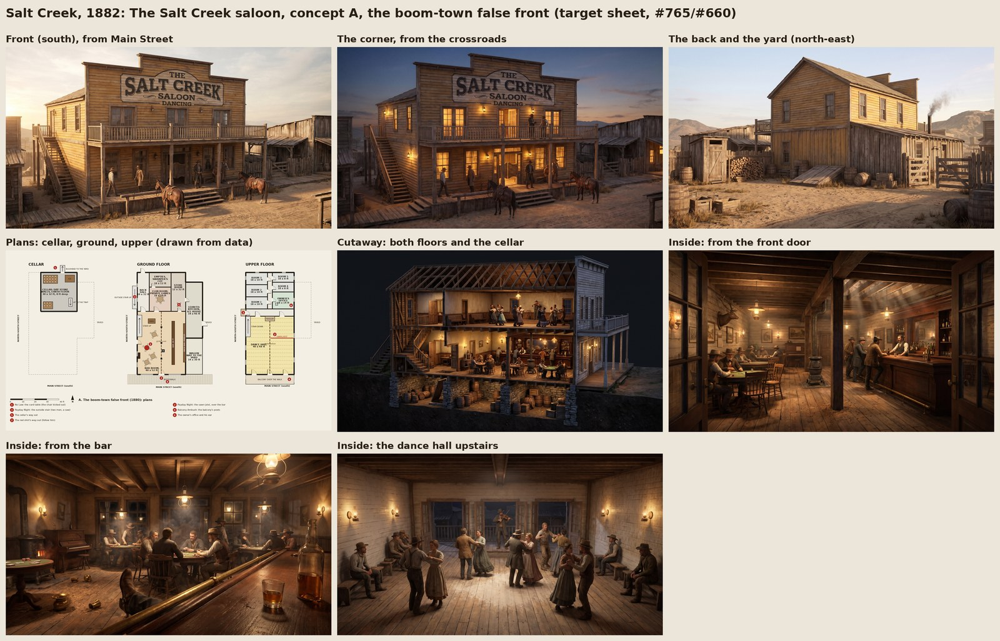

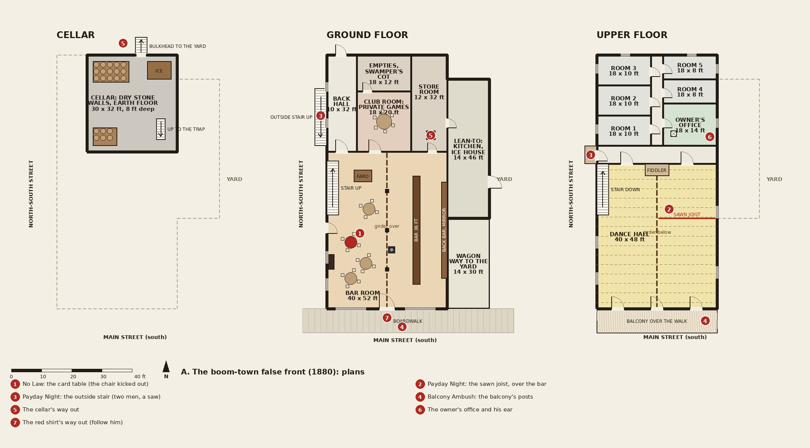

**What it is.** The saloon a two-year-old camp builds in a hurry: a two-storey frame box 40 x 84 ft behind
a 36 ft false front, raw shiplap and board-and-batten painted once in ochre, the name painted across the
front. Beside it a rough lean-to (kitchen and ice house) and a 14 ft wagon way to the yard.

**Based on:** the false-fronted two-storey saloons of Leadville, Creede and Deadwood, 1879-81; the Grecian
Bend (HABS WY-37: the bar and mirrored back bar along the side wall from just inside the door); Content
Corner (HABS MT-2: the upper floor reached by an outside stair up the side street).

**Floor by floor.**
- *Cellar* (30 x 32 ft, 8 ft deep) under the back rooms: dry stone walls, an earth floor, kegs, barrels,
  ice; a steep stair up to the trap in the store room; a sloping bulkhead up to the yard (⑤).
- *Ground:* one bar room 40 x 52 ft. The bar (36 ft) down the east wall to the right of the door, the back
  bar and mirror behind it; three posts down the middle under the girder; the stove mid-room; the card
  tables, the faro table and the piano on the west side; an **open stair up the west wall** to the dance
  hall. Behind: the club room (private games), the store room with the cellar's trap, the empties and the
  swamper's cot, a back hall to the back door.
- *Upper:* the dance hall 40 x 48 ft over the bar room (the fiddler's platform at the back, three pairs of
  doors onto the balcony); a cross hall with the outside stair's door; five rented rooms and the owner's
  office over the club room, with a grate in its floor over the club room's table (⑥).
- *Balcony* the full 40 ft front, five 6x6 posts at the walk's edge (④). *Outside stair* up the west wall
  on the North-South Street, to a landing and the upper hall's door (③).

**How the missions play.**
- *No Law:* Harlan sits at a west-side table facing the door; the cheat has his back to it (①). The red shirt
  comes through the front doors, crosses the open room, kicks the chair and shoots; the room has no walls to
  hide it. He goes out the front to his horse at the rail (⑦); a player who runs after him is on the walk in
  four strides and sees him ride.
- *Payday Night:* the two men go up the outside stair on the side street, in full view of the butcher's across
  it (the witness). From the bar the open joists and the girder are right overhead; the cut (②) is over the
  bar and the Kid. A free round brings the dancers down the open stair in plain sight. The fall comes down on
  the bar and the east tables.
- *Balcony Ambush:* five posts over the walk; dynamite against two of them and the 40 ft balcony folds onto
  the boardwalk and the hitching rail. The dance hall's doors behind it are the men's way on and off.
- *Fire:* frame throughout, the false front the last to go.

### Concept B: the corner saloon (1881)

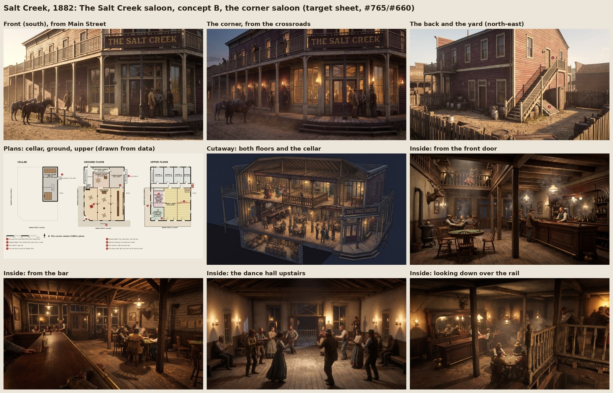

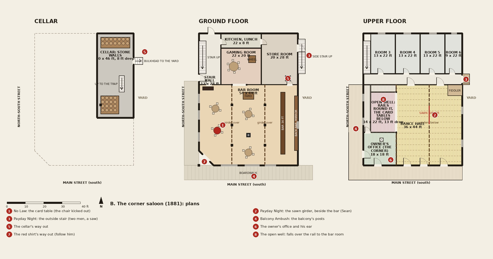

**What it is.** Built in 1881 by a man who meant to stay: the whole corner, 54 x 72 ft, two storeys, a low
hipped roof behind a bracketed cornice on both streets, dark red with cream trim. The south-west corner cut
off on the diagonal at the ground floor for the entrance, the upper floor carried over it on one cast-iron
column. The balcony wraps the corner over both streets' boardwalks.

**Based on:** the corner saloons of Tombstone, the Oriental and the Crystal Palace (HABS AZ-7: a corner
saloon under its porch; the first building there a two-storey brewery, 1880); Piper's Old Corner Bar,
Virginia City NV (a two-storey corner building, the bar below, rooms above; the figures unverified); History
Colorado on corner entrances with an iron column.

**Floor by floor.**
- *Cellar* (20 x 46 ft) under the bar's back half and the store room: stone walls, kegs, a stair up to the
  trap behind the bar's end, a bulkhead up to the yard (⑤).
- *Ground:* one bar room 54 x 44 ft entered at the corner; the bar (34 ft) down the east wall, ahead and to
  the right; two rows of three posts under two girders; the card tables by the side-street windows. Behind:
  through a wide arch the gaming room (faro, a wheel, poker); a **stair hall with its own door on the side
  street**; the kitchen and lunch counter; the store room with the trap and the back door to the yard.
- *Upper:* the dance hall 36 x 44 ft over the bar's half of the room; the owner's office in the corner over
  the entrance, windows and a door onto both streets' balcony, a grate in its floor over the card tables
  (⑥); four rented rooms off the back hall; the open well and its gallery (⑧, below).
- *Balcony* wraps the corner: 54 ft on Main Street and 44 ft down the side street, ten posts (④). *Outside
  stair* up the east wall in the yard to the back hall (③).

**How the missions play.**
- *No Law:* the card table by the side-street windows (①), the cheat's back to the corner door. The red
  shirt comes in at the corner, which faces the crossroads, and leaves the same way (⑦): out of the door he's
  in the crossroads with every road in view, so the follower sees which way he rides.
- *Payday Night:* the stair is in the yard, seen from Main Street across the yard's gate (the witness on the
  far walk). The dancers come down through the stair hall into the bar room. The cut (②) is over the bar.
- *Balcony Ambush:* the best of the four: men on two sides of the corner, ten posts, the corner column the
  key one; blow the corner and both arms sag toward it.
- *Fire:* frame throughout.

**The open well (Sean, 2026-11-10).** Upstairs, rooms 1 and 2 gave way to an open well 14 x 22 ft over the
card tables, a turned rail round it (36 in) and a 4 ft gallery along the west wall from the owner's office to
the back hall; the dance hall's west side is open to it along the girder line. Its framing: the well's edges
trimmed and headed, the west bay's joists cut short at the header, the girder carrying the rail's side. For
the missions: No Law's upper viewing place (the card draft's "the upper floor ... could offer another
viewing position"), men thrown or shot over the rail onto the tables (⑧), the AI's second level over the
room. Views repainted for it: the cutaway, the door, and the new one over the rail.

**Faults in the sheet** (settled by the spec, not repainted): the rear view painted the plan's red markers
onto the wall; the front view shows the corner door only from the side.

### Concept C: the brick front, after the Board of Trade (1882)

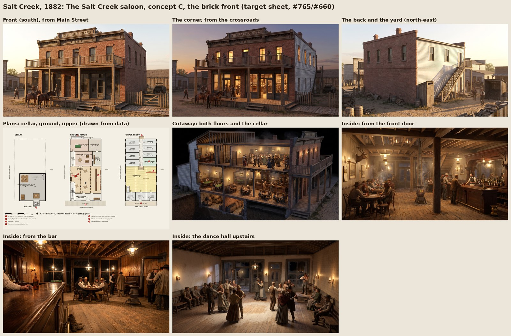

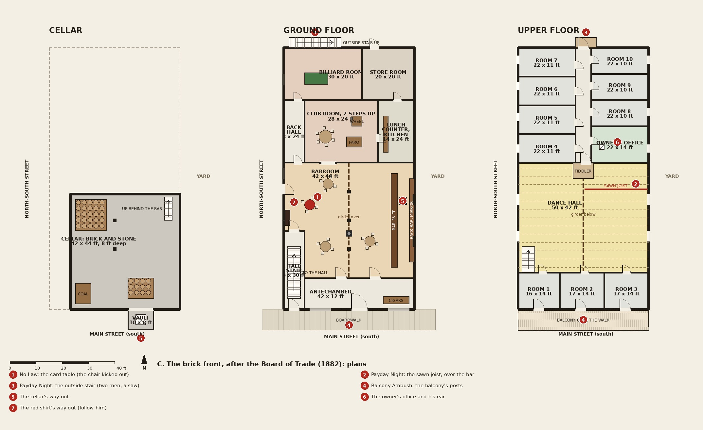

**What it is.** The town's best building, put up in 1882 once the town had money: a red-brick "fireproof"
front with segmental arches, a bracketed cornice and the name and date on the parapet, a frame body behind
(white clapboard), 50 x 100 ft, a 4 ft passage to the yard. The wooden balcony on four turned posts. The
dance hall is the town's hall, with its own door on Main Street.

**Based on:** the Board of Trade, Leadville (1883: an antechamber behind an oak partition, the barroom, the
club room, back rooms: reported, unverified here); the Miners' Union Hall at Granite MT (HABS, 1890: a hall
over club and game rooms reached by its own street door and stair); Kidder and Birkmire on brick fronts.

**Floor by floor.**
- *Cellar* (42 x 44 ft) under the front: brick and stone walls, kegs, a coal bin, the stair up behind the bar,
  and a vault under the boardwalk with **iron sidewalk doors** for the brewery wagon (⑤: a way out onto the
  street).
- *Ground:* the hall stair's door at the west end of the front; the antechamber (cigar stand) behind a carved
  partition; the barroom 42-50 x 44 ft (a tile floor, the bar 36 ft down the east wall, two rows of three
  posts); the club room two steps up at the back (faro, stud, a wheel); the lunch counter; a billiard room; the
  store room; the back door.
- *Upper:* the dance hall 50 x 42 ft; three front rooms with doors onto the balcony; the owner's office over
  the club room with a grate over the faro table (⑥); seven rented rooms.
- *Balcony* 50 ft on four turned posts (④). *Outside stair* along the back wall to the upper hall (③).

**How the missions play.**
- *No Law:* the table on the west side behind the antechamber (①); the red shirt leaves by the side door on
  the North-South Street (⑦) to his horse in the side street, so the follower comes round the corner.
- *Payday Night:* the two men go up the back stair from the back street (the witness is across the back
  street, not Main Street: a change to the card). The dance crowd comes and goes by its own street door
  without crossing the bar, so "thin it" means the barkeep sending a round up, or the crowd down the hall
  stair and in. The cut (②) over the bar.
- *Balcony Ambush:* four posts, the shortest spans to blow but the heaviest balcony.
- *Fire:* the frame body burns and falls in; the brick front can stand afterwards as a shell (a masonry
  wall: the masonry lab's work).

**Faults in the sheet:** the rear view made the whole building brick (only the front and its return are)
and put the outside stair on the east side instead of the back wall.

### Concept D: the variety hall, after the Bird Cage (1882)

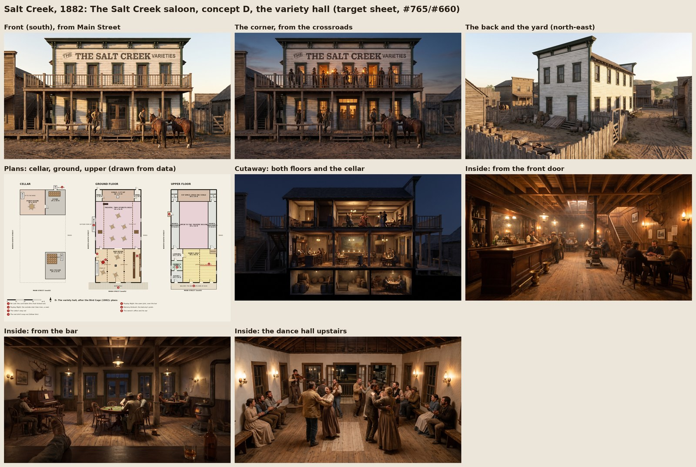

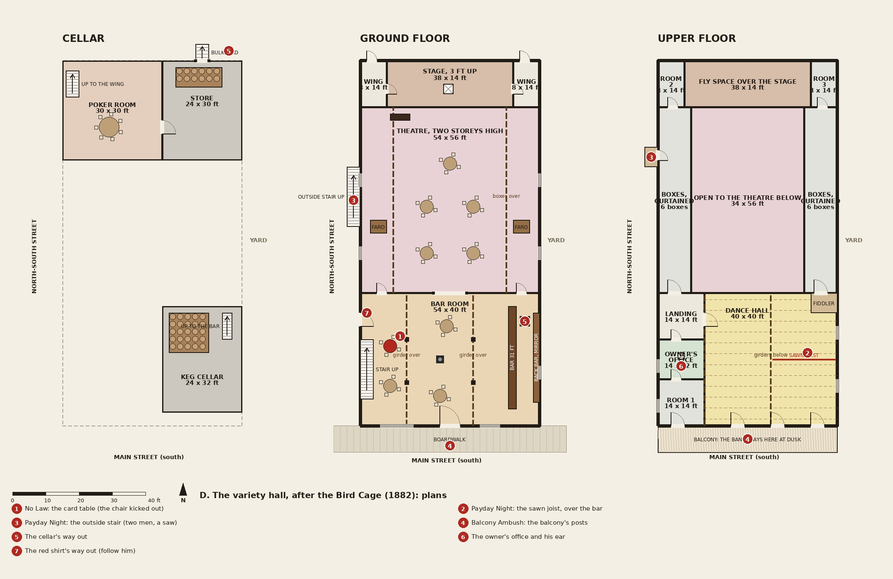

**What it is.** A saloon and variety theatre: a two-storey front block with a white false front ("THE SALT
CREEK VARIETIES"), behind it a theatre hall two storeys high with curtained boxes down both sides and a small
stage, 54 x 110 ft. The house band plays on the balcony at dusk to draw the crowd.

**Based on:** the Bird Cage, Tombstone (HABS AZ-10: the bar room across the front, the hall, about seven
boxes a side, a stage 31 ft deep, a room under it; stone and one storey there, wood and two storeys here); the
Leadville variety theatre of December 1881 ("down stairs ... chairs and tables and up stairs ... a row of boxes
on both sides").

**Floor by floor.**
- *Cellars:* a keg cellar under the bar (the trap behind it), and under the stage the poker room and a store,
  reached from the stage's wing, with a bulkhead up to the back street (⑤).
- *Ground:* the bar room 54 x 40 ft across the front (the bar 31 ft down the east wall, two rows of two posts,
  the open stair up the west wall, the card tables); through a wide opening the theatre 54 x 56 ft (tables,
  two faro banks under the boxes); the stage 38 x 14 ft, 3 ft up, with its wings.
- *Upper:* the dance hall 40 x 40 ft over the bar room; the owner's office over the card tables (a grate, ⑥);
  the landing; a front room; twelve curtained boxes on the two side galleries; two rooms over the wings.
- *Balcony* the full 54 ft, five posts (④). *Outside stair* up the west wall to the west gallery of boxes (③).

**How the missions play.**
- *No Law:* the table near the open stair (①); the red shirt leaves by the side door on the North-South
  Street (⑦).
- *Payday Night:* the outside stair reaches the dance hall through the boxes' gallery: the two men walk past
  the boxes with a saw, which someone in a box sees. The cut (②) over the bar.
- *Balcony Ambush:* the band's balcony: the men are on it because the band is (a reason for them to be there).
- *Fire:* the most to burn: the drop, the curtains and the boxes.

Its sheet has one view more than the others, the theatre from the boxes. D is the one concept with more than the must-haves: the theatre is a second big room to build, light and
fill with people.

## 3. Questions only you can answer

1. **Which concept** (or which parts of which)?
2. **What the Baron's men saw.** A joist sawn half through keeps about a quarter of its strength and its
   neighbours share the load through the floorboards and bridging: worked by the period's own rules, it
   sags and cracks but **doesn't fall**, even under a dancing crowd (§7). A **girder** sawn half through
   fails at ~75 lb/sq ft, less than the floor plus a packed or dancing crowd. Every collapse of the
   period found was a girder or a bearing (Richmond 1870, 62 dead). So: **(a) the girder over the bar**
   (recommended: one cut, the truest), **(b) three or four joists sawn three-quarters through**, or (c)
   one joist and the floor is weaker than real.
3. **Which saloon has the dance hall.** Payday Night's card (PR #743) sets it in the Railroad Saloon
   (`second_saloon`, by the tracks); your brief puts the dance hall and the outside stair here. Move
   Payday Night to The Salt Creek (the card changes), or give both a hall?
4. **The ceiling under the dance hall:** **open joists** (recommended: you see the joists, the girder and
   the fresh cut from the bar, and dust sifts through the floorboards' cracks) or a **plastered ceiling**
   (the card's "plaster dust": the cut is hidden until the plaster cracks).
5. **The moon** (#660): all four saloons face south. **(a)** re-aim the valley's moon so it crosses the
   south as a real full moon does: then the front doors, the front windows and the balcony frame it in
   every concept (recommended); or **(b)** keep it in the north: each concept has a door lined up on the
   back door so a seat in the bar room sees it at midnight (A: through the back hall; B: through the
   stair hall), and the west door frames it at moonset.
6. **Depth on the lot.** `config/valley.json` gives the saloon 17.1 m (56 ft), the old spec saloon's
   depth. The concepts are 72-110 ft deep on the 125 ft lot (real saloons were 60-114 ft deep: §5). OK to
   change it with the spec?
7. **Doors.** Every primary source has glazed double doors with a transom; none has batwings. Glazed
   doors in all four, and batwings only as an inner pair if you want the look?
8. **A boardwalk down the North-South Street** (B's balcony wraps over it). Only B needs it.
9. **C's brick front** would be the town's first brick, before the Baron's house (masonry lab). OK, or
   keep the saloon all frame?

## 4. The must-haves, and where each concept puts them

Numbers ① to ⑦ match the red marks on every plan.

| Must-have (mission) | A | B | C | D |
| --- | --- | --- | --- | --- |
| Dance hall over the bar, its floor real framing (Payday Night) | 40 x 48 ft over the bar room, one girder on 3 posts | 36 x 44 ft over the bar's half, two girders on 6 posts | 50 x 42 ft over the barroom, two girders on 6 posts | 40 x 40 ft over the bar room, two girders on 4 posts |
| ② The cut, over the bar | east bay, over the bar | east bay, over the bar | east bay, over the bar | east bay, over the bar |
| ③ Outside stair (Payday Night) | west wall, on the side street (seen from across it) | east wall, in the yard (seen from Main Street across the yard) | back wall, over the back street | west wall, up to the boxes |
| Rooms upstairs; ⑥ the owner's office and his ear | 5 rooms; office over the club room, a grate in its floor | 4 rooms; office in the corner over the entrance, a grate over the card tables; the open well over the tables | 10 rooms; office over the club room, a grate over the faro table | the boxes, 3 rooms; office over the card tables, a grate |
| ④ Balcony over the walk on posts (Balcony Ambush; falls #736/#759) | 40 ft, 5 posts | wraps the corner: 54 + 44 ft, 10 posts | 50 ft, 4 turned posts | 54 ft, 5 posts; the band plays on it |
| Cellar; ⑤ its way out | under the back, trap in the store room, bulkhead to the yard | under the bar's back half, trap behind the bar, bulkhead to the yard | under the front, trap behind the bar, iron hatch in the boardwalk | keg cellar under the bar; the poker room under the stage, bulkhead to the back street |
| Long bar, back bar and mirror | 36 ft, east wall | 34 ft, east wall | 36 ft, east wall | 31 ft, east wall |
| ① The card table (No Law) | west side, mid-room, the victim's back to the front door | by the side-street windows, the victim's back to the corner door | west side, behind the antechamber | west side, near the stair |
| Back room | club room for private games | gaming room through an arch | club room two steps up; billiards | the theatre; the poker room below |
| ⑦ Ways in and out | front, side door, back door, outside stair, balcony | corner door, side door, back door to the yard, outside stair, balcony | front, hall door, side door, back door, outside stair, sidewalk hatch, balcony | front, side door, stage door, outside stair, bulkhead, balcony |
| Fire | frame throughout | frame throughout | frame behind a brick front: the front can stand as a shell | frame; the theatre's drapes and drop |

## 5. What the primary sources say

This session could open the HABS drawings and data pages (tile.loc.gov, and loc.gov's own records
through its API) and the NRHP nominations (npgallery.nps.gov); you allowed those hosts for it. Every
drawing below is HABS, Library of Congress, public domain.

### The first pass's figures, checked

| Saloon | Figure | Status |
| --- | --- | --- |
| Carissa, South Pass City (HABS WY-31) | ~21 x 31 ft, a 21 x 10 ft room dug into the hill behind | **checked** (data p.2) |
| Carissa | "a log rear room" | **wrong**: the *front* room is log; the rear room is slate-schist walls cut into the hill |
| Carissa | "a long wooden bar" | **unverified**: HABS doesn't mention one; its 2 sheets are elevations and details, no plan |
| Carissa | a store 1868, a saloon ~1890 | **partly**: the 1868 store was an earlier building on the lot; this one ca. 1890 (rebuilt 1911) |
| Grecian Bend (HABS WY-37) | "no size found" | **found**: ~23 x 51 ft; the saloon room 22'-0" x 34'-6", ceiling 10'-10" |
| Grecian Bend | bar room, store room, office | **wrong**: the saloon room and two back rooms (four rooms in 1889) |
| Grecian Bend | (new) | the bar and mirrored back bar on the east side wall, ~17 ft long, starting ~4 ft in from the front |
| Bird Cage (HABS AZ-10) | two-storey adobe and brick | **wrong**: stone with lime plaster, one storey and a mezzanine |
| Bird Cage | bar at the front, stage at the far end, 12-14 boxes | **checked**: bar room 27'-11" x 19'-10", 14'-2½" high, the bar on the left wall; about seven boxes a side; a stage 31'-2" deep |
| Bird Cage | basement poker room | **unverified**: the section shows a room under the stage (9'-4" high), not labelled |
| Crystal Palace (HABS AZ-7) | one or two storeys | **resolved**: built 1880 as a two-storey adobe brewery, then a saloon, gambling house and theatre; one storey by 1937 |
| Crystal Palace | 16 ft ceilings; offices upstairs | **unverified** (the porch line is 14'-2" on the 1937 elevation) |
| Fort Laramie post trader's | its HABS number | **found**: HABS WY-2; the officers' club room and bar at one end, the soldiers' bar room (~19 x 25 ft) at the other |
| Fort Laramie | drawings 1937-39 | **wrong**: measured Dec 1937, drawn 1940-42 |
| Shute's Bar, Calumet | HABS-measured, 1893-1900 | **wrong**: HABS MI-424, data pages only; built 1895, enlarged 1900 |
| Shute's Bar | a 25 ft bar; a 5 x 15 ft back-bar mirror | **checked**; and new: the room over the bar rented to lodges, a basement gambling room with a speaking tube to the bar |
| Summer Saloon, Fairplay CO | 1879, one room, sandstone, false front | **checked** (NRHP 74000591); and new: no basement; doors centred in both side walls and the back |
| Board of Trade (Leadville), the Oriental's bar to the right, Piper's, Hibernia, Boston Saloon, Lamy, Denver's Western | | **unverified**: no HABS record, and their sources are on hosts still blocked here |

### Found this time

- **Content Corner, Virginia City, Montana (HABS MT-2, 1864):** a two-storey stone corner building,
  20'-6" x 60'-7"; the upper floor reached **only by an outside wooden stair and porch along the side
  street**. The model for A's and D's outside stair.
- **Miners' Union Hall, Granite, Montana (1890):** a 44 x 53 ft hall (18'-9" ceiling, a sprung maple floor)
  over two club and game rooms, reached by **its own street door and stair**; an outside stair from behind
  the stage. The model for C.
- **Fraternity Hall, Elkhorn, Montana (HABS MT-9, ~1890):** a two-storey balloon-framed false front,
  28 x 72 ft, a dance hall with a raised stage below, a **balcony over the front door**, storeys 12'-5" and
  11'-2".
- **Masonic and Odd Fellows halls, Idaho City (HABS ID-5, ID-8):** each upstairs hall reached by a stair
  **outside a side wall**, in the IOOF's case the only way up.
- **Miners' Exchange saloon, Idaho City (HABS ID-14, 1865):** a saloon ~21 x 51 ft, a 12'-8" game-room strip
  added beside it, a **liquor cellar**, iron shutters.
- **Diana Saloon, Sacramento (HABS CA-1706, 1852):** 40 x 114 ft; a row of 6x6 posts down the middle with
  diagonal braces carrying a 6x12 beam, the joists exposed. The open-joist bar room, measured.
- **Miners' Union Hall, Bodie (HABS CA-1919, 1878):** a 29 x 57'-6" hall, 13 ft ceiling, 6x6 girders, joists at
  18 in.

### The pattern, now from the drawings

- **The bar runs down one side wall from near the front** (Grecian Bend ~4 ft in, Bird Cage, Shute's), the
  back bar and mirror on the wall behind it.
- **Glazed double doors with a transom** at nearly every front; **no batwings in any of them.**
- **Bar rooms 10'-10" to 14'-2½" high**; halls 13 ft to 18'-9".
- **Upstairs halls and rooms often reached from outside:** a stair along the side street (Content Corner), a
  stair outside a side wall (Idaho City), or a separate street door to the stair (Granite).
- **Cellars** for liquor (Idaho City), gambling (Shute's), under a stage (Bird Cage).
- **A rougher store room behind** (Carissa's cut into the hill, Content Corner's stone room).

| | |
| --- | --- |
| 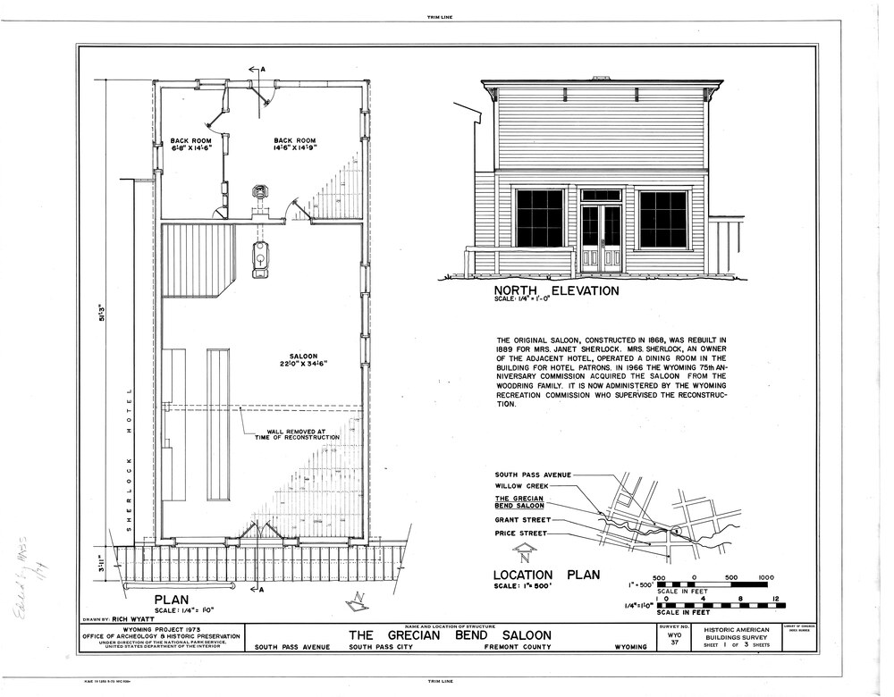 | 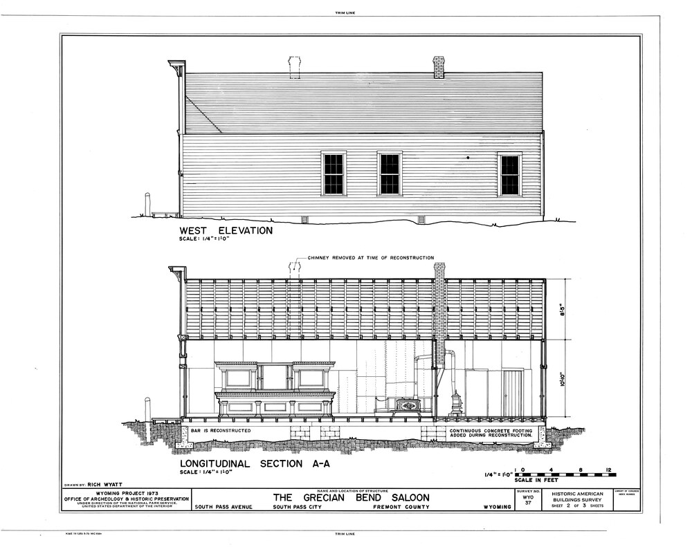 |
| Grecian Bend, South Pass City WY (HABS WY-37): the plan, the bar on the east wall | Its section: bar, back bar, 10'-10" ceiling |
| 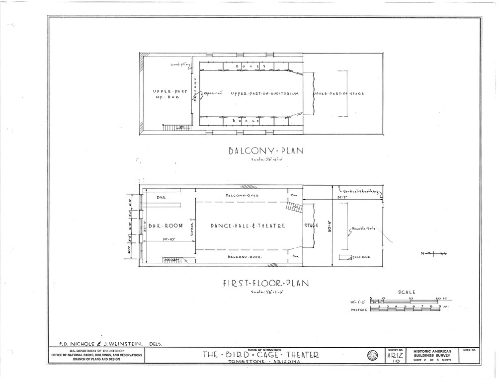 | 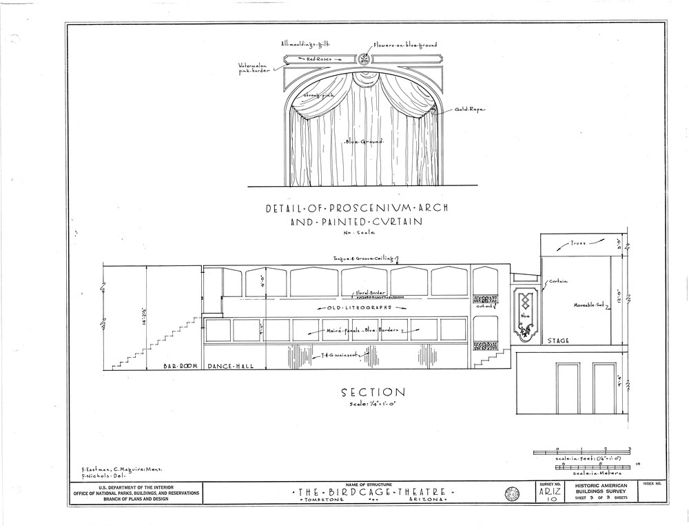 |
| Bird Cage, Tombstone (HABS AZ-10): bar room, hall, boxes | Its section: the boxes, the stage, the room under it |
| 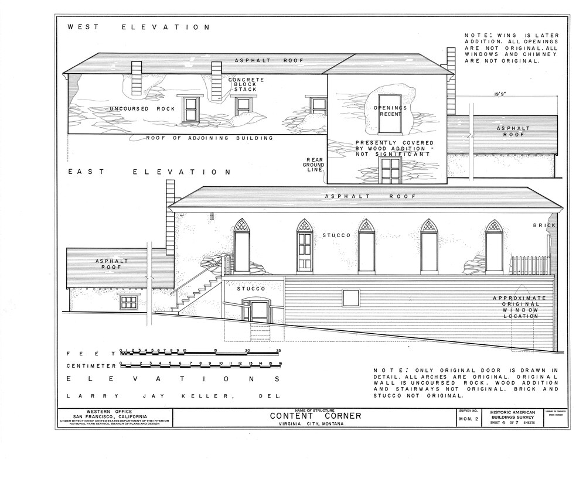 | 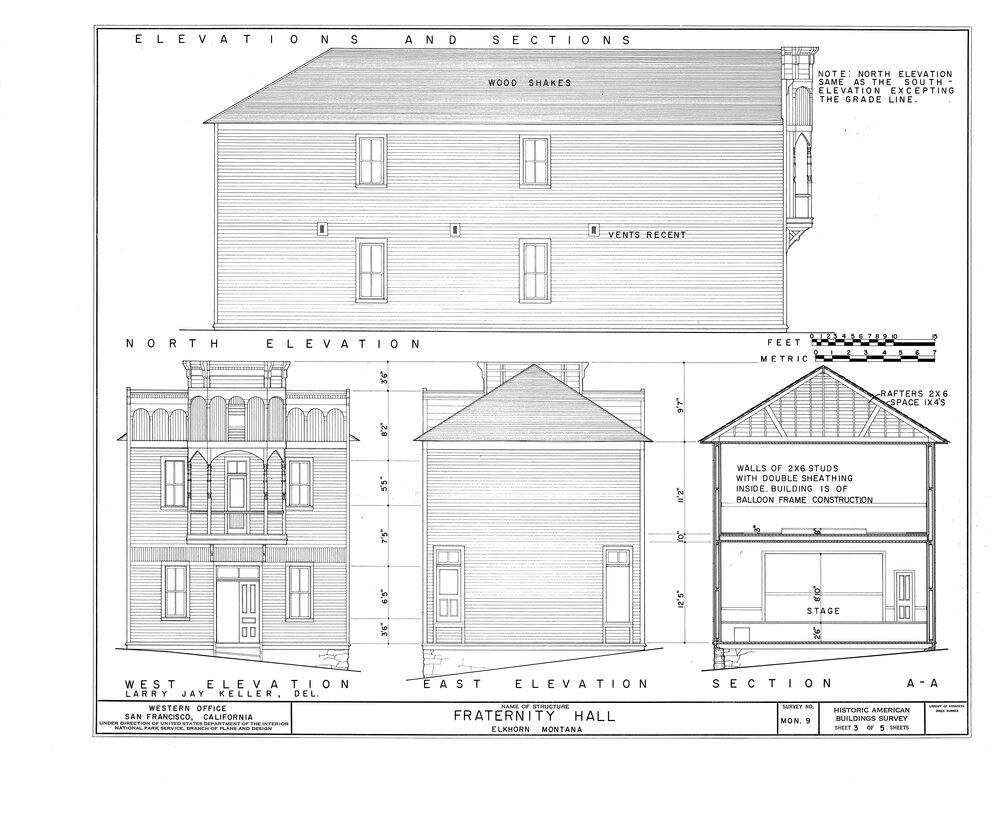 |
| Content Corner, Virginia City MT (HABS MT-2): the outside stair up the side street | Fraternity Hall, Elkhorn MT (HABS MT-9): false front, balcony, the hall's section |
| 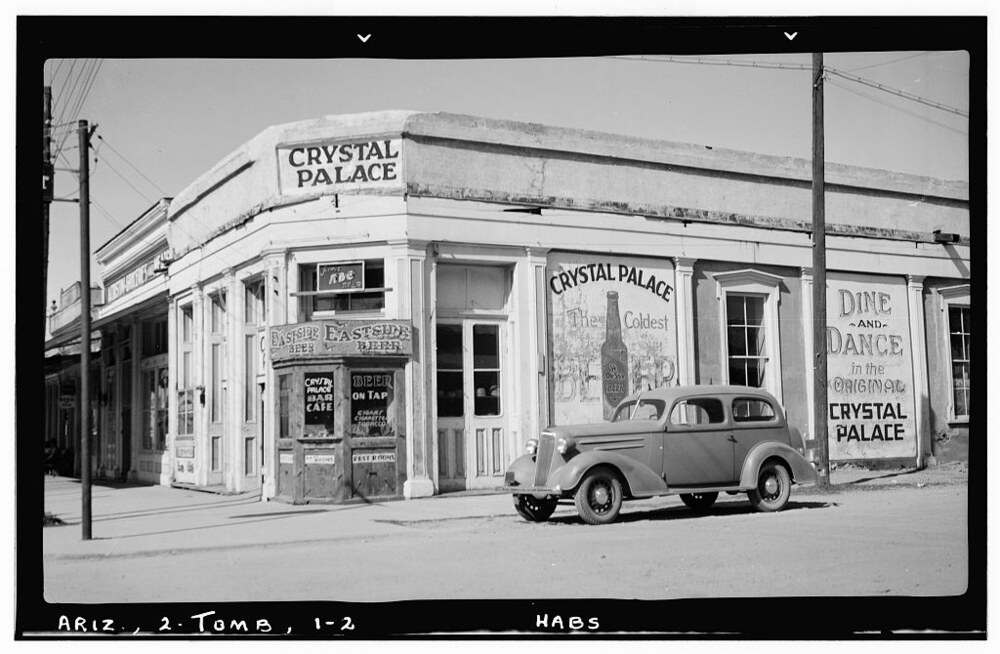 | 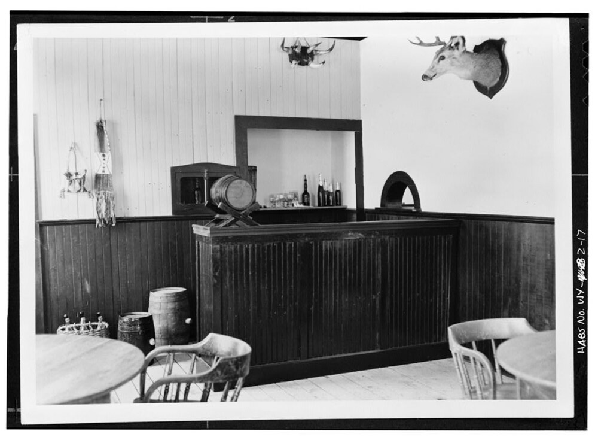 |
| Crystal Palace, Tombstone (HABS AZ-7), 1937: a corner saloon under its porch | Fort Laramie's soldiers' bar (HABS WY-2), restored |
| 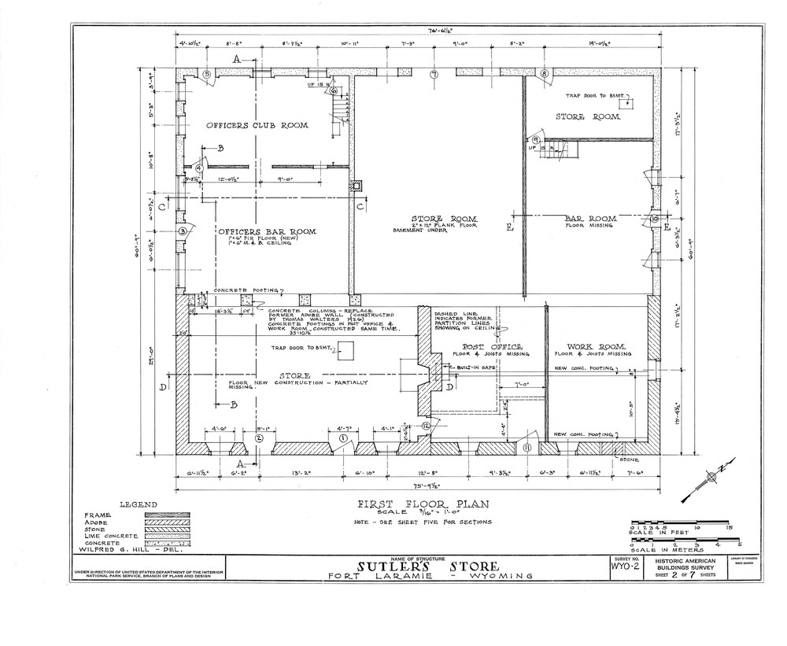 | 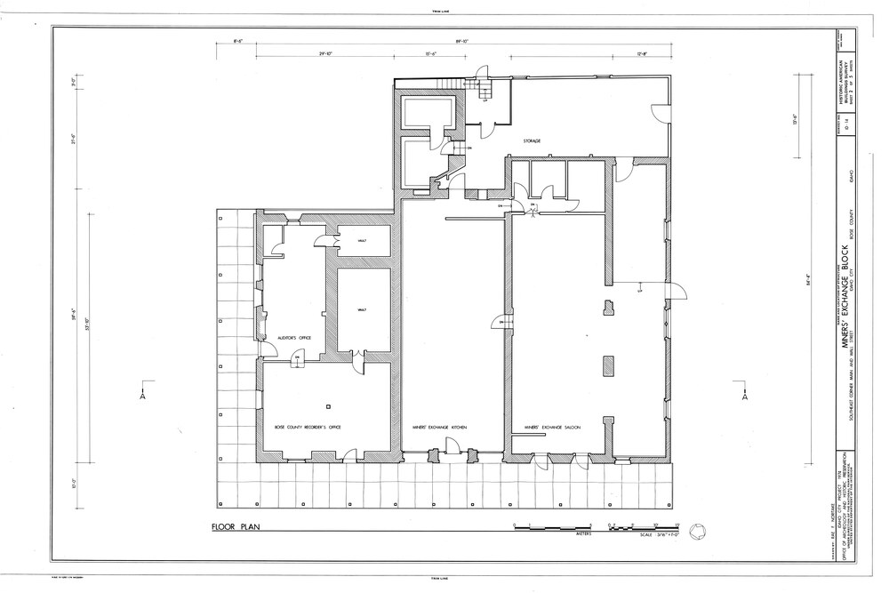 |
| Fort Laramie's post trader's (HABS WY-2): two bar rooms, a club room | Miners' Exchange, Idaho City (HABS ID-14): the saloon and its game-room strip |

## 6. Inside: what period saloons had (from photographs and the trade catalogues)

Most numbers come from catalogues read in full on archive.org: B. A. Stevens' *Billiard and Bar Supplies,
Saloon Fittings* (Toledo, 1894), Brunswick-Balke-Collender's billiard catalogues (1894, 1898), Gibson, Parish
& Co.'s hardware (1887). These are a decade late, but bar furniture was sold by catalogue and changed slowly;
the gadgets in them may be newer. Eyewitnesses: a Leadville letter of 9 December 1881 (*The Editor's Run in
New Mexico and Colorado*), Ingersoll on Leadville in 1879 (*The Crest of the Continent*), Richardson on a
Montana hurdy-gurdy house in 1865 (*Beyond the Mississippi*). "Estimate" means read off photographs.

- **The bar:** stock counters 9-18 ft (longer to order, with returns), panelled fronts standing on iron feet
  clear of the floor, walnut or mahogany, or softwood grained to look like them. **Top ~42 in high** (the ice
  box made to fit under it is 36½ in tall, 22 in deep), ~24-30 in deep. A 2½ in round wooden arm rail on brass
  brackets; an iron or brass **foot rail** ~1½ in across, about 6-9 in up and 8-12 in out (estimate). Brass
  spittoons 9 in across and 6 in high, one every 4-6 ft (estimate). Towels on hooks along the front. Behind:
  slat or wire mats 2 ft wide, zinc drip boards, sinks, an ice box with beer coils to the taps.
- **The back bar:** a counter-high cupboard, a shelf of bottles and glasses, and a mirror frame up to **~9 ft**
  tall, often a cornice on 2-4 turned columns; 10-20 ft long. The mirror is **one bevelled plate or three in
  wooden frames** (30 x 50 in for a cheap 8 ft one, up to 48 x 98 in), never a seamless wall of glass. Steer
  horns or a mounted head on top (Long Branch photograph).
- **No cash register in 1882 Colorado** (patented 1879, National Cash Register from 1884): a till drawer, and
  gold scales where dust was still taken.
- **Light:** Leadville, 1879: "sooty oil lamps ... burned with a weak and yellow flame". Hanging kerosene lamps
  and chandeliers **down the room's centre line**, 15-20 ft apart, 7½-9 ft up; lamps at the back bar doubled
  by the mirror, the brightest place in the room; a billiard table's own two-lamp fixture 6 ft 1 in off the
  floor (Brunswick). A 25 x 80 ft room wants 4-5 hanging lamps; a 50 x 50 ft hall two rows of three (estimate).
  The corners and ceiling stay dim.
- **Floor, walls, ceiling:** wide planks, sawdust ("the sawdust floors of these reeking bar-rooms", Leadville
  1879); carpet or oilcloth with a runner only in fancy places. Walls of boards, or muslin papered over; the
  ceiling **exposed joists** (the Diana, Sacramento: 3x12s) or boards; **pressed tin is later** (widespread from
  the late 1880s: wrong for 1882). Rooms 11-14 ft high.
- **The stove:** a long cast-iron box stove mid-room near the back wall (the Grecian Bend's is a Willson,
  Estes & Fairchild No. 38, patented 1867), its pipe 7-8 ft up to a flue hung on a braced shelf; a stove in
  each room.
- **Games:** New Mexico, 1881: "each saloon contained a bar, from four to a dozen gambling tables". Faro: an
  oval baize table ~3½-4 x 6-7 ft (estimate) with a cutout for the banker, the spade layout, a dealing box, a
  case-keeper and a lookout on a high stool. Billiards: 4½ x 9 ft the common public table (5 x 10 the match
  size), the rail 34 in high, a room 14½ x 18½ ft for one. Poker at small round or square tables, plain
  wooden chairs (bentwood later).
- **On the walls:** framed paintings hung high and tilted out, steer horns, mounted deer and elk heads, a
  calendar, bottle advertisements; rifles on racks in a hunters' saloon (Table Bluff, 1889); walls solid with
  pictures in a rich one (the Crystal, Virginia City). Nudes and "no credit" signs are commonly claimed and
  not found in these sources: plausible, unverified.
- **Dancing:** the Virginia City (MT) hurdy-gurdy, 1865: "At one end of the long hall, a well-stocked bar, and a
  monte bank in full blast; at the other, a platform occupied by three musicians"; $1 a dance, half to the
  girl, then to the bar for a drink. The Leadville variety theatre, 1881: tables downstairs, "a row of boxes on
  both sides" upstairs. **Where the stair ran isn't in these sources**; an inside stair along a side wall, or
  the outside stairs HABS recorded (§5).
- **Doors:** glazed double doors between six-light windows (Grecian Bend, 1889); Stevens sold slatted **"blind
  screens" 6 ft high to stand inside the door**. Batwings appear in an 1897 photograph and in 1902-04
  catalogues, in none of the pre-1890 interiors found.
- **The cellar:** "a trap-door behind the bar down which drunken men might be shunted" (*Daily Colonist*,
  Victoria BC, 22 December 1876). Kegs kept on racks in the back room or below, the lines run up to the taps.

| | |
| --- | --- |
| 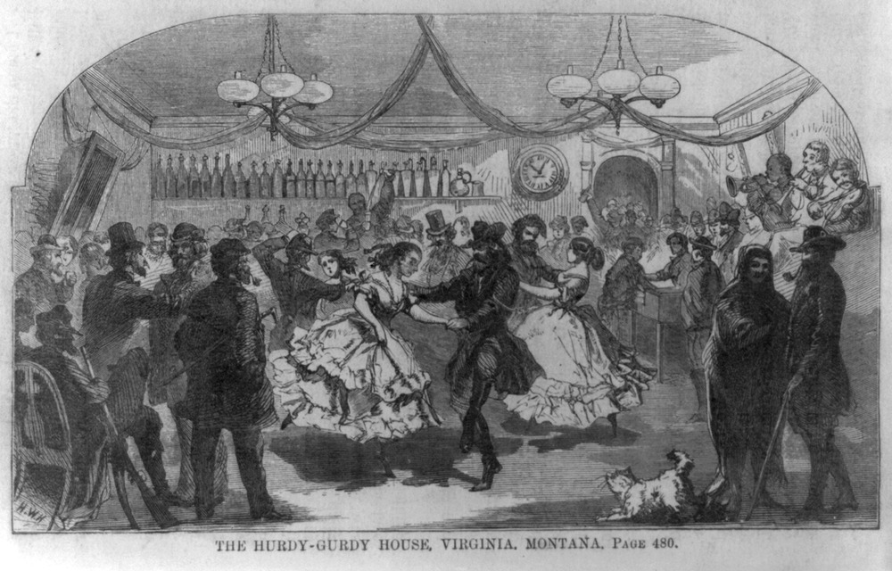 | 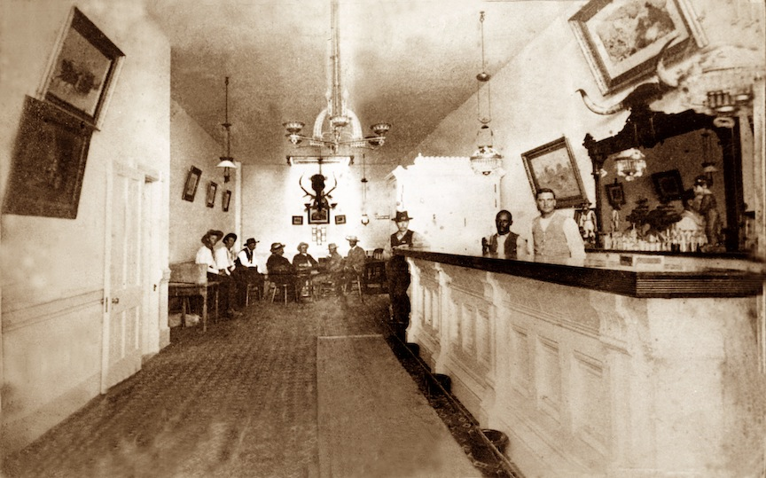 |
| The hurdy-gurdy house, Virginia City MT, 1865: the bar on one wall, the band on a box, dancing between (H. W. Herrick in Richardson, 1867; LOC, no known restrictions) | Dodge City, traditionally the Long Branch, 1870s-80s: the long room, the bar down one side, lamps on the centre line, horns on the back bar (public domain) |
| 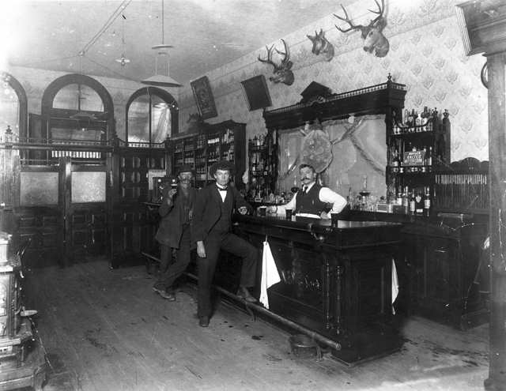 | 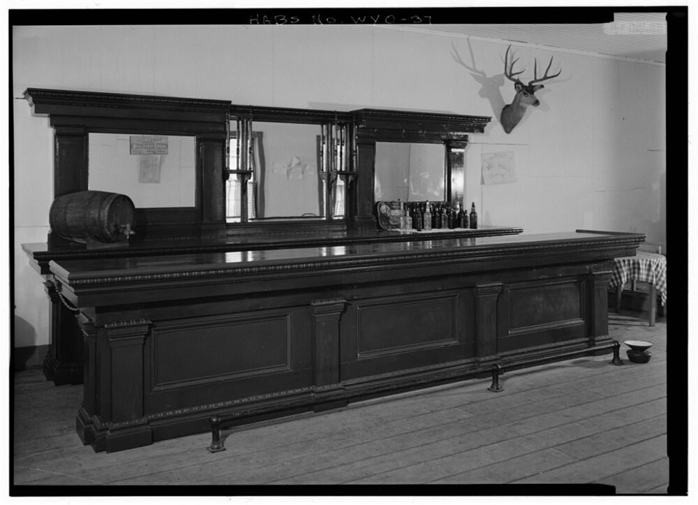 |
| Black Hawk, Colorado, 1897: panelled bar, towels, foot rail, back bar, mounted heads (Denver Public Library; public domain) | The Grecian Bend's 1889 bar and back bar, restored (Jack E. Boucher, HABS WY-37, 1973) |
| 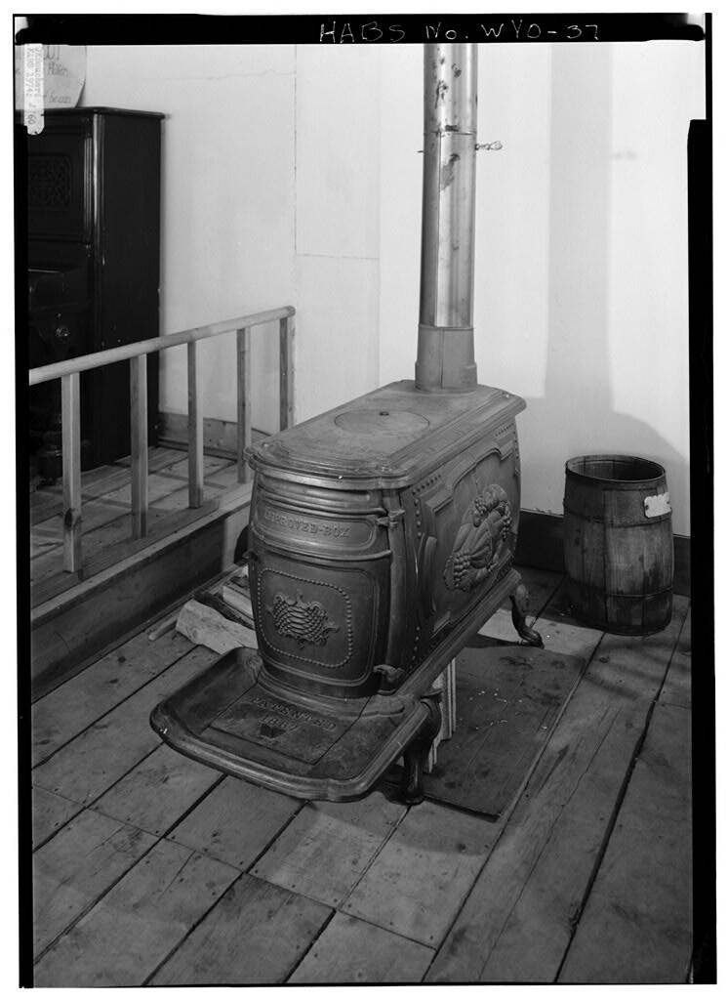 | 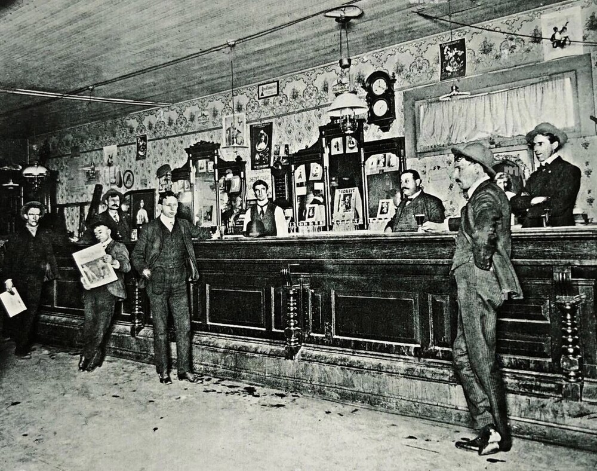 |
| The Grecian Bend's box stove, 1867 pattern (HABS WY-37, 1973) | The Gem, Deadwood, 1890s: the long bar, the board ceiling (public domain) |
| 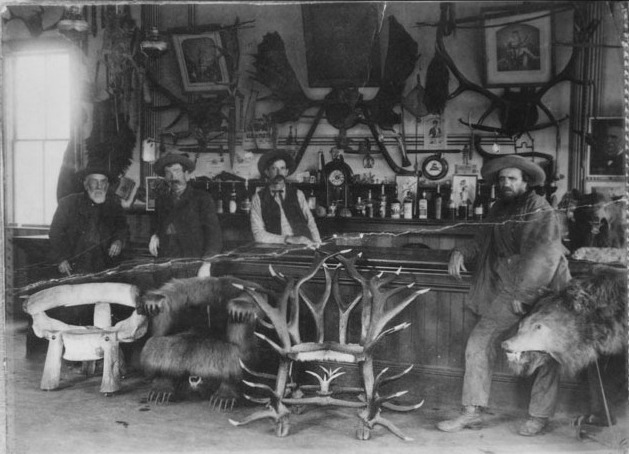 | 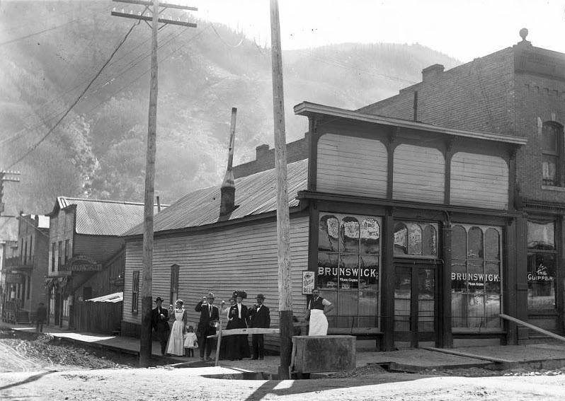 |
| Table Bluff, California, 1889: rifles, antlers and skins on the wall (public domain) | Telluride, c. 1900: a false front, lettered windows, a glazed recessed door (public domain) |
| 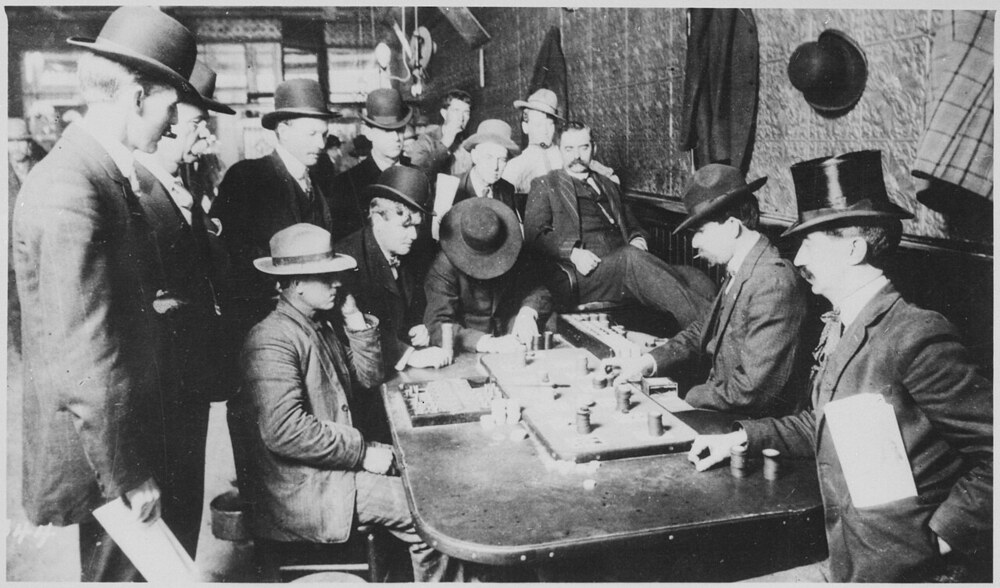 | 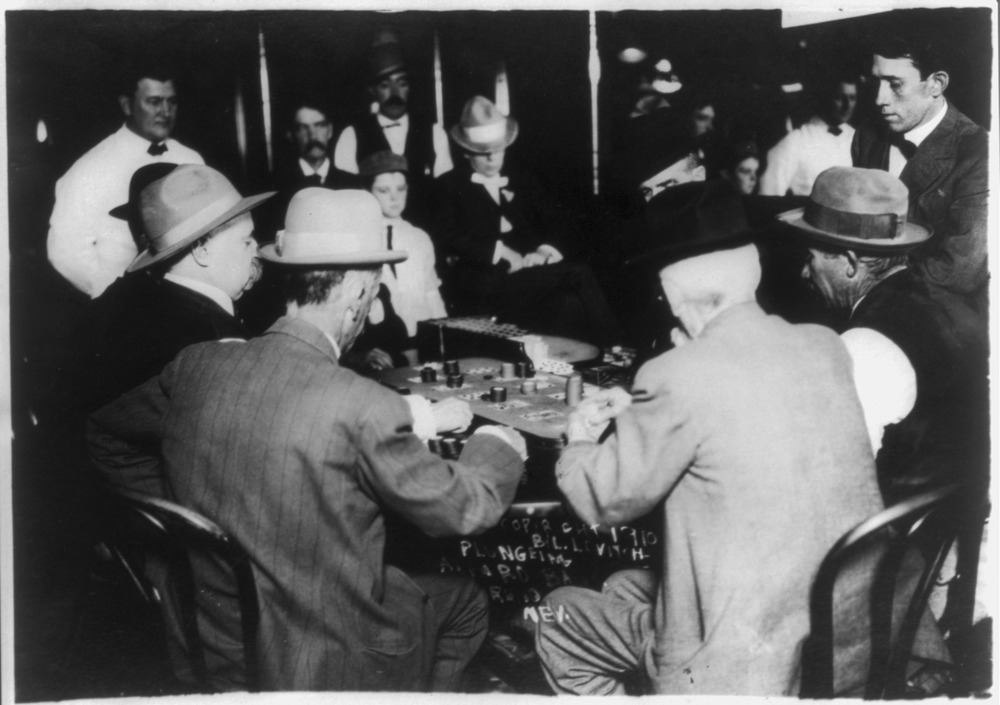 |
| A faro bank, Bisbee, c. 1900 (C. S. Fly; National Archives 530986) | Faro in Reno, 1910: layout, dealing box, case-keeper (L. Levitch; LOC) |
| 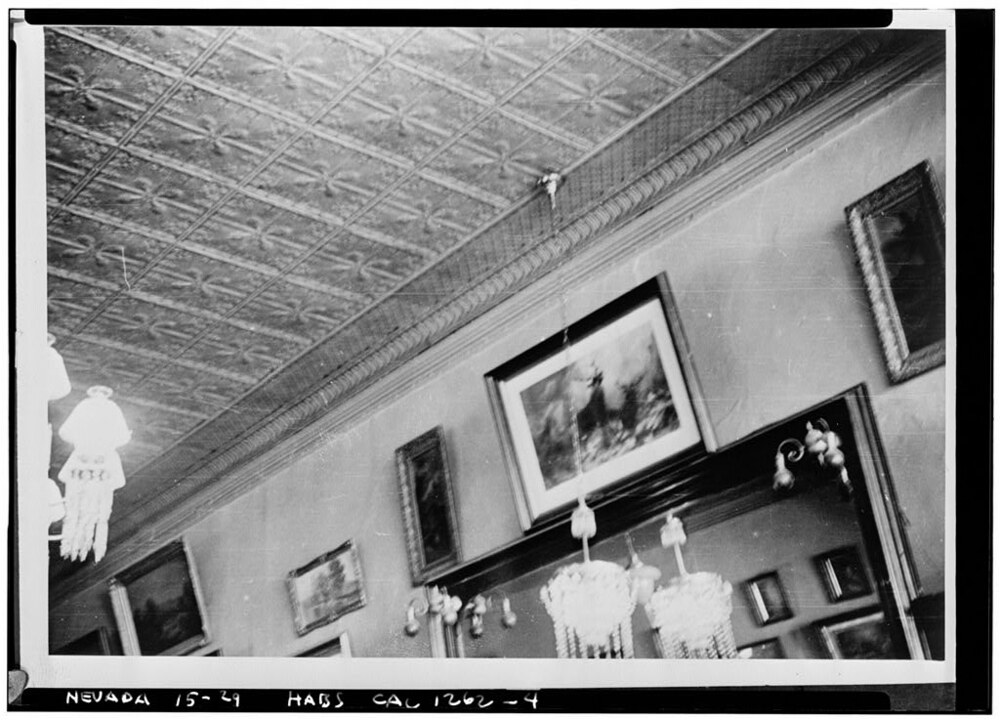 | 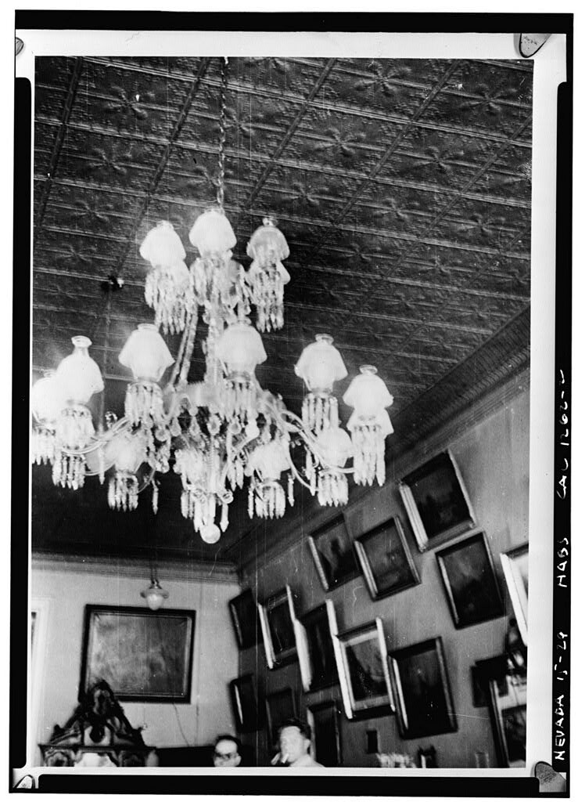 |
| The Crystal, Virginia City NV (HABS NV-15-29, 1940): prism chandeliers; its tin ceiling is later | Its wall of pictures |

## 7. Framing the dance floor, the balcony and the stair (period numbers)

From the period's own books, read on archive.org: Hatfield's *Theory of Transverse Strains* (1877) and
*American House-Carpenter* (1880), Trautwine's *Civil Engineer's Pocket-Book* (1883), Kidder's
*Architect's and Builder's Pocket-Book* (1895), Bell's *Carpentry Made Easy* (1858/75), *Woodward's
National Architect* (1869), *How to Build Houses* (1889), Hodgson's *Stair-Building* (1884). "calc" is
worked from the book's own rule.

**Loads.** Hatfield designs halls and assembly rooms for 70 lb/sq ft of people plus 20 of floor;
Trautwine takes 100 for crowds "to compensate for momentum"; the New York law of the 1890s asks 120 for
a place of assembly, and Kidder 80-120 for ball-rooms. A dancing crowd (modern measurements, AISC Design
Guide 11) pulses at 1.5-2.7 beats a second; one man jumping hits the floor at 2.3-4.8 times his weight.

**Spans.** Kidder: no wood joist over 25 ft, and the 1890s laws the same. So a 54 ft room needs two girder
lines (three bays of ~18 ft); a 40 ft room can take one (20 ft bays). Concept C was redrawn with two
girders for this.

**The sabotage, worked.** A joist's strength goes with the square of its depth: half sawn leaves a quarter
(nearer 15-20% with a saw kerf splitting along the grain). An 18 ft 3x12 joist breaks at ~555 lb/sq ft,
~140 half cut, and the floorboards and bridging hand its load to its neighbours: it sags and cracks and
holds. A 10x12 girder with posts 12 ft apart breaks at ~310, **~75 half cut**: less than the floor plus a
dancing crowd. When it goes it drops a panel ~12 ft along the girder and up to 18 ft to each side, hinged
on the wall ribbons (calc, Hatfield's rules). The period's collapses were girders and bearings: the
Richmond Capitol (27 April 1870, a girder under a partition, joists on a 4 in ledge; 62 dead), London,
Ontario's city hall (3 January 1898, a beam under a crowd; 23 dead); and a dance, later: the Pickwick Club,
Boston (4 July 1925; 44 dead). Trautwine: timbers carry a breaking load for months, sagging, before they go,
which is the creak and bow the card asks for.

| Member | Size | Spacing, span | Source |
| --- | --- | --- | --- |
| Dance floor joists | 3x12 (or 2x12 at 12 in) | 16 in, 18 ft | Hatfield 1880 pp.126-128 (calc) |
| Bridging | 1¼x3 crossed | a row every 5-8 ft | Hatfield 1880 Art.161; Kidder 1895 |
| Dance floor | 1¼ in tongued pine (or ⅞ maple strip) | across the joists | Woodward 1869 |
| Joists at the walls | on a 1x6 ribbon let into the studs, spiked to them (balloon frame) | | Bell p.52 |
| Girders | 10x12 (10x10 in *How to Build Houses*) | posts 10-14 ft apart | Hatfield 1880 p.142 (calc) |
| Bar-room posts | 8x8, chamfered, on stone footings | ~13 ft high | *How to Build Houses* 1889 |
| Balcony posts | 6x6 (4x4 light), chamfered or turned | ~10 ft apart, at the walk's edge | Woodward 1869; photographs |
| Balcony beam on the posts | 6x10 or 4x12 | 10 ft | calc: blow one post and it spans 20 ft and folds |
| Balcony joists | 2x8 (Woodward's porch 2x6 at 2 ft) | 16 in, ~8-10 ft to a ribbon on the front | Woodward 1869 |
| Balcony railing | 2x4 top rail, 2x2 or 3x3 balusters | 36 in high (period) | *How to Build Houses* 1889 |
| Outside stair | three 2x12 or 3x12 rough stringers, 3½-4 ft wide | 7½ in rise, 9-10 in tread, a landing half way | Hodgson 1884 p.12; Hatfield p.244 |
| Cellar walls | rubble stone 18-24 in, 7-8 ft clear | | Woodward 1869; Kidder 1905 |
| Trapdoor behind the bar | ~30 x 48 in, doubled trimmers and header | | Kidder 1895 |
| Brick front (C) | 13 in brick, cast-iron columns at the shop front | | Kidder 1905; Birkmire 1892 |

Not checked here (from memory, to check before quoting): the *Wood Handbook* strengths behind the "calc"
numbers, modern codes' 100 lb/sq ft for dance halls and 42 in guards.

## 8. What makes a saloon great in games and film

Rockstar hasn't published how its saloons are laid out, so this is from play, reviews and films (sources
in the research note; RDR2's layouts are from memory where marked). What each one teaches, ranked by how
much our missions need it:

1. **The floor over the bar is a ceiling the player watches.** Open joists and the girder, the lamps hung
   from them, the dance coming through: thumps, sifting dust, a swinging lamp, a drip. *Rio Bravo*: the
   wounded killer in the loft over the bar is found by his blood dripping into a beer glass. The payday
   collapse is fair only if the player saw it coming.
2. **Stage the card-table murder from the player's chair.** He sees the victim's face and the man who comes
   up behind him; the victim sits with his back to the door, as Hickok did in Saloon No. 10 (1876). The
   back-bar mirror shows what's behind the player.
3. **At least two ways out of every floor.** Valentine's brawl ends with Arthur thrown through the front
   window into the street; *Unforgiven*'s men go out a back window upstairs; Armadillo's (RDR1) balcony
   door to a horse below.
4. **The balcony on a few posts you can see,** reached by a door. Men on it are half hidden by the rail,
   easy to read from the street, with a clear fall line (Armadillo; Swearengen on the Gem's balcony,
   *Deadwood*).
5. **What you see first from the door:** the bar down one side, the stair and the floor above. The player
   sizes the room up before it starts (*Unforgiven*'s walk-in).
6. **The bar is cover with glass behind it:** chest-high counter, then the bottles and mirror that shatter.
7. **The stair and upper floor are the second level the AI takes,** and no perch is safe: rails break,
   falls land on tables (*Rio Bravo*, the Bird Cage's boxes).
8. **Zones by posts, not walls** (*The Hateful Eight*'s Minnie's: pillars and beams instead of walls, the
   room shot "like a landscape"). Ours are the same posts that carry the dance floor.
9. **At night, a few warm pools of light; who's lit is who's seen** (Desperados III; our `SightLight`). A
   smashed lamp changes the fight.
10. **The outside sells the inside:** the sign on the false front, lit windows upstairs on payday, the crowd
    on the balcony, the walk up the street (RDR2's Rhodes).
11. **Dense and worn:** Kotaku's best-rated RDR2 saloon, Smithfield's in Valentine: "dirty tables, patchy
    walls and rowdy drinkers".
12. **A cellar by a trapdoor behind the bar,** with a way out: a hidden gunman under the boards (*The
    Hateful Eight*), the Bird Cage's game below, an escape.

## 9. Credits and where things are

- HABS drawings and photographs: Historic American Buildings Survey, Library of Congress, public domain
  (the URLs are in `saloon-design/SOURCES.md`).
- The painted views: Nano Banana Pro (Gemini 3 Pro Image) through OpenRouter, from this brief's requests.
- Files: each concept's data `experiments/building_lab/saloon_<a-d>/concept.json`, its sheet request and
  views in `.../sheet/`; the plan drawer `tools/buildings/concept_plans.py`; the sheet painter
  `tools/buildings/target_sheet.py` (the doctor's, unchanged). The research notes the agents wrote, with
  every URL: `saloon-design/SOURCES.md`.
