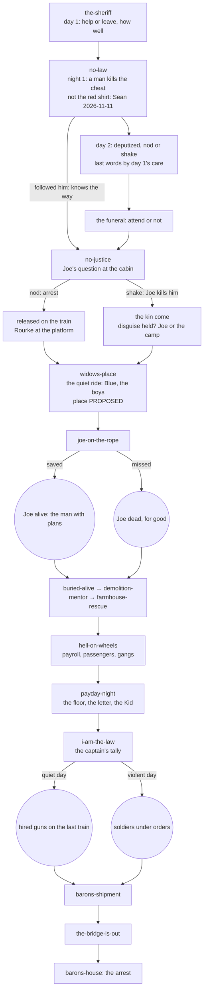

# Decisions: what each choice sets, and who reads it

Sean, 2026-11-09: "some sort of decision tree, which kind of points at, if you make this decision, this
will happen, or if you make that decision, this will happen, just so it all kind of flows, and we can
kind of always come back to it to see that it all kind of lines up". This is it.

**How to use it.** Every mission writes some **facts** (what the player did, who lived, what exists) and
reads others. A mission's card says what it sets and reads; this page joins them up, so a change on one
card shows which others it touches. **Check it whenever a card changes:** every fact a mission reads must
be set by an earlier mission, for every value it can have; every value must lead somewhere.

**It's also the story state's spec.** The build checks found the game has no save or story-state system
yet (`MAP.md`). The facts below are what that system has to remember. Built from the cards on
2026-11-09; PROPOSED as a map (each fact's source is the card named), DECIDED only where the card is.

## The main line

## The facts

Each fact: its values, the mission that sets it, the missions that read it, and what each value does.

### Act I

| Fact | Values | Set by | Read by | What it does |
|---|---|---|---|---|
| `sheriff.care` | good / poor / left him | `the-sheriff` (help-or-leave deed, DECIDED lock; how well, DECIDED pick) | `no-law` day 2; `farmhouse-rescue`; `dig-him-up` | His last words: clear, or "…boot", or nothing (DECIDED); the widow's lines follow it (DECIDED lock); the boot's lead is plain or half-said (PROPOSED) |
| `harlan.deputized_with` | nod / shake | `no-law` day 2 | the widow, the doctor (opinions) | Shake gets "that's not the way this works" and the revolver anyway (DECIDED); they remember the refusal (PROPOSED, draft) |
| `funeral.attended` | yes / no | `no-law` | the widow's family, the town | Remembered (DECIDED: "you can choose to attend"); the first step of her trust before the farmhouse |
| `nolaw.followed_red_shirt` | yes / no | `no-law` | `no-justice` | He already knows the raiders' way (DECIDED pick) |
| `joe.question` | stop (arrest) / step aside / acted / shot the surrendered man / killed him outside first | `no-justice` | `joe-on-the-rope`, Joe's trust, the camp | See the next rows |
| `red_shirt.fate` | released / killed by Joe / murdered by Harlan / killed outside | `no-justice` | `joe-on-the-rope`, the town | Released: he walks Main Street, and Joe kills him there (the rope's cause, DECIDED). Killed by Joe: the kin come (DECIDED). Murdered by Harlan: witnesses, rumour (DECIDED); the rope's cause **OPEN** |
| `saloon_killer.fate` | held for trial / killed / got away | `no-justice` (PROPOSED: he's among the six at the cabin) | `hold-him`, the town | Sean, 2026-11-11: he's not the red shirt, so he can be held for the cheat even when the red shirt is let go. PROPOSED: held, he's the Water Tower's prisoner |
| `joe.disguise_held` | yes / no | `no-justice` (witnesses, DECIDED pick) | `joe-on-the-rope` | Held: the kin come for Joe. Broken: they go to the Ute camp (DECIDED) |
| `camp.trust` | trusts Harlan / cooled | `no-justice` | the camp, Joe | Revenge: trusts; arrest: cools (DECIDED) |
| `widow.visited` | yes / no | `widows-place` (DECIDED, Sean 2026-11-09) | `farmhouse-rescue` | Not visited: a stranger to her, the boys and Blue; the ways in unknown (DECIDED) |
| `blue.knows_harlan`, `boys.know_harlan` | yes / no | `widows-place` (DECIDED, Sean 2026-11-09) | `farmhouse-rescue` | Blue barks at the gang, not him; the boys follow a voice they know in Phase B (DECIDED) |
| `harlan.has_sheriffs_horse` | yes / no | `widows-place` (PROPOSED, Sean's "maybe") | every ride after; the town | She gives him the horse with the rifle; people know it as the sheriff's. With "no horse at the start" (Sean's maybe, `the-sheriff`), his first horse: until then he walks |
| `widow.told_end` | the truth / a kind lie / not asked | `widows-place` (DECIDED, Sean 2026-11-09; the nod) | the widow's lines; the rumour | A lie about `sheriff.care = left him` found out later costs her trust (PROPOSED) |
| `joe.alive` | yes / no | `joe-on-the-rope` (DECIDED: "If Harlan can't save Joe on the rope, Joe dies") | every later mission with Joe | See "Without Joe" below |

### Act II

| Fact | Values | Set by | Read by | What it does |
|---|---|---|---|---|
| `harlan.has_winchester` | yes | before `joe-on-the-rope` (DECIDED) | the rope shot | DECIDED (Sean, 2026-11-09): the sheriff's rifle, given by the widow at `widows-place`; OPEN if he left the sheriff to die |
| `dynamite.level` | none / single sticks / bundles | `buried-alive`, `demolition-mentor` (DECIDED progression) | `farmhouse-rescue` (the breach), `balcony-ambush`, `the-bridge-is-out`, `barons-house` | The breach only once taught (DECIDED lock); the balcony later, with dynamite (DECIDED) |
| `miner.alive` | yes / no | `buried-alive` | `demolition-mentor` | **OPEN: who teaches if he dies** |
| `widow.signed` | yes / no | `farmhouse-rescue` (DECIDED v2) | `dry-creek`, the Baron's thread, the ending | Signed: the Baron has the water and starts his ditch (PROPOSED v2) |
| `kid.state` | turned / dead / still with the gang | `farmhouse-rescue` (the Kid on the porch) | `payday-night`, `kid-wants-out` | Turned or alive: he can be the informant; dead: that voice is gone (see "The informant") |
| `farm.prisoners` | none / some | `farmhouse-rescue` | `hold-him` | Prisoners the gang will come for (later) |

### Act III

| Fact | Values | Set by | Read by | What it does |
|---|---|---|---|---|
| `payroll.fate` | saved / lost | `hell-on-wheels` | `payday-night` | The crowd's mood: a celebration or a hungry night; the crowd comes either way (DECIDED) |
| `gang_a.fate` | fled with the money / arrested / dead | `hell-on-wheels` | `the-bounty`, `hold-him` | Fled: wanted posters; arrested: the jail (DECIDED v2) |
| `gang_b_man.taken` | yes / no | `hell-on-wheels` | the Baron's thread | He names the foreman who paid him (DECIDED v2) |
| `payday.floor` | held / fell | `payday-night` (the load decides) | the town, the building | Fell: the dead, the maimed, the rubble with the sawn joist; held: the two men ride out, the outrage waits (DECIDED) |
| `payday.letter` | signed / refused / never offered | `payday-night` (Rourke's rule) | `i-am-the-law`, the Baron | Signed: the captain reads it, the Baron uses it; the saved owe the Army (DECIDED) |
| `payday.proof` | the cut found / the day-book / the witness / none | `payday-night` | `i-am-the-law` | Walk the captain to it: it weighs against the letter (DECIDED) |
| `law.tally` | quiet / mixed / violent | `i-am-the-law` | `the-bridge-is-out` | Quiet: hired guns with no orders; violent: soldiers under orders (DECIDED) |
| `law.joe` | rode out / stayed beside / stayed by his choice | `i-am-the-law` | Joe's trust | Asked to hide: he remembers it (DECIDED) |

| `prisoner.fate` (the Water Tower night) | freed / dead / still held for the train | `hold-him` (the Water Tower) | the gang, the Baron, `joe-on-the-rope` (the released man's walk) | Freed: back on the street, as the arrest ending's released man; dead: the Baron's loose end tied (DECIDED pick) |
| `depot.tank` | standing / wrecked | `hold-him` | the daily train | Wrecked: the train can't take water at Salt Creek until rebuilt (DECIDED pick) |

### Act IV

| Fact | Values | Set by | Read by | What it does |
|---|---|---|---|---|
| `ledger.held`, `bookkeeper.state` | taken / half / lost; alive with Harlan / dead / gone | `barons-shipment` (v2, waiting on Sean) | `barons-house` | **OPEN** (evidence is "a maybe") |
| `trestle.state` | blown with the train / stopped another way | `the-bridge-is-out` | `barons-house`, the ending | The finale goes past the trestle to the Baron's house (DECIDED); Rourke's fate **OPEN** |
| `baron.fate` | arrested / dead / fled | `barons-house` | the ending | He must survive the breach (DECIDED) |
| `baron_house.wall` | standing / a section down / the wall down | `barons-house` (the Sap, or a charge) | the town, the ending | The house leaning with its wall down stays on the rise (DECIDED pick) |

## Without Joe (`joe.alive = no`)

Joe dies for good if the rope shot misses (DECIDED, 2026-11-04). #738 rule 2: "no idea depends on him
alone". Every later card that uses him needs a path without him:

| Mission | Uses Joe for | Without Joe | Status |
|---|---|---|---|
| `barons-shipment` | the plan ("Harlan and Joe plan"; Joe pitches the log) | the place shows the log deck; the driver as the way in | partly covered (v2); **check** |
| `payday-night` | a second pair of eyes | Harlan alone | covered |
| `i-am-the-law` | the Baron's men's target; the choice to hide him | **OPEN**: who do they goad? (someone from the camp in town?) | **gap** |
| `the-bridge-is-out` | his role OPEN | Harlan alone | **OPEN** |
| `farmhouse-rescue` | "whether Joe comes" (#622) | Harlan alone | covered |

## The informant (who names who pays the gang)

Three sources, so the thread never hangs on one man: **the Kid** (farmhouse, Payday Night: alive and turned
or saved), **Gang B's man** (Hell on Wheels: taken alive), **the bookkeeper** (the Shipment: kept alive).
If all three are lost, **OPEN**: what's left (the day-book, the sawn joist, the ledger's figures).

## The checks (gaps found, 2026-11-09)

1. **The rope's cause if Harlan murdered the surrendered man** (`red_shirt.fate = murdered by Harlan`): neither
   DECIDED cause applies. OPEN.
2. **The Winchester:** answered (Sean, 2026-11-09): the sheriff's rifle, from the widow at `widows-place`. Still
   OPEN: whether she gives it if he left the sheriff to die and she knows it; if not, where it comes from.
3. **I Am the Law without Joe:** who the Baron's men goad. OPEN.
4. **The miner dead in Buried Alive:** who teaches dynamite. OPEN.
5. **Harlan's title:** a deputy throughout (DECIDED); missions that say "sheriff" (the inventory's "A New
   Sheriff") read as deputy; whether he's ever sheriff is OPEN.
6. **Evidence "a maybe":** the ledger, the papers, the day-book and the proof feed the captain and the
   Baron's arrest; if the trial stays out, they matter through people who see them (the captain, the
   town), not a court. Check each card says so.
7. **Cards outside the main line** (`widows-place`'s exact place: after No Justice, PROPOSED; `hold-him`, `vaqueros-horses`, `dry-creek`, `the-bounty`, `kid-wants-out`,
   `dig-him-up`, `balcony-ambush`): they read facts above (prisoners, `widow.signed`, `gang_a.fate`,
   `kid.state`, `sheriff.care`) but their place in the order is OPEN; place them when Sean reviews them.

## Keeping it true

- When a card changes, update its rows here in the same commit.
- A new mission adds the facts it sets and reads.
- Before a mission is built, its facts become the story state's keys (names here are working names).
