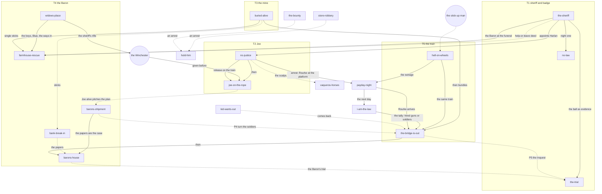

# The story map

Every mission (`README.md`'s index) as a node, the threads between them, the factions, the places,
and the systems table. Planning only. Built 2026-11-09 from the cards; where a card says OPEN, so
does the map. **Every edge and every thread here is PROPOSED (this session's reading of the
sources)** unless it's marked DECIDED with the card that holds Sean's words.

The story is open-ended threads with no day count (Sean, 2026-11-01, #546: "The story doesn't advance
until it should advance"; "yes to nudges"). So the map is about **what unlocks or changes what**, not
about days.

## The threads

| Thread | What it's about | Its missions, in the order they lean | Status |
|---|---|---|---|
| **T1 The sheriff and the badge** | Who shot him, the town without law, the badge | `the-sheriff` → `no-law` → (the badge, day 2) → `the-trial` | PROPOSED (#546 names "the sheriff and the badge") |
| **T2 Joe and the revenge** | His wife's killer, the town's "no justice", his life on the rope | `no-justice` → (the Winchester) → `joe-on-the-rope` → Joe's plans | order DECIDED (Sean, 2026-11-09, #738) |
| **T3 The mine and the miner** | The rescue, dynamite learned, sticks then bundles | `buried-alive` → single sticks → bundles | PROPOSED (#546); progression DECIDED (2026-11-04) |
| **T4 The Baron and the water** | The widow's water, his papers, his arrest | `widows-place` → `farmhouse-rescue` → `barons-shipment` / `bank-break-in` → `barons-house` | the finale DECIDED (2026-11-04); the rest PROPOSED |
| **T5 Rourke and the train** | The train of hired guns and soldiers, Harlan's old commander | `hell-on-wheels` → `the-bridge-is-out` | the finale DECIDED; Rourke PROPOSED (#546 P4) |
| **T6 The gang** | The Colters' jobs, the men who want out | `store-robbery`, `bank-robbery`, `stage-held-up` → `hold-him`; `kid-wants-out` | PROPOSED |
| **T7 The town's law** | Mobs, lynching, a trial: "What do you do when the law is wrong?" | `hold-him`, `railhead-lynching`, `joe-on-the-rope`, `the-trial` | PROPOSED (#546 P1, not accepted) |
| **T8 Harlan's past** | Found through play: Rourke, a sergeant, a letter | runs under T5; told to Joe or not | PROPOSED (#546 P2, not accepted) |

OPEN: #546's body names "Vale's land play" as a thread; later sources put the Baron at its centre
and never mention Vale again. T4 stands in for both until Sean says.

**Outside the threads** (side missions and set pieces that can land any time): `fever-house`,
`dust-storm`, `cattle-drive`, `fire-night`, `night-meeting-trap`, `tied-to-the-tracks`,
`vaqueros-horses` (touches T4), `railhead-lynching` (touches T4 and T7), and the repeatables
`the-bounty`, `small-fights`, `stage-held-up`.

## The graph

Solid arrows are DECIDED (the card quotes Sean); dotted are PROPOSED or OPEN.

**The opening, in order** (Sean, 2026-11-09): day 1 dawn, the sheriff on the road → the doctor's →
night 1, `no-law` (Harlan seated, unarmed, no law yet; the stranger tells him not to do anything; the
red shirt murders the card cheat and rides off; Sean 2026-11-11: two men, so the saloon killer isn't the red shirt,
which is which OPEN) → the same night, the red shirt's gang raids Joe's camp
→ day 2, the sheriff deputizes Harlan, gives him his revolver and dies; the funeral (attend or not);
OPEN (Sean: "gotta be flagged"): where and when Harlan meets Joe →
`no-justice` (now he's the law, and the law fails anyway).

**The evidence and the trial are a maybe** (Sean, 2026-11-09: "Yeah I'm not sold on the whole evidence and trial stuff yet - that's a maybe"): the edges into
`the-trial` and the papers' role as evidence hang on it.

**The spine's 1882 correction** (PROPOSED by this session with Hell on Wheels v2; Sean: "Yes fold it in
with all the ticks"; confirm it applies to the spine): after the Posse Comitatus Act (1878) the Army
couldn't simply be sent to keep order in a town. In the Johnson County War (1892) the governor called it
an insurrection and the President sent troops. So the Baron needs Salt Creek to look like a town in
revolt, not only a lawless one.

**The spine** (the story judge's frame; Sean took its three changes, 2026-11-09: "Yes I like the
ticks"): the Baron wins if Salt Creek looks lawless enough that soldiers are sent to restore order;
Rourke is the officer he pays to bring them. Every crime serves that plan; Harlan's badge stands in its
way.
- DECIDED: the red shirt is the Baron's hired gun and shot the sheriff (T1 + T2 + T4 joined).
- DECIDED: the Baron at the sheriff's funeral, offering to buy the widow's claim (the farmhouse is his
  answer to her refusal).
- DECIDED: Payday Night is the hinge: the attack on the payroll brings Rourke in on the train; the Kid
  knows who pays the gang.
- DECIDED (Sean): "we need rourke to come no matter what because if Joe kills him we should still meet
  him". The arrest ending shows Rourke at the platform; OPEN how the revenge ending meets him (Payday
  Night meets him in both).

The DECIDED edges and where Sean's words are:
- `no-justice` → `joe-on-the-rope`: #738 (2026-11-09). The Winchester before the rope: #546 (2026-11-04,
  "after Harlan has been given the rifle"), #733/#734 (2026-11-09, which rifle OPEN).
- `the-sheriff` → `no-justice`: by No Justice Harlan has "been temporarily appointed by the dead
  sheriff" (Sean, 2026-11-09). The prisoner's release rides the train (Sean, 2026-11-09).
- `the-sheriff` → `the-trial`: DESIGN.md §11 signature features 1–3 (2026-10-01, "the game's spine").
- `buried-alive` → sticks → bundles: #546 (2026-11-04, "charge sizes as progression").
- `barons-shipment` → `barons-house`: #736 (2026-11-09, the papers "can also be the evidence after you
  arrest the Baron").
- `hell-on-wheels` and `the-bridge-is-out` share the train: #542 (2026-11-01, "It's the same train").
- `the-bridge-is-out` → `barons-house`: #546 (2026-11-04, "the finale goes past the trestle").
- The farmhouse's dynamite breach "once demolition has been taught elsewhere": the lock (2026-11-03,
  PR #621, unmerged).

## The factions

| Faction | Who | Missions they drive | Notes |
|---|---|---|---|
| **The Baron** | the Baron, his foreman, his hands, his gunmen | `farmhouse-rescue`, `barons-shipment`, `bank-break-in`, `barons-house`, `vaqueros-horses`, `railhead-lynching` (his foreman) | "wants every drop of water in the valley, and is patient" (DESIGN.md); "A Baron with a point" (#546 P3, PROPOSED) |
| **The Colter gang** | Brody, Lyle, Dutch, Hollis, the Kid (+ Pike, Wes) | `store-robbery`, `bank-robbery`, `hold-him`, `kid-wants-out`, `stage-held-up`, `small-fights`; `farmhouse-rescue` (OPEN: or the Baron's own men, #622 item 7) | "hired to scare homesteaders off, with plans of their own" (DESIGN.md) |
| **The railroad** | Rourke (PROPOSED), Vale? (OPEN), the crew, the train's crew | `hell-on-wheels`, `the-bridge-is-out`, `railhead-lynching` (OPEN: a crew still?) | the line already runs (#552, 2026-11-04) |
| **The army** | the soldiers on the train | `the-bridge-is-out` | "the army train" (#623); hired guns and soldiers (#542) |
| **The town** | the leaders, the doctor, the saloon owner, the storekeeper, the banker, the crowd and the mob | everything; `no-justice` (their "no justice"), the mobs in `hold-him`, `joe-on-the-rope`, `fever-house` | "owners care about their own things first" (showcase) |
| **The law beyond the town** | the circuit judge, a US Marshal | `the-trial`, `hold-him`, `no-justice` (past the town) | |
| **The Southern Ute community** | Joe, the war leader, the elder (DESIGN.md; OPEN whether kept) | `no-justice`, `joe-on-the-rope` | handled with research and care |
| **The Mexican rancher's people** | the rancher (#430) | `vaqueros-horses`; `no-justice` (the scalps) | |
| **The Chinese workers** | | `railhead-lynching` | premise OPEN |
| **The widow's family** | the widow, her two sons (protected), Blue (protected) | `widows-place`, `farmhouse-rescue` | lock 2026-11-03 |
| **The miners** | the miner (teaches dynamite), the mine's owner | `buried-alive` | the miner may propose the coach trap (#546) |
| **Outlaws of the valley** | road agents, rustlers, claim jumpers, horse thieves, wanted men | `small-fights`, `the-bounty`, `stage-held-up` | "fights that have nothing to do with the story" (#736) |

## The places

Coordinates and heights from `config/valley.json` (x east, z south, metres from the crossroads).

| Place | Height | Missions | Note |
|---|---|---|---|
| `town` (0, 0): the saloon, jail, bank, store, doctor | 0 | `no-law`, `the-sheriff` (the doctor), `hold-him`, `bank-break-in`, `bank-robbery`, `store-robbery`, `the-trial`, `dust-storm`, `fire-night`, `night-meeting-trap`, `cattle-drive` | most of the side missions sit in town |
| `church` (-62, -135) | 7.5 | `the-trial` (or the saloon) | |
| `opening_site` (530, 128) | -5.3 | `the-sheriff` | PROPOSED |
| `harlan_homestead` (432, 470) | 2 | `the-sheriff` (his dawn ride) | |
| `widow_homestead` (1712, -560) | -10 | `widows-place`, `farmhouse-rescue` | |
| `baron_town_house` (-215, 75) | 4.5 | `barons-house` (OPEN which house) | masonry |
| `baron_ranch` (1320, 1260) | 20 | `barons-shipment` (start), `vaqueros-horses`, `barons-house` (OPEN) | |
| a road off the ranch | | `barons-shipment` | five candidate points, none chosen |
| `mine`, `ore_works`, `powder_magazine` | 79, 24.3, 91.5 | `buried-alive` | |
| `bridge_b` the overpass (1912, -229) | deck 11.2 | `hell-on-wheels` | boarding point |
| `bridge_c` the trestle (1183, -79) | rail ~27 m over the creek | `the-bridge-is-out` | |
| `ute_community` (-1350, 1230) | 41 | `no-justice` | |
| bandits' camp | | `no-justice` | OPEN |
| the hanging tree / overlook | | `joe-on-the-rope` | OPEN (valley-plan §10) |
| `hideout` (-450, 2020) | 86 | `small-fights` (outlaws camped) | no mission yet |
| `abandoned_homestead` (-860, 330) | 24 | `the-bounty` (candidate), `no-justice` (candidate) | PROPOSED |
| #736's places with height (12–15, unplaced) | | `small-fights`, `the-bounty` | |
| `stock_pens` (-29, -100) | 3.9 | `cattle-drive` | |
| off the map (`east_exit`) | | `fever-house` ("the next town"), `stage-held-up`, `kid-wants-out` (the stage) | |

**Seen from the map:** the town carries 11 of 27 missions; the west half of the valley carries only
the mine and the Ute community; `hideout`, `timber_camp`, `prospect_shack`, `rock_camp`,
`mesa_overlook` have no mission of their own. Five missions have no place yet (`joe-on-the-rope`,
`no-justice`'s camp, `railhead-lynching`, `tied-to-the-tracks`, `barons-shipment`'s spot).

## The systems table

Every system a mission needs, which missions share it, and whether it exists on main (2026-11-09).
**State:** exists · partly · being built · decided (DESIGN says yes, nothing built) · new. Sorted by how
many missions need it; the build order should read down this table.

| System | Missions that need it | n | State |
|---|---|---|---|
| Witnesses, perception, memory, rumours, opinions | almost all | 20+ | partly (Senses, deeds, opinions; rumours that change: decided) |
| Gunfight AI, cover, men holding a building (`HouseDefence`, posts, climb) | `farmhouse-rescue`, `no-justice`, `barons-house`, `hold-him`, `the-bounty`, `small-fights`, `store-robbery`, `bank-robbery`, `stage-held-up`, `hell-on-wheels` | 10 | exists |
| Dynamite: single sticks, planted, bundles, plunger | `farmhouse-rescue`, `buried-alive`, `bank-break-in`, `bank-robbery`, `hold-him`, `night-meeting-trap`, `the-bridge-is-out`, `barons-house` | 8 | exists |
| Evidence as objects (the ball, papers, brands, scalps, an oil can) | `the-sheriff`, `the-trial`, `barons-shipment`, `bank-break-in`, `barons-house`, `no-justice`, `vaqueros-horses`, `fire-night` | 8 | new (roadmap 5.6); **a maybe** (Sean, 2026-11-09: "not sold on the whole evidence and trial stuff yet") |
| Arrest, binding, escorting a prisoner | `no-justice`, `hold-him`, `the-bounty`, `store-robbery`, `barons-house`, `small-fights`, `bank-robbery` | 7 | partly (the shout key arrests, #128) |
| A crowd or mob with a purpose (a rope, a hanging, driving people out) | `joe-on-the-rope`, `hold-him`, `railhead-lynching`, `the-trial`, `fever-house`, `fire-night` | 6 | new |
| Gang and faction plans as data, events that refill (Prompt 18) | `store-robbery`, `bank-robbery`, `small-fights`, `vaqueros-horses`, `fire-night`, `stage-held-up` | 6 | new |
| Horses as creatures: riding, leading, teams that bolt | `widows-place`, `vaqueros-horses`, `fever-house`, `stage-held-up`, `barons-shipment`, `the-bounty`, `joe-on-the-rope` | 7 | partly (one horse, #341; riding #478) |
| Masonry walls that breach | `hold-him` (jail), `bank-break-in`, `bank-robbery`, `barons-house`, (`buried-alive`'s magazine) | 5 | being built (#663, step 2 of 8) |
| Rope: cut by a ball or knife, a binding, pulling | `joe-on-the-rope`, `tied-to-the-tracks`, `fire-night`, `hold-him`, `barons-shipment` (#546's version) | 5 | new (a DESIGN §8 must-have) |
| Money: coins, bribes, buying, rewards | `hold-him`, `vaqueros-horses`, `store-robbery`, `the-bounty`, `kid-wants-out` | 5 | partly |
| Leading people: deputies, a posse, a companion | `hold-him`, `bank-robbery`, `no-justice` (Joe), `farmhouse-rescue` (Joe, OPEN) | 4 | decided (signature 6), not built |
| A strongbox or safe to open (key, shot, pry, charge) | `barons-shipment`, `bank-break-in`, `bank-robbery`, `hell-on-wheels` (express car) | 4 | new (the express car's model exists) |
| The train: sim, walkable cars, timetable, derail | `hell-on-wheels`, `tied-to-the-tracks`, `the-bridge-is-out` | 3 | exists (steps 1–5) |
| Hostage cut loose, drag by the collar | `farmhouse-rescue`, `tied-to-the-tracks`, `joe-on-the-rope` | 3 | exists |
| Physiology, first aid, the doctor | `the-sheriff`, `buried-alive`, `joe-on-the-rope` | 3 | partly (the doctor: treatment lab part 2) |
| Fire and smoke | `fire-night`, `night-meeting-trap`, `hold-him` | 3 | exists, **out of play** (#458) |
| Joe as companion with plans (#738) | `no-justice`, `joe-on-the-rope`, `barons-shipment` | 3 | new (PROPOSED) |
| The stage on the town's calendar | `stage-held-up`, `kid-wants-out`, `the-trial` (the judge's arrival) | 3 | partly (#276) |
| The nod and shake | `no-justice`, `no-law` | 2 | decided in outline (2026-10-21), not built; Sean: before No Justice |
| Wanted posters, likeness, disguise and recognition | `the-bounty`, `stage-held-up` | 2 | new (§10) |
| Falls from height through roofs; enemies on high ground | `small-fights`, `the-bounty` | 2 | new (#736 D); climbing partly |
| Fighting on a moving train; cab controls | `hell-on-wheels`, `the-bridge-is-out` | 2 | new (train step 7) |
| Coaches and wagons as rigid bodies that tip | `barons-shipment`, `stage-held-up` | 2 | new |
| Dented steel | `barons-shipment` (and the train, #542) | 1 (+train) | new; "one dent system for both" (#736) |
| Cards (poker, faro, cheats) | `dust-storm`, `no-law` | 2 | new (backlog) |
| Owners care about their things | `no-law`, `store-robbery` | 2 | new (a rule, showcase) |
| Acts (scenes as data) | `no-law`, `barons-shipment` (the fade) | 2 | new (roadmap 3.5) |
| Teaching (signature 8) | `kid-wants-out`, `buried-alive` | 2 | decided, not built |
| Telegraph and letters | `no-justice`, `hold-him` | 2 | decided (signature 5), not built |
| Cattle | `cattle-drive`, `small-fights` (rustlers) | 2 | new; OPEN whether at all (#728) |
| Protected actors (the boys, Blue) | `widows-place`, `farmhouse-rescue` | 2 | new (PR #621 A1) |
| A jury and a courtroom | `the-trial` | 1 | new (signature 3); **a maybe** (Sean, 2026-11-09) |
| The trestle's collapse | `the-bridge-is-out` | 1 | exists / being built (#658) |
| A heavy log as a rigid body | `barons-shipment` | 1 | new |
| A hanging body (airway) | `joe-on-the-rope` (and `the-trial`'s hanging) | 1–2 | new |
| Illness | `fever-house` | 1 | new |
| Weather (a storm that drops sight and hearing) | `dust-storm` | 1 | new |
| Underground workings, digging rock, gas | `buried-alive` | 1 | new |
| Scalping on the wound system; a unique wardrobe at range | `no-justice` | 1 | new |
| Brands read up close | `vaqueros-horses` | 1 | new |
| Messages with time windows | `night-meeting-trap` | 1 | new (Phase 5) |
| A stampede | `cattle-drive` | 1 | new |
| Harlan's rare lines | `hell-on-wheels` (Sean's example) | 1 | PROPOSED (P9) |

**What the build checks found missing everywhere** (2026-11-09, read against main's code). These come
before most missions' "after" sections can be built, and they weren't on this table:

| Missing | What it blocks | State |
|---|---|---|
| **People in the valley** (`valley_world.gd:12`: no townsfolk, gang or saloon yet) | every mission set in the valley | new (the valley's next G-steps) |
| **A save and story state** (nothing writes `user://`; `GameReset` rebuilds the scene; no flags for "met the Kid", "the peaceful visit") | every consequence that outlasts a session; mission order; nudges | new, LARGE |
| **Long memory** (`Relations` holds threat, grudge and fear, fading in about an hour; no gratitude) | the widow's memory, Joe's, the camp's trust, "owes Harlan" | new |
| **Carrying things** (the player can't pick up items) | papers, the boot's find, scalps, a spike from the break | new |
| **Speech** (two shouts: `drop_it`, `call_out`; no nod yet) | "tell them", the Kid, Joe's question | partly |
| **Riding a horse** (the horse idles and is tied) | chases, the fever ride, bringing a man in | new (horse lab P2) |
| **Money** (no economy in `src/`) | bribes, rewards, "sells what he hears" | new |
| **Doors that open and shut** (doorways are open) | "the door opens for him", barricades | new |
| **Children and animals** (no child bodies, no dog) | the boys, Blue | new (characters; #728) |

**Systems only one mission uses** (cut, share, or accept as that mission's own cost): protected
actors, a jury, the trestle's collapse, the heavy log, the hanging body, illness, weather,
underground workings, scalping and the wardrobe piece, brands, timed messages, a stampede. Some are
worth it because the mission is the game's spine (the jury, the trestle); others are a whole system
for one evening (illness, weather, the stampede, underground digging).

**The cheapest missions on today's systems** (most of what they need exists): `farmhouse-rescue`
(built), `tied-to-the-tracks` (train, cut loose; needs rope or the farmhouse's ties), `the-bounty`,
`small-fights` (once #736's places and falls exist), `hell-on-wheels` (needs train step 7).
