# Playtest 2026-10-22: the saloon and the barkeep

Branch `claude/gameplay-barkeep-rag`. Played through the dev bridge, about a frame a second.
Scope: the saloon, mostly the man behind the bar. Screenshots are in `2026-10-22/`, all named
`saloon_…`.

## What I did

**First run.** Walked from the street into the saloon at about 17:00. The barkeep stood behind the
bar at his spot, middle of the back bar.

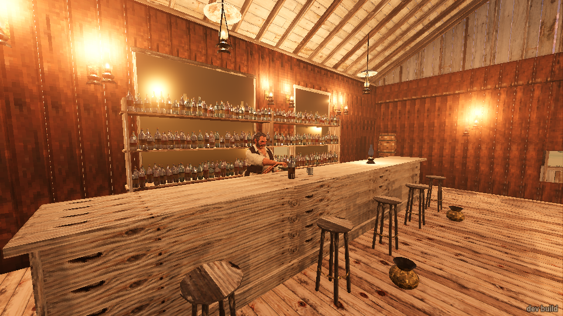

I stood back by the door and watched him for about a minute and a half, with a screenshot every 15
seconds. He stayed in one spot. He shifted a little (once he was leaning forward with his hands on
the bar), but mostly he just stood.

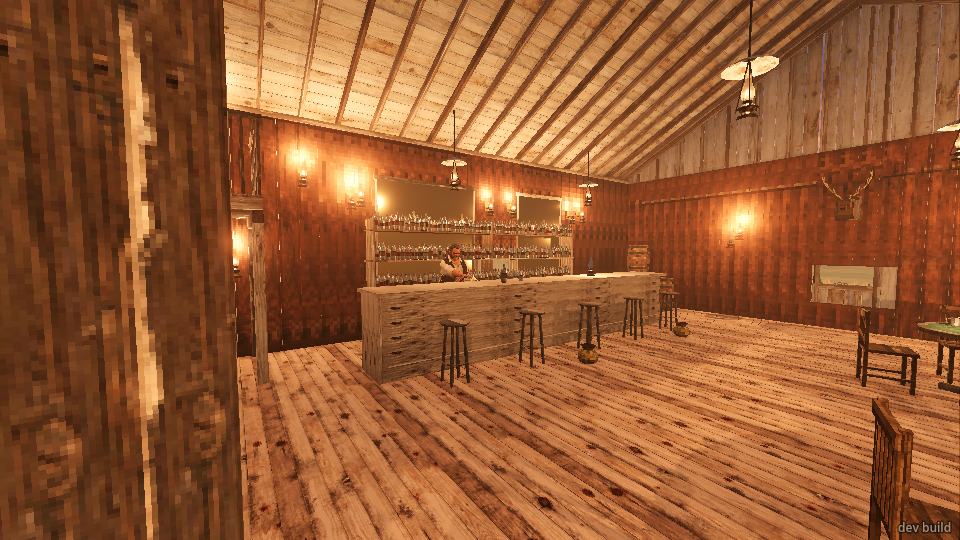

Then I moved to stand opposite him, about 4 m back from the bar. At about 95 seconds in, the gang
(Brody, Lyle and the Kid) walked in and lined up at the bar on its customer side. The Kid said
"Another." The barkeep stood and faced them. He didn't pour, move or say anything.

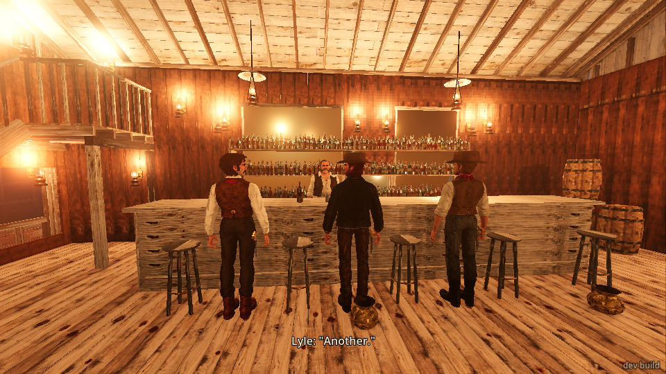

The usage limit cut the session off here and the game had stopped, so I started it again.

**Second run.** I went straight to the same spot, 4 m back from the bar and facing him, and watched
with a screenshot every 6 seconds. This time I saw the chore. At about 14 to 30 seconds he was
working his way along the bar, head down, one hand flat on the top pushing a pale cloth. He moved
about a metre along the bar while he did it. Then, at about 37 seconds, he went back to his spot,
put his arms down at his sides and stood still. He was still standing like that 45 seconds later.

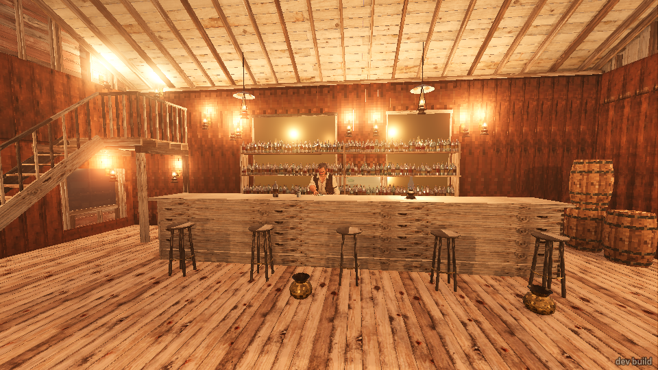
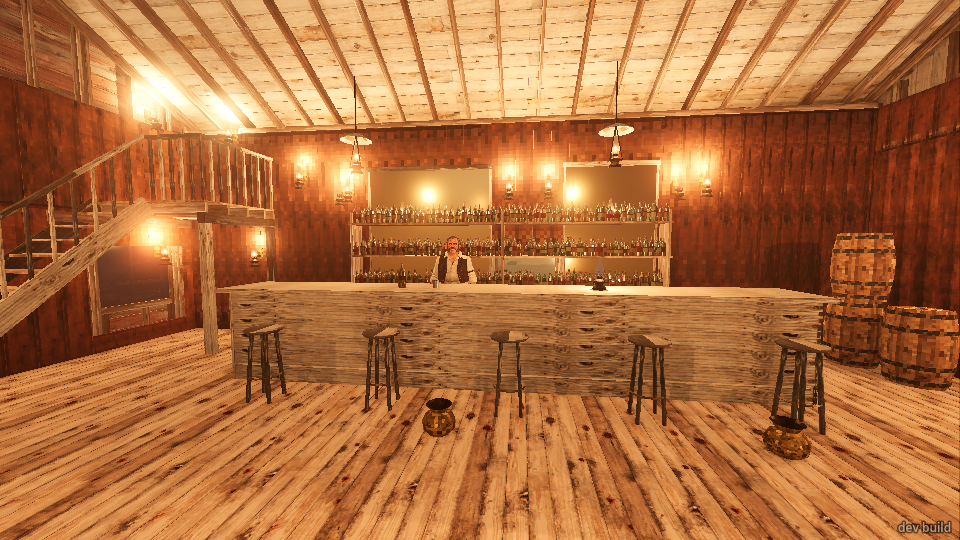

At about 85 seconds I walked up to the bar (`bar_front_1`) and stood at it, facing him from 2 m
away. He turned to face me and stood there. He didn't speak, nod or reach for a bottle, and nothing
seemed to happen.

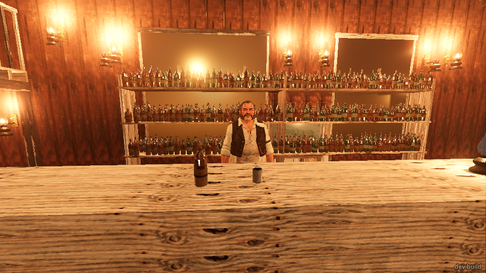

Then the gang came in again and crowded in round me at the bar. Lyle started on me: "Something I
can do for you?", "Walk on, mister.", "Put it down, or I put you down.", "One more move…". My
revolver was in its holster and my hands were empty. I didn't move. At about 116 seconds all three
said "I see him!", "Your funeral, friend." and opened fire on me from about a metre away. The room
filled with gun smoke. Brody shot Lyle in the hand twice, and Lyle shouted "He got me!", blaming
me. Lyle and the Kid gave up with their hands up.

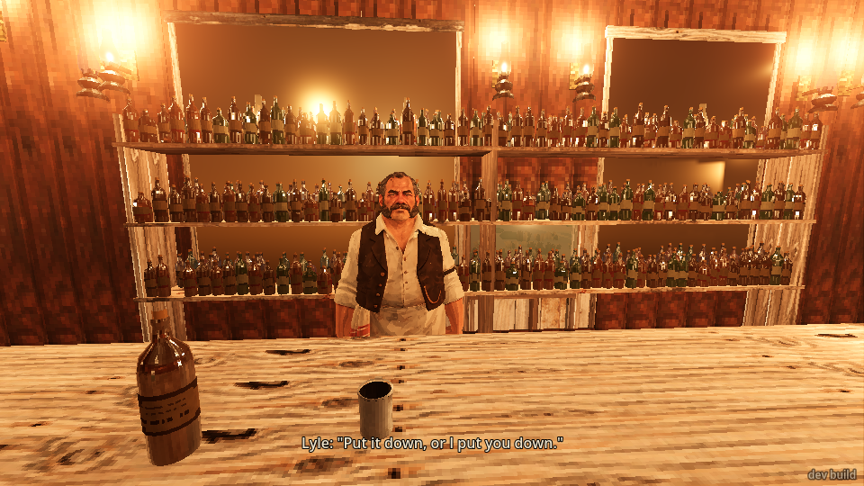
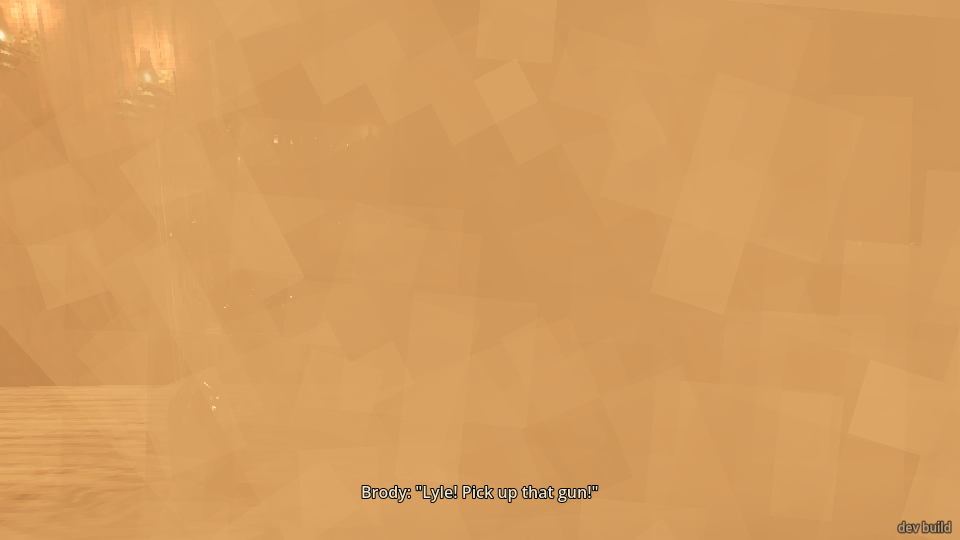

The barkeep said "Lord almighty!", then "It's going up! Clear out!", and ran. One reading had him
out in the street; a few seconds later he was back inside the saloon by the door; then he was out
in the street again. The bar was left empty. Something had caught fire during the shooting. I
didn't set it; the storekeeper said "Lord, it's burning!" a second after the first shots.

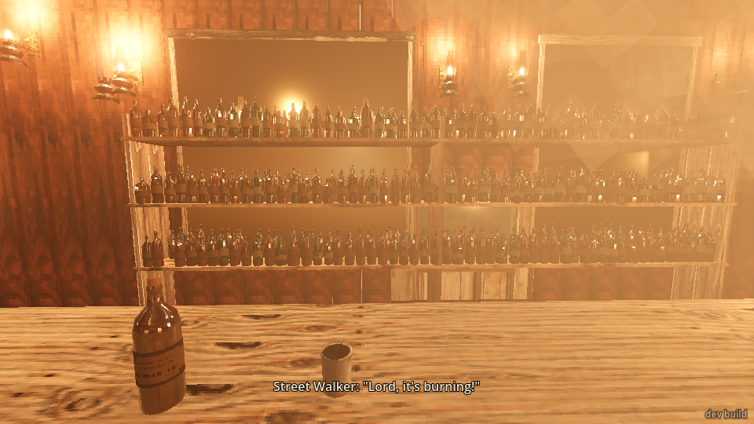

I was stuck: Brody was standing a metre in front of me with his gun on me, and I couldn't walk in
any direction. I drew and shot Brody twice. He gave up after the first shot and went down after the
second. He died of blood loss half a minute later. I still couldn't walk, so I jumped. That put me
standing on the bar (I was 1.4 m up), and I still couldn't move. In the end I used `goto` to get out.

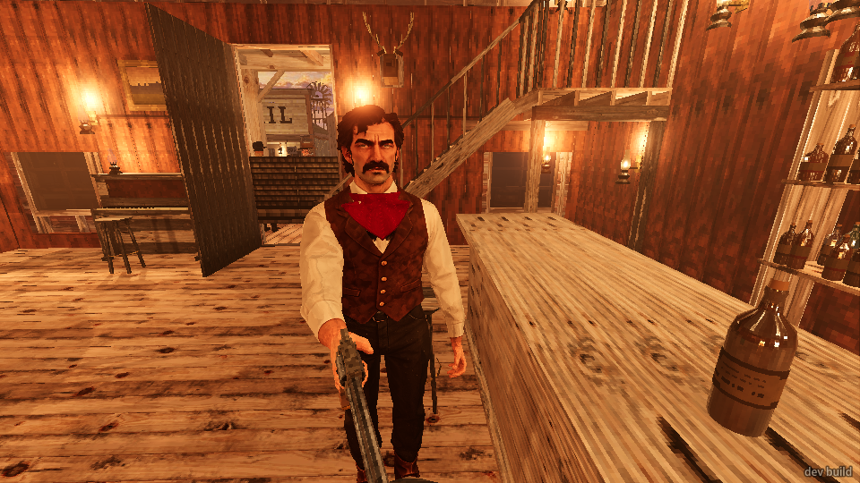
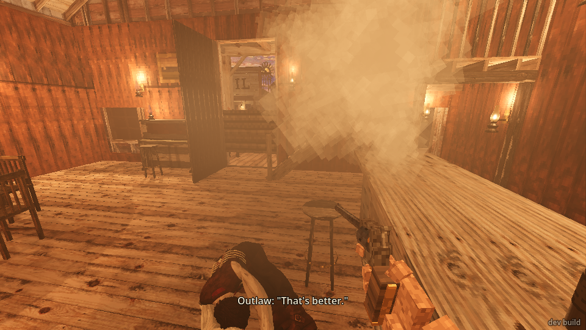

Inside, the fire was across the back corner of the room. As I passed, the screen said "You're
burning!", but I came out unhurt.

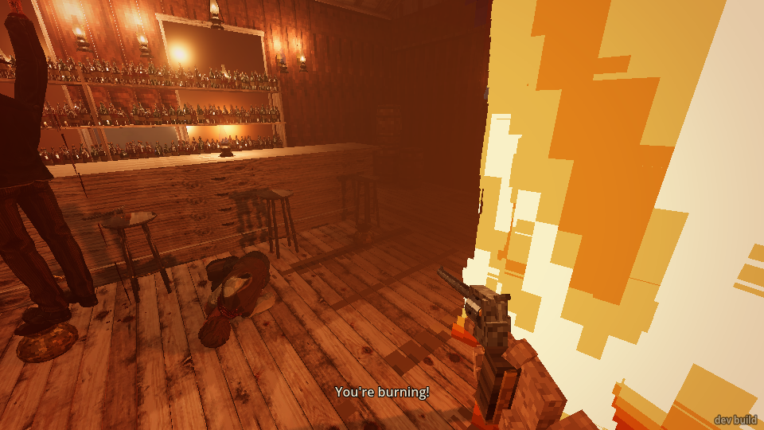

I ran out to the street and watched the saloon burn at dusk. Black smoke rose from the roof, and
then the whole front and the windows were ablaze. The barkeep stood in the middle of the street
doing nothing, his mood "fleeing", for over three minutes, and nobody brought water. Lyle and the Kid
stayed inside where they had given up, hands up, and burned to death ("kid died (burns)", "lyle
died (burns)"). The fire spread to the general store's windows.

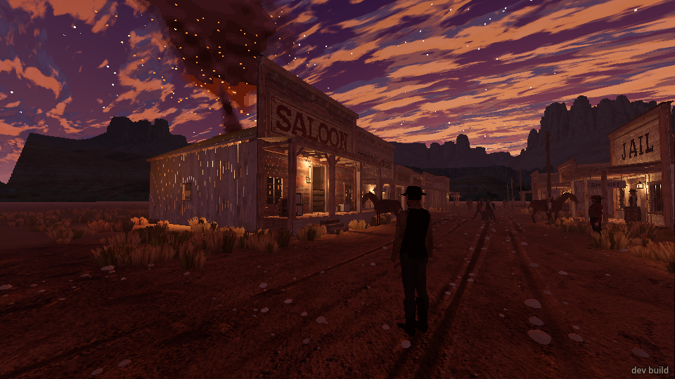
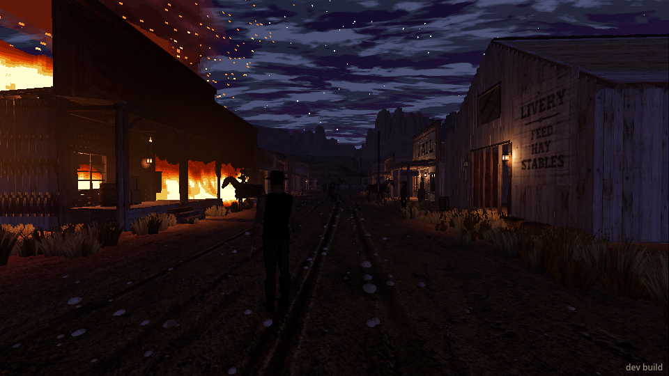

**Third run (restarted to test the rag).** I went back to watch him wipe. While he was wiping
(about 20 seconds in), I drew and fired one shot into the floor in front of the bar. The whole town
shouted at once. The barkeep said "Lord almighty!" and then "Please, mister…", and threw both hands
up. When his hands went up, the cloth was left lying on the bar top.

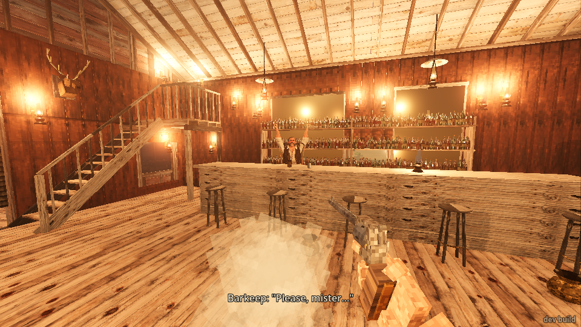

I holstered and watched. He went back to his spot, mood "shaken", and said "Lord. Lord, lord." He
never went back to the cloth or the wiping. I watched for another 60 seconds.

I walked round behind the bar and stood next to him. He didn't mind me being behind his bar at all.
He has a second cloth, a striped towel, hanging at his hip, which is a nice touch. The wiping cloth
was still lying crumpled on the bar top where he'd dropped it.

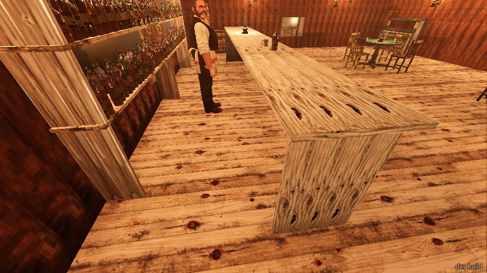
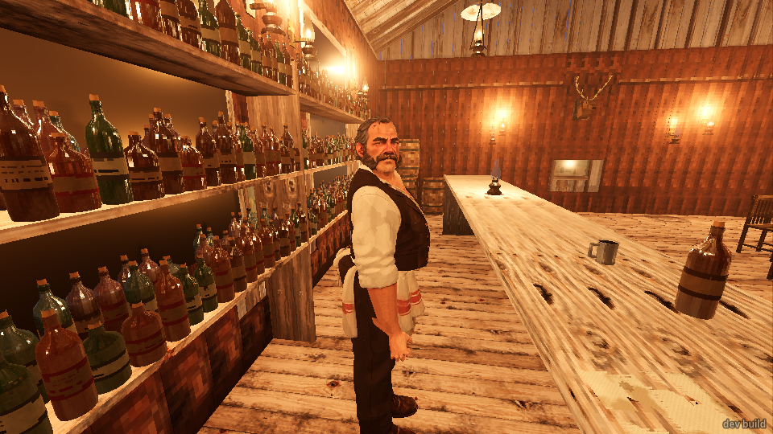
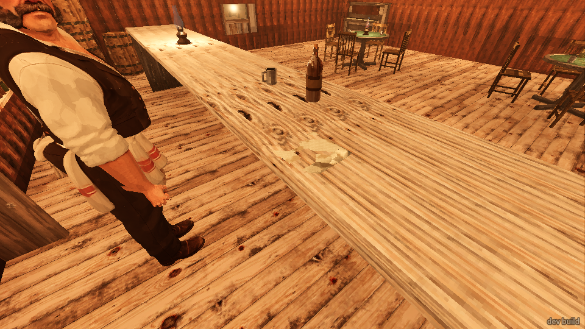

Then I used `ignite` on the bar top next to the rag. At once, a wall of flame as tall as the room
went up along the far side of the bar, and the rag's spot went dark and scorched. Everyone in town
shouted "Fire!" within a second, the barkeep "Fire! FIRE!", and he ran out to the street. I ran too,
and the game said "Burnt."

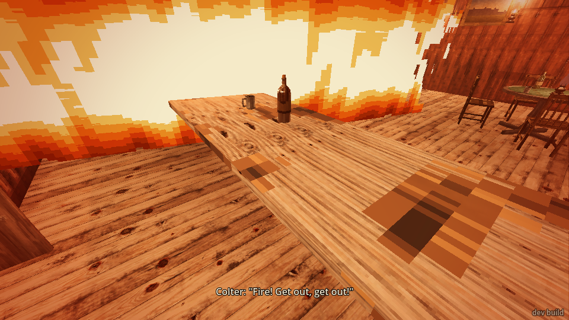

From the street I saw the jail man go in and put it out ("That's got it!", about 30 seconds after I
lit it). The barkeep stood by the store's steps, still "fleeing", and didn't help. I was watching
to see whether he'd go back in, when my game stopped answering: another headless copy of the game
had started on the same port (not something I did), so I couldn't watch the end of this run.

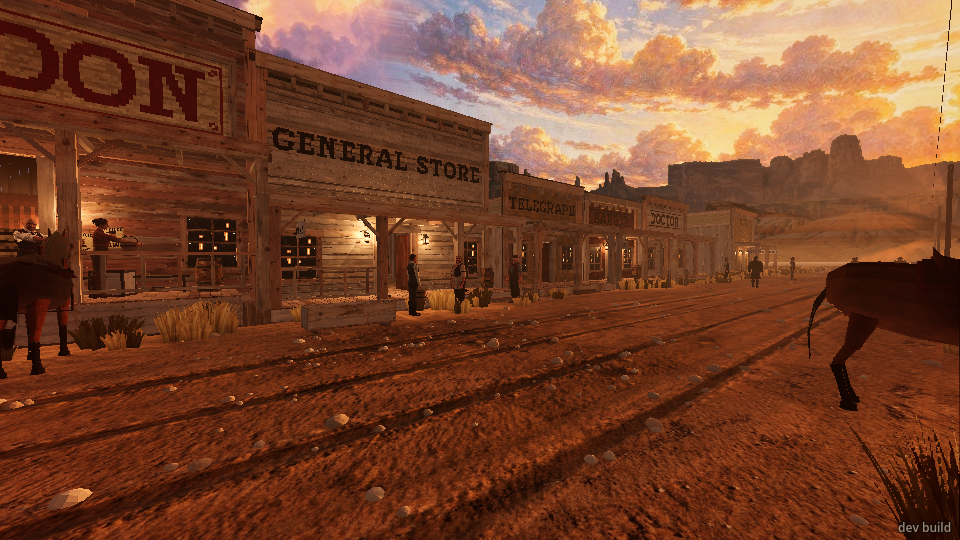

## What broke

- **Surrendered men burn to death standing still.** In run 1, Lyle and the Kid gave up with their
  hands up inside the saloon. When it caught fire, they stayed exactly where they were until they
  died of burns, about 2 minutes later. Everyone else ran.
- **Stuck against the bar.** I walked to `bar_front_1` and stood still. When the gang came in and
  stood round me, I ended up pushed into the bar (my position moved from 11.2 to 12.1, which is
  the bar's line), and after that `walk` moved me 0 m in every direction. Jumping put me on top of
  the bar, still stuck. Only `goto` got me out.
- **The gang shot an unarmed man for standing at the bar.** I was quiet with my gun holstered. Lyle
  said "Put it down, or I put you down" and "One more move…" when I was holding nothing and hadn't
  moved, and then all three opened fire.
- **Friendly fire blamed on me.** Brody hit Lyle in the hand twice, and Lyle shouted "He got me!",
  and the event log says he "called hit (you)".
- **The gang don't move in the readout.** Through the whole fight, Brody, Lyle and the Kid were
  always listed at the same three spots by the bar, even after Brody "went down". Lyle's height was
  1.03 m, as if he were standing on something.
- **A wall of flame from one ignite.** Lighting the bar top made one flat sheet of fire the height
  of the room along its whole length at once, instead of a flame starting at that spot.
- **"You're burning!" with no burn.** Run 1: shown on screen as I passed the fire, but my health
  said "Unhurt" afterwards. (In run 3 it did say "Burnt.")
- **Black rods on the saloon floor.** Thin black sticks were standing up off the floor near the
  right-hand wall, past the stools, during and after the fire in run 1. They looked like stray
  lines, not anything a saloon would have.

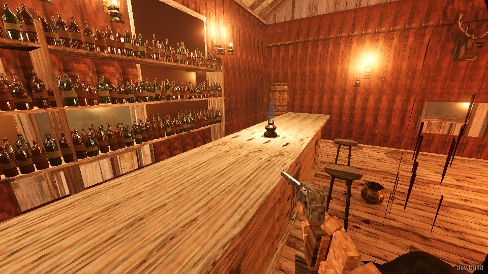

## What was flat or confusing

- **He wipes once, then becomes a statue.** In both runs he wiped for about 20 to 30 seconds in the
  first half-minute, then stood with his arms at his sides for as long as I watched (45 to 80
  seconds). In the first run I never caught him wiping at all. With nobody at the bar, I'd expect
  him to go back to it, or polish a glass, or look round the room.
- **He ignores customers.** He faced me when I stood at the bar, but he didn't speak or serve, and
  nothing happened. The gang asked for "Another." and "This the best you got?" and he didn't pour.
- **The rag is forgotten.** After my shot he dropped it on the bar. He never picked it up again or
  went back to his chore, even after everyone said "…They gone?" and things were quiet.
- **He doesn't fight fire in his own saloon.** Both times he ran into the street and stood there.
  In run 1 he said "Let it go, she's gone!" while the fire was still small. In run 3 the jail man
  came in and put it out while the barkeep watched.
- **The whole town in chorus.** After every shot, eight to ten people said the same line in the
  same tenth of a second ("…They gone?", "Lord almighty!", "Get down! Everybody down!"), including
  people a long way off who couldn't have seen anything.
- **An outlaw 40 m away talking to me.** A fourth gunman ("outlaw") far down the street kept
  saying "Keep that iron where it is.", "Smart.", "One more move…" in the subtitles while he was
  nowhere near.
- **Fleeing people heading into the fire.** In run 3, just after I lit the bar, the man from the
  livery came into the saloon doorway and the widow came onto the saloon porch, both "fleeing",
  towards the fire.

## What was fun

- **Watching him wipe.** Head down, a hand flat on the cloth, walking it along the bar. It looks
  right and it's the most alive he gets.
- **"Please, mister…"** One shot into the floor and he throws his hands up and the rag falls out of
  his hand onto the bar. It's a good, readable moment.
- **The saloon itself:** the back bar with its shelves of bottles, the mirrors, the lamps, the
  striped towel at his hip. Coming in through the door is lovely.
- **The burning saloon at dusk** from the street, with sparks going up into a purple sky and the
  front windows full of fire. It looks like a Western poster.
- **"Let it go, she's gone!"** That's a great line, just too early.

## The top three things to fix

1. **Men who've surrendered stand in a fire until they die.** Lyle and the Kid burned to death with
   their hands up while the saloon burned round them. Hands-up men should still run from fire.
2. **The barkeep doesn't keep living after the first half-minute.** He wipes once and then stands
   still. He never serves or speaks to anyone at the bar (me or the gang). After a scare he never
   picks up his dropped rag or goes back to work, and he doesn't help put out a fire in his own
   saloon.
3. **Standing quietly at the bar gets you trapped and shot.** The gang crowded in and pushed me into
   the bar so I couldn't walk at all. Then they started a gunfight with lines ("Put it down", "One
   more move…") that didn't fit an unarmed man standing still.
