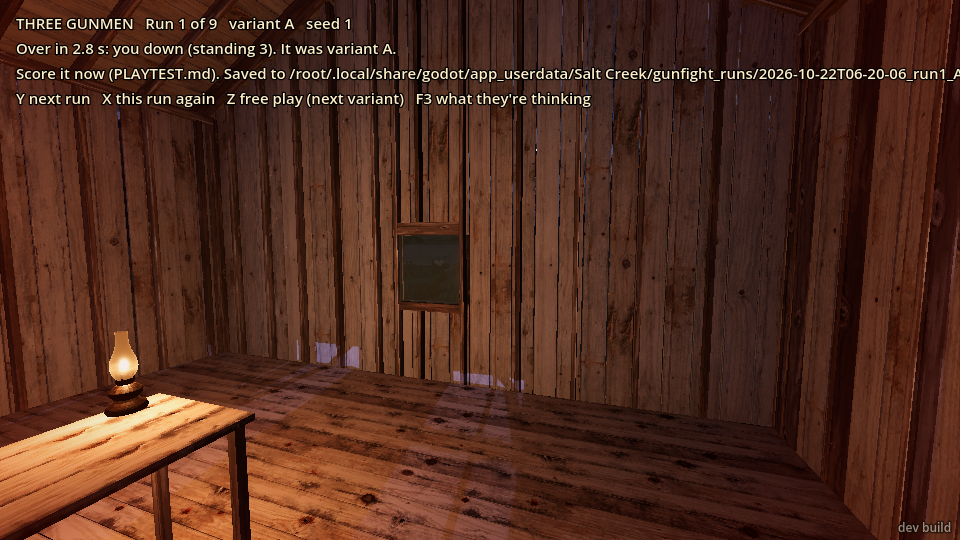
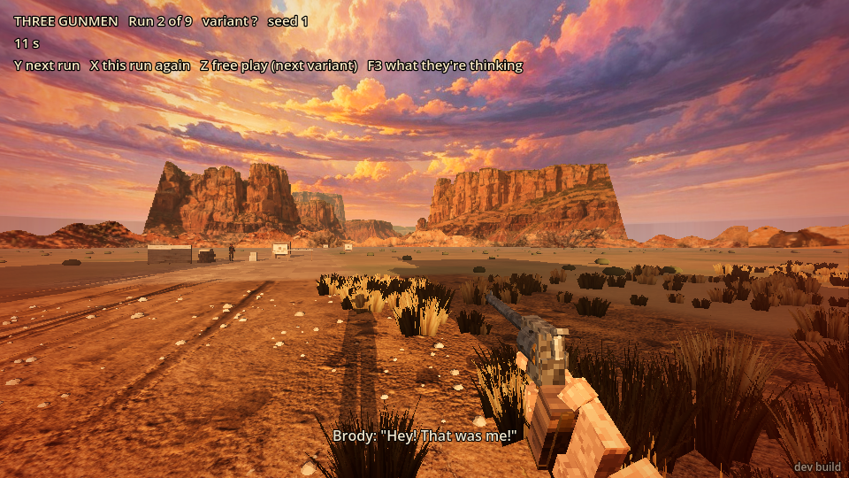
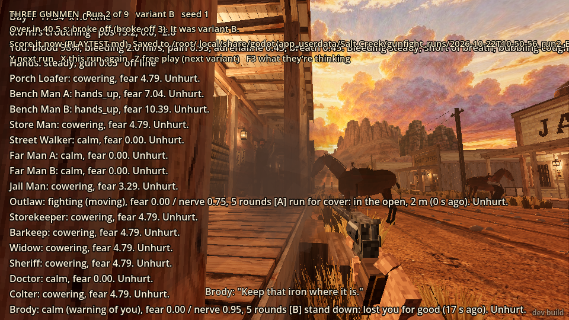
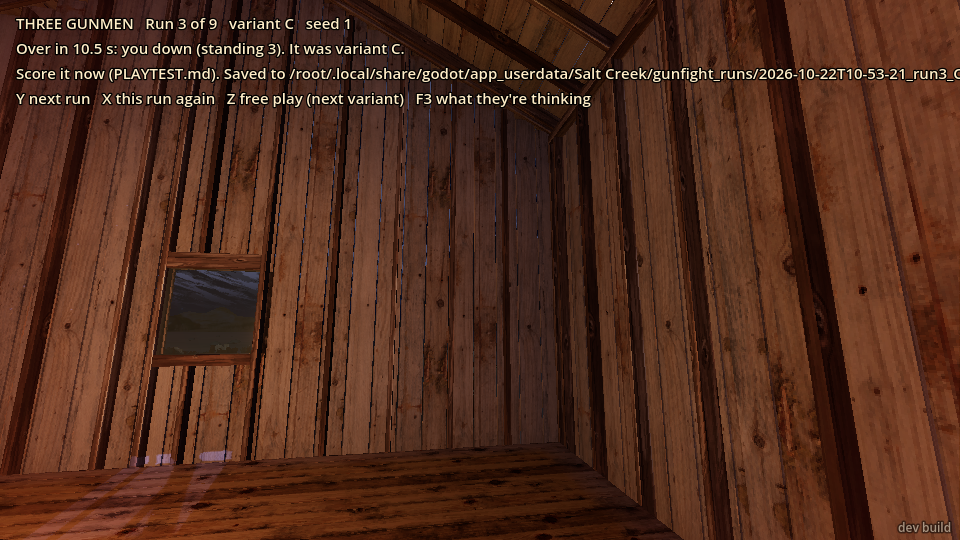
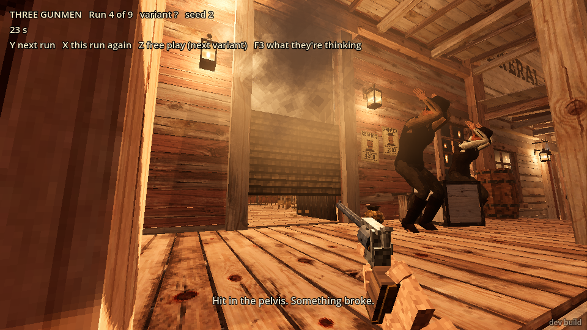

# Playtest 2026-10-22: the three gunmen (A/B/C)

**Who played:** an automated tester (Claude), driving the game through text commands on the dev
bridge. The game draws about **one frame a second** here, and every command I send uses up 0.5 to
5 seconds of game time (drawing and firing a revolver took about 5 seconds each time). A human
plays at 60 frames a second with a mouse. So my scores are **not** a human player's: read them as
"what the fight looked like from the outside", not as how it feels in the hand.

**Note on the session:** I was stopped partway through by a usage limit and the machine was
restarted. The nine-run schedule starts again at run 1 after a restart, so runs 1 and 2 were
played twice (the first tries are the screenshots named `run1_…`/`run2_…`, the second tries
`run1b_…`, `run2b_…`, `run3b_…`). After the restart I played runs 1 to 6.

## What I did

1. Started the game; it opens in the street. Pressed "next run": the scene reloaded into the
   saloon (the bridge dropped and came back, as expected).
2. **Run 1 (first try):** drew and tried to shoot Brody. All three fired within half a second of my
   draw and all three hit me (chest, arm, forearm). I blacked out without firing and came round at
   the doctor's. Variant A.
3. **Run 2 (first try):** same plan, faster. Same result: Lyle, the Kid and Brody hit me four times
   (chest twice, forearm, neck) in two seconds. Variant B.
4. *Restart.* **Run 1 again:** turned on F3 and crouched first. The keys took so long that the 3
   seconds ran out; they shot me six times before I'd drawn. Variant A.
5. **Run 2 again:** ran straight out of the door before they drew. Brody spotted me through the
   doorway and hit me once in the chest. I went round the corner of the porch, drew and crouched.
   The three stayed inside "searching" without moving, said "Lost him" and "...Gone", and calmed
   down. I walked back to the door and fired once (hit a porch post). The run ended "broke off".
   Variant B.
6. **Run 3:** out of the door again, unhurt this time. Brody waited just inside the door ("I know
   you're there"). When I stepped into line with the doorway he shot me in the neck: out cold in
   one shot. Variant C.
7. **Run 4:** out of the door, but I got stuck at the porch step and couldn't walk on. Brody shot
   at me from behind the batwing doors; my shot back hit the door. Then **the street outlaw** (the
   lone gunman who lives out in the street, not one of the three) shot me in the chest and put me
   down. Variant B.
8. **Run 5:** stayed in and called Brody out with my gun holstered. He took it ("Alright. Right
   here, then. Go on. Make your play."), but two seconds later the 3-second timer fired anyway and
   all three opened up. Down before my shot came. Variant C.
9. **Run 6:** out of the door, round the corner, gun cocked out of sight, crouched. Brody came out
   onto the porch shooting, called "Reloading! Cover me!" and the others answered "Covering!". I
   was hit (a broken bone) and from then on my revolver wouldn't stay in my hand. Brody took a
   wound from somewhere and gave up ("Brody! Pick up that gun!" from Lyle); the other two lost me
   and the run ended "broke off (surrendered 1, broke off 2)". Variant A.

I never landed a shot on any of the three in six runs.

## The three runs (and the three after)

| Run | Variant | Seed | How it ended | Fun | Tactical variety | Fair and readable | Believable men |
|---|---|---|---|---|---|---|---|
| 1 (first try) | A | 1 | Me down in 2.8 s | 1 | 1 | 2 | 2 |
| 2 (first try) | B | 1 | Me down in 4.4 s | 1 | 1 | 2 | 2 |
| 1 (after restart) | A | 1 | Me down in 6.5 s | 1 | 1 | 2 | 2 |
| 2 (after restart) | B | 1 | Broke off, 40.5 s | 2 | 2 | 2 | 2 |
| 3 | C | 1 | Me down in 10.5 s | 2 | 2 | 3 | 3 |
| 4 | B | 2 | Me down in 31.9 s (by the street outlaw) | 2 | 2 | 1 | 2 |
| 5 | C | 2 | Me down in 8.3 s | 1 | 2 | 2 | 3 |
| 6 | A | 2 | Broke off, 67.7 s (Brody surrendered) | 3 | 3 | 2 | 3 |

(Automated tester at about one frame a second through text commands; not a human's scores.)

**Run 1 (A, seed 1).** Started in the doorway, the three at the bar, card table and back. I drew;
they all fired within 0.1 to 0.5 s and every shot hit. Nobody moved or looked for cover. I couldn't
tell what they intended: they just shot. Lost because the draw is instant death.

**Run 2 (B, seed 1).** First try: they called out "I see him!", "There he is!" (a nice touch), then
Lyle fired after about a second (slower than A, as B promises) but they still put four rounds in me
inside two seconds. Second try (out of the door): Brody called "I see him!" and hit me through the
doorway. Then nothing: all three stood exactly where they were for 30 seconds, "searching" and
"going to where you were" according to F3, but not moving a step. They said "Damn it. Lost him",
"...Gone", and went calm while I stood six metres away by the door with my gun out. It ended as
"broke off". It felt like the fight just switched off.

![F3 in run 2: Brody's line shows [B]](2026-10-22/run2b_overlay.png)

**Run 3 (C, seed 1).** I got out unhurt. Brody stayed just inside the door and said "I know you're
there", which was good: it told me where he was and that he was waiting. When I stepped into the
doorway line he dropped me with one shot to the neck. That's fair, and the most "Western" moment of
the session: he held the door and I walked into it. Lyle and the Kid didn't move.

**Run 4 (B, seed 2).** Brody went to cover ("hidden") behind the batwing doors and shot at me over
them; my shots hit the door. Readable. But then the street outlaw, who isn't part of the fight,
walked up and shot me, and the run counted it as the gang's win.

**Run 5 (C, seed 2).** Calling Brody out worked for two seconds and was a lovely moment ("Go on.
Make your play."), then the fight started on its own timer before I'd drawn, so the duel never
happened. Brody backed off ("moving"), the Kid went "hidden": more movement than seed 1, but I was
down before I could see what came of it.

**Run 6 (A, seed 2).** The liveliest run. Brody came out onto the porch after me, emptied his gun,
called for cover to reload, and the others answered. After a wound (not from me) he passed his nerve
and surrendered, and Lyle shouted at him to pick his gun up. The other two lost me and broke off.
Real behaviour, but most of it happened while I couldn't hold my gun.
![run 6: F3, Brody "give up: past his nerve", variant [A] showing](2026-10-22/run6_overlay.png)

**Which variant would I keep?** I can't really separate them from here. At my speed the draw is
lost in every variant. From what I saw, B and C took cover more (behind the batwings, "hidden")
and said more, and C's Brody holding the door was the best moment. But A's run 6 had the most
going on.

## What broke

- **"Next run" often ignored the first time.** After a run ended with me knocked out, the first
  `press gunfight_next` did nothing (the game answered "ok" but didn't reload). A second press
  always worked. This happened four times out of six, with 0.1 s and 0.5 s presses. Pressed right
  after "You come round at the doctor's" was on screen.
- **The street outlaw joins the fight.** In run 4 the lone outlaw from the street came over and
  shot me down; the label still said "you down (standing 3)" as if the three had done it. All
  through the runs he talks to me from 40+ metres away ("Keep that iron where it is.", "Don't you
  do it.", "Where'd he go?", "I know you're there.").
- **F3 gives away the variant** while the label still says `variant ?`: every gang man's line has
  `[A]`/`[B]`/`[C]` in it. See the run 2 and run 6 overlay shots.
- **F3 is cut off and overlaps the label.** It lists the whole town (15 people) first, so only the
  first gang man (Brody) fits on screen; Lyle and the Kid are off the bottom. Its top lines print
  on top of the THREE GUNMEN label, so neither can be read.
- **The first seconds of a run are empty.** For about 4 s after the reload the saloon has no gang
  in it and no label (run 1's start shot, both tries). Then the men and the label "THREE GUNMEN Run
  N of 9 variant ? seed N" appear with the timer at a few seconds.
- **My gun wouldn't stay in my hand** in run 6 after I was hit (a broken bone): `weapon revolver`
  said "in hand", then a fraction of a second later it was "put away". No message on screen said
  why. If a broken arm means you can't hold the gun, the player needs to be told.
- **Stuck at the porch step** (run 4): walking from the saloon door down to the street east of it
  stopped at the same spot twice ("walked 0.0 m").
- The game clock doesn't reset when a run reloads (it kept counting from the previous run). Only
  matters for reading the logs.

## What was flat or confusing

- **The draw is unwinnable** for me in every variant. Even in B ("a moment to react") the first
  round came in about a second and they almost never missed at 4 to 8 m: I was hit 3 to 6 times
  before my first shot every time I stayed inside. A human at 60 fps will do much better, but in A
  three men hitting with their first shots at once is very harsh.
- **The 3-second timer overrides the duel call.** Brody accepted my challenge and then the timer
  started the whole fight anyway.
- **B's men froze.** In run 2 all three stood still for 30 s while "searching" and "going to where
  you were", then gave up. Nobody came to the door to look, though I was just outside it.
- **Lines that don't fit.** After shooting me down: "Easy, friend.", "Something I can do for you?",
  "Walk on, mister.", "That's better.", "Smart." (peaceful-greeting lines in a shoot-out). "Watch
  where you're shooting!" said by the man who just fired. In run 5 Lyle fired and then said "Hey!
  That was me!". The porch loafer said "Thank God you came along" to me after I'd fired into the
  saloon.
- **The whole town shouts at once.** Ten people, including the sheriff and the widow out in the
  street, all shout "Get down! Everybody down!" or "Lord almighty!" on the same instant, then all
  "...They gone?" on the same instant later. It reads as a chorus.
- A bystander on the porch put his hands up and kept saying "Take it! Take whatever you want!" as
  if I were robbing him, because I had my gun out near him.
- I couldn't tell who wounded Brody in run 6 (I never fired a round that hit anything); maybe one of
  his own men. The events didn't say.

## What was fun

- **Callouts.** "I see him!", "There he is!", "Over there!", "Reloading! Cover me!" / "Covering!",
  "Brody! Pick up that gun!", "Come on out!". They tell you what the men are doing without F3.
- **Brody holding the door** in run 3 ("I know you're there"), then dropping me the moment I showed
  myself in the doorway.
- **The duel call**: "Alright. Right here, then. Go on. Make your play." A great line; it just
  needs the fight to wait for it.
- **Brody surrendering** past his nerve in run 6, with his men reacting to it.
- The end label is clear: how long, how it ended ("you down", "broke off (surrendered 1, broke off
  2)") and the variant revealed. Being carried to the doctor's ("You come round at the doctor's,
  bandaged, 6 hours on... Brody shot you down, and he's long gone") is a nice touch.

## Top three things to fix

1. **The opening is decided before the player can act.** All three fire within a second of the
   draw and hit nearly every time at saloon range, in every variant; the timer also overrides a
   duel the player has started. Give the player some way to win or survive the first two seconds
   (a delay, misses, the duel honoured), or every run ends the same.
2. **Keep the fight to the three.** The street outlaw joins in and can win the run for them, and he
   comments on the fight from across town. And make "next run" work on the first press after
   you've been knocked out.
3. **Make F3 usable without spoiling the test.** Hide the `[A]/[B]/[C]` tag while the variant is
   hidden, put the three gunmen first (or only), and stop it printing over the label. Then fix the
   B men who "search" without moving.
