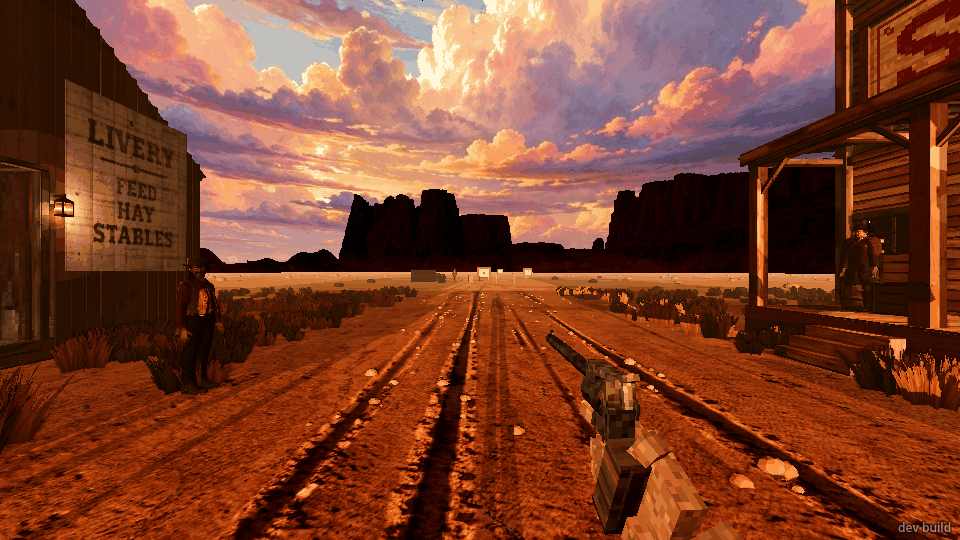
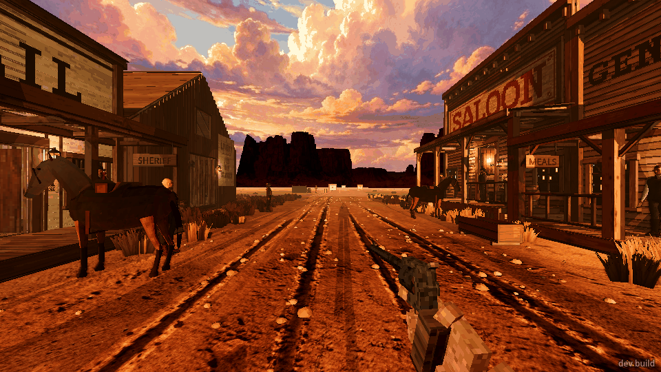
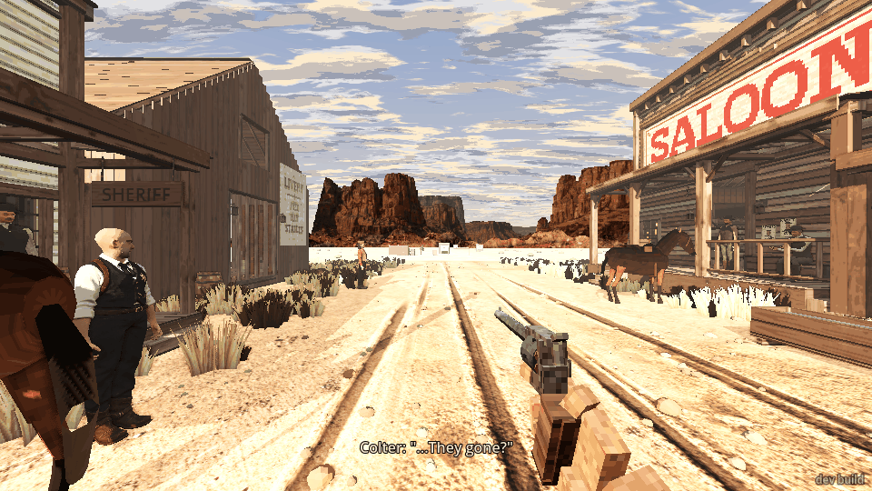
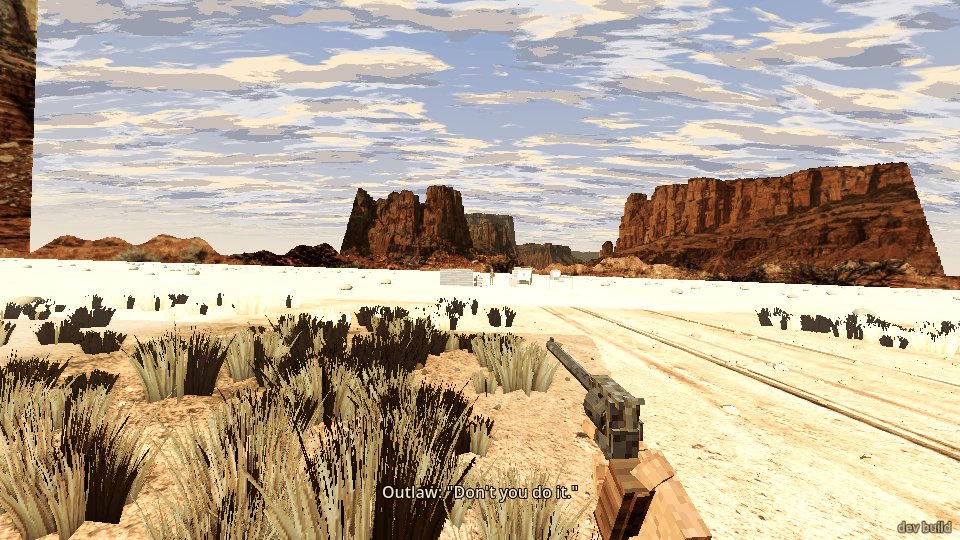
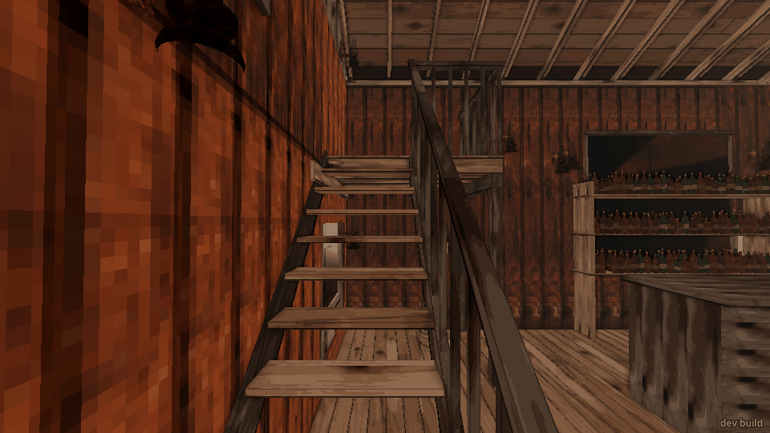
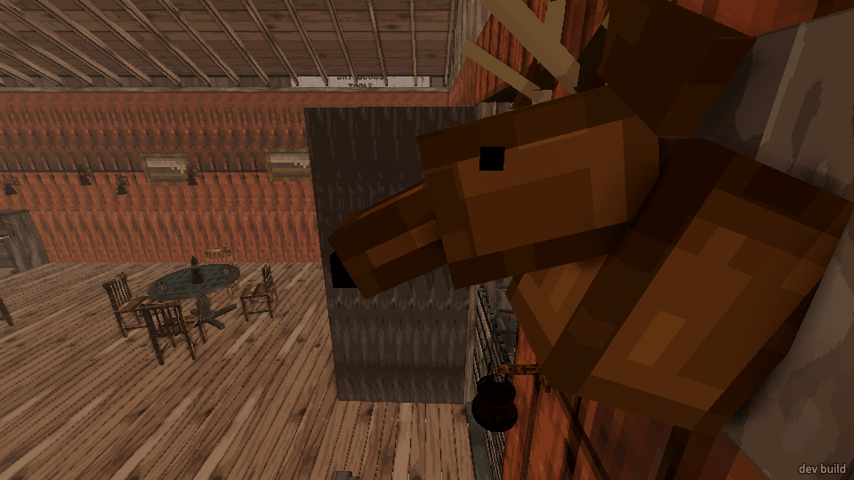
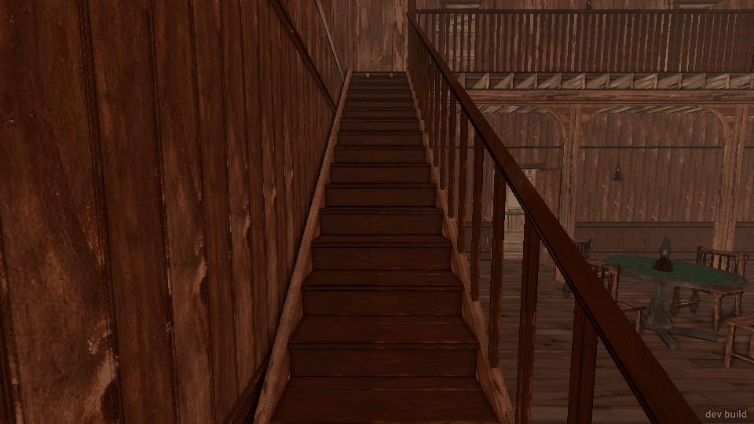
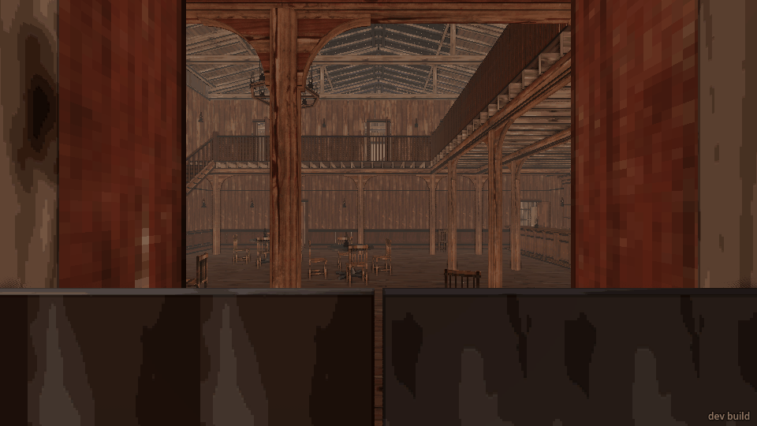
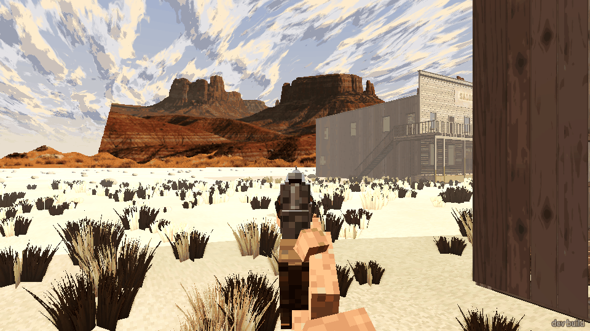
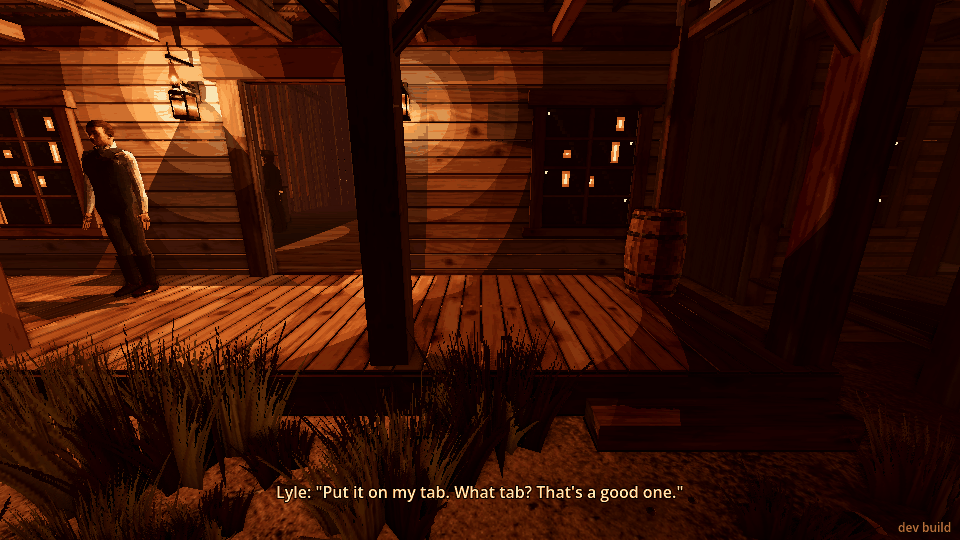

# Playtest 2026-10-23: how the player moves (light, middle, heavy)

About 35 minutes of play through the dev bridge. The game was drawn at 960x540 for the playing and
the screenshots. Then I made a short headless run at a fixed 60 fps to time starts and stops frame
by frame, because the drawn game moves about 0.7 s of game time between commands. All the numbers
below come from that run. I stopped the clock at 16:00 partway through (`time 16`, `clock off`)
so the light stayed the same from one shot to the next.

## What I did

1. Started on **middle** in the street. I walked and ran east down the street with the revolver
   out, strafed both ways, backed up (and backed into a wagon), turned while moving, jumped, and
   crouch-walked. I walked with the sights up, then ran with them up.
2. Walked up the general store's steps and into its front wall. Jumped from the street onto the
   store porch where it has no steps.
3. Pressed F once and got **heavy**: middle goes to heavy, as the order says. I did the same
   things, then pressed again for **light** and did them a third time.
4. Went into the street saloon and tried its stair along the front wall, going up and going down,
   in all three. Walked its porch, front steps, door and landing with `walk`.
5. Pressed `debug_teleport` seven times to reach the new saloon in the desert. It was built when I
   arrived. I tried the front batwing doors, walked round the hall and tried its big stair along the
   east wall in all three.
6. Back in town, I checked that `walk` still arrives in each mode (street_west to street_mid, then
   to saloon_landing).

## What broke

- **Neither saloon's stair can be climbed, in any of the three modes.**
  - *Street saloon:* holding forward at the bottom of the stair by the door, I stop dead on the
    first tread. Running doesn't help. A jump gets me two treads up, and then I'm stuck again.
  - *Coming down:* I put myself on the top landing and walked down. I stopped halfway, level with
    the deer head mounted on the wall over the stair. From there I could not move in any direction:
    forward, back, left and right all did nothing. I had to teleport out. In the screenshot my
    face is right in the deer head.
  - *Desert saloon:* the big stair is the same going up. Light, middle and heavy all stop on the
    first step, about 6 cm up. Walking and running both fail, and so does starting a little to
    either side. A jump lifts me a few treads, then I'm stuck again. Coming *down* this stair works.

  
  
  

- **The desert saloon's batwing doors don't open.** Walking or running into them stops me in the
  doorway, and `walk` to a point inside fails ("arrived": false, 0 m walked). I had to teleport in.
  

- **`walk` inside the desert saloon mostly fails.** It stops at the first post, chair or partition
  and reports "arrived": false. In town, `walk` still arrives in all three modes.

- **No footsteps show in `events`.** In about 20 minutes of walking and running there were 75
  events, and every one was speech. So I couldn't check that steps match the movement. The motion
  line's "step" counter does climb steadily while moving and stops when I stop.

## What was flat or confusing

- **All three modes have the same speeds.** Walk is 2.8 m/s and run 6.0 m/s in each. Crouch is
  1.4 m/s and the jump is 0.69 m high with 0.7 s in the air in each. What changes is how fast you
  get going and stop, and how much the view and gun sway:

  | | light | middle | heavy |
  |---|---|---|---|
  | walk: to full speed | 0.07 s | 0.21 s | 0.40 s |
  | walk: stop after letting go | 0.19 s, 0.24 m | 0.33 s, 0.46 m | 0.49 s, 0.68 m |
  | run: to full speed | 0.28 s | 0.82 s | 1.43 s |
  | run: stop after letting go | 0.35 s, 1.05 m | 0.69 s, 2.05 m | 1.02 s, 3.05 m |
  | running, then pull back: carries on | 0.82 m | 1.47 m | 2.17 m |
  | head bob, walking / running | ±1.5 / ±2 cm | ±2 / ±3 cm | ±3 / ±4.5 cm |
  | gun sway, walking / running | ±0.2° / ±0.35° | ±0.5° / ±0.8° | ±1.2° / ±1.4° |
  | side roll, strafing | ~1° | ~1.7° | ~2.2° |
  | dip on landing a jump | 2 cm | 5 cm | 10 cm |
  | turn 90° at a run: new heading reached | ~10 frames | ~20 frames | ~30 frames |

  Heavy leans forward about half a degree when running. Nothing else tilts.
- **Sights up costs nothing.** Walking with the sights up is the same 2.8 m/s. I can hold sprint
  with the sights up and run at 6 m/s, and the gun stays steady on the aim (screenshot).
  
- **No penalty for direction.** Backing up and strafing go at full speed. That includes running:
  6.0 m/s sideways and 6.0 m/s backwards.
- **Jumping is high and the same in every mode.** I can jump 0.69 m, even crouched, and stay
  crouched. That's enough to hop onto a porch from the street without its steps. From the side,
  the porch's 38 cm edge is a wall unless you jump.
  
- **Running stands you up out of a crouch.** It makes sense, but nothing says so.
- **`walk` says "arrived" while you're still at full walking speed.** It then coasts on 0.4–0.9 m
  past the spot. Once that carried me into the saloon's front wall, and once 1.2 m past
  saloon_floor.
- **`press KEY N` holds for longer than N seconds of game time.** For example, `press move_forward 1.5`
  moved me 9 m in the drawn game. That's a bridge quirk, not movement, but it makes timing by hand
  hard.

## What was fun

- On the street, all three feel solid. Starting, stopping, steps up to the porches, sliding along a
  wall or the side of a wagon: none of it snagged, slid or tilted wrong. After every stop the view
  and gun come back to dead level (roll 0, tilt 0, gun 0,0).
- Heavy's landing dip and its slow wind-up into a run feel like a man in boots and a coat. Running
  past the saloon with the gun bouncing at ±1.4° looked right for 1882.
- The gun sits where it should in every mode: low right at rest, centred with the sights up.

## Which felt best

**Middle**, from what I could tell. Light stops on a dime: a quarter of a metre walking, a metre
running. It reads as a modern shooter, and its bob and sway are so small that moving feels like
gliding. Heavy has the best weight: the landing dip, the lean and the bob. But a 1.4 s run-up and
a 3 m skid when you let go would hurt in a gunfight in a narrow saloon. You'd overshoot cover and
the doorway. Middle has visible weight (bob, a 2 m run stop) and still stops a walk in under half a
metre. I'd try middle's starts and stops with heavy's landing dip and lean. I'd also make running
backwards and sideways slower, and slow down with the sights up. Those would make the modes differ
more than the acceleration does.

## The top three things to fix

1. **Stairs can't be climbed in either saloon, in any mode.** The deer head over the street
   saloon's stair also traps you halfway down with no way out.
2. **The desert saloon's batwing doors don't open.** You can't walk in, and `walk` inside the
   hall fails at every chair and post.
3. **The three modes only change starts, stops and sway.** Speed, jump and crouch are the same in
   all three. There's no slowdown for sights up, backing up or strafing, and you can sprint
   backwards or sideways with the sights up.
