# Playtest 2026-10-28: the shove and the kick (second look)

A blind playtest through the dev bridge, about 10 minutes of game time. I didn't read the code.
The subject: the player's shove (a tap of E) and kick (E held). Screenshots are in
`2026-10-28-kick-shove-2/`.

## The short answers

- **Is the shove clearly different from the kick?** Yes. Every time. A shove moves a man about a
  quarter of a metre and he stays on his feet; a kick puts him on the floor (doubled over, on his
  knees, or flat on his back) and he's up again in 4 to 7 seconds. You'd never mix them up.
- **Too strong, too weak, or about right?** The kick is about right for knocking a man down. The
  shove is too weak to matter: a quarter of a metre, often not enough to see in a screenshot, and
  it changes nothing in a fight. Both are always exactly the same strength (the same numbers on
  every man, every time), whether he's a blacksmith, a woman, or a gunman with his feet set.
- **Are people's reactions believable?** The bodies mostly are. The people mostly aren't. A
  townsman says one line ("Easy! Easy..." for a shove, "Hey—! There's no call for that." for a
  kick), gets up and goes back to exactly what he was doing, usually with his back to you. Kick
  the same man three times and he says the same line three times and never walks off, squares up
  or calls the sheriff (who was 9 m away). Nobody nearby ever reacts. In the gunfight and the card
  cheat, the gunmen ignore being laid hands on entirely.

## What I did

1. **The street, the blacksmith.** I walked up behind him and shoved. He shuffled 0.24 m and
   didn't say a word, didn't turn round, his mood stayed "calm". Then a kick: he went down in the
   weeds and was up again, back to me, a few seconds later. Still not a word.
   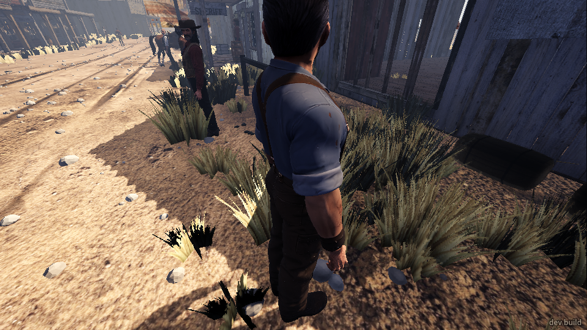
   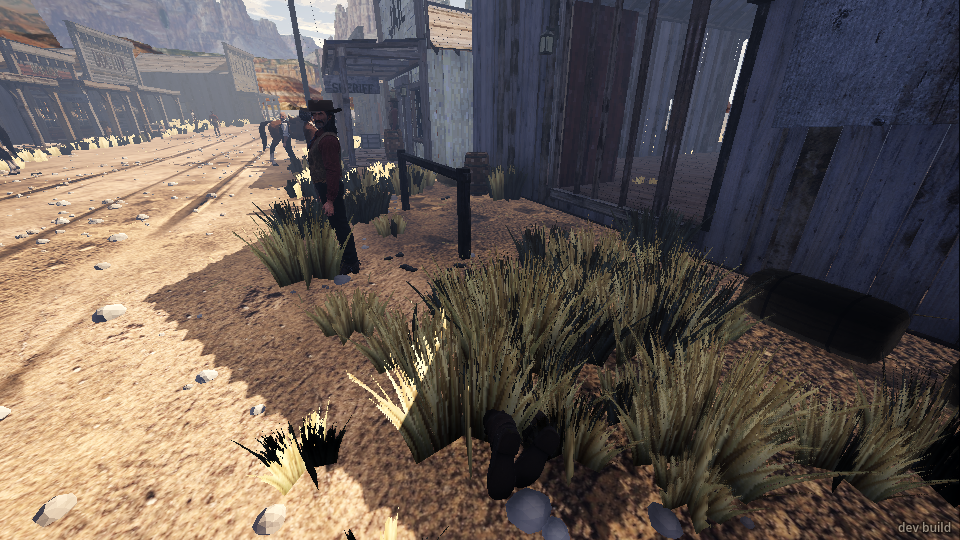
   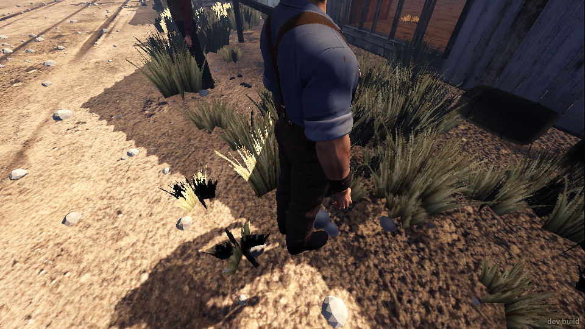
2. **The street, Colter (from his side).** A shove: he threw an arm out for balance and said
   "Easy! Easy...". That was the best moment of the shove. Then a kick: he staggered off doubled
   over, went to his knees, lost his hat, said "Hey—! There's no call for that.", and was up in
   about 5 seconds. His mood went to "shaken". I kicked him twice more: the same fall, the same
   line, each time. The rancher 3 m away and the blacksmith 4 m away stayed calm throughout.
   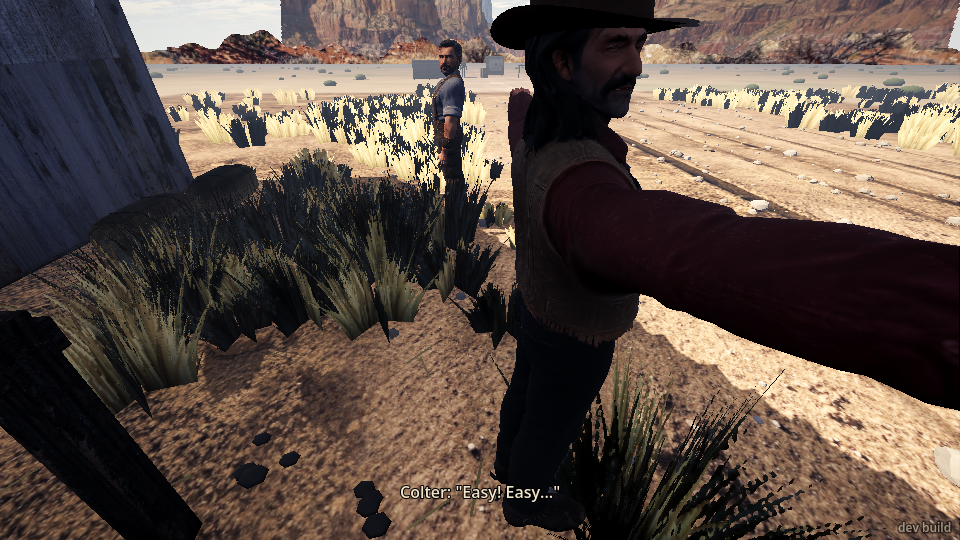
   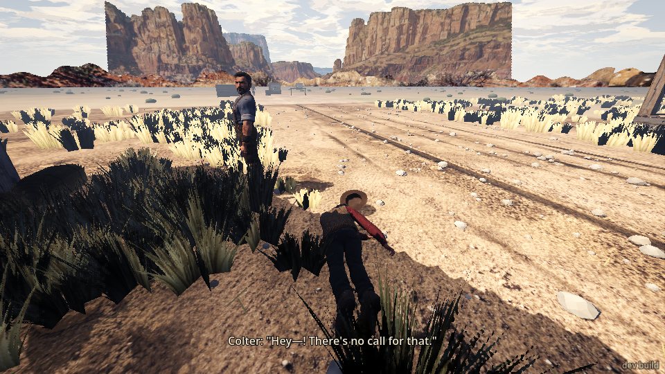
   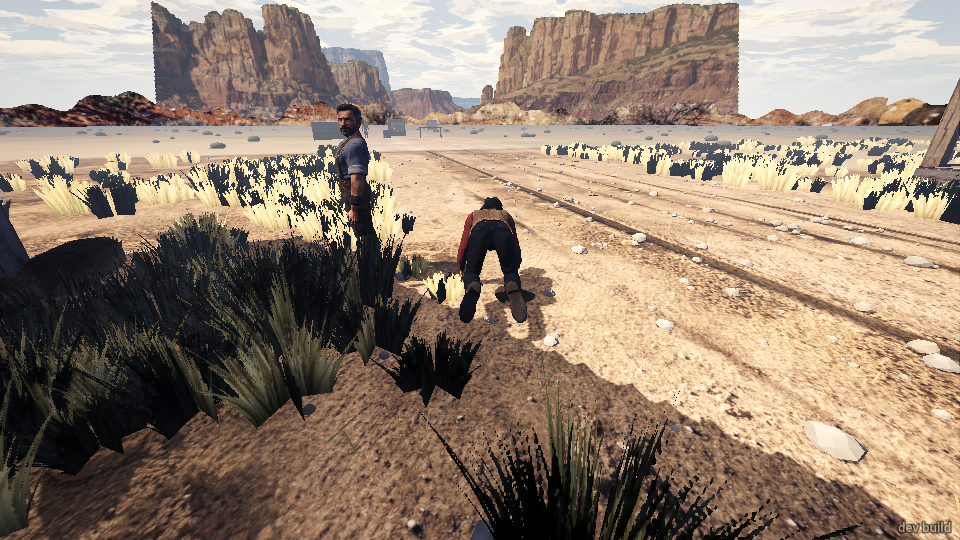
3. **The town saloon.** No man stood with a chair or table right behind him, so:
   - The working girl by the west wall, a chair a metre and a half to her side: the shove moved
     her 0.2 m; she turned to face me and said "Hey—! There's no call for that." She never reached
     the chair. (The game's own message said "he staggered back" about her.)
     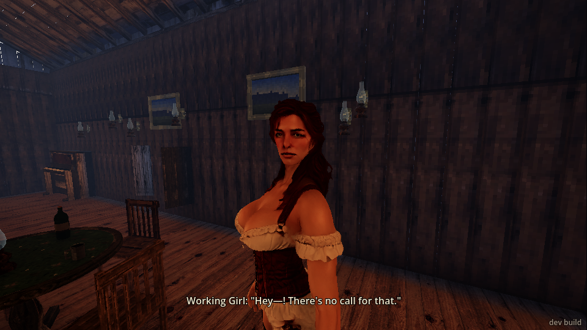
   - The barkeep behind the bar, with the back bar's shelves of bottles beside him: two shoves
     ("Easy! Easy..." both times), then a kick that laid him flat on the floor by the shelves. No
     bottle moved. He was up in 4 seconds. Brody and Lyle were sitting at the bar 1.7 m away the
     whole time and said nothing about it.
     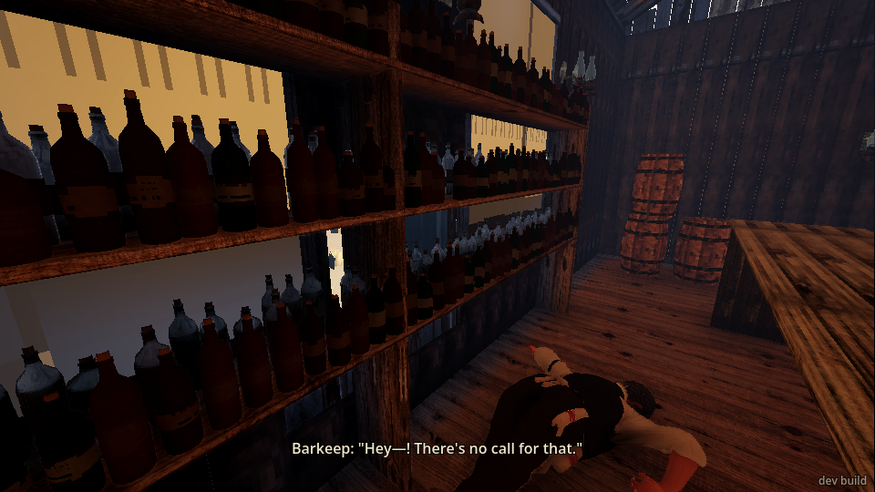
     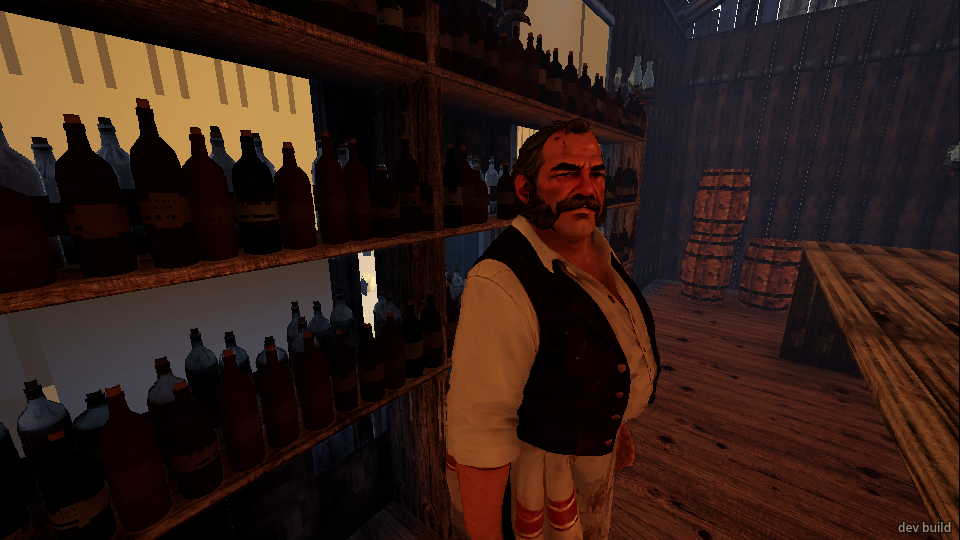
   - On the porch, a man standing with his back to the saloon wall: the shove put him against the
     wall (fine, believable). A kick along the porch doubled him over onto the seated man beside
     him, who didn't react at all. A second shove sent him backwards over a crate and he went
     down: the one time a shove knocked someone over, and it looked right.
     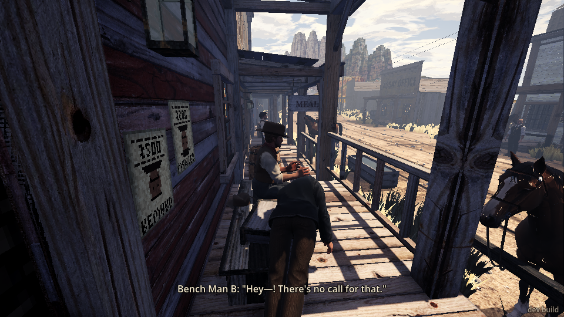
     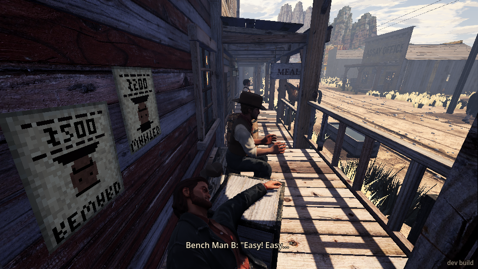
4. **The saloon gunfight** (`press gunfight_next`, four setups).
   - Setups 1 and 2: I ran at a gunman from 7–9 m. I was shot (head, then arm) before I got there
     and blacked out both times. Closing to arm's length across an open room isn't a plan.
   - Setup 3 (the galleries): Brody was 7 m off on the floor; I reached him and kicked him. He went
     flat on his back, said "My leg... damn you..." (I'd kicked him in the belly), and Lyle shouted
     "Brody's down!" and "You son of a bitch! Come on!". Good. But Brody kept his gun, was up in
     about 6 seconds and shot me from 2 m through his own gun smoke.
     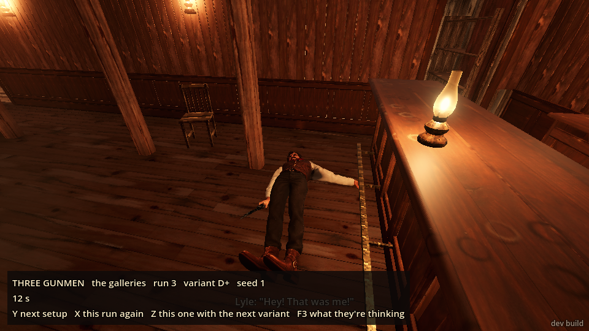
     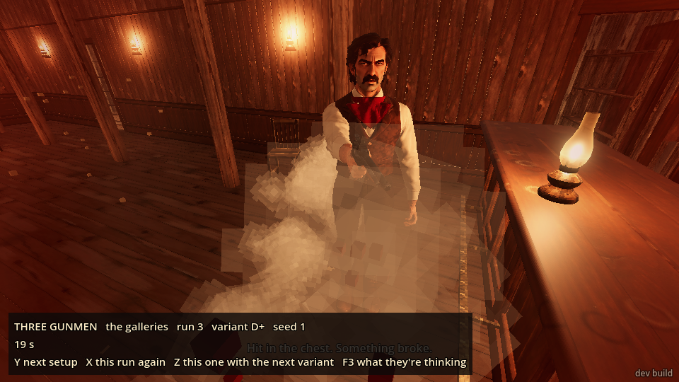
   - Setup 4: Brody 2.7 m away before the fight started. I walked up and shoved him. He staggered,
     said nothing about it and turned "wary"; Lyle shot me in the chest the same instant and I
     blacked out. Brody's only line was at Lyle: "Watch where you're shooting!"
     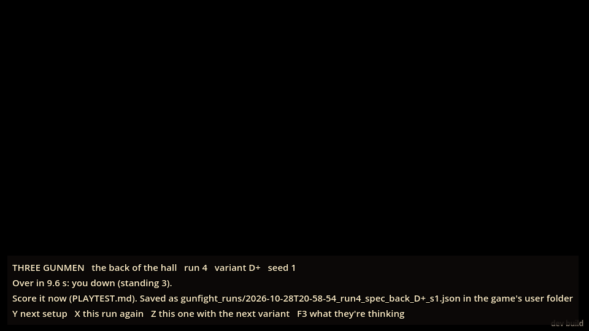
   - Verdict: the kick buys you about 5 seconds against one man, if you can get to him. The shove
     buys nothing. Neither makes a man drop his gun.
5. **The card cheat** (`moment card_cheat`). The first time, it played out before I got there:
   Earl's table went over (33 pieces of timber broke) and Earl was on the floor. The second time I
   ran in while Cody was at Earl's table and shoved him: he staggered and carried straight on with
   his lines ("Say it. Say you dealt from the bottom."). Then a kick: he went down, got up, and
   stood there. The moment said "timed_out" both times. Cody never looked at me or said a word to
   me; Earl and the working girl a metre away didn't react to the scuffle.
   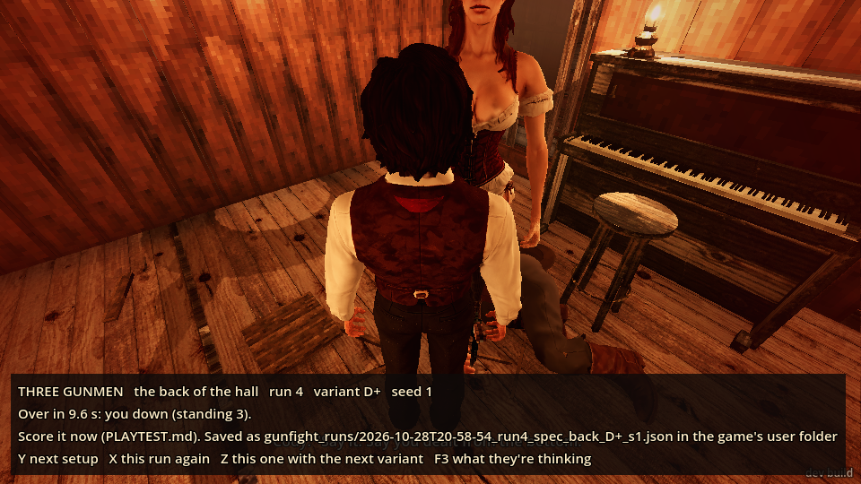
   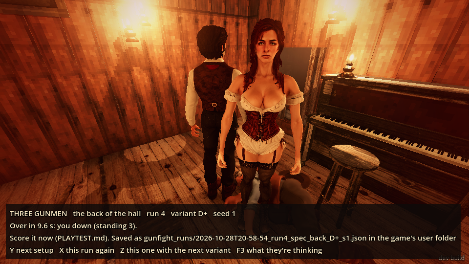

## What broke

- **Gunmen don't react to being touched.** Brody shoved in the gunfight and Cody shoved and kicked
  in the card cheat said nothing to me and didn't change what they were doing. Cody's moment just
  ran on and timed out.
- **"No arm to shove with."** After being shot in the gunfight and coming round, `shove` answered
  "you can't: no arm to shove with". I'd been hit in the left upper arm and the chest; my right arm
  should still shove. If one arm is out, the message should say so, or the shove should use the
  other arm.
- **"he staggered back" about the working girl.** The message gets her wrong.
- **The gunfight's text stays on screen in the town.** After the gunfight setups, the panel
  ("THREE GUNMEN the back of the hall run 4 ... Over in 9.6 s: you down ...") stayed at the bottom
  of the screen all through the card cheat in the town saloon.
  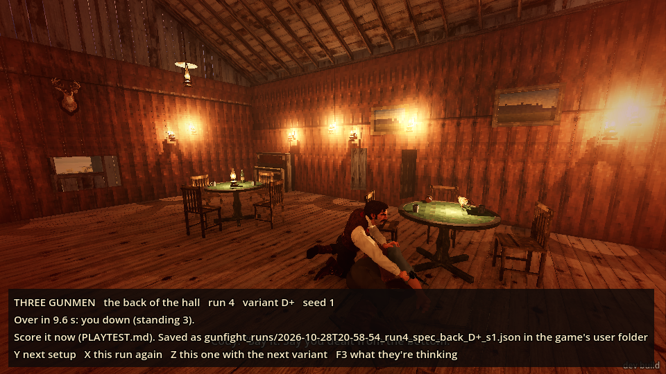
- **Every shove reads as a "hit in the chest"** (and every kick "hit in the abdomen") in the event
  list, even when I shoved the blacksmith from behind. It reads like a gunshot.
- **Brody says "My leg..." after a kick to the belly.**
- **Two misses when the man was in reach.** On the porch, `look bench_man_b` then `kick` missed
  ("nothing within reach") with him 0.8 m away: the look had pointed me the wrong way (facing 245
  when he was nearly due south). A second `look` fixed it. Once, my player had drifted a metre
  sideways between commands, I don't know why.
- **Townsfolk 40 m away react to the desert saloon's gunfight.** During the gunfight setups the
  storekeeper and the working girl, back in town, said "Lord almighty!".

## What was flat or confusing

- **No escalation.** Three kicks to the same man got the same fall and the same line three times.
  He never left, never fought back, never told anyone. The sheriff 9 m away never came over.
- **No witnesses.** Nobody standing or sitting nearby ever said or did anything about a man being
  kicked to the ground beside them, in the street or the saloon. Brody and Lyle watched me kick
  the barkeep from 1.7 m without a word: men like that would have something to say.
- **Back to his business, back to me.** After a kick every townsman got up facing the way he'd
  been facing before, usually away from me. He should at least turn and look at me.
- **The shove is too small to read.** A quarter of a metre, same on everyone. In the screenshots
  before and after a shove you mostly can't see that anything happened, except when he's talked.
- **Always the same strength.** The kick and the shove are the same numbers on the blacksmith, the
  barkeep, the working girl, and a gunman braced for a fight.
- **Nothing in the room moved.** The barkeep went down beside a wall of bottles and nothing
  rattled; the working girl was shoved towards a chair and stopped short of it.

## What was fun

- Colter flinging an arm out and saying "Easy! Easy..." when shoved, and staggering away doubled
  over, losing his hat and going to his knees when kicked. That looked like a real man.
- The bench man going backwards over a crate from a shove: the shove finally mattered, because of
  what was behind him.
- Kicking Brody flat in the gunfight and Lyle yelling "Brody's down!" then "You son of a bitch!
  Come on!". That was a Western moment.
- The kick's falls themselves: never the same twice (knees, flat on the back, doubled over a
  neighbour).

## The top three things to fix

1. **People should react to being shoved and kicked, and so should the people around them.** The
   man who's kicked should turn on you, back off, or leave, and get angrier each time rather than
   repeating one line; bystanders, the sheriff and the gang should notice. A gunman or Cody in
   the card cheat should break off and deal with you. Right now only the body reacts.
2. **The shove should do something.** Stronger, or a bigger stagger, so it moves a man into a
   chair, a table or the bar (it already works when there's a crate right behind him). In a
   gunfight it should at least spoil his aim or make him drop his guard for a moment.
3. **The kick in a fight: make the time on the ground count.** A kicked gunman is up and shooting
   in about 6 seconds with his gun still in his hand. A chance to lose the gun, or a longer daze,
   would give the kick a purpose; so would a way to get close without being shot first (I was
   dropped twice crossing 7–9 m).

Also small: the "no arm to shove with" message after one arm is hit, "he" for the working girl,
the gunfight panel staying on screen in town, and shoves listed as chest hits.
