# Playtest 2026-10-28: the shove and the kick

A blind playtest of one new thing: the player's shove (a tap of the key) and kick (hold, then
let go). About 15 minutes of game time over roughly an hour, played through the dev bridge at
960x540, about one frame a second. I haven't read the code. Screenshots are in
`2026-10-28-kick-shove/`.

## What I did

1. **The street, by the livery.** I walked up to the blacksmith (0.6 m) and shoved him. He went
   flat on his back in the grass. The only events were "blacksmith went down" and "blacksmith hit
   in the abdomen". He said nothing, and nobody near him reacted. He got up within about 5
   seconds, still "calm". I kicked him: he went down again and said "Easy! Easy...", and was
   "shaken" for a few seconds, then calm again. I shoved Colter, the man next to him: he went down
   and said "Easy! Easy...". The rancher, 4 m away, stayed calm the whole time.
   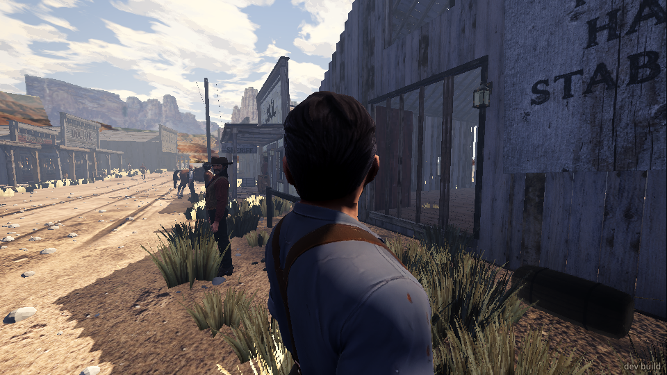
   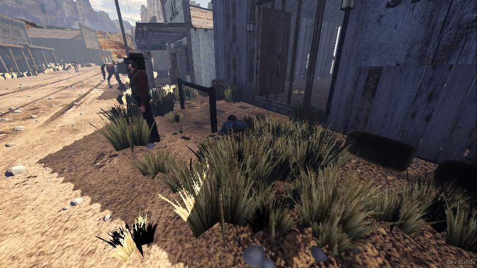
2. **A miss.** I shoved Colter from 2.7 m. Nothing happened: no event, nothing on screen that I
   could see, no sound I could check. In the screenshots I never saw my own hands or a foot.
   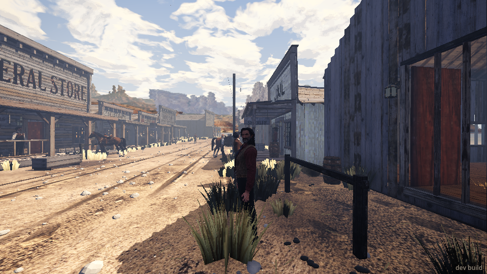
3. **The general store.** I shoved the widow. She went flat on her back, arms out like a cross
   ("Easy! Easy..."). I kicked her: the same again. The storekeeper and the store man, 4 to 7 m
   away, stayed calm.
   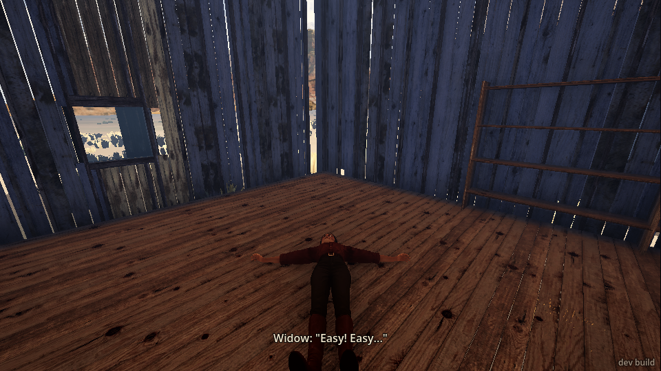
4. **A gang man in the store.** Lyle came in for a drink. I kicked him from 1.1 m. He went down
   face first. At once Brody shouted "They got Lyle!" and "That's how it is? Fine!", the Kid
   covered Brody as he dragged Lyle off, and within 10 seconds the Kid and Lyle had shot me twice
   in the chest. I blacked out. One kick started a full gunfight. The townsfolk all cowered.
   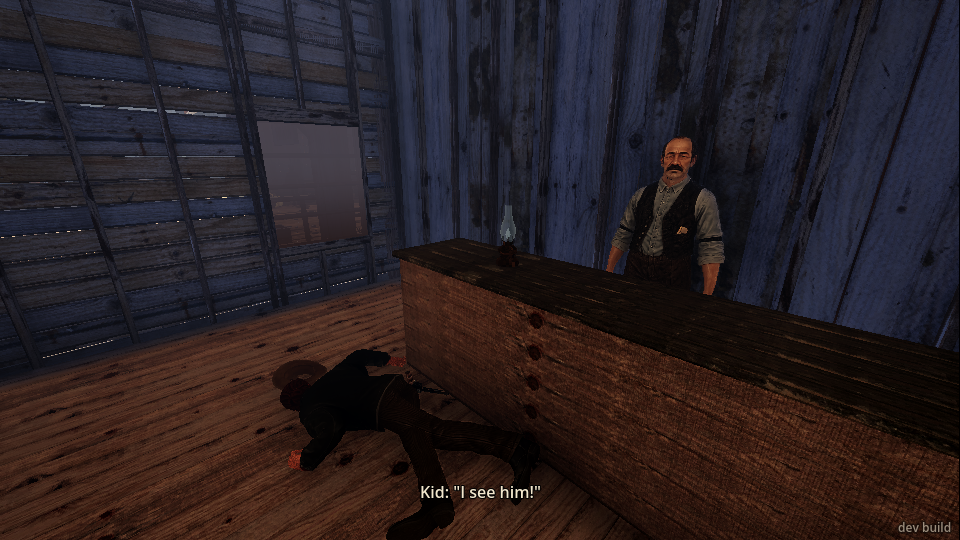
5. **The saloon.** I kicked the working girl by the piano: flat on her back, arms out, "Hey! There's
   no call for that." I went behind the bar and shoved the barkeep. From 1.5 m nothing happened.
   From 0.6 m he went down in a heap against the back bar ("Easy! Easy..."). The men on the bench
   didn't react. I couldn't find the stair on foot (see "What broke"), so I never got anyone on the
   stair or the gallery.
   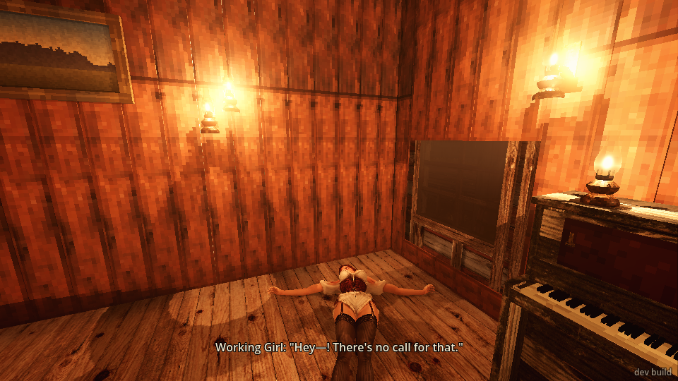
   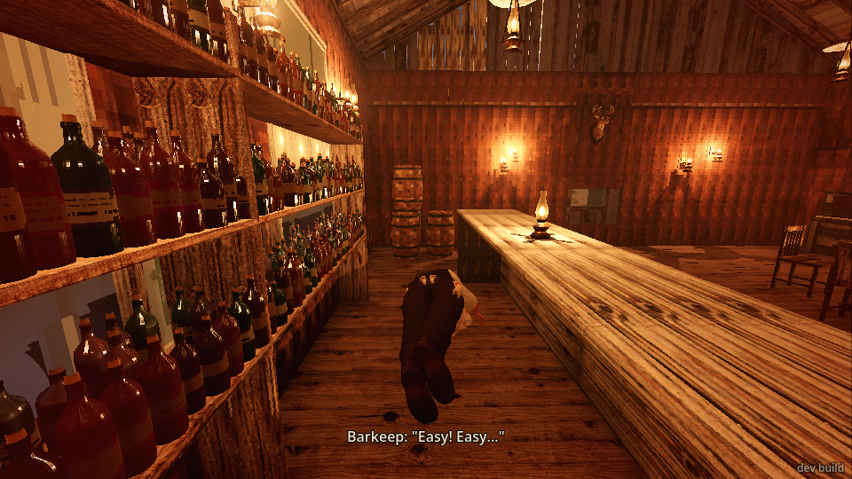
6. **The saloon gunfight (`gunfight_next`, five runs).** In four runs I tried to run up to a gunman
   and kick him. Each time they shot me down before I got there, or I got there and the kick did
   nothing: two kicks at 1.1 m on Brody missed. In one of those I faced a plank wall and the kick
   broke a board in the saloon front. Then I tried "the back of the hall", where Brody stands next
   to you at the start. I shoved him before the fight began. He went down on all fours ("My leg...
   damn you..."), and that started the fight. Lyle's next shot hit Brody in the chest ("Hey! That
   was me!"). I kicked Brody while he was down. He was up and shooting at me within 2 seconds, and
   the three of them put me out in about 13 seconds. The shove and the kick didn't help me once.
   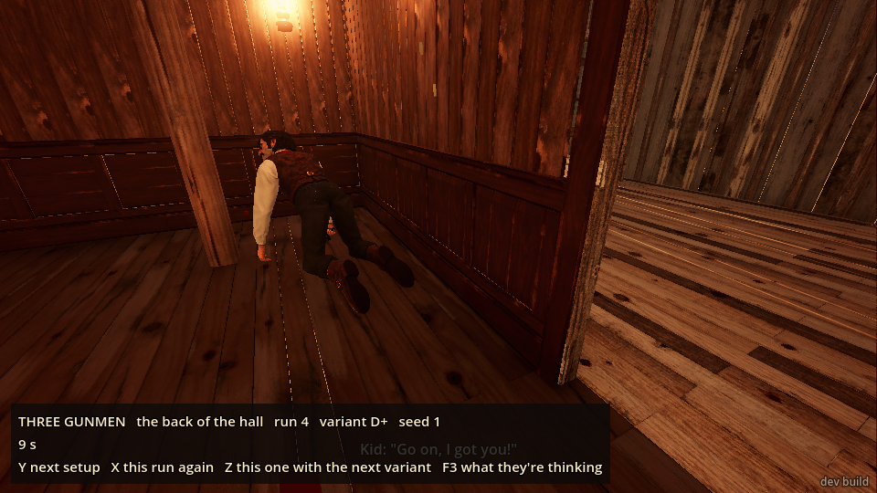
   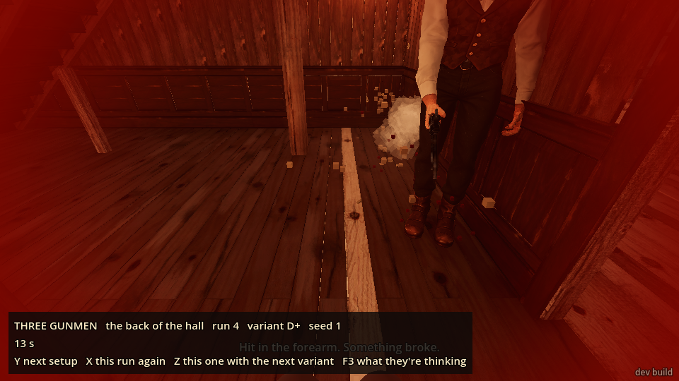
7. **The card cheat (`moment card_cheat`, three runs).**
   - Run 1: I stood and watched. Cody kicked Earl's chair, the chair broke ("spindle3"), and Earl
     went over on his back. I shoved Cody afterwards: he went down, and "13 pieces of timber
     broke" (I think a chair). He got up.
   - Run 2: I shoved Cody as he came in. It missed, and he kicked Earl over anyway.
   - Run 3: I stood beside Earl's chair and kicked him out of it before Cody arrived. It worked:
     "the chair went loose", "Earl fell", 13 timbers broke. But the table lamp went over and the
     **whole saloon caught fire**. The town ran, shouting "Fire! Get out, get out!", and I was
     "badly burnt". Cody stood over Earl saying "Tell me I'm wrong, Earl!" while the saloon burned.
     `moment_result` said Earl drew (`victim_drew: true`).
   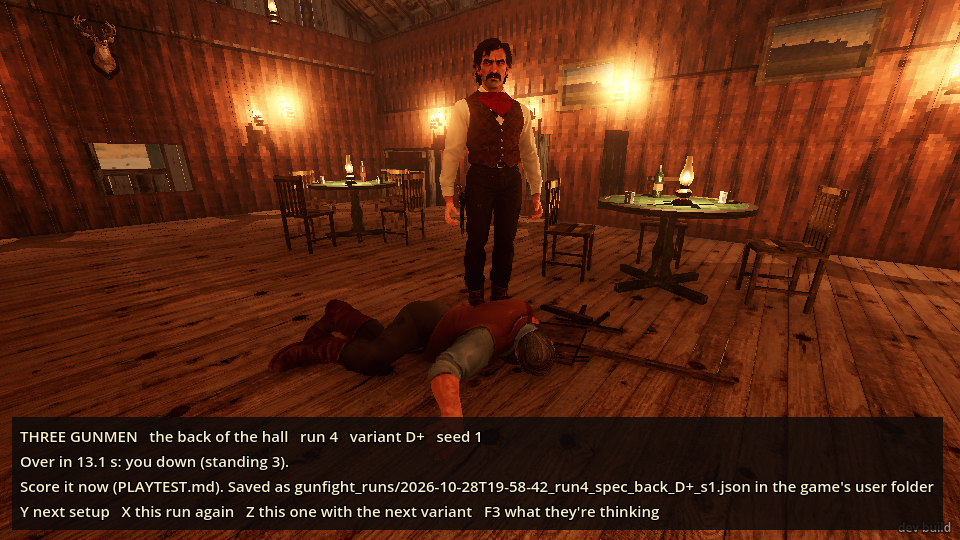
   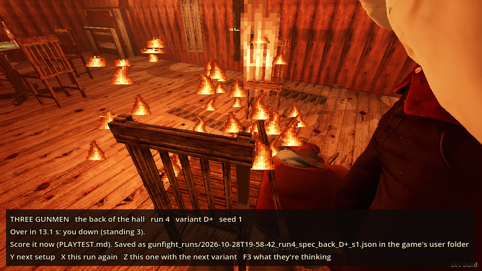
8. **A post, a wall and the stair.**
   - I kicked the jail's porch post (0.4 m). My wound count went up by one, but "how" didn't
     mention the foot.
   - I kicked the store's front siding. One board broke ("store/front/siding/r09_1"), and no wound
     this time.
   - I stood on the saloon stair (put there with `goto`), facing down, and kicked five times. I
     never lost my footing. The first kick broke 4 pieces of timber, but I couldn't see which.
   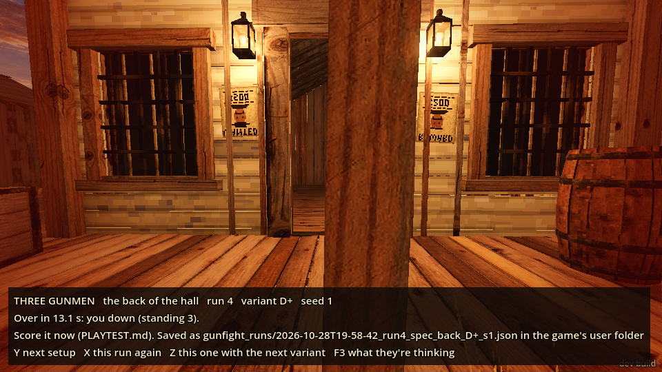
   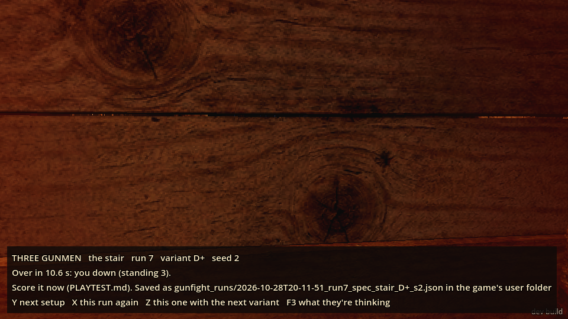

## What broke

- **Every gunfight reload dropped the bridge connection** ("lost the game: the game closed the
  connection"). It came back after a few seconds each time. That's fine for a player, but it looks
  like a crash from the command line.
- **After the gunfight the gunfight's panel stayed on screen everywhere**, back in town and in the
  card cheat ("THREE GUNMEN ... Over in 13.1 s: you down ... Y next setup"). It sits over the
  subtitles.
- **The card cheat started me in the wrong place.** The first time I ran `moment card_cheat`, I was
  left at the far west end of town, and the moment played in the saloon without me. I had to
  `goto saloon_floor`.
- **Kicking a man out of his chair set the saloon on fire** (run 3 above). The lamp on the card table
  went over and the oil spread across the floor. That may be meant (spilt oil), but from one kick
  the whole building went, which is a lot.
- **Brody shot Brody.** In the back-hall fight, Lyle's shots hit Brody twice, once while Brody was
  down from my shove. "Hey! That was me!" is funny once, but it happened in nearly every fight.
- **The stair can't be walked onto from the saloon floor** with `walk`: every point I tried near
  the stair's foot stopped me at the bottom (around x 12.3–13.1, z 1.3). I only got on it with
  `goto`. So I couldn't test putting anyone down the stair or over the gallery rail.
- **The revolver put itself away.** In town, after I was wounded (a broken bone), `weapon revolver`
  said "in hand", and a second later `read player` said "put away". So I never tried the
  one-handed shove with the gun out in town. In the gunfight (unhurt) the gun stayed out.
- **`goto` onto the gunfight's stair dropped me through it to the floor below** and hurt me. That
  was my misuse of a test command, but worth knowing.

## What was flat or confusing

- **I couldn't tell when a shove or kick had missed.** A miss gives no event, no line and no sound
  that I could check. A hit gives "X went down / X hit in the abdomen" and nothing else. On screen
  I never saw my own arms or leg move, in any shot. From the command line, only the
  people's positions told me whether it landed.
- **The reach is very short and unforgiving.** `walk NAME` stops 1.1–1.5 m away, and nearly every
  shove or kick from there missed. I had to walk to a point 0.6 m from the person. Against a
  gunman who's moving, I never once got close enough.
- **The shove and the kick do the same thing.** Both put the person flat on their back, arms out,
  every time, whoever they are. I couldn't feel a difference between the tap and the hold.
- **Townsfolk barely care.** They take it with "Easy! Easy...", "shaken" for a few seconds, then
  "calm" again, with nothing said or felt toward me. Nobody standing near ever said a word.
  The sheriff, 10 m off, did nothing. Knocking a widow flat twice should matter to someone.
- **Gang men care far too much.** One kick on Lyle in a store was answered as if I'd shot him: all
  three drew and shot me within seconds. I'd expect a punch-up, a warning or a draw-down first.
- **"Hit in the abdomen"** for every shove and kick, even on the wall's side. It reads like a
  bullet wound in the log.
- **No footing lost on the stair** in five kicks. If that's a chance, it never came up.
- **A wall kick hurt my foot once (the post) and not the second time (the siding)**, which broke a
  board instead. "How" never said anything about a foot.

## What was fun

- Kicking Earl out of his chair at the card table: the chair breaking and him going over backwards
  looked right, and Cody carrying on with his accusation over the top of it was very funny.
- The gang's chatter after Lyle went down ("They got Lyle!", "Easy, I got you. Come on!", "Go! I
  got him!") felt alive. They work as a team.
- Brody on all fours after the shove, saying "My leg... damn you...", was a good moment.
- A kick that breaks a siding board is satisfying.

## Answers

- **Strong enough?** Too strong on people and too weak as a tool. Any tap lays anyone out flat, a
  woman or a blacksmith, which looks like a knockout rather than a shove. But they're up in 2 to 5
  seconds unhurt, and in a fight it doesn't stop a man shooting you.
- **Clear when it landed or missed?** No. A landed one shows only as the person on the floor. A
  miss shows nothing at all.
- **Did people's reactions make sense?** Half. Townsfolk shrug it off too easily, the gang
  goes straight to killing you, and there's nothing in between.
- **Did it help in the gunfight?** No. I couldn't get close without being shot, and the one man I
  did put down (Brody) was up and shooting a second later. He could still shoot me from the floor.
- **Anything broken or wrong?** The gunfight panel stuck on screen, the card cheat starting me at
  the west end, the stair I couldn't walk onto, and one kick burning the saloon down.

## The top three things to fix

1. **Make a landed shove or kick, and a miss, easy to see.** Show the arms or the boot on screen,
   give a thump or a whiff sound, and log a miss. Give a bit more reach, or a short lunge, so that
   standing where `walk NAME` stops you (about 1.1 m) is close enough.
2. **Give each one its own effect.** A shove should mostly stagger him back a step or two (and
   over a rail or down a stair when there is one); a kick should knock him down, or not, depending
   on how big he is. Right now both lay everyone flat on their back, arms out. In a fight, a man
   who's down should be out of it for longer than a second, or the kick is useless.
3. **Give the reactions a middle ground.** Townsfolk should remember it (a word, a grudge,
   witnesses talking, the sheriff coming over). Gang men should answer a shove with a shove, a
   warning or a draw-down, not open fire on the first kick in a store.
