# Playtest: the farmhouse (2026-11-01)

A fresh playtester, no code read, playing the hostage rescue through the dev bridge. About 90
minutes. Five runs at the house: three the front way, one in at the back door, one by dynamite.
**The rancher never came out alive.** Front: I went down every time before I could fire a shot.
Back door: Brody shot the rancher. Dynamite: the blast made all five outlaws give up, but the
loft floor fell on the rancher. He was out cold under the boards, and holding E kicked him
instead of cutting him loose.

The game was drawn at about one frame a second, and each bridge command takes 0.5 to 3 seconds
of game time. So my reactions were far slower than a player's on a keyboard. That matters most
for the front way.

The game was killed twice by the machine running out of memory. Other sessions' Godot runs were
going on the same box (a film render and two headless labs), and the kernel's out-of-memory
killer took this game both times. Both times it happened on the first `shoot` near the house.
I restarted at 640x360 after that, so some screenshots are smaller.

## What I did

1. **The briefing.** The game starts by the livery. The blacksmith calls "You there! A word,
   mister." I walked up and he gave two lines: they've got the rancher out east, it's Brody's
   bunch, and the sheriff's in no shape to go. He stood with his back to me the whole time.
   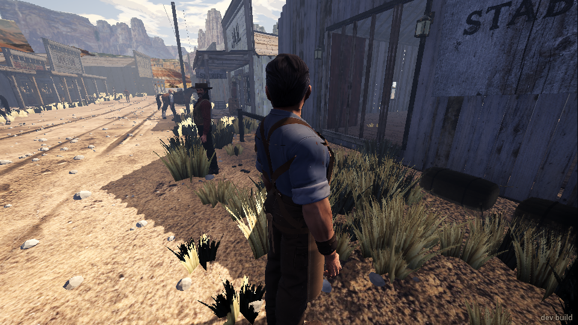
   I waited 30 seconds and saw no line on screen saying what to do. The events had nothing
   either, only his two lines.

2. **The road.** `walk road_farm` from the edge of town stopped dead at x≈52, 11 m out. There's
   a rail or posts across the middle of the road, plus a scatter of dark crates and panels in
   the desert. `read look` calls one of them "range_cover/crate1". I had to step 3 m to the
   side to get past. The farmhouse shows up well from the road, grey on a rise. The painted
   cliffs behind it end in a hard vertical cut, like a cardboard flat.
   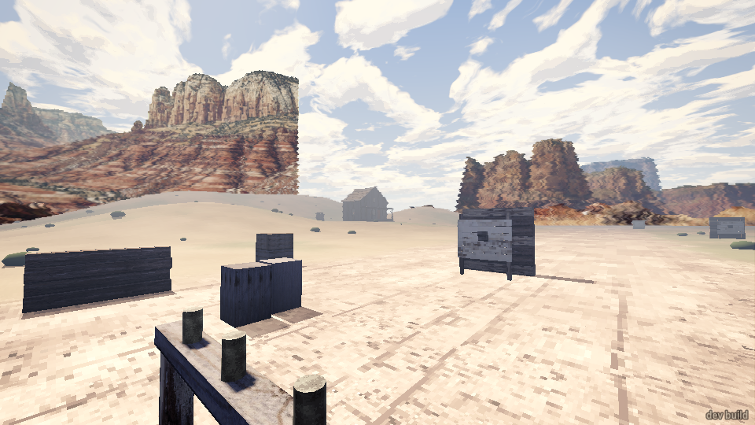
   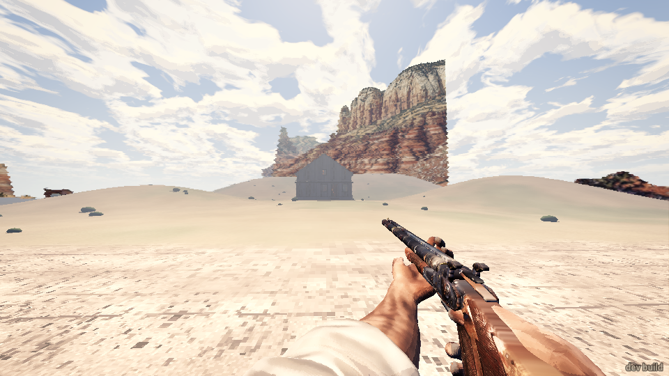

3. **Try 1: the front, three times.**
   - **1a.** I walked the road with my gun put away. At about 45 m the Kid, on the porch, said
     "Over there!" and all five answered at once: "You damn fool!", "Your funeral, friend.",
     "That's how it is? Fine!" (two men said each of the last two). I ran up the lane with the
     shotgun. The Kid fired from the open front door.
     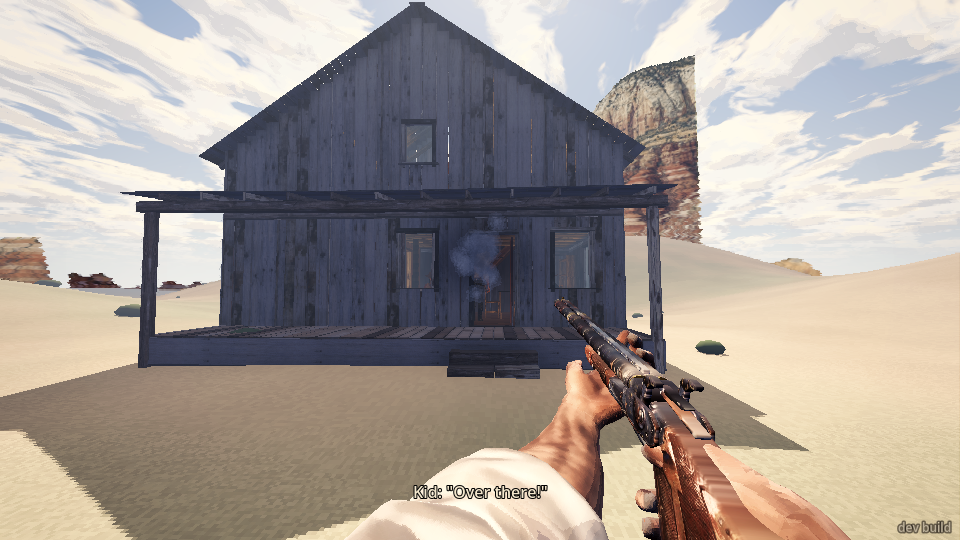
     I turned to him and pressed shoot. Within about 2 seconds I'd taken two chest hits and
     blacked out. The shotgun never fired: `shoot` gave "fired 0", and the gun showed as
     "put away". I came round in a back room in town:
     "You went down. The rancher's still out there with them. (Enter: try again)".
     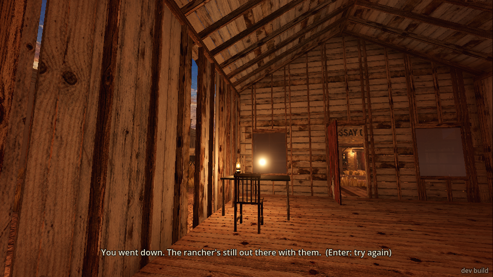
   - **1b.** Same again with the revolver out, running straight to the porch steps. The
     rancher shouted "Help! In here! They've got me tied!", which was the best moment of the
     front way. The Kid hit me in the chest twice in two seconds and I was down again before
     my shot.
   - **1c.** Same, with every command queued so there was no gap. I took three chest hits from
     the Kid while running up the lane and at the steps. `shoot` cocked the hammer but never
     fired in the ~4 seconds I was still up.

   Each time, as soon as I went down, all five outlaws switched to their friendly lines in the
   same instant: "Help you?", "Easy, friend.", "Something I can do for you?", "Walk on,
   mister.", "Smart." Coming from men who'd just shot me, it reads as a bug.

4. **A false start.** After a restart I went straight to `goto road_east` without talking to
   the blacksmith. The mission never started. The farm was empty, the rancher stood at the
   livery, the gang rode into town instead, and a lone "outlaw" stood idle on the road east of
   town. When I came back with my revolver out, the blacksmith only begged ("Don't shoot! I got
   a family!", "Please, mister...") and never gave the briefing, even after I put the gun away.
   The game had to be restarted.

5. **Try 2: the back door, crouched.** I left the road at x=70 and crept north in a crouch, gun
   put away. The Kid spotted me anyway at ~30 m, across open sand at noon, and the same five
   lines came, plus "Out front! He's out front!" even though I was on the side. Then nobody
   shot at me. All five stayed inside, "hidden", and let me walk round past the outhouse to the
   open back door.
   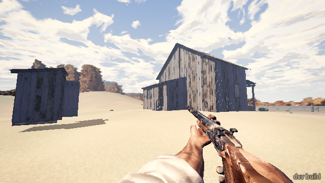
   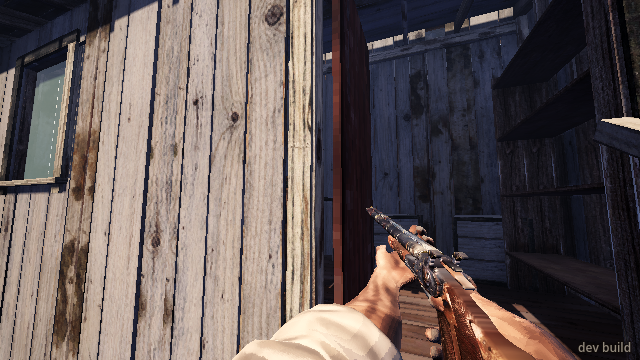
   Two steps into the kitchen, Brody shouted "Back off! Back off or he's dead!" Five seconds
   later, while I stood still in the kitchen, he shot the rancher in the head. Then all five
   called "Covering!" at once.
   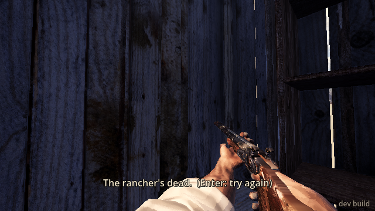

6. **Try 3: dynamite.** I went wider: north from x=53 to z=-72, then east behind the outhouse.
   **Nobody saw me this time.** I could hear them talking inside ("Smells like horse in here.").
   I stood at the bedroom's side wall, with Brody 3.8 m beyond it and the rancher 3 m, and
   planted a stick (`press shove 1.2`). They heard the fuse: "Your funeral, friend." I ran
   about 16 m off. The blast broke 52 pieces of timber and dropped the loft floor into the
   bedroom. Lyle and Hollis caught splinters all over. Lyle shouted "I'm gone!" and Hollis
   "To hell with this!" Brody, Dutch and the Kid ran out the front. The rancher took about ten
   hits from falling timber and went down out cold.
   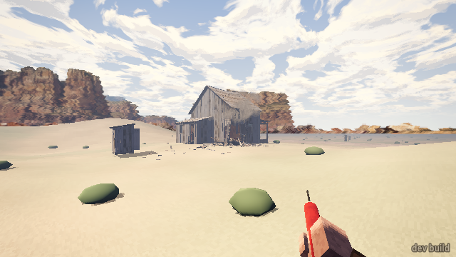
   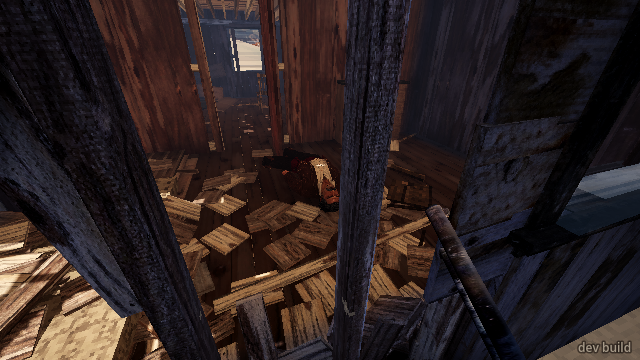
   - **The hole was no way in.** The siding was gone but the studs stood, and I couldn't step
     through even crouched. `kick` only aims at people ("nothing within reach").
   - **The back door was blocked.** A loose board was jammed across it, and I couldn't get past.
     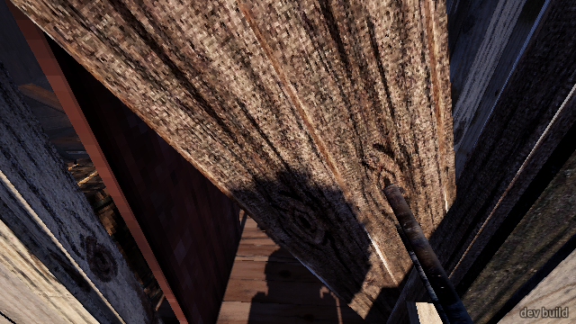
   - **Everyone gave up.** Lyle and Hollis surrendered inside. I ran round the side to the front
     with my revolver out. The other three were standing in the yard, and all three gave up as I
     came round ("Don't shoot! I quit, I quit!", "Enough! It's yours!"). On the way, two hits to
     my right foot showed in the events with no shooter named (debris?).
   - **I couldn't free him.** In through the front door, to the bedroom door. The rancher lay
     under the boards, out cold.
     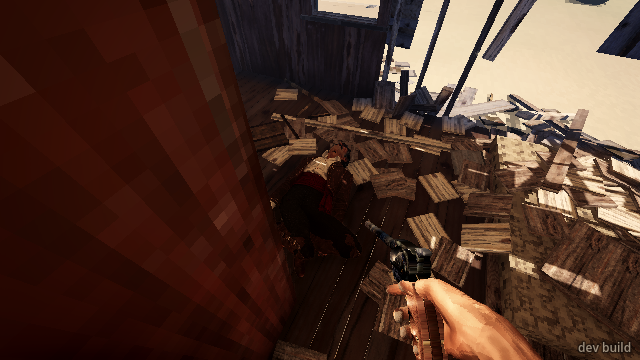
     I held E by him twice (`press shove 2`, then `2.5` with the gun put away). The first did
     nothing. The second **kicked him**: "you kicked rancher: moved where they lay". There was
     no cut-loose, no line and no end. I stopped there at the time limit.

## What broke

- **Cutting him loose didn't work on an unconscious hostage.** Holding E by him did nothing the
  first time and kicked him the second. There's no way to carry or drag him out either, so the
  run can't be won after this.
- **`shoot` never fired after I'd been hit.** In three front runs it returned "fired 0", once
  with the hammer cocked, while I was still standing for 2–4 seconds after the first hit.
- **A rail or posts block the road out of town** at x≈52 on the road's centre line, and
  "range_cover" crates sit in the open desert east of town. `walk road_farm` and walks across
  the desert stop dead on them.
- **The outlaws go friendly the moment you go down:** five greetings in the same instant
  ("Help you?", "Easy, friend.", "Walk on, mister.", "Smart.").
- **The Kid spams his reload call:** about 30 "Reloading! Cover me!" / "I'm empty! Cover me!"
  lines in 0.2 s, enough to push everything else out of `events 80`.
- **The same line from two men at once:** "Your funeral, friend." and "That's how it is? Fine!"
  are each said twice, by different men, every time they spot you.
- **Skipping the blacksmith leaves the mission unstarted.** You get the ordinary town, with the
  gang riding in and a lone outlaw on the east road. Walking up to him with a gun out makes him
  beg, and he never gives the briefing after that.
- **"Out front! He's out front!"** is shouted when you're at the side or back.
- **The back door was jammed by a loose board after the blast,** and the blown wall leaves the
  studs standing, so the hole can't be used to get in.
- **Enter (try again) drops the bridge connection** ("the game closed the connection") for
  about 20 seconds while it reloads. That's harmless, but a script can mistake it for a crash.
- **Out of memory twice** on a shared machine; see the top. The game is about 5.5 GB resident.

## What was flat or confusing

- **No objective line came** after the blacksmith's talk, in 30+ seconds of waiting, and none
  in the events. The talk itself was clear enough: rancher, east, Brody's bunch, go now.
- **The open approaches can't work.** On the road, with my gun put away and walking like a
  traveller, the gang spotted me at ~45 m and fought at once. There's no "Walk on, mister" stage
  out there: those lines only came after I'd gone down. Crouching across the open sand still got
  me spotted at ~30 m. Only a very wide loop (~50 m out) got me there unseen. Nothing in the
  game hints that the wide loop is the way.
- **The front way felt unwinnable.** One man (the Kid, in the doorway) hit me in the chest 2–3
  times in 2–4 seconds, at a run, from 10–40 m. The other four barely fired. My command lag
  makes this worse than it would be for a player, but three chest hits from three shots at a
  running man is very sharp shooting.
- **The back-door threat gave no room to act.** Brody's warning and his shot were five seconds
  apart, and in between I stood still. Did standing count as not backing off? I couldn't tell
  what he wanted.
- **After the blast two of them gave up and three ran outside,** and then nobody said anything
  about the rancher. I had no sign of whether he was alive, tied or free.
- **In try 1 I heard the rancher** ("Help! In here! They've got me tied!", "¡Dios!", "Ay—!").
  In tries 2 and 3 I never heard him at all.

## What was fun

- The rancher's "Help! In here! They've got me tied!" as you hit the porch.
- The outlaws' idle talk, heard from behind the house: "Smells like horse in here.",
  "Somebody's coming, I'd say. Somebody always comes.", "Keep your eyes on that road."
- Brody's "Back off! Back off or he's dead!", a real hostage moment, and he meant it.
- The Kid firing from the doorway with smoke in the frame. It looked like a Western.
- The dynamite: they heard the fuse, the wall and loft came in, and the gang broke. Two gave up
  inside, three ran out to the yard, and they called each other quitting ("Kid's giving up!",
  "Lyle's quit on us!"), then gave up to a man with a gun coming round the corner. That was the
  best sequence of the session.
- The house itself looks good up close: porch, open door, lean-to kitchen, outhouse.

## Top three things to fix

1. **Let the player free and move an unconscious or buried hostage.** Holding E should cut him
   loose and then carry or drag him, never kick him. Right now the dynamite way, the one that
   works, ends with the rancher stuck and the mission unwinnable.
2. **Make the front way survivable and give the approach a stage before shooting.** A man
   walking up the road with his gun put away gets "Walk on, mister" or a warning shot, not three
   chest hits. Also fix `shoot` not firing after the first hit.
3. **Clear the road and fix the briefing.** Take the "range_cover" crates and the rail off the
   road out of town. Show the objective line after the blacksmith's talk. Start the mission
   even if the player skips him, or let him brief you once your gun's put away.
