# Playtest 2026-11-10: cards in the saloon's yard (the valley, at night)

Played through the dev bridge, without reading the code. The game ran in the valley
(`--world=valley`), with the clock set to 21:00. I played Harlan: new in town, no gunman. I spent
about 14 minutes of game time at the yard and the card table, and played about 12 hands.

## What I did

I started at the crossroads in the dark. `read people` showed five people about 30 m east: the
barkeep, the miner and the rancher at the bar, and Earl and the drifter at the card table. I walked
up the saloon lane into the yard. The table is lit by its oil lamp and the bar by its own lamp,
and you can see it from the lane.

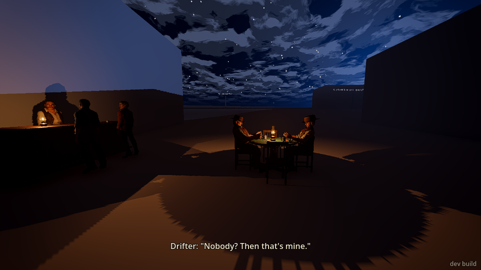

I walked to the empty chair on the near (south) side, faced it and pressed E. It worked first try.
The screen said "E: sit down", then "E: stand up" and "You're in from the next hand". (I only used
`sit n` once, as a check. Walking to both chairs worked.)

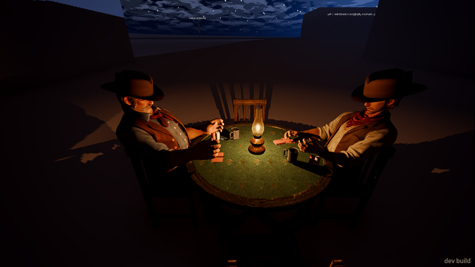
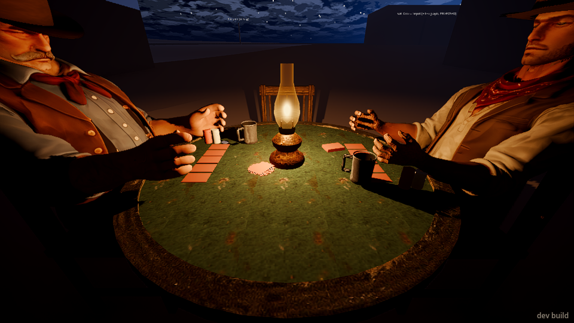

The next hand dealt my five cards face up in front of me, big enough to read: "3s Jd 4c 3c Qc". The
screen said "You're dealt in: a pair of threes", and then "Your bet. Nod: check · shake: fold". I
nodded. The draw happened for me ("You draw 3": it kept the pair and threw the rest). Earl said
"You in or out?" when it was my turn again. I checked, and won with the pair. The drifter said
"Beginner's luck."

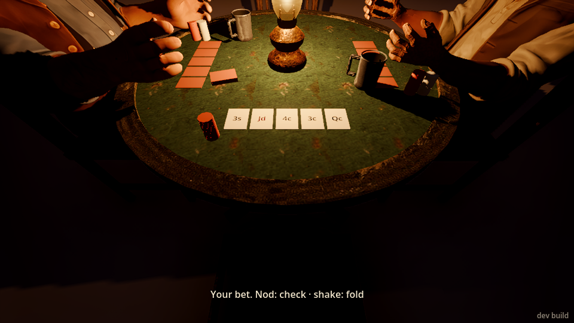

I played about ten more hands. I won with three aces, a pair of nines, three fours, and two pair
(aces and fours). I folded once to a bet (the drifter said "Smart."), and lost a called hand to the
drifter's two pair. Earl won a full house, aces over jacks, after drawing one, and said "Don't look
at me like that." `cards` later said he'd cheated twice. Nothing on screen showed that.

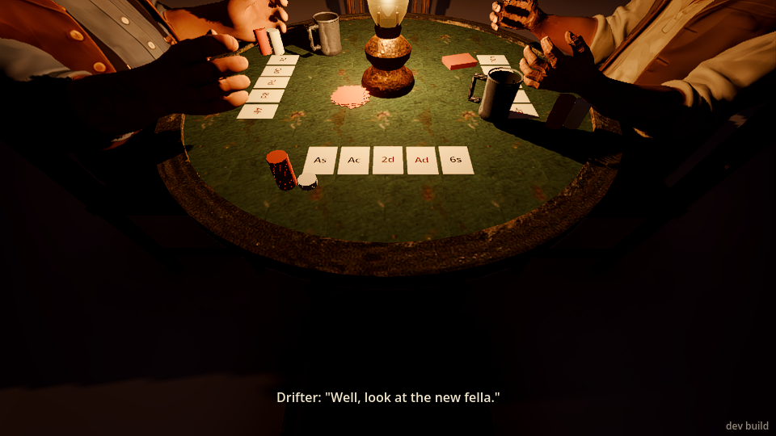

While sat I tried to walk, jump, crouch, draw the revolver and fire. None of them did anything,
which is right. The gun gave a clear reason: "You can't hold the gun: you're sat at the table." I
could turn all the way round and look straight up.

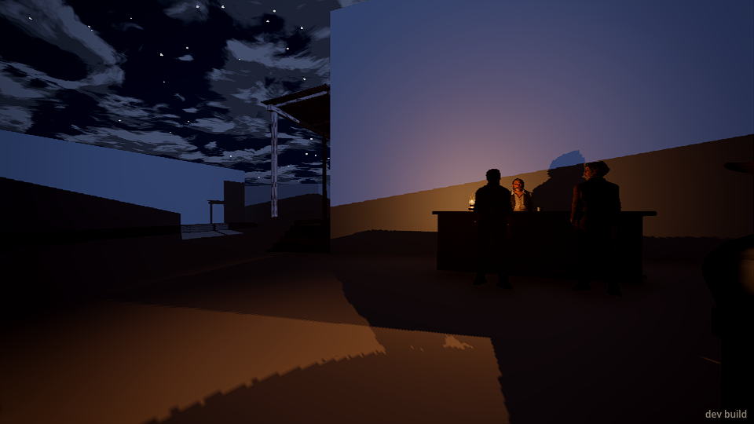
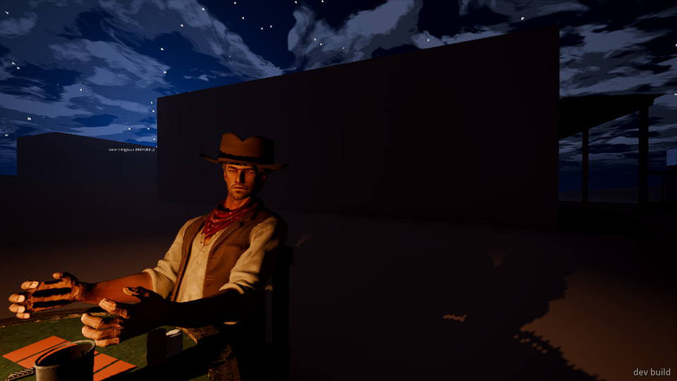

I stood up, and found myself flat on the ground under the table (see What broke). Then I sat and
stood a few more times, tried Earl's chair (nothing happened), and moved to the north chair.

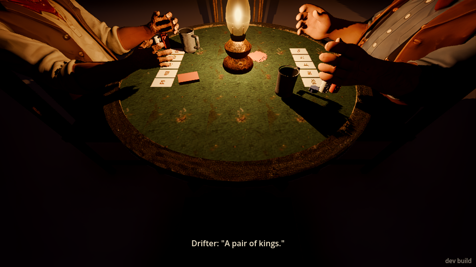

To disturb the game, I stood, stepped 3 m off, drew and fired once into the air. Everybody shouted
at once. The game stopped, the drifter stood with his hands up, and Earl sat back down. Once I
holstered and turned away, the game started again about 18 s later.

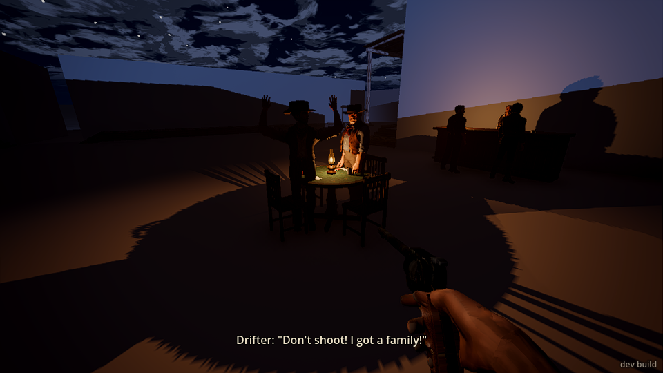

Then I walked behind Earl and kicked his chair. It broke into 13 pieces. Earl "went down", got up
at once, and stood there without a word. The game stopped and never started again with him: he
stood on the wreck of his chair for over three minutes. When I shoved him he said "Easy! Easy...".
I sat in the north chair and the game went on with only the drifter and me.

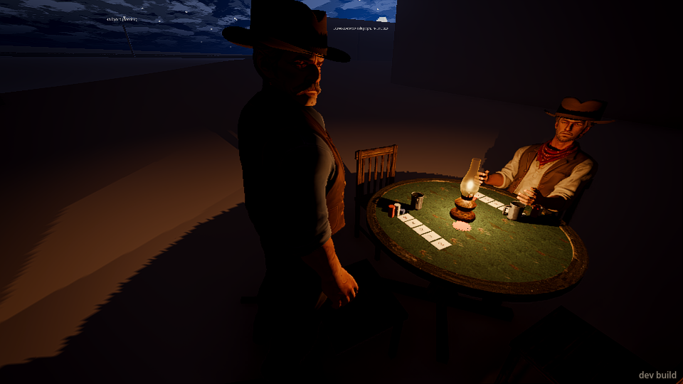
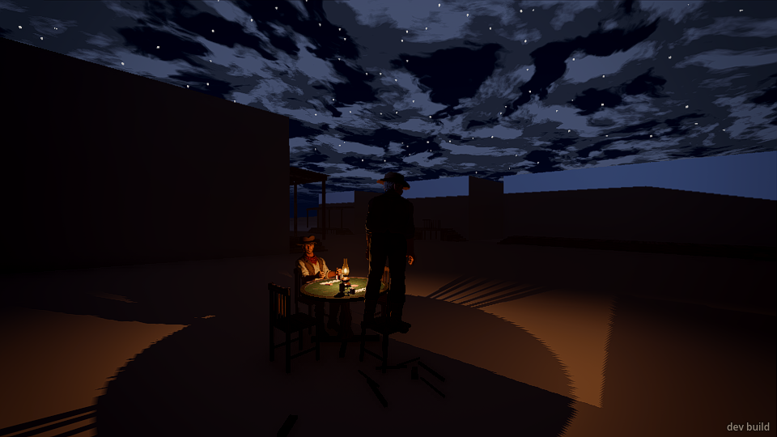
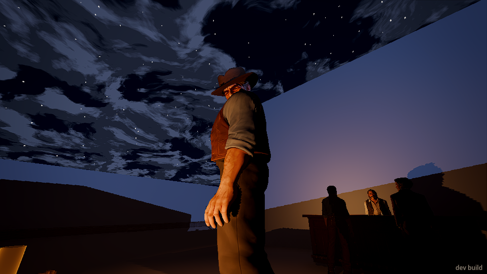

## What broke

- **Standing up dropped me into a crawl, and I couldn't get up.** While I was sat I had pressed
  crouch, which did nothing then. When I stood (E), I came up lying flat at chair-seat height,
  looking under the table. I tested it again: sit, press crouch once, stand. Every time I ended up
  crawling. Sitting and standing without pressing crouch was fine. Getting out of it was hard.
  "crawl off" did nothing. Pressing crouch flipped me between crouching and crawling but never back
  to standing. Only a run stood me up.
  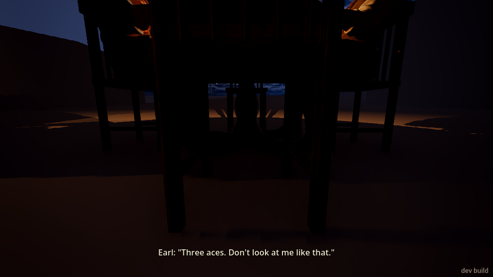
- **The drifter babbled two lines a second for over 20 s after my shot.** He mixed his
  hiding lines with his pleading lines: "Lord. Lord, lord." / "Don't shoot! I got a family!" /
  "...They gone?" / "Take it! Take whatever you want!" / "Please, mister...", about every 0.3–1 s.
  I counted 50+ lines. "...They gone?" makes no sense while he's pleading with a man pointing a
  gun at him.
- **After my shot, all five people shouted in the same instant.** Three of them said "Lord
  almighty!" and two said "Get down! Everybody down!". Then nobody got down: the drifter stood with
  his hands up and Earl sat back down.
- **Kicking Earl's chair out stopped the game for good.** Earl stayed standing on the
  pieces, about half a metre off the ground, for over three minutes. He never took one of the free
  chairs, never sat on the ground, and never left. His 47 chips stayed on the table.
- **"Earl went down", "earl hit in the chest" and "13 pieces of timber broke" from one kick,
  and not one word from anyone.** He was back on his feet the next moment, mood "calm".
- **If you don't nod or shake within about 7 s, the game plays for you, including calling bets.**
  It checked for me several times while I was looking round, and twice it *called* a bet and spent
  my money ("You call"). That cost me a pot I'd have folded.
- **Walking to a point by the table twice stopped short** (once 1.5 m off). The second try got there.
- **Small ones:**
  - The gun message merged into a subtitle: "Earl: "Mister?" / You can't hold the gun...".
  - Walking while sat turned my view to 250° even though I didn't move.
  - Earl said "Don't mind if I do." in the same breath as the drifter winning a pot from him.

## What was flat or confusing

- **You can only check, call or fold.** With three aces I couldn't bet or raise: the prompt only
  offers "Nod: check · shake: fold". So the best hands play exactly like the worst ones.
- **I never knew how much was being bet, or what I had.** "Bet." and "I'll bet." never say an
  amount. The prompt says "Nod: call" but not what calling costs. I had no idea of my own stack
  until I used `cards` (I'd started with 19 against their 38–40). Chips don't move into a pot you
  can see, and they don't come to me when I win.
- **The screen and the men's words were almost enough to follow the game, but not quite.**
  - Turn order and whose turn it was came through well: "Your bet, mister.", "Mister?", "You in or
    out?". The win and lose lines were clear too: "You take the pot with three aces".
  - What wasn't clear: money (above), and the other men's hands. At the showdown, Earl's cards
    turned up but are small and upside down from my seat, and the drifter's were hidden behind his
    tin cup. They vanish a few seconds later.
  - I needed `cards` for my stack and the bet sizes, and to learn that Earl cheated.
- **Earl's cheating can't be seen.** His only tell was "Don't look at me like that." I watched the
  table and his hands and saw nothing. There was no way to call him on it.
- **The men's hands hold no cards.** Their cards lie face down in a row on the felt, while their
  hands hover over the table, open and empty, as if holding a fan of cards. The drifter's hands look
  like dark striped gloves, almost like bones (screenshot 13).
- **Nobody greets you, or minds you leaving.**
  - Sitting down got no "Evening" or "Pull up a chair". Standing up halfway through a hand, after
    I'd put money in, got no word either.
  - Coming back after I'd fired a gun next to them got nothing. I was dealt straight back in.
- **I won a lot.** I was dealt a pair or better in nearly every hand (6 wins against Earl's 6 and
  the drifter's 8, in far fewer hands than theirs). "Well, look at the new fella." came four times,
  and "Beginner's luck." twice.
- **A drawn gun 3 m from the table changed nothing.** Everyone stayed "calm" until I fired.
- **The draw is automatic.** I never chose which cards to throw. Fine for a "nod or shake" game,
  but say so on screen ("You keep the pair, draw 3"?).
- **My own body isn't there when I look down from the chair.** No knees, no hands on the table.
- **The "E: sit down" prompt goes away fast.** It was gone by my screenshot a few seconds later.
- **The yard's other people do nothing.** The barkeep and the two drinkers stood at the bar the
  whole time and said nothing except when I fired.

## What was fun

- Walking up the dark lane towards the one lamp-lit table, with two men talking cards, looks and
  feels right. The table is lovely close up: the lamp, the felt, the tin cups.
- **The banter fits.** "Five-card. Same as ever.", "Three. And make 'em good.", "Bet two bits
  more'n it's worth.", "Lady's been kind tonight.", and "Smart." when I folded. The men talk to you
  by the table's rhythm: "Your bet, mister." / "Mister?" when you're slow.
- **Nod to check and shake to fold is a good idea.** It's quiet, in-world and fast. My cards
  dealt face up in front of me read clearly.
- A shot into the air near a card game gets a proper scramble and a man with his hands up begging.
  That's the right instinct (once it's toned down).
- The kicked chair breaking into pieces under him is a good, physical surprise.

## The top three things to fix

1. **Standing up from a chair can leave you crawling and unable to stand.** A crouch press while
   seated carries over. Stand up into a normal stance whatever was pressed in the chair.
2. **The table should recover, and the men should react, when the game is broken.** After the
   kick, Earl stood silent on his broken chair for minutes and never sat again. A man whose chair
   is kicked out should say something and do something: rise angry, take another chair, or leave.
   The drifter's two-lines-a-second babble after a shot (hiding and pleading lines mixed) needs the
   same calming down.
3. **Make the money and the stakes readable, and let the player bet.** Show your stack, the
   pot and what a call costs. Let a good hand raise, not only check. And don't play for the player
   when he's slow: a timeout that calls bets for him spends his money while he's looking away. A
   timeout should check or fold.
