# Playtest 2026-11-10: a night at the card table (the valley)

Blind playtest, played through the dev bridge at about a frame a second. Started with
`--world=valley`, clock set to 21:00. I played Harlan, new in town, no reputation.

## What I did

1. **Into the yard.** I jumped to the saloon's yard (behind the saloon, north of Main Street). The
   barkeep stood behind an outdoor bar with a lamp, two drinkers (a miner and a rancher) in front of
   it, and Earl and the drifter at a round card table with a lamp in the middle. As I arrived the
   drifter was grumbling at Earl: "Every damn hand." It looked good straight away: warm lamplight,
   stars, two men hunched over cards.
   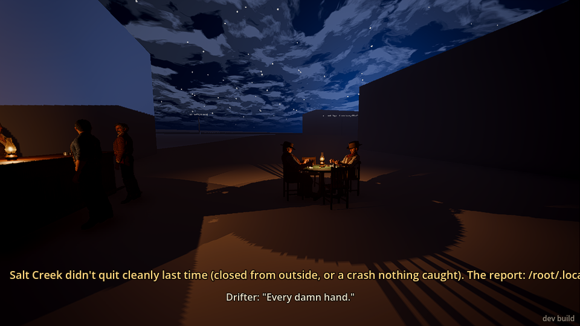

2. **Sitting in.** I sat in the free south chair. The screen said "You're in from the next hand".
   Earl said "My deal. Ante up, boys." and dealt me in. My cards showed face up along the bottom of
   the screen, with the prompt "Your bet. Nod: check · shake: fold".
   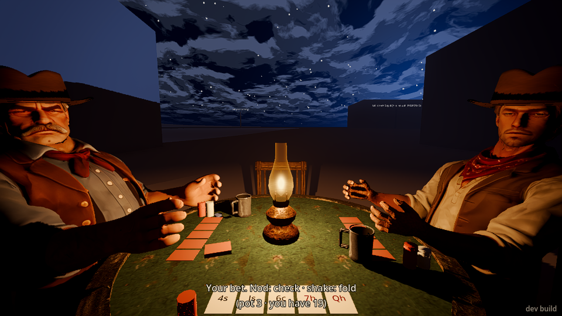

3. **The cards (three hands).**
   - Hand 1: queen high. I checked, Earl bet 1. I nodded to call, but the game said **"You fold"**.
     My nod came about 7 seconds after the prompt. It looks like there's a turn timer that folds
     you, with no warning or countdown on screen. The drifter won with two pair, aces and fives.
   - Hand 2: a pair of sevens. This time I answered fast. The game drew three cards for me without
     asking ("You draw 3"), which gave me two pair, tens and sevens. I checked, the drifter made it
     2 ("Bet two bits more'n it's worth"), and I called. The drifter won with **aces and eights**.
     That's the dead man's hand, a nice touch if it was meant.
   - Hand 3: Earl dealt. The draw gave me a pair of jacks. I checked twice, then Earl said "You in
     or out?"

4. **The murder** (in the order I saw and heard it, game clock still showing 21:00):
   - A man I hadn't noticed (the **stranger**) was suddenly right at my shoulder: *"Don't move,
     friend. Whatever happens next, you sit still."*
   - A second man, **Cody**, gun already out, standing behind Earl: *"Earl. You been dealing off the
     bottom of that deck."*
   - Earl: *"Now, Cody, I never..."*
     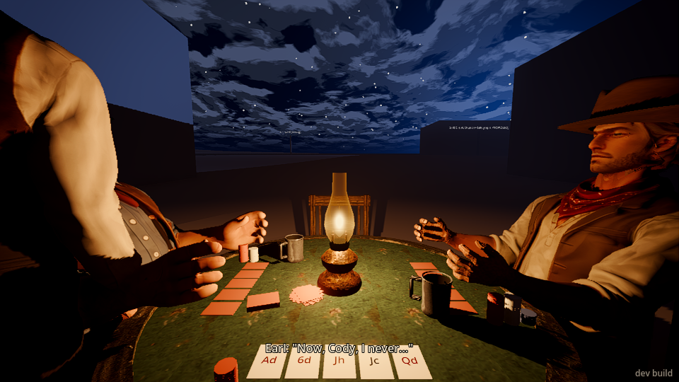
   - With no shot fired, the events said the stranger was "hit" in the shin and thigh and Cody in
     the forearm. A chair broke about now (the barkeep complains about it below), so it may have
     been a chair kicked out. On screen I couldn't tell what happened.
   - The stranger: *"Evening. Mind if I sit in a while?"* This came **after** his threat, so the
     lines are in the wrong order.
   - Screen: **"The stranger's hand is on your arm. Sit still."** I tried to stand. The game
     answered "held" and I stayed in the chair. I tried to draw my revolver. The command answered
     "revolver in hand", but straight after that the player readout said "put away ... you can't
     hold it: you're sat at the table". So I couldn't stand or draw, which I think is intended and
     felt tense.
     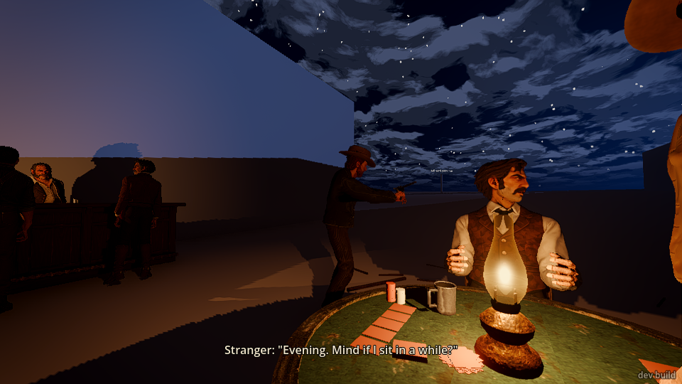
   - **Cody fired once.** Earl was hit in the head and died. The ball passed 1.5 m from me.
     Cody: *"Ain't no law left in this valley to save you now, Earl."*
   - The people at the bar put their hands up. The barkeep: *"Jesus, Cody, my chair!"*
     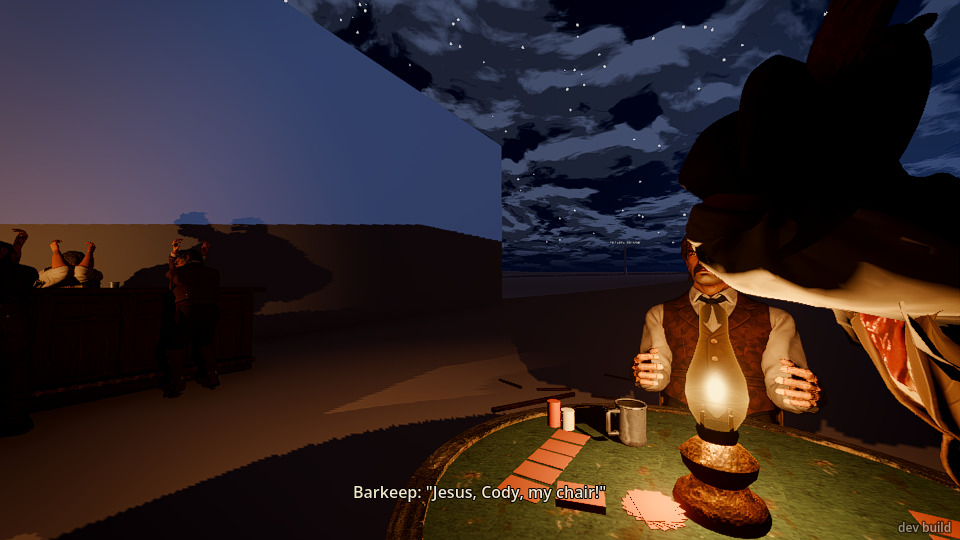
   - The stranger: *"You didn't see a thing tonight. Nobody did. Remember that."* Then I could
     stand ("E: stand up"). The barkeep: *"Somebody ought to fetch the... hell. Ain't nobody left to
     fetch."* Good, dark line.
   - Earl's body lay on the ground beside the table with his hat by him and a broken chair nearby.
     It was hard to see at first, in the table's shadow.
     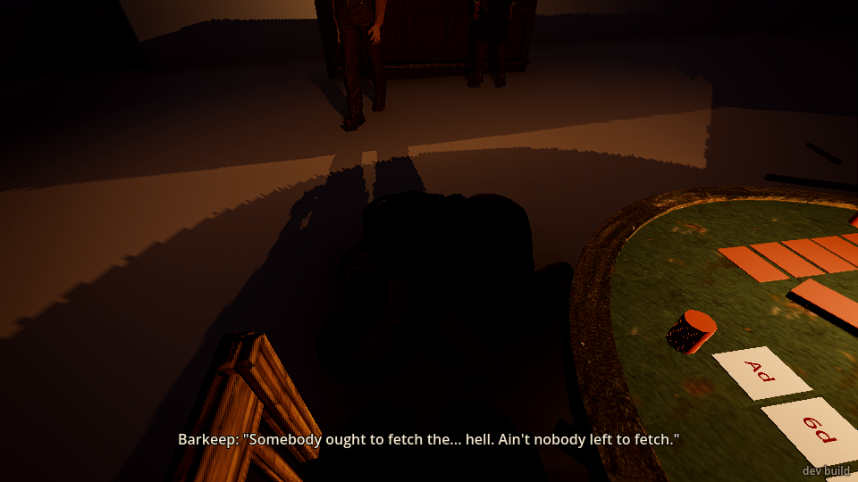
     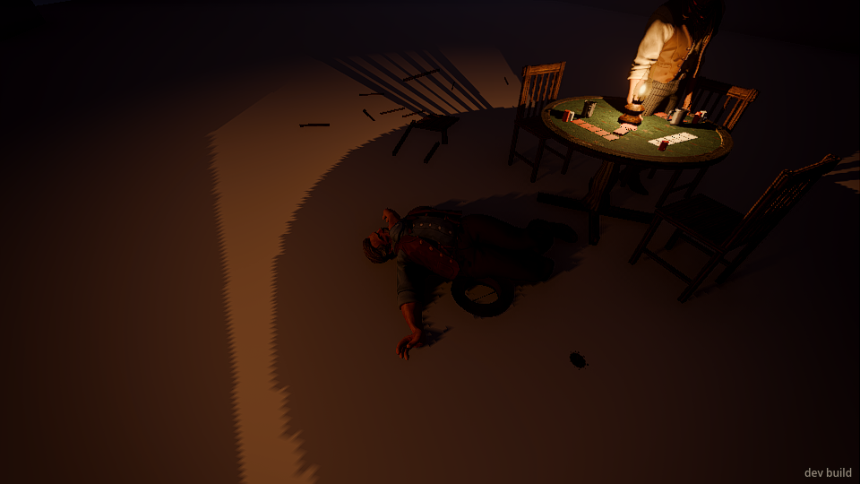

5. **After.**
   - By the time I was on my feet, **Cody had walked off south toward Main Street. A few seconds
     later he was gone from the world.** He wasn't in the list of people, I couldn't `look` at him,
     and I couldn't see him from the street.
     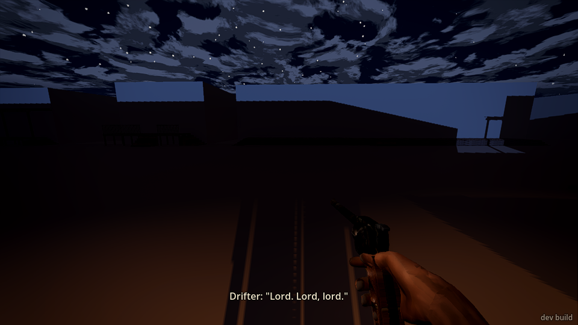
     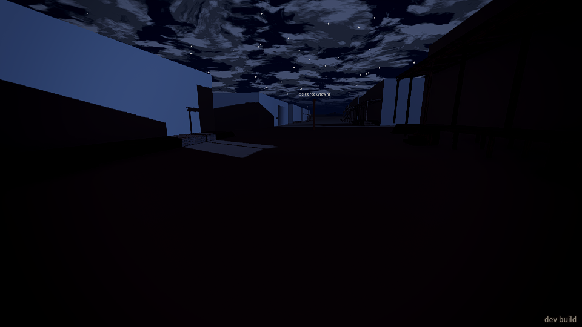
   - I drew my gun on the **stranger**. He put his hands up. The drifter, who was innocent, panicked:
     "Whoa, now. Easy with that iron." "Take it! Take whatever you want!" "Don't shoot! I got a
     family!" I shouted "Drop it!" at the stranger. **He said nothing and did nothing**, while the
     drifter kept begging. When I holstered, the drifter asked "...They gone?"
     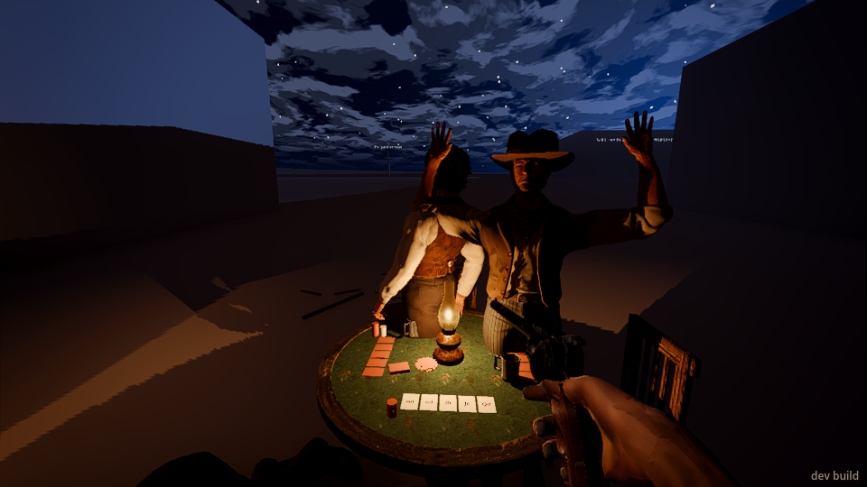
   - The stranger had ended up standing **inside the card table**.
     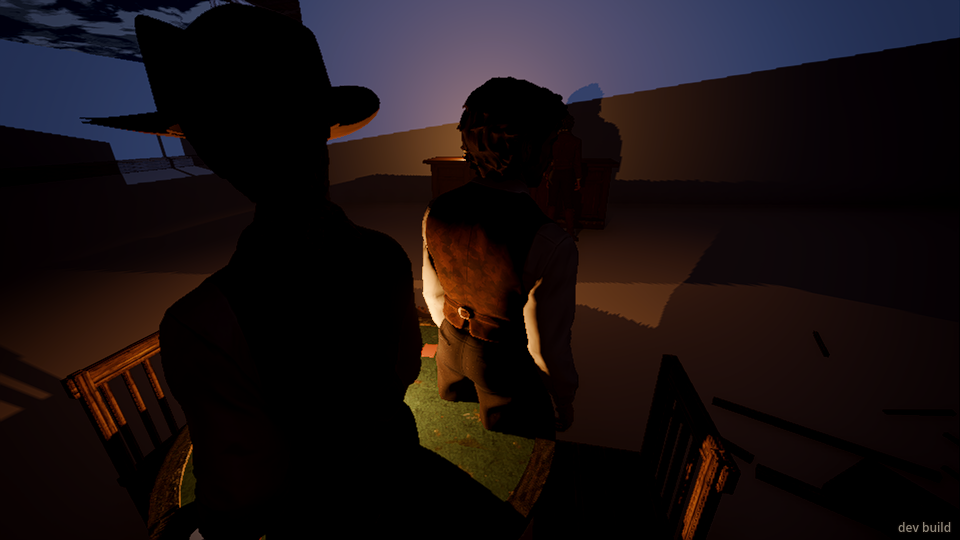
   - I walked round and shoved him. "Staggered back", "stranger went down", and he landed on the
     table top. A few seconds later **he was gone from the world too**: not in the list, couldn't
     look at him.
     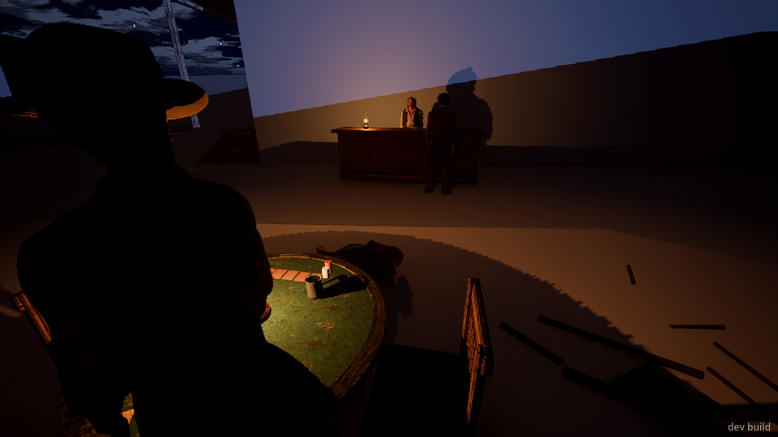
   - I went to the bar. The barkeep stood calmly behind it and said nothing when I walked up. The
     barkeep and rancher were "calm" again within about 30 seconds of a man being shot dead 5 m
     away, and stayed that way while a stranger (me) walked about with a drawn gun.
     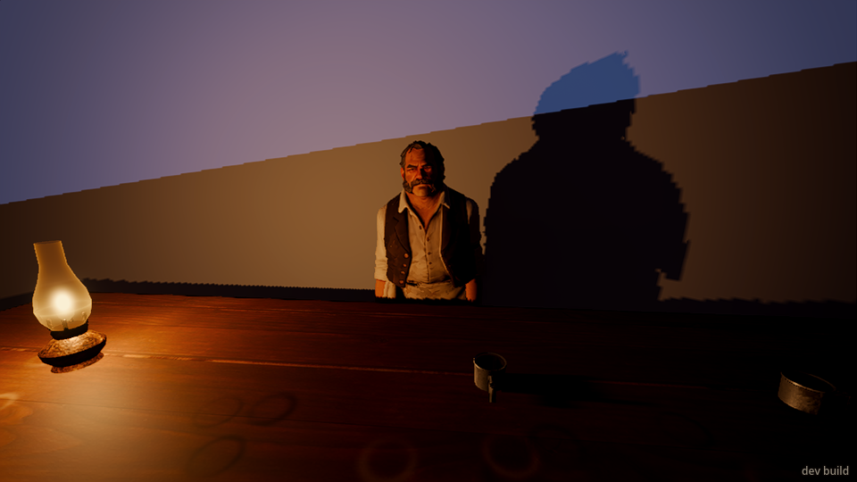
   - I sat back down at the table. The card game stayed "stopped" for good: my last hand still
     lay face up on the felt, and nobody suggested another hand or touched the body. The drifter
     stood by the table, calm, for the rest of my time there. Nothing more happened in about two
     more minutes.
     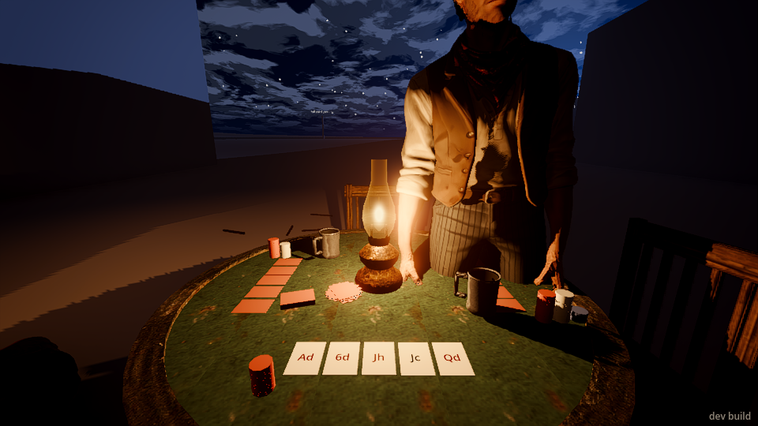

The game clock showed **21:00 the whole session** (about 5½ minutes of play), so I never got near
22:15. The murder came on the third hand, about 1½ minutes after I sat down.

## What broke

- **The killer and his partner vanish.** Cody walked off and was gone from the world within
  about 15 s. The stranger disappeared a few seconds after I shoved him over onto the table. I
  never got the chance to follow, confront or catch either of them. Losing the stranger right after
  I laid hands on him is the worst of it: it felt like the game deleted him to get out of a
  situation it didn't handle.
- **Auto-fold with no warning.** I nodded to call and was told "You fold". The turn seems to time
  out after about 7 s, with no countdown or "Hurry up" on screen. Earl's "You in or out?" came
  once, on another hand. A player who takes a moment to think loses the hand.
- **Lines out of order.** The stranger said "Don't move, friend..." and only then "Evening. Mind if
  I sit in a while?" The greeting should come first, or be dropped once the threat is said.
- **Bodies inside each other.** The stranger stood inside Earl's body while Cody accused him
  (screenshot 03). Later he stood in the middle of the card table (09), and the drifter overlapped
  him (07). The drifter also ended up standing inside the edge of the table (13).
- **Mystery "hits" with no shot.** The event log reported the stranger hit in the shin and thigh
  and Cody hit in the forearm, about 6 s before Cody's shot. Nothing on screen explained it. I
  couldn't tell whether this was the chair being kicked out.
- **The gun answer contradicts itself while held.** `weapon revolver` answered "revolver in hand",
  but the next readout said it was put away because I was seated.
- **"E: sit down" prompt spam.** Walking past the table's chairs flashed "E: sit down" five or six
  times in a row.

## What was flat or confusing

- **I never saw Cody coming.** One moment I was looking at my cards. The next, a stranger was at
  my elbow and Cody was behind Earl with his gun out. There was no footstep, no "Cody walks into the
  yard", and no one at the bar reacting to an armed man crossing the yard. A beat of warning (the
  barkeep going quiet, someone saying "Cody...") would make it land harder.
- **I couldn't tell who Cody was or which one was the "red shirt".** At night in the yard every
  man is a dark silhouette. I couldn't make out a red shirt on anyone.
- **Nobody cared afterwards.** The barkeep and the drinkers went from hands up to "calm" in about
  half a minute. They stood exactly where they had been, said nothing more, and didn't go to the
  body. The miner left without a word. The drifter calmed down and just stood at the table. Nobody
  spoke to me, asked what I'd do, warned me off, or sent for anyone.
- **The stranger never speaks once the shooting is over.** Gun on him, "Drop it!", a shove: no
  words, no running, no fight. He just put his hands up.
- **No way to talk.** I wanted to ask the barkeep who Cody was and where he'd gone. I could only
  walk up to people and stand there.
- **The card game is dead after the murder.** The stopped hand stays on the felt forever. It would
  be good if the drifter said "Reckon the game's over" and the cards were swept up, or if someone
  covered Earl.
- **The draw is automatic.** I never chose which cards to throw back. That's fine for a nod/shake
  game, but the screen only told me after the fact ("You draw 3").
- **Clock held at 21:00.** Time never moved during the session.
- **The murder scene is very dark.** Earl's body is a black lump in the table's shadow until you
  stand right over it.

## What was fun

- **The setup is excellent.** The lamplit table, Earl and the drifter bickering ("Every damn
  hand", "Two pair, eights and fours. Don't look at me like that."), the barkeep, the poker
  chatter ("Bet two bits more'n it's worth", "Three. And make 'em good.", "Up to you, friend.").
  It felt like a real Western card game.
- **Being pinned in the chair** while it happened was the best moment. "The stranger's hand is on
  your arm. Sit still." I couldn't stand or draw, and I had to watch. The ball passing 1.5 m from
  me made it feel close.
- **The dialogue around the killing** is strong and in tone: "Ain't no law left in this valley to
  save you now, Earl." / "Jesus, Cody, my chair!" / "You didn't see a thing tonight. Nobody did.
  Remember that." / "Somebody ought to fetch the... hell. Ain't nobody left to fetch."
- **The drifter's panic** when I drew on the stranger ("Take it! Take whatever you want!", "Don't
  shoot! I got a family!", "...They gone?") was funny and believable.
- The drifter winning with aces and eights the hand before the murder.

## The top three things to fix

1. **Don't let Cody and the stranger vanish.** Cody should walk off somewhere you can follow or
   find him later, and the stranger shouldn't disappear when shoved. Right now you can't do
   anything about the murder.
2. **Make the aftermath react.** Bystanders should stay shaken, say something (to me, about Cody,
   about Earl), and go to or cover the body. The stranger should answer a drawn gun with words,
   running or a fight, not silence. The dead card game should be wound up.
3. **Fix the card table's rough edges.** Warn before auto-folding (or don't fold a nod that
   arrives late). Put the stranger's lines in order. Stop people standing inside each other and the
   table during the scene. Give a moment of warning as Cody walks in, so the player sees him coming.

## After this playtest (the building session, not the playtester)

Fixed in the same PR (#773): the stranger's way to the north chair went straight through the table, so
with you in the south chair he never sat, Cody came in after a minute anyway, and the stranger's lines
came out of order and he stood in Earl and the table; his way in and out now goes round the table, and
his greeting is said only before Cody comes. Cody and the stranger walk on down Main Street while you
follow and are taken out only 30 m from you and out of your sight. A gun or "Drop it!" on the stranger
gets his word. The barkeep comes round to Earl's body, says his piece and gathers the cards, then goes
back to his bar. The card game says "3 s left" before it folds you (and waits 10 s, not 7); "E: sit
down" no oftener than every 6 s. The "hits" before the shot were the kicked chair's pieces striking the
stranger, stood beside Earl (he sits now). The clock standing at 21:00: it's held unless T runs it, so
the murder came by your hands played (after the first), not by the hour.

Left for the next step: telling the red shirt apart in the dark (the characters lane's red shirt), Earl's
body lost in the table's shadow (art's light), the bystanders' aftermath beyond the barkeep, `weapon`
answering "in hand" while you're sat, men standing in each other.
