# Playtest 2026-11-10: the Winchester 1873 (key 6)

A blind playtest of the new lever-action rifle, played through the dev bridge at 960x540, about a
frame a second. I didn't read the game's code. About 90 bridge commands (plus some automated
`look`/`read look` sweeps to find the ropes, see "What broke").

## What I did

1. **Took it out.** I started on the east end of the street at noon. `weapon rifle` said:
   *"rifle in hand, 15 in the tube, chamber empty, 24 on the belt, hammer down"*. That reads
   clearly: a full magazine, nothing in the chamber. The rifle sits low in both hands, muzzle
   to the left across the body.
   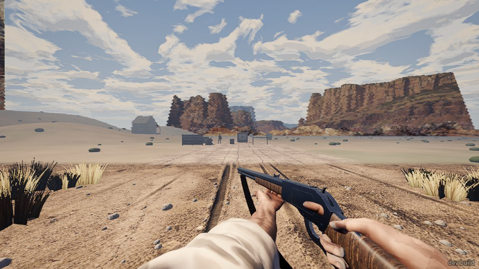
2. **Fired straight away.** `press fire` did nothing and said why: *"work the lever"*. The
   screen showed "Work the lever." Good.
3. **Worked the lever.** `hold cock` swung the lever down. The bolt comes back (you can see
   bright metal at the back of the receiver) and the line said *"14 in the tube, chamber empty,
   lever open, hammer cocked"*. `release cock` closed it: *"14 in the tube, chamber loaded,
   hammer cocked"*. The counts made sense every time: one round leaves the tube per stroke,
   firing turns "loaded" into "spent", and the belt doesn't change.
   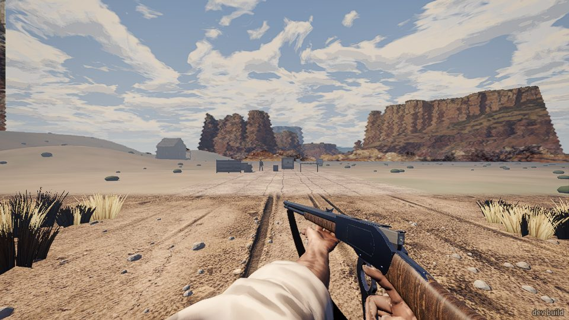
4. **First shot, from the hip**, into the dirt off to the side. A nice puff of powder smoke
   downrange. Then an armed man called "outlaw" standing behind crates out on the range east
   of town shot back at me (a ball passed 0.7 m from me). He'd been saying "Easy, friend",
   "Don't you do it", "One more move..." from the moment I drew. Townsfolk shouted "Get down!
   Everybody down!"
   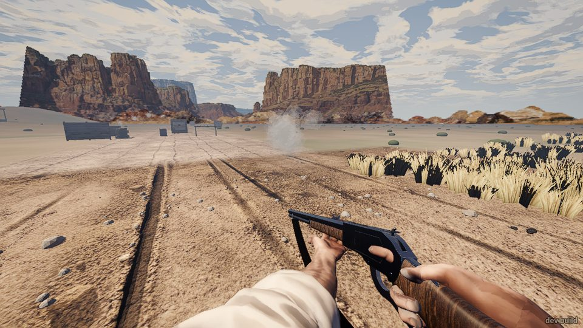
5. **Shot back, aimed.** Lever, `look outlaw head`, `hold aim`, fire. The aimed view brings the
   rifle up to the eye: buckhorn rear sight, a small front sight in the notch.
   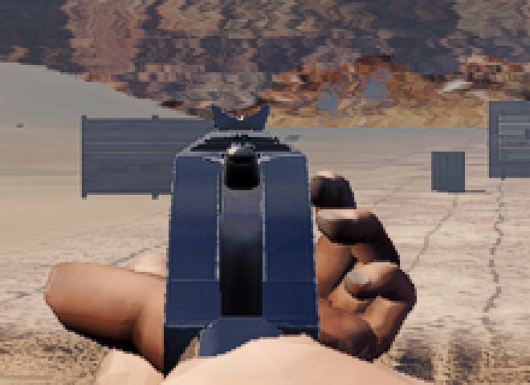
   No hit or miss came up in `events`. Seventeen seconds later he said "My leg... damn you...",
   and by the end of the session he was listed as "down" with 0 wounds.
6. **Looked for the spent case.** I held the lever open right after a shot twice and looked at
   the ground around my feet. I never saw a case in the air or on the ground.
   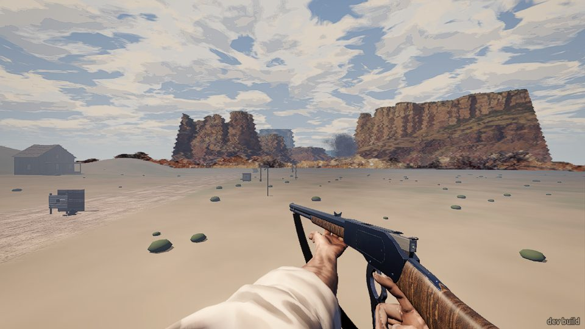
   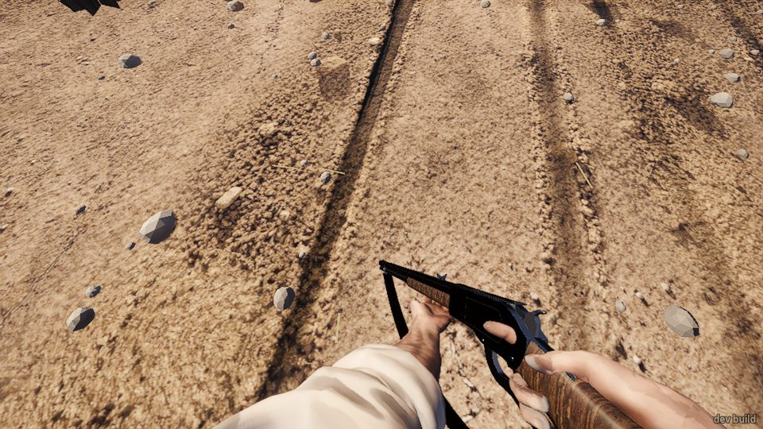
7. **Half cock.** `press hammer` set *"hammer half cock"*. `press fire` then said *"it's at half
   cock: thumb the hammer back"*. A second `press hammer` set it back to "hammer cocked". This
   is clear and it feels right.
8. **Loading.** `press reload` put one round in: tube 12 to 13, belt 24 to 23. `hold reload`
   kept going until the tube was full at 15 (belt 21). Later, holding for 8 seconds loaded 8
   rounds, about one a second. The rifle looks the same while you load it: I saw no hand at
   the gate and no cartridge.
   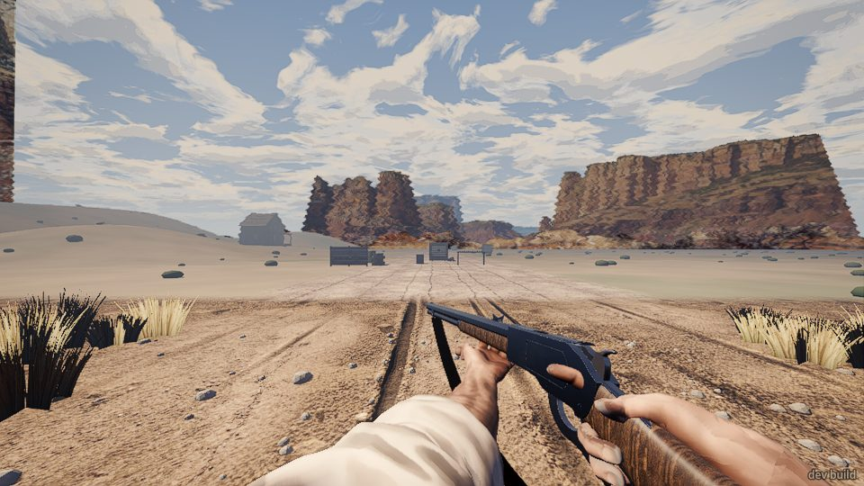
9. **Shared belt.** I switched to the revolver ("5 loaded, 21 on the belt") and loaded one
   (belt 20), then went back to the rifle: "20 on the belt". The belt is shared, as it should be.
10. **The target board** on the range, 37 m out. Aimed, fired. The board sits behind the rear
    sight. The receiver hides everything below the sight line, which is right for a rifle.
    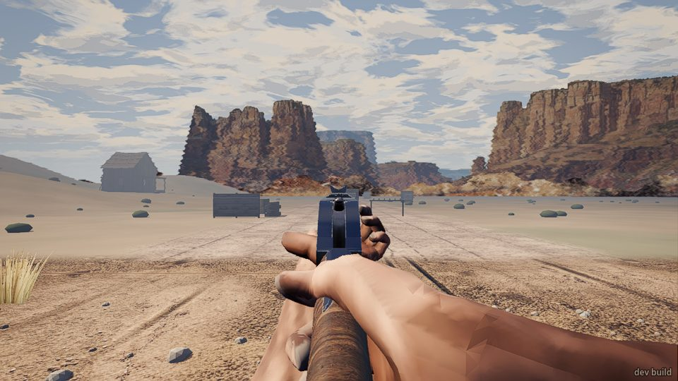
    Walked up to it: one small hole, upper left. Fired again from 6 m, aimed. I couldn't see a
    clear second hole, and nothing in `events` told me where either ball went.
11. **The rope shot.** F5 cycles nine jump points. The raised stand was the 8th; the 9th wraps
    back to the start. From the stand you face east toward two gallows posts, each with a
    rope and a sack.
    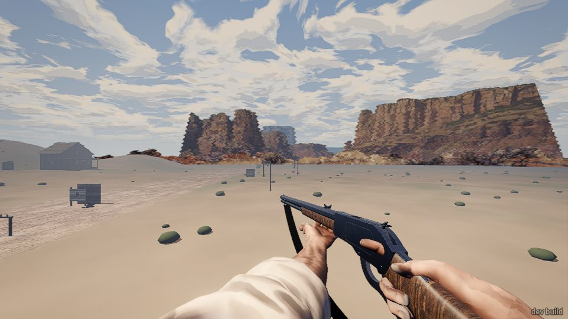
    - **30 m rope:** 10 aimed shots, each lined up with `look` on the rope. Not cut. One shot
      seemed to make it sway: a ray through it read "sky" once, then "rope" again. In the sight
      picture the rope is a one-pixel line that runs down into the rear notch.
      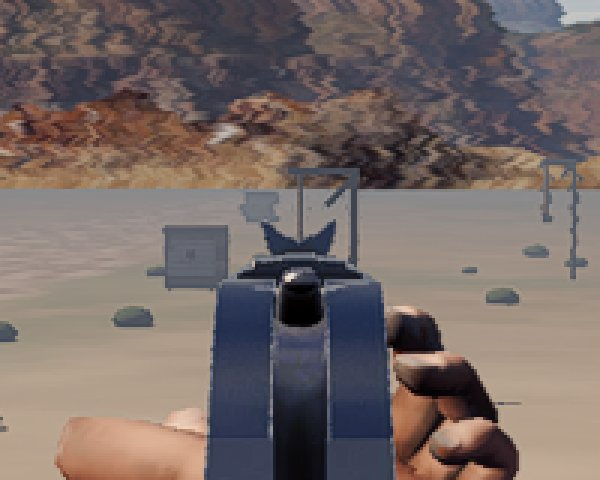
    - **60 m rope:** 5 aimed shots. Not cut. At 60 m, aimed, the front sight and the rear
      sight's ears cover the whole rope and sack. You can only see the top of the gallows.
      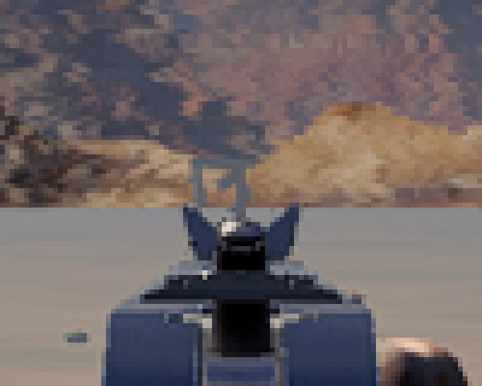
    - 15 shots in total, 0 ropes cut.
12. **Slung it.** `press holster`: *"rifle put away, 6 in the tube, chamber spent..."*. Nothing in
    my hands. I drew the shotgun ("2 loaded, 0 cocked") and then the rifle again. Its state was
    kept (spent case still in the chamber), and `press fire` correctly said "work the lever".
    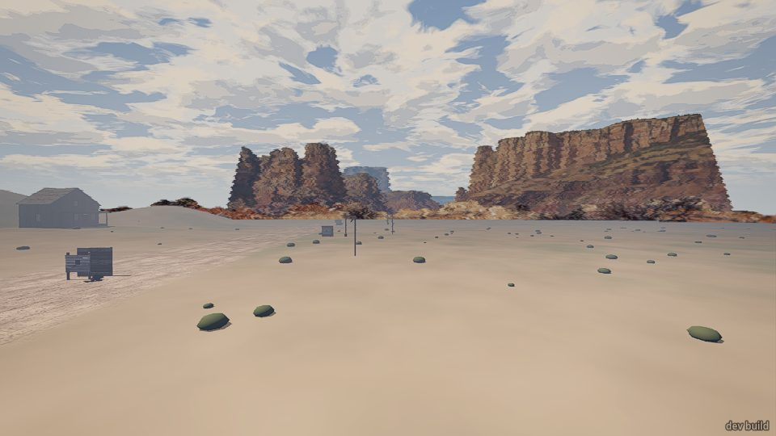

## What broke

- **I couldn't find the ropes without testing tools.** With my own eyes at 960x540 the 30 m
  rope is a 1-pixel line and the 60 m rope is hidden by the sights. To aim at them at all I
  swept `look X Y Z` + `read look` in steps (hundreds of probes) until a ray said "RopeBody".
  The 60 m rope only answers in a 2 cm window (z 15.00 to 15.01). A player couldn't do this.
- **No ropes cut in 15 aimed shots** (10 at 30 m, 5 at 60 m), all fired with my view on the
  rope. Either the gun puts the ball elsewhere (the shots looked identical, so I don't think
  it's wobble), or a ball through the rope doesn't cut it. Nothing in `events` said
  "hit the rope" or "missed".
- **My shots leave no trace in `events`.** It says "you fired" and nothing else: no hit on
  the outlaw, no hit on the board, no rope. The outlaw's "My leg... damn you..." came 17 s
  after my aimed shot. At the end he was "down" with **0 wounds**, which doesn't add up.
- **`shoot 1` only works half the time with the rifle.** When the chamber holds a spent case,
  `shoot 1` works the lever but doesn't fire. The screen says "The lever's open." and the shot
  is lost. Every second `shoot` fires. Five `shoot 1`s gave three shots. (Pressing `cock`,
  waiting a second, then `fire` worked every time.) A real player who clicks quickly after the
  lever may hit the same thing.
- **No spent case seen** in two tries with the lever held open right after a shot, or on the
  ground near me afterwards.
- `goto X Z` gave an error; it needs `goto X Y Z [YAW]`. playtest.md's `walk X Z` form made me
  expect the same for `goto`.

## What was flat or confusing

- **The sight picture is small and dark.** Aimed, the rear sight's two "ears" and the front
  sight are a few pixels at the top of a big blue-black receiver. At 30 m the front sight
  roughly covers a man's head. At 60 m it covers the whole target. I couldn't tell the front
  blade from the hammer behind it.
- **The hands look stuck on.** Aimed, the left hand floats to the right of the receiver with
  its fingers curled round nothing, and the skin is flat-shaded with visible facets. From the
  hip the rifle points well left of where you're looking (across the body), so from the hip
  it never looks aimed at what you face.
- **Loading has no picture.** Holding reload changes the numbers but the rifle and hands
  don't move.
- **An outlaw at the range picks a fight as soon as you draw.** A gunfight started before I'd
  fired at anything but the dirt. If the range is for practice, that's a surprise.
- **Townsfolk speak as a chorus.** Three to seven people said the exact same line at the same
  instant ("Get down! Everybody down!", "Lord almighty!", "...They gone?").
- The barkeep said "Take it! Take whatever you want!" when I turned toward the saloon with the
  rifle out, from 20 m on the street. Funny, but a bit much.
- With the rifle put away it keeps "hammer cocked" on a loaded chamber (shown in the weapon
  line after switching). That's maybe fine, maybe not.

## What was fun

- **The lever's rules.** "Work the lever", half cock that refuses to fire and says why, the
  tube and belt counting down honestly, and the revolver sharing the belt. It feels like a
  real 1873.
- The lever and bolt opening on screen when you hold the lever.
- The powder smoke hanging out on the range after a shot.
- A stranger who answered my first careless shot with one of his own. It felt Western,
  even if I didn't mean to start it.

## The top three things to fix

1. **The rope shot as it stands can't be done by a player.** You can't see the rope at 30 m,
   the sights hide it at 60 m, and 15 aimed shots cut nothing. Make the ropes and sacks
   readable (thicker, or lit against the sky), and check that an aimed shot on a rope can
   cut it.
2. **Say where my shots went.** Hits on people, boards and ropes, and the outlaw's wound,
   should show in `events` (and on screen). The outlaw being "down" with 0 wounds after
   complaining about his leg is wrong somewhere.
3. **The lever-then-fire timing and the spent case.** A fire pressed right after the lever
   says "The lever's open." and the shot is lost (`shoot 1` fails every other time). And I
   never saw a case eject. The lever's main pay-off is missing.
