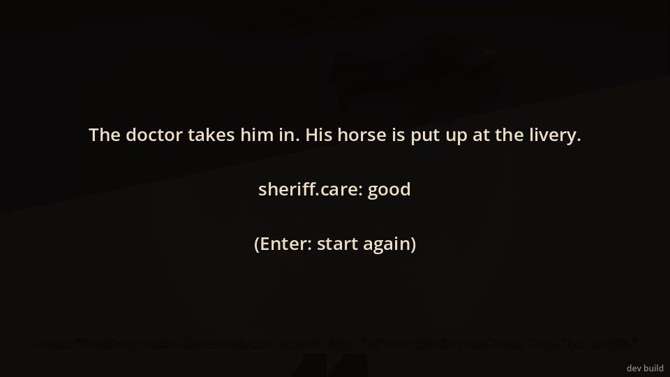
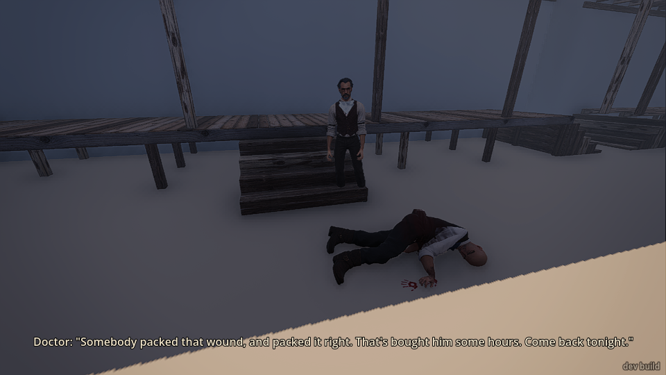
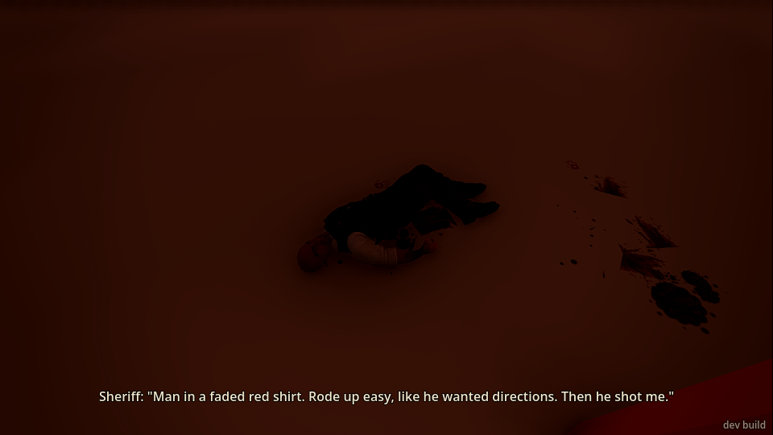
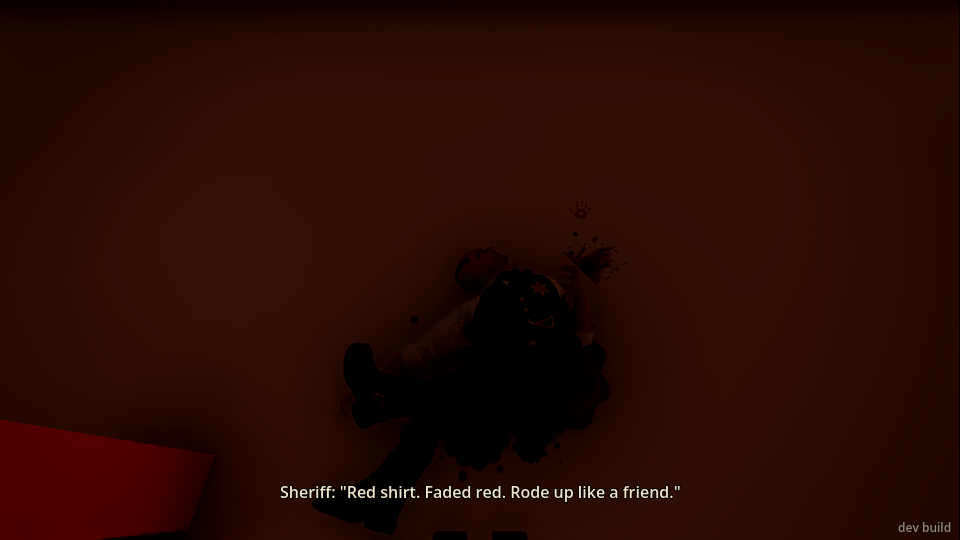
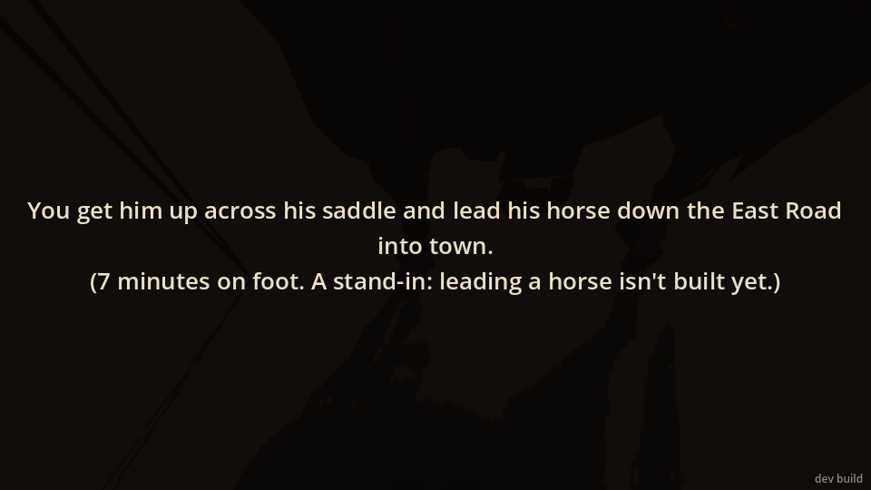

# Playtest 2026-11-10: the sheriff on the road

Played the opening mission in the valley (`--world=valley,--mission=sheriff`) three times as asked,
plus two short extra runs to catch the end card and to see what pressing looks like. The game was
drawn at 960x540 under a software renderer, about a frame a second.

## What I did

**Try 1: help as well as I can.** I woke at dawn by my homestead post ("Thomas Harlan's
homestead"). No card, no sound, nothing told me what was wrong; I just set off north down the path.
Nothing on the ground showed the path; I followed the named path points. Down through the dry ford
and up the other side, I could see a post and a horse on the skyline about 50 m off. Walking up, the
sheriff called out "Hold it! Who's that?", then "Harlan. You're Harlan, from up the creek. I'm
gut-shot. I need the doc. You going to help me or not?" A line on screen said to nod or shake my
head. I nodded. He said "Thank God. Press on it. Hard," and told me about the man in a faded red
shirt. I held E on his belly for about 7 seconds: "Christ! That's it. Keep on it," then "That'll
hold. My horse is yonder. Get me up on him." I stepped to his horse and pressed E. A black card
said I got him across the saddle and led the horse into town ("7 minutes on foot. A stand-in:
leading a horse isn't built yet."). I was put in town by the doctor's steps, the sheriff lying face
down in the street. The doctor: "He's bled a fair bit. Up the steps with him, quick now," then
"Somebody packed that wound, and packed it right. That's bought him some hours. Come back
tonight." An end card: "The doctor takes him in... sheriff.care: good (Enter: start again)".

**Try 2: help, carelessly and slowly.** I stood at home for a minute and a half, dawdled twice more
on the way and stood near him for 15 seconds before answering (about 6 minutes in all). This time
he didn't know me: "Who's there? Don't... don't come closer," then "I'm shot. In the belly. Get me
to the doc... will you?", and "Please." twice while I said nothing. I nodded, then held E for only
two seconds, looking at his head rather than his belly. He got "...that's it." but no "packed".
I took him to the horse anyway. The doctor: "Lord. He's near bled white. Get him inside," then
"He's lost more than he can spare. I'll do what I can. It may not be much." End card: care poor.

**Try 3: don't help.** I came up, he asked, I shook my head. "You'd leave a man in the road? Then
go on. Damn you." I walked back toward home. After a while he shouted "Harlan! HARLAN!" and a card
said a freighter found him later that morning and hauled him into town. End card: "left him". When
I walked back, he was gone.

**Extra runs.** (a) I walked up and didn't answer at all: every 14 seconds, "Well? Nod or don't,
but don't just stand there." I then pressed the wound without ever nodding: that worked, and he
packed fine, but he kept saying "Well? Nod or don't..." even after "That'll hold." (b) A run just to
screenshot the press itself.

## What broke

- **He says things twice.** In try 3, my one shake got "You'd leave a man in the road? Then go on.
  Damn you." twice within half a second, and then a third time 15 seconds later while I was only
  walking away. The mission's own readout logged two separate "shake" answers, so turning round to
  walk off seems to count as shaking my head again.
- **He asks for an answer after you've already helped.** If you press the wound without nodding
  first, he thanks you and says "That'll hold. Get me up on him," then, five seconds later, "Well?
  Nod or don't, but don't just stand there." Pressing his wound should count as your answer.
- **The end card shows debug text.** "sheriff.care: good" / "sheriff.care: poor" / "sheriff.care:
  left him" is printed on the card under the story line. It reads like a spreadsheet, not a game.
  
- **The doctor asks for help nobody gives.** "Up the steps with him, quick now" / "Help me get him
  up the steps" / "Get him inside", but the sheriff just lies face down in the street, the doctor
  stays on his steps, and the end card says "The doctor takes him in". E there did nothing useful
  (a short press was a kick at nothing).
  
- **The clock.** It was 05:36 the whole way to him (several minutes of walking and waiting, same
  minute every time I checked); after the "7 minutes on foot" card it was 09:24 in town.
- **The view isn't reset on "start again".** After Enter I woke at home looking at the ground with
  whatever pitch I'd had in town. 
- **Every restart shows the sheriff shot twice** in the event list ("sheriff hit in the abdomen"
  twice, 1.6 s apart). He only had one wound when I got to him, so it may only be the log.
- Pressing E while looking at his head (not the wound) still counted as pressing the wound.

## What was flat or confusing

- **Nothing tells you why you're walking.** The start is a dark field, a post and an empty sky:
  no shot heard, no card, no smoke, no horse whinnying. I only went north because the brief said
  so. A distant shot at dawn, or a riderless horse, would give a player a reason to go.
  
- **The path isn't on the ground.** Walking the named path points, I saw no track, ruts or posts
  between home and the ford; at the ford all I could see was a bank of dirt.
  
- **You can't see him until you're nearly on him.** At 50 m only the post and the horse show; the
  man lying in the road is invisible in the dawn light. 
- **Pressing doesn't look like anything.** While holding E I saw him from standing height, a few
  metres below me, in near darkness: no hands, no kneeling, no cloth. Only his words said it was
  working. 
- **Lines tread on each other.** "Christ! That's it. Keep on it." was replaced on screen by the red
  shirt line 0.3 seconds later, so you'd never read it.
- **Answering with your head** worked every time I tried (nod, shake, even looking straight down
  at him), and the hint on screen said how. But the hint says "(move your view)", which is a
  programmer's phrase; and a player would expect E or a key to also work.
- The scene, done well, lasts about 30 seconds of talking and one key press. The trip to town is a
  card; once there it ends. "Come back tonight" sets something up that isn't there yet.

## The wounded man

- **He did seem hurt and frightened, and he changed with time.** Reached fast he's sharp and
  knows me by name ("You're Harlan, from up the creek"), and tells the red-shirt story in full.
  Reached late he doesn't know me, is scared ("Don't... don't come closer"), begs ("Please."), and
  the same story comes out in pieces ("Red shirt. Faded red. Rode up like a friend."). That was the
  best part of the mission.
  
- He lies still apart from shifting about a metre over the first few minutes. Some blood on the
  ground beside him. Nothing about his breathing or moving that I could see in the dark.
- Leaving him earned "Harlan! HARLAN!" from behind, which hit home.

## Did helping well make a difference?

Yes, and you can hear it, which is good:
- Fast and packed: the doctor says the wound was packed right and "bought him some hours".
- Slow and not packed: "Lord. He's near bled white", "It may not be much."
- Left: a freighter brings him in.

But you only hear it through the doctor's two lines and the debug word on the card. Nothing you
can see differs (he lies face down in the street the same either way).

## The typed cards

- The ride-in card reads well until the bracket: "(7 minutes on foot. A stand-in: leading a horse
  isn't built yet.)" That's a note to the team and it breaks the spell. 
- The freighter card ("Later that morning a freighter coming down the East Road finds him and
  hauls him into town in the back of his wagon.") is the best-written of them.
- The end card's "sheriff.care: good" line should go; "(Enter: start again)" is fine.

## What was fun

- Finding a hurt man who reacts to how long you took, and whose story comes out differently.
- Nodding to answer is a nice, quiet idea; it felt like being there rather than picking from a menu.
- The doctor's verdicts, and "Harlan! HARLAN!" when you walk off.
- The town by the doctor's steps (boardwalk, steps, the doctor in his waistcoat) looks good even as
  a greybox.

## The top three things to fix

1. **Make the answers clean:** count turning to walk away as walking away, not as more head
   shakes (no repeated "Damn you"), and treat pressing his wound as a yes so he stops asking "Nod
   or don't" after you've helped.
2. **Take the debug words off the cards:** "sheriff.care: ..." on the end card and "A stand-in:
   leading a horse isn't built yet" on the ride-in card.
3. **Give the opening a pull and finish the arrival:** a shot, a horse or something at dawn to send
   you down the path (and a visible path), and at the doctor's, have him (or you) actually get the
   sheriff up the steps instead of leaving him face down in the street while the card says he's
   taken in. (Also reset the view on restart.)

Screenshots: `docs/playtests/2026-11-10/` (t1 = try 1, t2 = try 2, t3 = try 3, t4/t5 = extra runs).
