# Playtest 2026-11-10: the Winchester 1873

A blind playtest of the new lever-action rifle, played through the dev bridge (about one frame a
second here). The game was started with `tools/playtest.py start` (the town, noon). I didn't read
the code. Screenshots are in `2026-11-10-winchester/`.

## What I did

1. **On the street, by the saloon.** `weapon rifle` took it off the sling: "15 in the tube,
   chamber empty, 24 cartridges, hammer down". That's what I was told. Just drawing it, with no
   shot fired, set Bench Man B (17 m away) begging.
   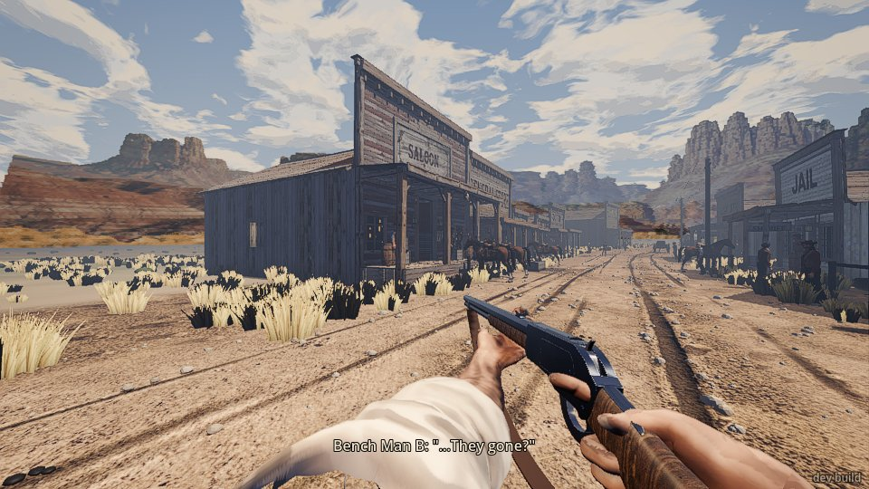
2. **Worked the lever** (`press cock`): 14 in the tube, chamber loaded, hammer cocked, and the
   dust cover slid open. The outlaw, 31 m off, said "Keep that iron where it is."
3. **Half cock.** `rifle half`, then `press fire`: nothing fired. The screen said "It's on half
   cock: Q to cock it." Q brought it back to full cock and no round was wasted. Good.
4. **From the hip**, at the livery's side wall 16 m off: two shots. The first went through the
   siding and broke a window at the back of the livery. Everyone in the street shouted "Get down!
   Everybody down!" and cowered. The gang (Lyle, Brody, the Kid) rode in during this, ignored the
   shooting, went into the saloon, bullied the barkeep ("What's the matter, Pop? Hands shaking?")
   and rode out ("We'll be back, Pop").
   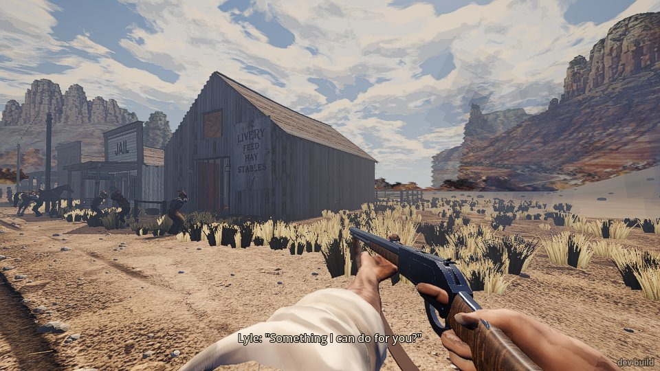
5. **Aimed** (`hold aim`): the rifle came up to the eye and I fired two more. `shoot 1` worked the
   lever each time as promised.
   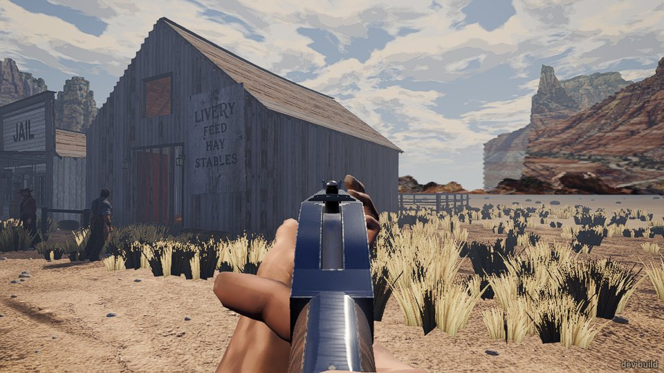
6. **Up high for the rope.** The town's saloon has no place up top to go to, so I went to the
   farmhouse loft window (about 5 m up), facing south. Standing at the window, the rifle was
   shoved up into my face (below). I stepped back a metre.
   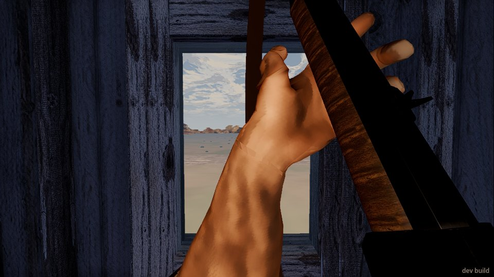
7. **Rope at 30 m from the loft, steady** (aimed, 2 s settle before each shot). The first shot
   broke the window glass. **It took 6 shots to cut it**: shot 4 counted as a hit but took nothing
   off ("left 1.0"); shot 6 cut it ("parted", "left 0.38").
   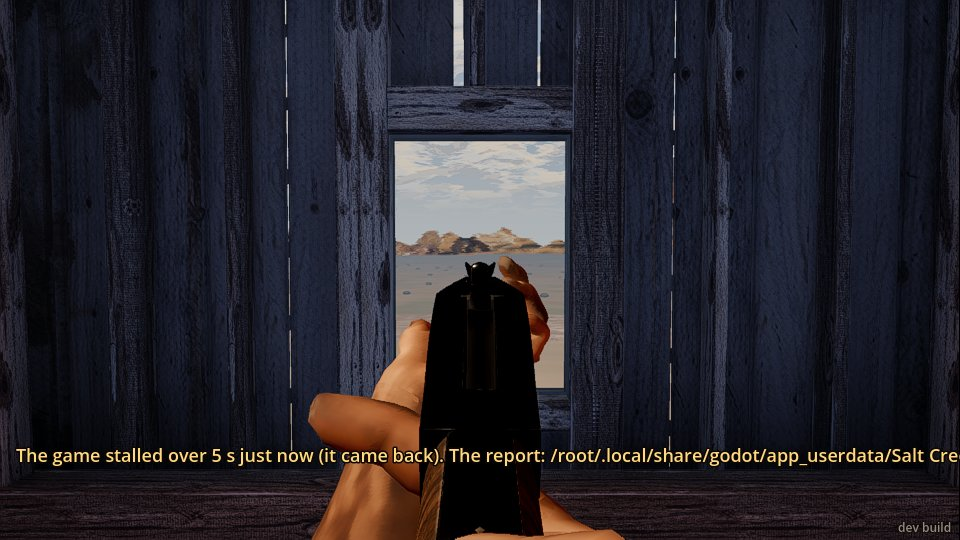
   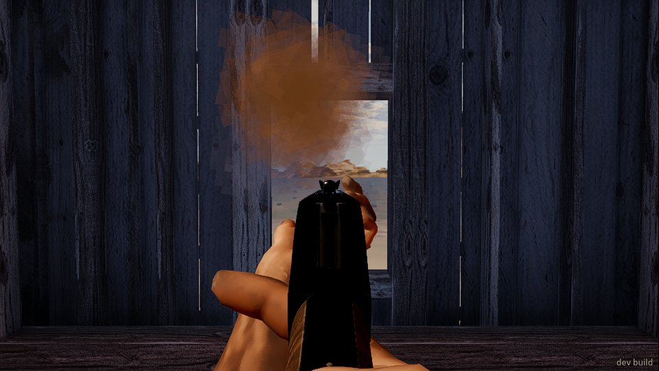
8. **Loading through the gate.** `press reload` added one round each time and drew one from the
   belt. Holding reload for about 9 s loaded 7. Topping up past 15: "The tube's full (15)."
   `rifle load 3` on a full tube said the same.
   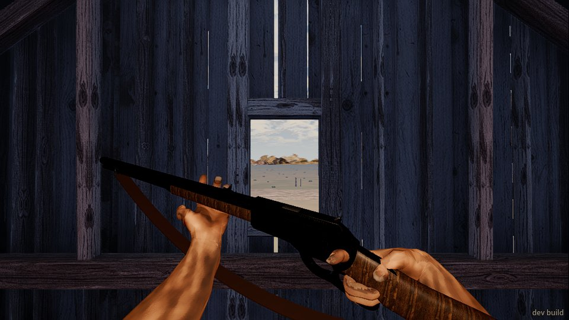
9. **Rope at 60 m from the loft, steady.** **10 shots, no hits.** I didn't re-aim between shots,
   and my view had climbed from level to 4.6 degrees up by the end: the recoil lifts the view and
   it doesn't come back down. Then I put the sights back on level before every shot, with a 2 s
   settle: **the 4th of those cut it with one hit** ("left 0.32"). So 14 shots, or 4 if you re-aim.
10. **On the ground, 30 m, rushed**: I ran 9.6 m towards the rope, turned straight onto it,
    shouldered and fired with no wait. **2 shots, 2 hits, cut on the 2nd.** (Before that, 3
    "immediate" shots from the farmhouse porch at about 38 m gave 1 hit.)
    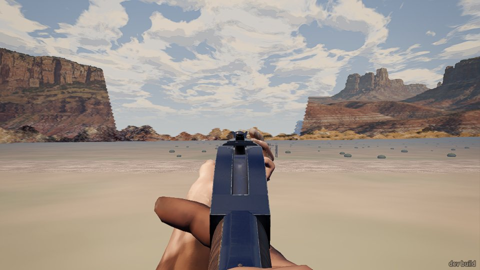
11. **60 m, rushed** the same way: **5 shots, 1 hit (the first, "left 0.6"), not cut.**
12. **Emptied it.** The last round fired, then `shoot 1` answered "clicked 1": "It's empty: load
    it through the gate (R)." Clear.
13. **Put away and taken out:** the rounds in the tube stayed. The dust cover had closed itself
    when I slung it.
14. **Shared cartridges.** With 2 in the rifle's tube and 2 on the belt, the revolver showed "2 on
    the belt". I fired two with the revolver and reloaded it, which took the last 2. Back on the
    rifle, `press reload` said "You've no cartridges left to load (2 in the gun)." So the belt is
    shared, as promised.
15. **Lever on a live round.** `rifle lever` with a round in the chamber, then `rifle open`: both
    live rounds were thrown out and gone (not back on the belt, the pouch still 0), with no message.
16. **Back in town, aimed the (empty) rifle at the outlaw**, 14 m away. For 8 s he stayed "calm,
    ignore". When I shouted "Drop it!" he said "Easy, friend", then "One more move..." twice, then
    "You win. For now." He was bluffed by an empty gun.
    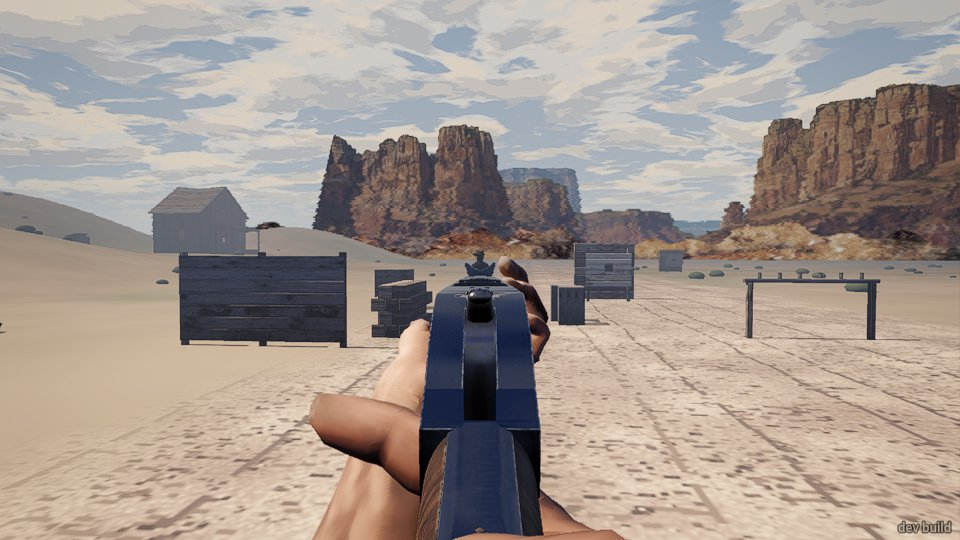

### The rope, in numbers

| Where | How | Shots to cut | Hits |
|---|---|---|---|
| Loft, 30 m (first shot through glass) | steady, not re-aimed | 6 | 2 (one took nothing off) |
| Loft, 60 m | steady, not re-aimed (view climbed 4.6 degrees) | not cut in 10 | 0 |
| Loft, 60 m | steady, re-aimed to level each shot | 4 | 1 |
| Ground, about 38 m | shouldered and fired at once | not cut in 3 | 1 |
| Ground, 30 m | ran, then shouldered and fired at once | 2 | 2 |
| Ground, 60 m | ran, then shouldered and fired at once | not cut in 5 | 1 |

There's a caveat on "rushed". Drawn at about a frame a second, every bridge command takes a
second or more of game time, so even my "at once" shot came 1 to 3 s after I stopped running (my
speed read 0). And `look` put my view exactly on the rope, which a player can't do (see below).
So my rushed shots were steadier than a real rushed player's.

## What broke

- **Q puts it on half cock when you mean to make it ready.** With a round in and the hammer back,
  every `press cock` (even `press cock 0.1`) eased the hammer to half cock. The next press cocked
  it again. At this frame rate any press is a "hold", so I couldn't tell a tap from a hold. But a
  player who taps Q "to be sure" before a shot may find his rifle on safe.
- **Working the lever on a live round throws it away without a word** (step 15). I lost two rounds
  and nothing said so.
- **`rifle lever` answers halfway through the stroke.** It said "lever open, chamber empty,
  carrier 1". A second later `rifle state` showed it closed and loaded. That reads as if the lever
  stuck open.
- **`shoot 1` on an empty rifle took 20 s of game time** to come back (t 711 to 731), where a shot
  takes about 4.
- **A stall notice after jumping to the farm loft:** "The game stalled over 5 s just now (it came
  back). The report: /root/.local/share/godot/…". It stayed on screen across two screenshots
  about 8 s apart.
  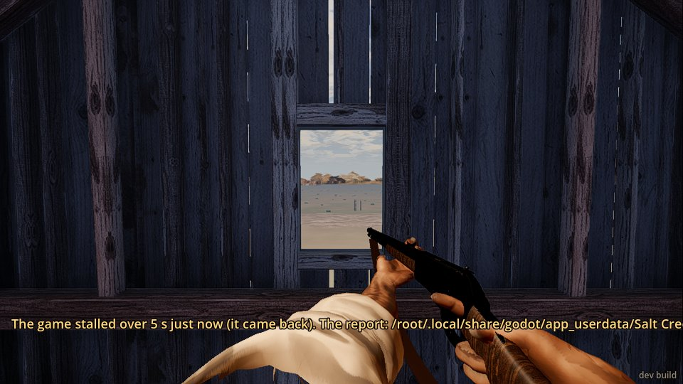
- **Too close to a window, the rifle fills the screen** (step 6). The forearm and stock are pushed
  up across the view at 0.8 m from the glass.
- **The walk off the farmhouse porch went nowhere:** three `walk 99.7 -37.2 run` from the porch
  each moved me 0.35 m and said "arrived". From the yard the same walk worked.

## What was flat or confusing

- **I couldn't see the rope at 30 m or 60 m.** No line shows in any screenshot, even blown up 3
  times. At 8 m it's a single hair-thin line running down to the ground, and there's no man on it.
  A player would be shooting at empty air and couldn't aim at it.
  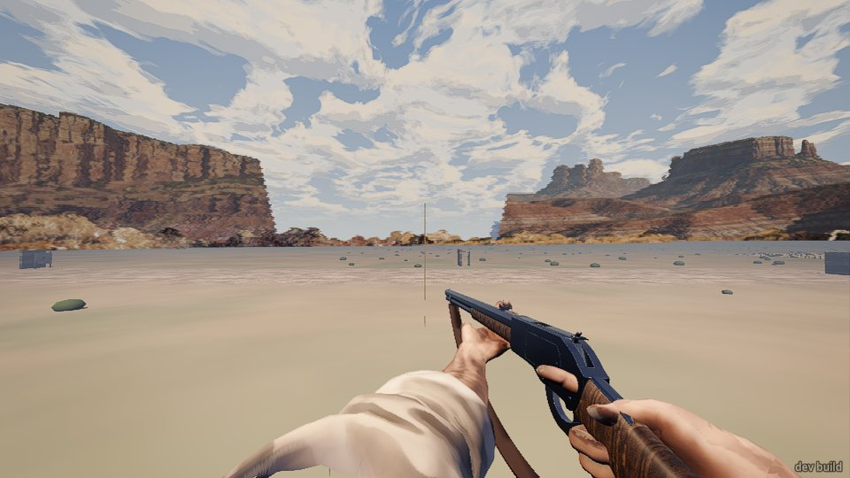
  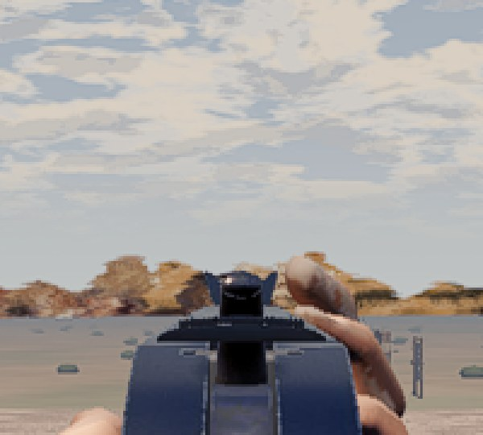
- **Nothing tells you that you hit or cut the rope.** No event, no line on screen. I only knew
  through the `rope` command. A hit that "took nothing off" (left 1.0) is puzzling too.
- **Rushed wasn't harder than steady.** Running in and firing at once cut the 30 m rope in 2
  shots; steady from the loft took 6. What really decided the hits was the recoil lifting the view
  and not coming back. (See the caveat above: I can't truly rush at a frame a second.)
- **The rope can't be "shot down at" the way the story scene would.** It hangs from a metre above
  your own eye, so from the loft it hung about 7.5 m up in mid-air, and my shots were level, not
  downward.
- **The sights cover the target.** Aimed, the receiver and front blade are big and close: at 14 m
  everything of the outlaw below his head is hidden behind the front sight. In the first aimed view
  (16 m) I could see the front blade but not the buckhorn; at the loft and on the ground the
  buckhorn and blade lined up properly. The left thumb sits just right of the front sight.
- **The hands in the loading pose:** the left hand floats under the forend without holding it.
  The right hand is on the wrist of the stock with no cartridge in it. Both forearms are bare,
  where at the hip the left arm has a big white sleeve.
- **From the hip** the barrel points well up and left of the middle of the screen. `look outlaw`
  with the rifle gave no `from_the_barrel` line, so I couldn't tell how far off a hip shot goes.
- **No reaction to being aimed at:** the outlaw stood "calm, ignore" with a rifle on him at 14 m
  until I shouted. Bench Man B, though, panicked at the mere drawing of it, 17 m off. He said
  "...They gone?" and "Don't shoot! I got a family!" in turn about every half second, over and
  over.
- **The rifle's "24 cartridges" run out fast:** the rope tests and the lever's lost rounds used
  the whole belt (and the revolver's spares) in about 15 minutes.

## What was fun

- **The rifle's messages are short and clear:** "It's on half cock: Q to cock it." "The tube's
  full (15)." "It's empty: load it through the gate (R)." "You've no cartridges left to load (2 in
  the gun)."
- **It feels like a lever gun:** a round at a time through the gate, topping up any time, the
  dust cover sliding open and staying open, half cock as the safety.
- **A ball went through the livery's side wall and broke the window at the back.** The rifle
  punches through boards, which feels right.
- **The street's reaction to gunfire** ("Get down! Everybody down!"). And the gang walked into the
  middle of it, ignored it, drank and robbed the barkeep anyway.
- **The thick brown powder smoke** from a shot filling the loft window, so you wait for it to
  clear before the next shot.
- **One clean hit cutting the rope at 60 m** after laying the sights back on and waiting felt
  earned.
- **The outlaw backing down** ("You win. For now.") from a rifle with nothing in it.

## The top three things to fix

1. **Let the player see the rope and know when he's hit it.** It's invisible at 30 and 60 m, and
   a hit or a cut gives no feedback at all. The rope shot can't be played as it stands.
2. **Make rushing cost something, and settle the recoil.** Shots fired at once after a run hit as
   often as or more than steady ones. What decided the hits was the view climbing with each shot
   and never coming back. (Worth checking at full frame rate, which I couldn't do.)
3. **Gun handling traps and the hold:**
   - Q eases a ready rifle to half cock (any press, here).
   - Working the lever throws live rounds away without a word.
   - Aimed, the receiver and blade cover a man at 14 m; the rifle is shoved into your face near
     a window; the hands don't hold the gun while loading.
