# Playtest: the coach heist (2026-11-12)

Mission `--world=valley --mission=coach`, played through the dev bridge at about one frame a second.
About 45 minutes of wall clock. Four tries: two from the high bank, two from down in the road.
Test-only commands: I used `ch_fight` twice (a read-out, no changes to the game) when I couldn't tell
whether I was carrying the strongbox and couldn't find the way out. I used `goto` three times to save
walking. Nothing else test-only.

## What I did

**Try 1: too slow.** I start on the high bank beside a timber frame with a big log hanging in it. One
line on screen: "The Baron's coach is coming up the grade. Shoot the pin as it comes under the log."
The ground is pale and bare, and big untextured white and blue blocks stand on the hilltops.

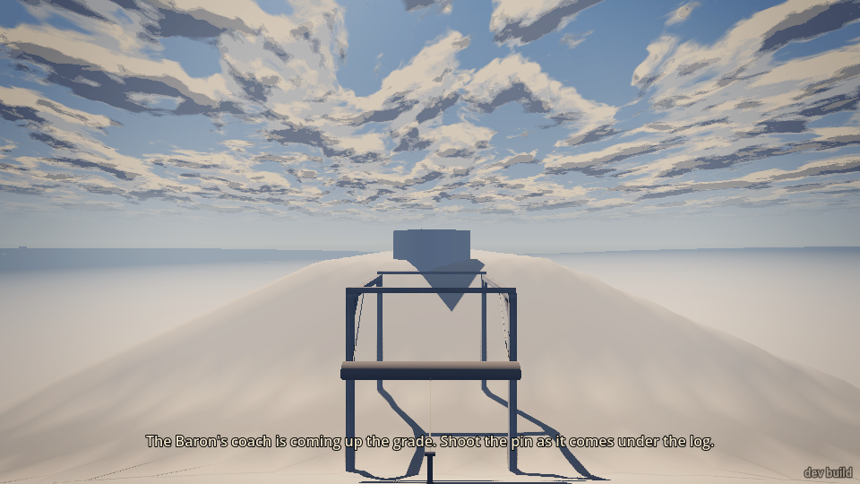

The coach comes up the road at walking pace. **There are no horses.** It rolls along by itself with the
tongue trailing on the ground, and the driver and messenger sit on the box holding reins to nothing.

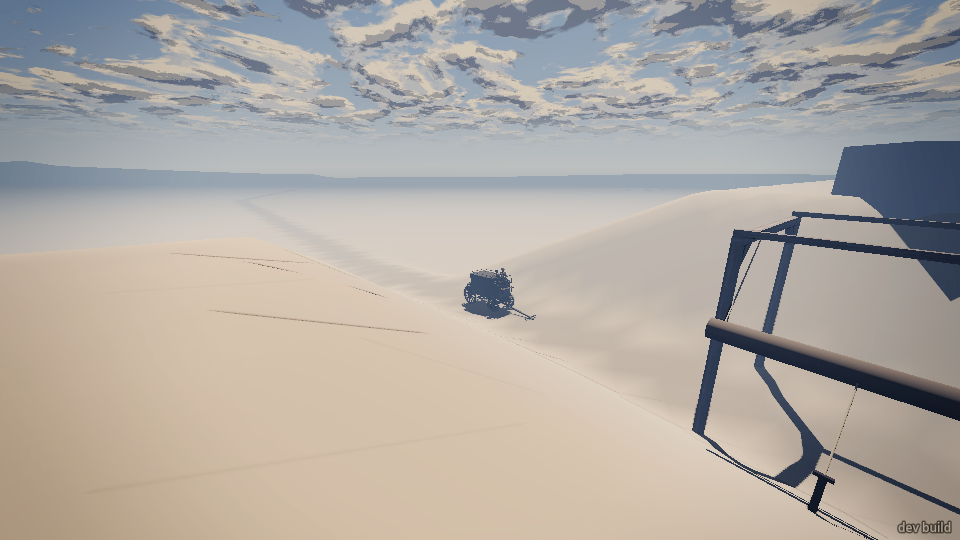

It took me too long to work out which thing was the pin (a short post at the foot of the frame on my
bank, about 10 m down) and the coach got past. "The coach got by. The Baron's papers are on their way to
his ranch. (Enter: try again)." Enter worked; the bridge dropped for a few seconds while it reset.

**Try 2: shot the pin from the bank, won the fight, got the box, couldn't get away.** I aimed at the pin
before the coach came and fired as it reached the log. The pin broke and the log swung down into the
coach. "196 pieces of timber broke", and all six men went down at once. The coach stayed upright.

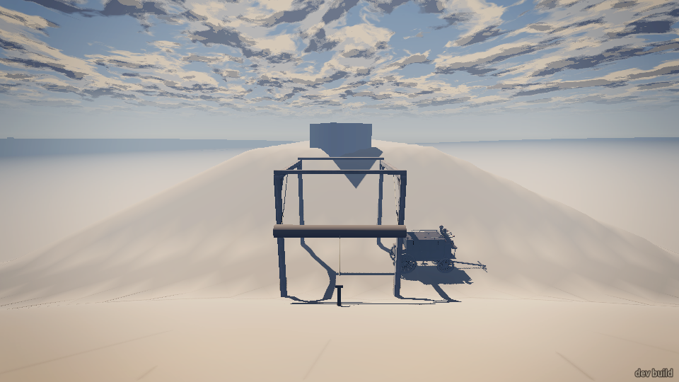
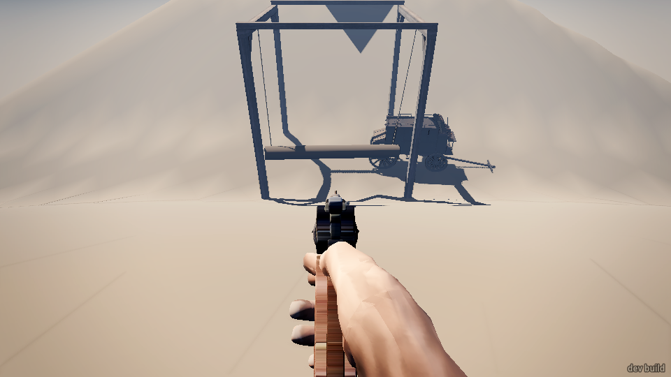

The four guards climbed out and shot back at me on the bank. I went prone with the rifle and fought for
about four minutes of game time. They called to each other the whole time ("Reloading! Cover me!",
"Go on, I got you!", "Hold on, I got you!"), went to drag their hurt friends, and one climbed the far
bank to flank me. I hit three of them. One bled out, two were knocked cold. The driver and messenger
lay by the coach. When I walked down and shouted "Drop it!", both gave up: "Don't shoot! I quit, I
quit!" and "Enough! It's yours!". The last guard gave up later on his own: "Alright! Alright! I'm done!"

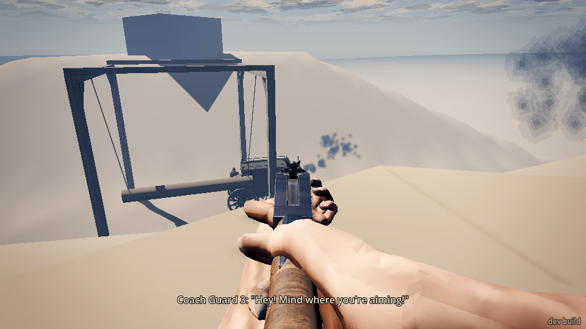

Down at the coach, everything was called "Rubble" (`read look`) and a tap of E did nothing. I found the
cargo by luck: standing right at the open side door, a tap of E gave "Hold E to haul the strongbox
out through the door". Holding E: "Hauling the strongbox out...", "The Baron's strongbox: iron,
padlocked.", "Shouldering it...", "You've the box on your shoulder. E sets it down."

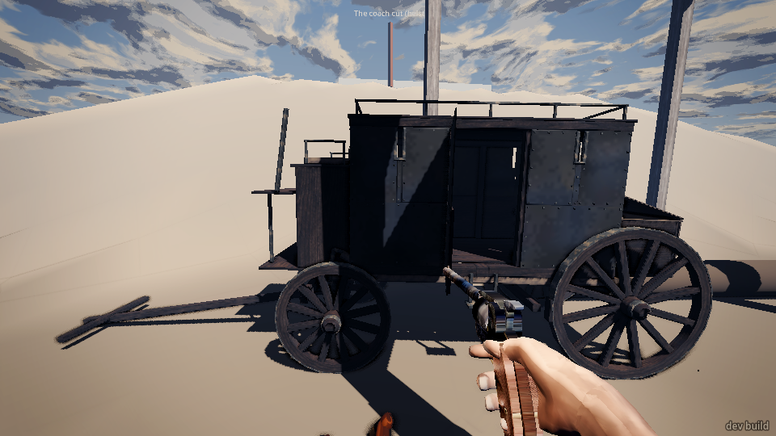

Nothing on screen shows the box, though (I still hold my revolver, see below). With it "on my shoulder"
I *ran* 150 m down the road and 100 m up the road. Nothing happened. Then a tap of the real E key
(`key E`) set it down: "Padlocked. Shoot it off, or hold E to shoulder the box (44 kg)". I shot the
padlock off ("timber broke (baron_strongbox/padlock)", then "The lock's gone. Hold E to open it"),
held E to open it, and held E again to take the papers: "The Baron's papers: deeds, a ledger,
letters. Now get clear: the rimrock trail, past the cut."

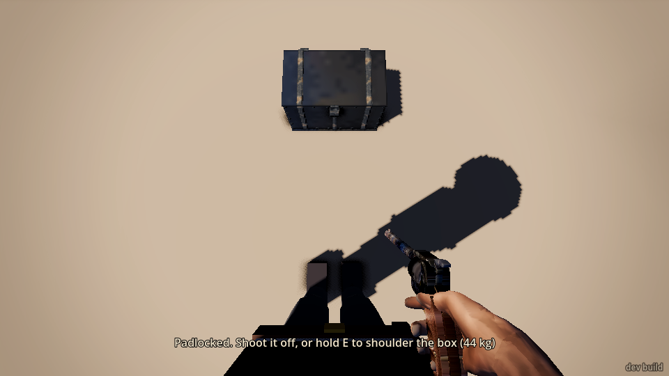
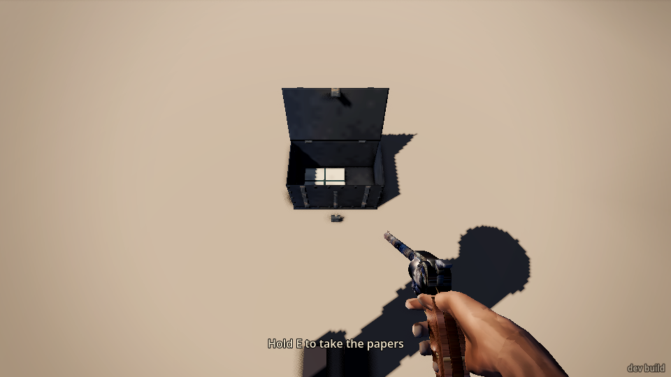

**I never found the rimrock trail.** It isn't in `read places`, there's no marker, and from the banks
I couldn't see any path. I walked 100 m past the cut up the road, went up to the outcrop on the far
bank, went 100 m north and 100 m south. The mission never ended. The only marker in the world is a red
post above the start with a floating debug-looking label, "The coach cut (heist)".

**Try 3: went down early and tried a hold-up.** I stood in the road past the log, revolver drawn, and
shouted "Drop it!" as the coach came at me. Nobody reacted. The coach rolled by about a metre from me.
I fired twice at the men on the box. No hits and no reaction from them, and the coach "got by" again
at exactly 64.4 s, the same moment as try 1.

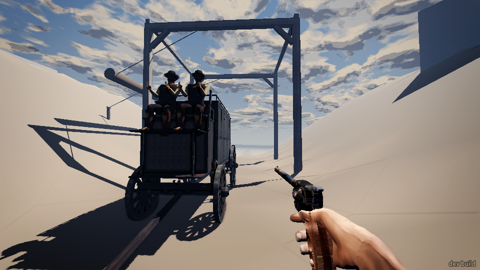

**Try 4: shot the pin from the road, fought up close.** The pin can be shot from the road (about 16 m).
My first shot didn't break it, the second did, but too late and the log missed the coach. On the retry
I waited for the coach and it hit. This time the coach was knocked back down the grade.

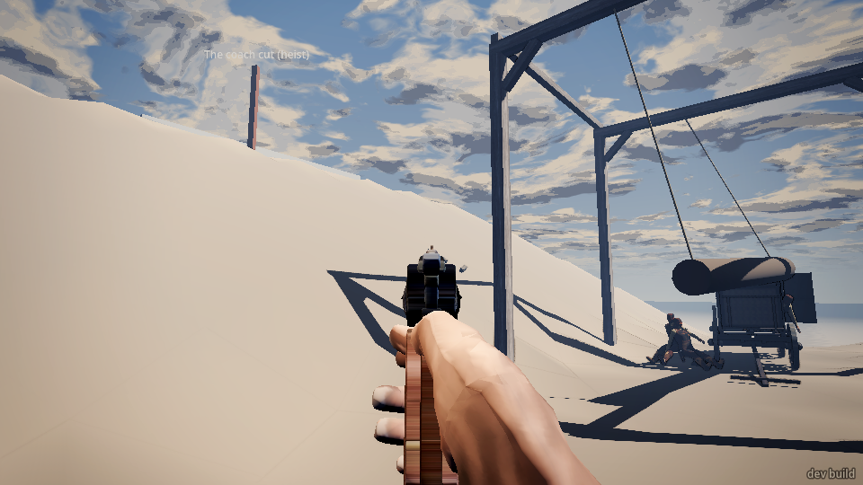

Up close it was a real fight. I shot the driver from prone. I was hit, then gut-shot by the messenger
from the far bank behind a block. I crawled behind the fallen log and held tend_wounds ("Packed and
bound it with your bandana"). The messenger then walked right up to me, two metres away, reloading.
I shot him and he gave up. I put down the last guard, hauled the box out and walked off with it.
About 15 seconds later I blacked out: "You're down." Then, oddly, "You come round on the store floor,
bandaged, 6 hours on. It's 18:00. / Messenger shot you down." I came round standing in the valley at
sunset, with 3 wounds.

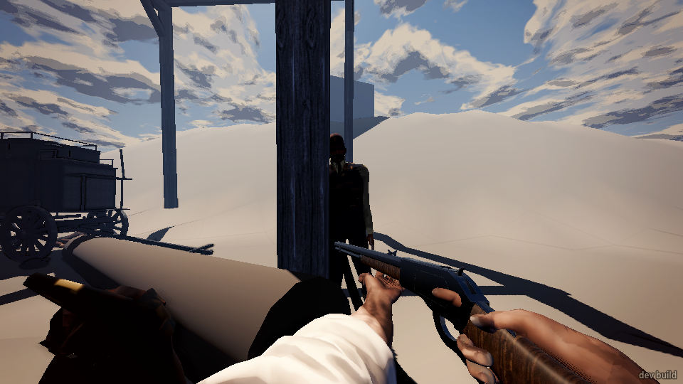
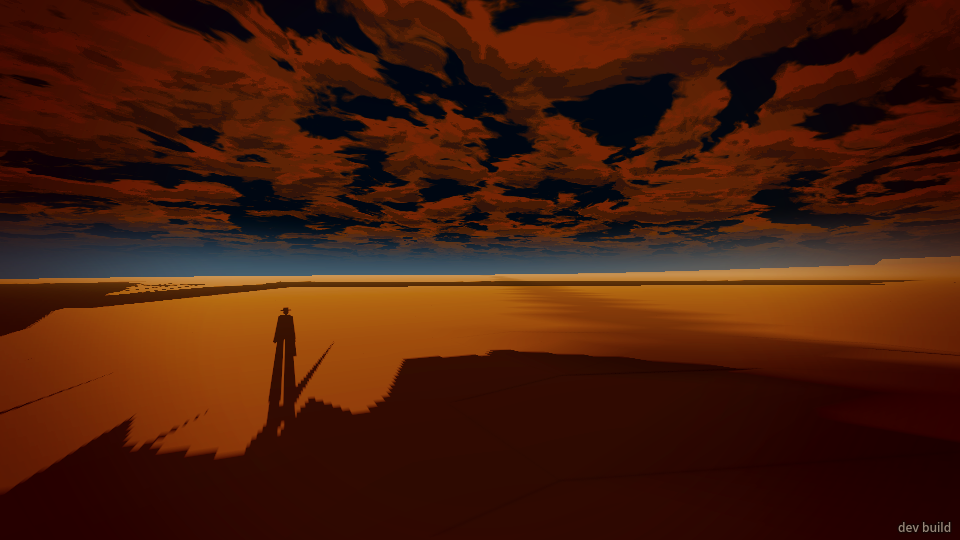

**Try 5 (short): from the bank again.** The pin went early (coach still ~10 m off), but the log waited
and hit anyway. One guard then ran between his three downed friends for two minutes, "Hold on, I got
you!" every 6–8 s, switching who he was dragging each time and never finishing. He ignored my "Drop
it!" from 18 m, then shot me in the head as I walked to the coach: "Your skull's broken. You're down."
I came round on "the store floor" again, with "An ear shot off, bone broken."

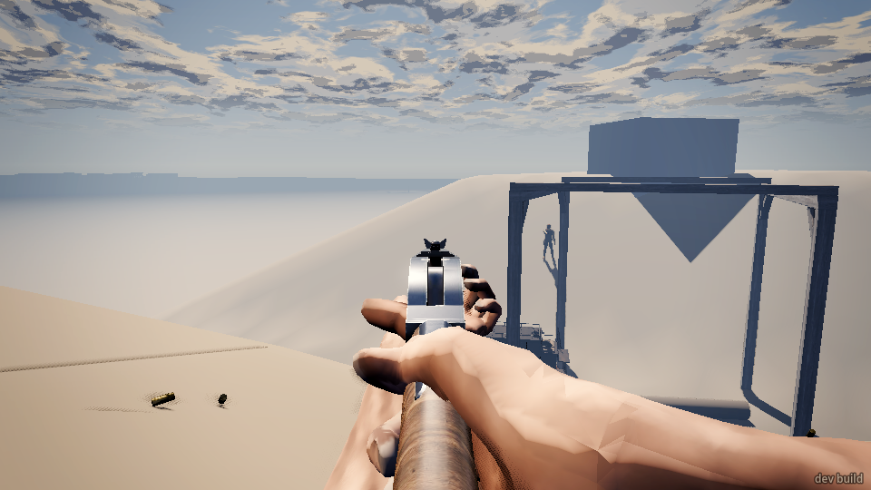

## What broke

- **The way out doesn't exist for the player.** "Now get clear: the rimrock trail, past the cut" names
  a place that has no marker, no path, no `read places` entry and nothing to see. I went 100 m in
  every direction from the cut with the papers and the mission never ended. I couldn't finish the
  heist in any try.
- **Carrying the box shows nothing, and the bridge's `shove` doesn't set it down.** After "You've the
  box on your shoulder" the screen shows the revolver still in hand and no box.
  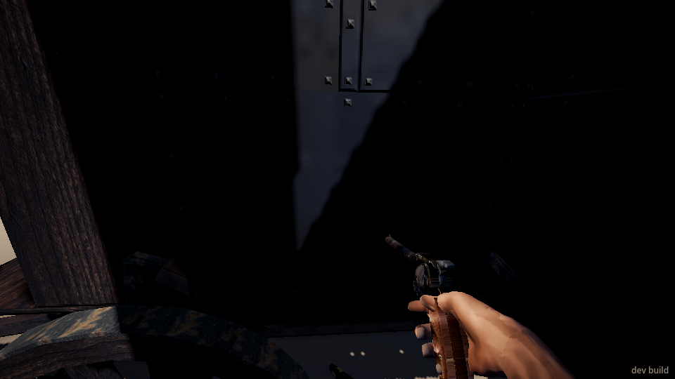
  The `shove` command (a tap of E) only answered "you shoved at nothing", so I couldn't tell if I had
  it. `ch_fight` said "carried". Only `key E` set it down. I also *ran* well over 100 m with a 44 kg iron
  box, revolver out.
- **"You come round on the store floor... It's 18:00"** shows in the valley mission (twice). You come
  round standing where you fell, out in the valley at sunset, not in a store. And the mission had
  already said "You're down. (Enter: try again)", so it isn't clear whether you've lost or carry on.
- **The coach has no horses.** It drives itself, with the tongue dragging and the driver holding reins
  to nothing.
- **A man in the road with a gun gets no reaction from the coach or its men.** I shouted "Drop it!" and
  fired at the box from a few metres. Nobody spoke, ducked, sped up or fired back, and the coach drove
  past me.
- **One guard stuck in a rescue loop** for over two minutes: "Hold on, I got you!" to a different
  downed man every 6–8 s, never dragging anyone anywhere. He didn't react to "Drop it!" either.
- **Downed men "rescuing"/"moving" who never move.** After the log hit, the messenger and driver
  (try 2), and the messenger and a guard (try 5), sat as "down" with 0 wounds and tactic "rescuing" or
  "moving" for minutes, never moving. The messenger and driver only gave up once I shouted.
- **Hits with no wound.** Right after the log hit: "driver hit in the pelvis, thigh_r, thigh_l,
  shin_l, head" and "messenger hit in foot_l, thigh_l, pelvis", but `read people` shows wounds 0 for
  both. In try 4 I had a wound (`wounds: 1`, "Bleeding a little") with no "you hit" event at all.
- **`press crouch_toggle` never stands you up.** It goes to crawling, then crouching, then crawling
  again. `crawl off` didn't stand me up in the open road either. Only a `walk ... run` did.
- **Guards scold each other in the middle of a gunfight.** "Hey! Mind where you're aiming!" and "Watch
  where you're shooting!", several times. Probably friendly fire (one guard took a thigh hit I didn't
  fire), but it reads as if they're telling *me* off.
- **Debris hangs in mid-air.** A few broken bits from the log's frame stayed floating above the coach
  for the whole try.
  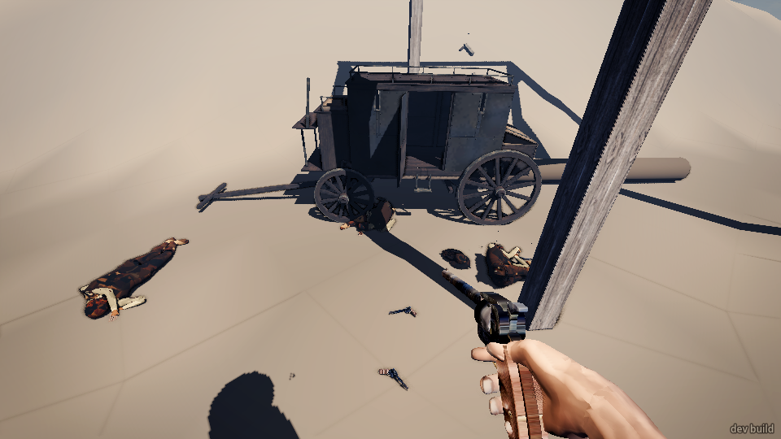
- **A debug label in the world.** A red post on the hill above the start carries the text "The coach cut
  (heist)", readable from the road.
  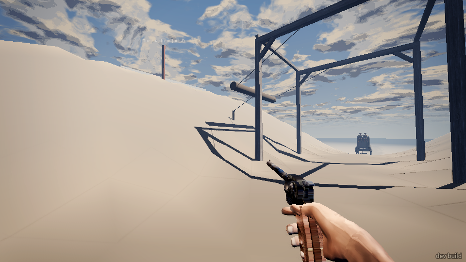
- **The coach counts as "Rubble"** when you look at it (`read look`), and so does the fallen log. An
  unnamed "@RigidBody3D@78186" also turns up in `in_the_way`.

## What was flat or confusing

- **The world is unfinished.** The ground is a bare pale sheet, and the "rimrock" is big untextured
  white and blue blocks. There is nothing to read the land by: no road edges, no trail, no brush.
  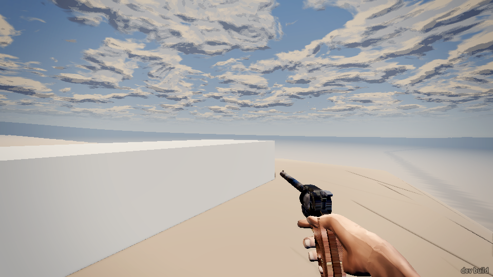
  
- **Finding the pin.** "Shoot the pin" doesn't say where it is. It's a small post at the foot of the frame
  on your bank, about 10 m below you, and `read look` calls it "oak post of ram_trip_1". I lost try 1
  working that out.
- **Finding the cargo.** Nothing says "the box is inside, use the door". Looking at the coach always
  says "Rubble". I only found the strongbox prompt by tapping E right in the open side doorway. The
  coach's rear boot looks like the obvious place and does nothing.
- **The padlock and papers come late.** The whole "shoot the lock, take the papers" step, and the
  escape line, only appear after you've set the box down. Until then I didn't know the goal was the
  papers, or where to go.
- **The coach is very dark in its own shadow.** Up close at midday its side is near black, so the door
  is hard to see.
- **The rifle's sights cover a man at 20 m or more.** The front sight post hides him (see below). And
  because the game draws so slowly, a man who keeps moving is gone by the time the shot goes. I
  missed one running guard about ten times in a row.
  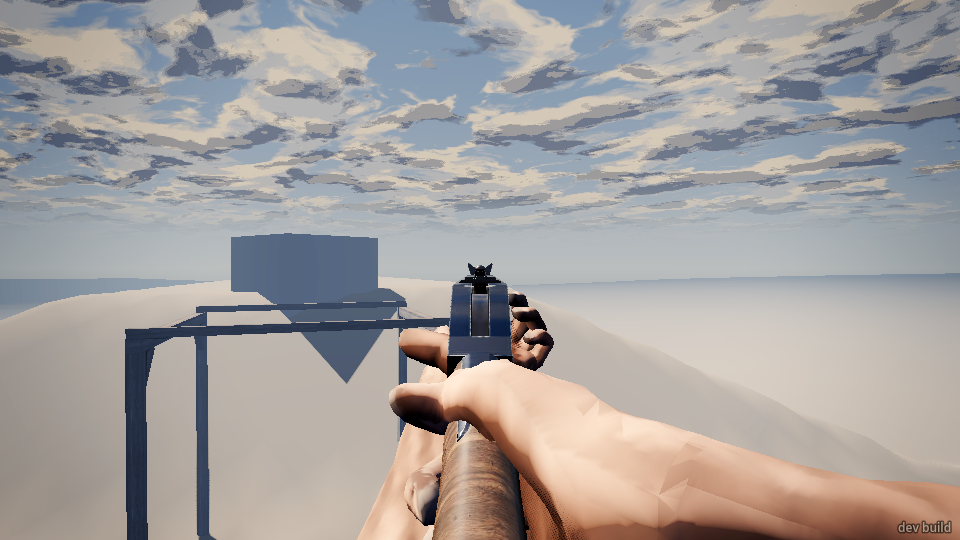
- **When the mission's over is unclear.** After everyone was down or had given up, the screen said
  nothing. No "they've quit", no "get the box".
- **The coach "got by" at exactly 64.4 s in both lost tries**, whatever I did in between. It feels like a
  timer rather than the coach getting away.
- **Prone arms.** Lying prone with the rifle, a second forearm and hand float in the lower half of the
  view.

## What was fun

- **The log drop is great.** Shoot a peg and a big timber swings down into an iron coach, the men get
  thrown off, and the coach is shoved back down the grade. It's forgiving too: one pin I shot early, and
  the log still waited and hit.
  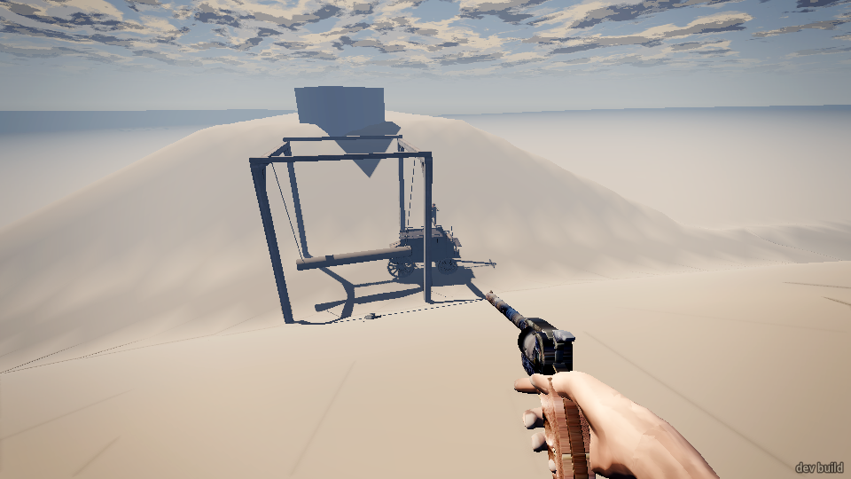
- **The guards feel like a crew.** They call reloads and cover ("Reloading! Cover me!" / "Go on, I got
  you!"), drag the wounded, one flanks up the far bank, and they lose their nerve one by one: "Hell.
  Hell, hell, hell...", "Lord, get me out of this one.", "Enough! It's yours!", "Alright! Alright! I'm
  done!"
- **The close fight in try 4.** Gut-shot in the road, crawling behind the fallen log to bandage it,
  and then the messenger walks round the post two metres away, reloading. That was a real Western
  moment.
- **The strongbox step.** Haul it out, shoulder it, set it down, shoot the padlock off and watch it drop,
  open the lid, take the deeds and ledger. It's slow and physical in a good way, and the 44 kg makes
  you think twice about how far you'll carry it.
  
- **Coming round at sunset**, alone in the valley with a long shadow, looked good (even if the words
  were wrong).
- **Small touches:** spent brass on the ground beside you, a misfire ("chamber dud"), an ear shot off.

## Top three things to fix

1. **Make the way out findable and make it end the mission.** Mark the rimrock trail in the world, add
   it to `read places`, and say where it is plainly ("up the far bank by the outcrop..."). Make
   reaching it with the papers (or the box) win. Right now the heist can't be finished.
2. **Make the cargo readable.** Show the box on your shoulder, make the bridge's `shove`/E-tap set it down
   as the real E key does, slow the player while carrying 44 kg, and point at the box: the side door,
   not the "Rubble" coach. Say early on that the papers are what you're after.
3. **Give the coach a team and make its men react.** Horses pulling it, and a driver and guards who react
   to a gunman in the road or shots at the box. Fix the stuck states while you're there: the guard
   looping between downed friends, and the "down, rescuing" men who never move. Replace "You come
   round on the store floor" in the valley with something that fits.
