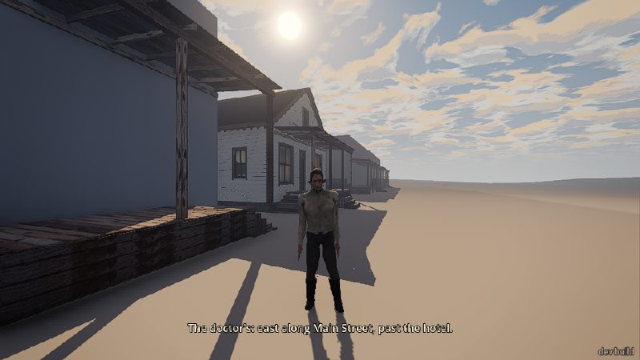
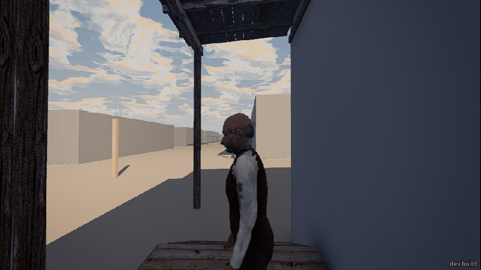
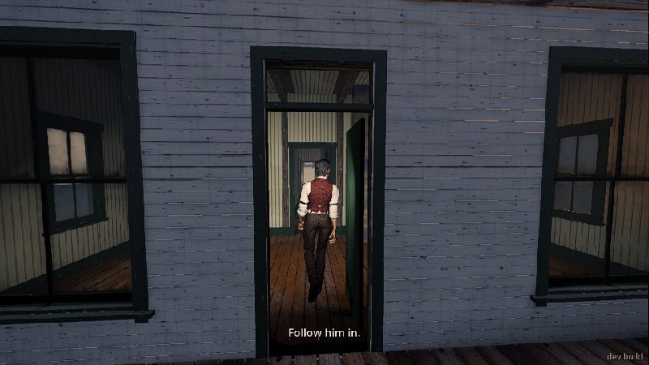
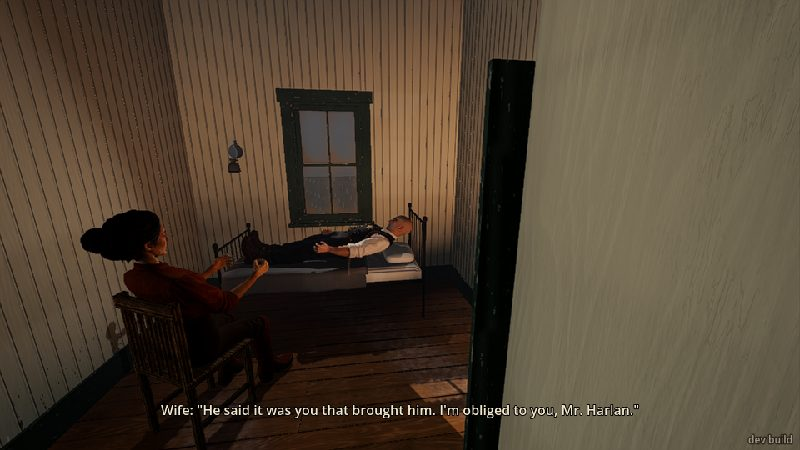
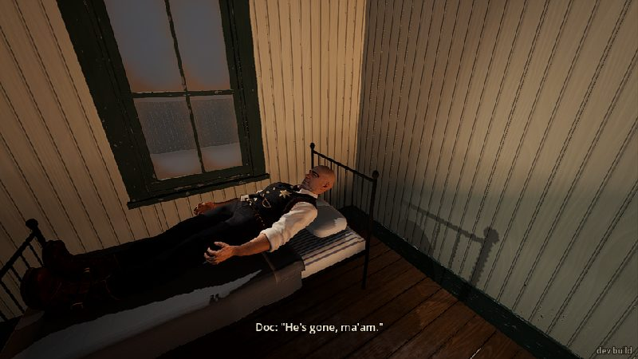
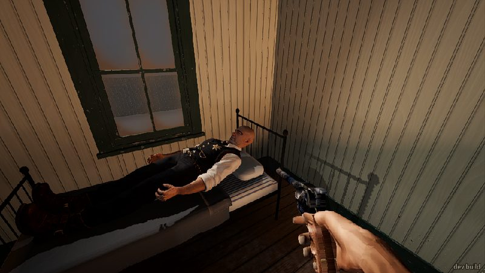
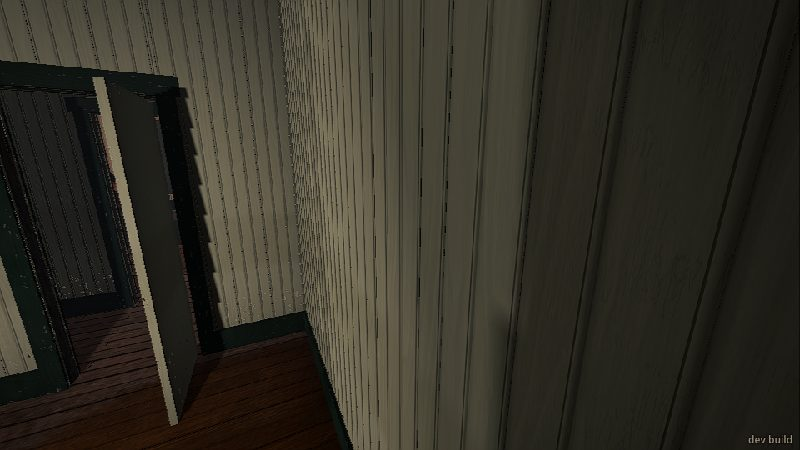
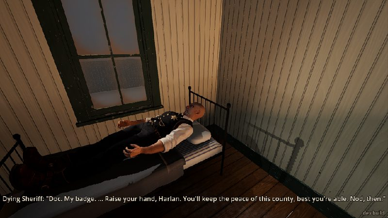

# Playtest: the sheriff dies (2026-11-12)

Mission `--world=valley --mission=sheriff_dies`, played through the dev bridge at about one frame a
second. Two runs: `--care=poor` (I nodded) and `--care=good` (I shook my head). About 50 minutes of
wall clock in all. Test-only commands: `goto doctor_steps` once in the second run to save the walk.
I didn't read the code.

## What I did

**Run 1, care=poor.** I start on Main Street at half past eight in the morning. A runner shouts
"Harlan! Doc's asking for you. Says the sheriff's sinking." and a line on screen says "The doctor's:
east along Main Street, past the hotel." Then the runner vanishes from the list of people near me
(I tried to walk to him: "no way there").

I tried my gun first. H does nothing; the screen says "You can't hold the gun: you haven't got one."
Holster and fire do nothing either. Fine for a homesteader, but my read-out says "revolver put away,
5 loaded, 24 on the belt" at the same time.

I walked the street before going to the doctor's. Three townspeople are out, each standing still on
a porch:

- The townsman, outside the hotel: "You were sat right there at the table, they say. And you never
  moved." then "Cody shot Earl dead over the cards. Said there's no law left to save him. Bold as brass."
  That stung, in a good way.
- The loudmouth, far west: "And who's to take Cody in? The sheriff's dying." He spoke to me while
  facing side-on, not looking at me.
- The undertaker, east: nothing at all, even standing 0.6 m from him.

At the doctor's the doc was waiting on his porch: "He's asking for you. He comes and goes. Be
quick." He turned and walked in; "Follow him in." came up on screen. This was the best moment of the
session: the green-trimmed door, the doc's back going down the hall.

The sickroom is lovely: the wife in a chair by the iron bed, the sheriff lying under the window, warm
morning light. The wife asked "Were you with him?" and then, 2.6 s later, before I could do anything,
answered herself: "He said it was you that brought him. I'm obliged to you, Mr. Harlan."

At the bed the sheriff muttered "...red shirt... rode up easy..." and "...the ditch... look to them...".
The doc said "Hold him. No... yes, like that. You've done this before. Where? ... No. Keep it." and then
the screen said "Hold E: hold him down while Doc works." I held E for 3 s. The sheriff then said
"Badge... Doc. Pin it on him." and the screen said "Nod or shake your head (move your view)." I nodded:
"...good." / "Doc pins the sheriff's badge on your coat." / "...pistol... take it." / "The sheriff's
revolver is yours. H: draw it." / "...boot." and he died. The doc: "He's gone, ma'am." The wife: "I'll
sit with him now. Go on, the both of you." The doc: "I'm the coroner, Harlan, so until the county sends
a man I'm what law there is. And you're my deputy. Keep the badge on."

Now H drew the revolver (5 loaded). I pointed it at the widow's head from 0.6 m: no reaction from her
or the doc. Holster put it away.

Walking out by name ("walk doctor_steps") took me into the room west of the sickroom and pinned me
against a wall; I had to pick my way out point by point.

Back on the street: the townsman now said "Earl drew first, I heard. Or reached, anyhow." and "Three
shots, they say. Or two. Nobody counted." (good: rumours shifting). The loudmouth said "He'll be back,
you watch. Nobody to stop him." I drew on him: "Put that away, mister.", hands up, "Please, mister...",
"Don't shoot! I got a family!" — but in the middle of that he also said "And who's to take Cody in? The
sheriff's dying." After I holstered: "...They gone?" The undertaker still said nothing. Nobody mentioned
the sheriff's death, the badge, or that I'm the deputy now. The doc never came out, though the wife
told us both to go.

**Run 2, care=good.** Same start. The doc's porch line was different: "He's asking for you. He's clear
this morning. It won't last." The sheriff spoke in whole sentences: "Faded red shirt. I'd know him
again. You find him, Harlan." / "He's wanted my ditch since the day I cut it. Now he'll go at her. Look
to them." / "Doc. My badge. ... Raise your hand, Harlan. You'll keep the peace of this county, best
you're able. Nod, then." There was no "hold him" step this time.

I shook my head right after his line, but the "Nod or shake" prompt only came up 1.5 s after my shake
and nothing happened. I shook again 25 s later: "That's not the way this works, son. ... Doc. Pin it on
him." and the badge went on me anyway. Then: "Take my pistol. She pulls a hair to the left." / "Sun's
up. Ain't that something." and he died. Same doc and wife lines after.

I drew and aimed the gun (fine), walked out (stuck in a side room again, this time the one at the front
west of the hall), and fired one shot on Main Street. Nobody reacted: the townsman 29 m off stayed calm
and said nothing about it. Back with the townsman and loudmouth, their lines were the same as before
the scene, including "The sheriff's dying."

## What broke

- **Walking out of the doctor's gets you stuck, twice.** `walk doctor_steps` / `walk townsman` from the
  sickroom put me in a side room west of the hall (once the back one, once the front one), pressed
  into a wall, "arrived: false". Walking point by point (75 -17, 74.9 -15, 74.5 -12) got me out. Going in
  from the street also once stalled at the porch edge (z -7.3) from the ground after `goto doctor_steps`.
- **The nod/shake can be lost.** In run 2 I shook my head as soon as the sheriff said "Nod, then"; the
  prompt appeared 1.5 s later and my shake didn't count. Nothing happened for 25 s until I shook again.
  A player who answers promptly gets silence.
- **Stale lines after the death.** The loudmouth says "The sheriff's dying." after he's dead, in both
  runs, and even in the middle of begging me not to shoot.
- **The badge stays on the dead sheriff.** "Doc pins the sheriff's badge on your coat", but the star is
  still on his vest afterwards (screens 10, 11).
- **"Follow him in." shows six times at once** in the event log (both runs).
- **The wife's question answers itself.** "Were you with him?" then 2.6 s later her own answer. No chance
  to nod.
- The runner vanishes right after his line (can't walk to him).
- Before the scene the gun read-out says "5 loaded, 24 on the belt" while the screen says I haven't got
  one.
- The sheriff's boots sit through the bed's foot rail.

## What was flat or confusing

- **Nobody in town knows what happened.** After the sheriff dies and I'm the deputy with his badge and
  gun, the townsman and loudmouth repeat their morning lines; nobody says "Deputy", notices the badge,
  or mentions the death. They still call me "mister".
- **The undertaker never speaks**, before or after, even with a body fresh at the doctor's.
- **A gunshot on Main Street gets no reaction** from anyone (run 2).
- **Pointing a gun at the widow's head from arm's length gets no reaction**, nor from the doc.
- **Shaking your head changes nothing.** The sheriff overrules you and you get the badge and gun anyway.
  "That's not the way this works, son" is a good line, but the refusal has no cost or after-effect that I
  could see.
- **"Hold him" is out of order.** The doc says "Hold him. No... yes, like that." before the prompt
  appears and before I've done anything, so it reads as if the game played it for me. Holding E didn't
  give any line or sign that I'd done it. In the good-care run there's no hold step at all.
- **The sheriff never moves.** He lies stiff with arms out the whole time; no breathing, no flinch while
  "held down", no sign of the moment he dies.
- **Prompts vanish fast.** "Hold E" and "Nod or shake" were already gone from the screen 5–6 s later when
  I took screenshots.
- **"...boot."** (care=poor) is a dying man's clue I couldn't do anything with; nothing I could find to
  look at.
- The doc says "Go on, the both of you" but stays in the room.
- Townspeople stand still on porches facing the wall or side-on; the loudmouth talks without facing you.
- The far buildings and the hotel front are blank grey or blue boxes; a "Salt Creek (town)" label floats
  in the sky (screen 04).

## What was fun

- The doc on his porch, turning and leading you down the hall: it feels like being sent for.
- The sickroom: the widow in her chair, the iron bed, the morning light. It looks like a painting.
- The care setting really changes the scene: mumbled fragments ("...red shirt... rode up easy...") when
  care was poor, clear sentences and last words ("Sun's up. Ain't that something.") when it was good. The
  good run's lines are the best writing in the game I've seen.
- The townsman's "And you never moved." lands hard when you play Harlan.
- Rumours drift: "Earl drew first, I heard. Or reached, anyhow." / "Three shots, they say. Or two."
- The loudmouth's hands-up begging is good and quick.

## The top three things to fix

1. **The town should know.** After the scene, people should react to the death and the badge (new lines,
   "Deputy"), drop "The sheriff's dying", and the undertaker should speak.
2. **Make the nod/shake reliable and the refusal matter.** Accept an answer given just before the prompt
   (or show the prompt with the question), keep the prompt on screen until you answer, and let a shake
   change something.
3. **Walking out of the doctor's**: going from the sickroom back to the street routes you into a side room
   and leaves you stuck against a wall. Also take the badge off the dead man's vest.

## Fixed before the merge (the building session)

- A nod or shake from the oath line on counts, before the prompt's up; the prompts stay 12 s.
- "Follow him in." shown once.
- The town after: the loudmouth and townsman have lines for the dead sheriff and the new deputy
  (no more "The sheriff's dying."), the undertaker has the sheriff's box; the scene alone sets Earl
  at the undertaker's, so his line plays.
- Left open (gameplay's lane file): the badge on the dead man's vest (it's in his model), the wife's
  question with no wait for an answer, the bridge's walk out of the doctor's, the readout while
  unarmed, the boots through the cot's rail, nobody reacting to a gun drawn in the town by day.
