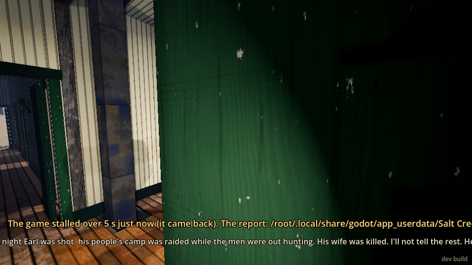
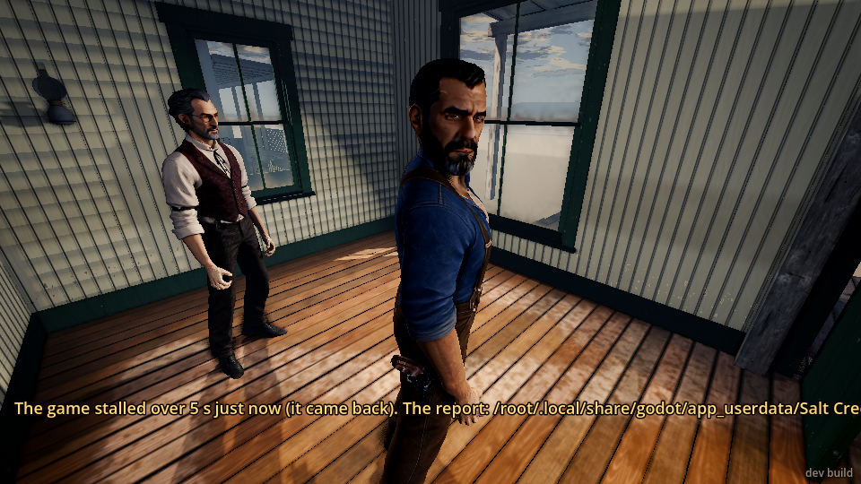
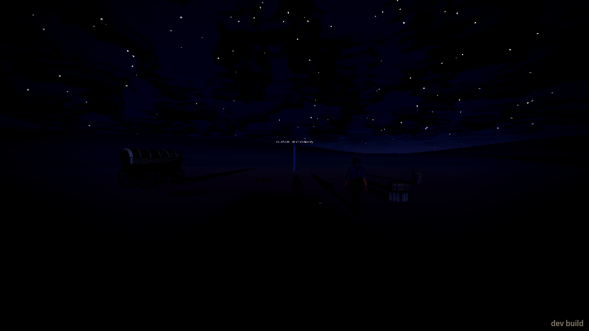
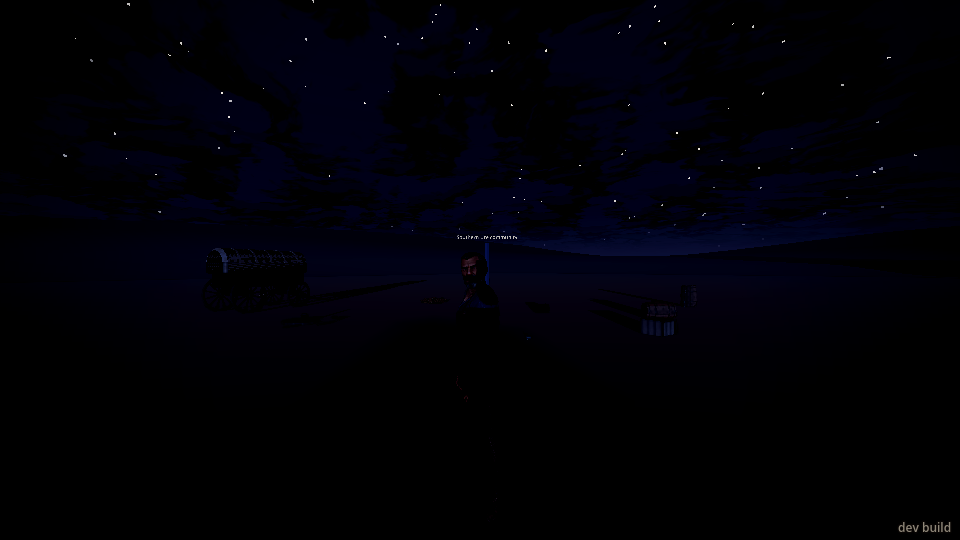
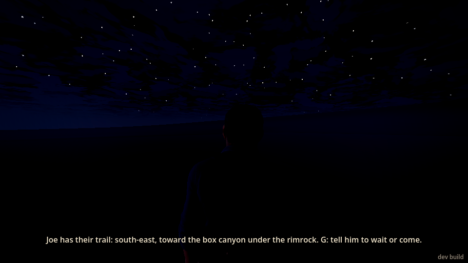
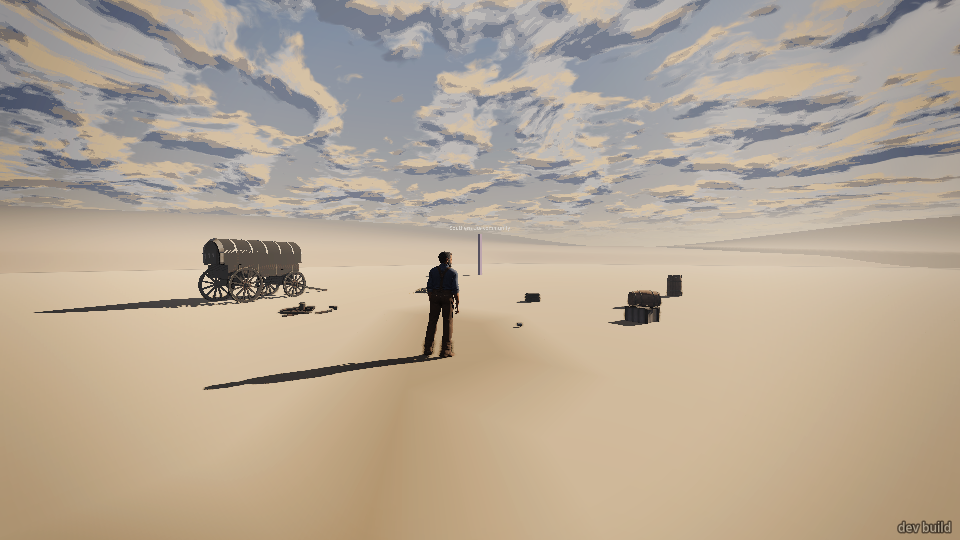
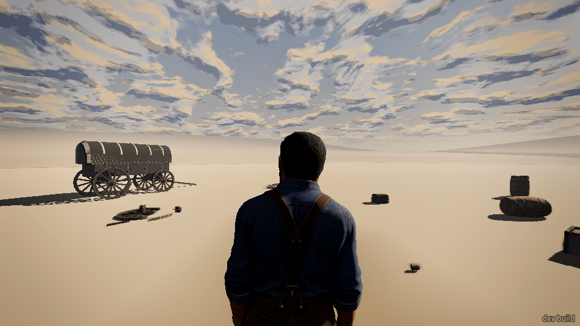
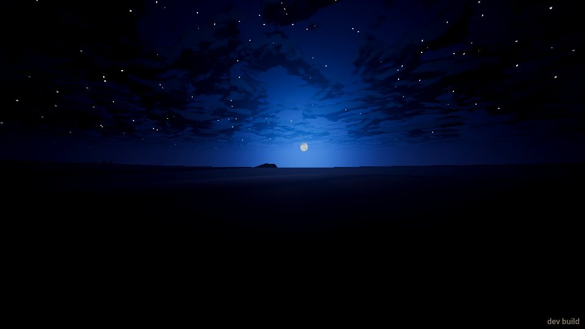
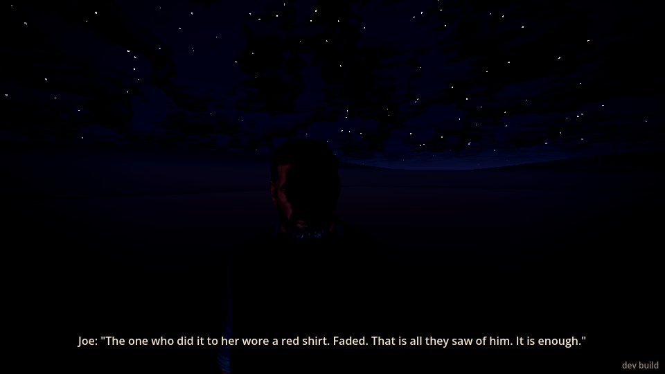

# Playtest: the doctor's office and the camp (No Justice, step 2), 2026-11-13

A blind playtest through the dev bridge. I haven't read the code. Screenshots are in
`2026-11-13/` (the `camp_*` files).

**A warning about the conditions first.** The machine was heavily loaded by other games running
at the same time (load average about 14 on 4 cores). The game ran at about one frame a second at
best, and often much slower. The game's own "the game stalled over 5 s" notice appeared on screen
several times, and in run 2 the game stopped answering for a long stretch inside the doctor's
office. Treat the slowness and the stalls as at least partly the machine's fault, not the game's.

## What I did

**Run 1 (the plain start).** I started on Main Street at 10:30 in the morning. A line on screen
said "The doctor's: along Main Street. Go in." I walked to the doctor's steps and in. As I
stepped through the door the doctor spoke: this is Joe, his people's camp was raided the night
Earl was shot, his wife was killed. Joe said he wanted the men who did it, and asked whether the
sheriff's badge does anything. The doctor and a cowboy (standing in the room) both said no white
jury would hang a white man on an Indian's word. Joe said "I ride today. Will you come?" and a
line said "Nod or shake your head (move your view)." I nodded. Joe said "Then we go now" and
"Joe goes out to the horses." I followed him out; the next thing I knew I was at the camp, at
night (19:52). Joe said "Wait here." and walked off about 50 m. A line said "(Joe talks with the
survivors, in Ute.)" Then he came back and told me what they'd said: six or seven men, at night,
while the men were four days gone hunting; the one who did it to her wore a faded red shirt; they
went toward the hills. A line said "(Joe puts on a cowboy's hat and ties a neckerchief.)" and Joe
said a hat and a rag at the neck makes him nobody's Indian; if they see a Ute they go to the camp
after, if they see a cowboy they come to him. He walked off a few metres, said "Six horses. One
throws his right fore." and the screen said "Joe has their trail: south-east, toward the box
canyon under the rimrock. G: tell him to wait or come." I walked off south-east: Joe followed me.
I told him to wait: he said "I will wait here." and stayed. I walked on 30 m and called him: "I
am with you." and he came. I then went looking for the damage. It was too dark to see anything,
so I set the clock to 16:00 (a test command, not something a player can do) to see the camp.

**Run 2 (`--followed`, answering the other way).** Same start, same office, the same lines word
for word. I shook my head. Joe said "No. I did not think so." and "Joe goes out to the horses."
Playing a man who changed his mind, I went out after him. The ride happened as I stepped out
(Joe said "Wait here." at the camp), but my walk command was still running, and it walked me the
whole way back to town (about 1.8 km, 11 minutes of game time). Joe then followed me across the
valley toward town. So I missed the camp that time, and I restarted run 2.

**Run 2, again.** In the office the game stopped answering for about 25 minutes while Joe was
asking his question (see the warning above), then came back. I shook my head: "No. I did not think
so." I stood my ground for five seconds. Joe was stuck right behind me in the doorway, unable to
get out past me. Then I changed my mind and walked out after him: the ride happened as I stepped
out, and I was at the camp at night again. Joe said "Wait here." I didn't: I followed him to
where he talks to the survivors. He didn't react to my coming; he simply started telling me what
they'd said, the same lines as run 1, plus one new one after "They went toward the hills. That
way.": **"You knew that already."** Then the hat and neckerchief line, the cowboy line, "Six
horses. One throws his right fore." and the trail line.

## The office

- The lines are good. Short, hard, period-sounding. "You wear the sheriff's badge. Does it do
  anything?" lands. The doctor's "I'll not tell the rest. He can, if he chooses." is a nice touch.
  The cowboy's "No jury in Colorado'll hang a white man for a Ute woman. I've seen 'em try." makes
  the stakes plain.
- It was clear what was asked: will you ride with Joe. It was clear Joe is Ute only from the
  words ("his people's camp", "an Indian's word", "a Ute woman"). Nothing in how Joe looks says it:
  he looks like any bearded townsman in a blue work shirt and braces, with a holstered gun.
- The cowboy is never introduced. He's listed as "cowboy" and just chimes in. Who is he and why
  is he in the doctor's office?
- The doctor's first line starts the moment you cross the threshold. Standing there, the open
  door fills most of the screen and hides the doctor and Joe (screenshot 2). The bridge said the
  door was between me and both of them. A player who stops in the doorway to listen sees a door.
- The first line is very long. On screen it ran off both edges of the window and couldn't be
  read whole (screenshot 2).
- In run 1 the first lines came at the doorway. In run 2 I stopped half a metre short (still in
  the doorway) and nothing was said until I stepped in further. Fine, but a player standing at
  the door gets silence.
- Joe's "Does it do anything?" sounds like a question to answer. I nodded at it: nothing
  happened. The real question came 20 s later.

## The answer

- The nod worked (run 1): Joe answered at once, "Then we go now."
- The shake worked (run 2): "No. I did not think so." That's a good line for it.
- Both answers came back fast: Joe's reply is timed from the start of the head movement.
- After a shake, Joe still "goes out to the horses", and following him out the door starts the
  ride just the same as a nod. That's what a man who changed his mind would want, but there's no
  moment where the game shows it noticed: Joe never says anything like "So you came." He just says
  "Wait here." at the camp exactly as in run 1.
- Nothing tells you that the shake still lets you go. "No. I did not think so." and "Joe goes out
  to the horses." read as the end of it. I only followed because the brief told me to try.
- The `--followed` start (a player who followed the killer out of the saloon) changed nothing in
  the office: the same lines, word for word. At the camp it added one line, "You knew that
  already.", after Joe says which way they went. It's a good sting, quiet and accusing, but it's
  easy to miss, and a player who didn't remember the saloon wouldn't know what Joe means.

## The ride and the camp

- **I never saw the ride card**, in any of the three tries, and it never showed in the event log
  (the other on-screen lines do). Each time I was mid-walk out of the door and the next reading
  had me at the camp. A screenshot taken a second after stepping out (run 2) was already the
  camp. If there's a card, it doesn't stay up long enough to read at this frame rate. (A note for
  whoever runs these: a walk that's under way when the ride starts can carry on afterwards, from
  the camp.)
- **Ignoring "Wait here." changed nothing.** I walked up to Joe while he was "talking with the
  survivors"; he cut it short and told me the story as if I'd waited. No look, no word about it.
- **It's night when you arrive.** The clock jumped from 10:30 to 19:52. The camp is almost black:
  stars, the outline of a wagon, a few barrel shapes. I couldn't find the damage, Joe at 10 m, or
  his hat. Joe saying "I ride today" and arriving after dark is plausible, but as it is a player
  sees nothing of the camp.
- **The camp is empty.** No lodges, no fire, no survivors, no bodies, no horses. Joe "talks with
  the survivors, in Ute", but there's nobody there: he walks 50 m into the dark, stands, and walks
  back. In daylight (clock forced to 16:00) the camp is one covered settler's wagon, a broken wheel
  and some timber on the ground, a few barrels and boxes, on flat bare sand. It doesn't read as a
  Ute camp, or as a raid.
- **A marker in the sky.** A thin blue post with a floating label "Southern Ute community" stands
  in the middle of the camp. It looks like a debug or map marker.
- **"20 pieces of timber broke"** appears in the events both runs, a few seconds after Joe leaves
  the office and before I've arrived. I guess that's the wagon wheel and barrels being broken for
  the scene, out of sight. It's harmless, but it's a strange thing for the log to report while
  you're standing on Main Street.
- **What Joe did.** Talked off-screen, came back, told the story in four short lines (they're
  good: "Four days." and "It is enough." land hard), changed, walked a few metres and read the
  trail ("Six horses. One throws his right fore."). He stood upright the whole time: no crouch, no
  kneeling, no pointing when he says "That way." From behind, in the dark, it looked like a man
  standing in a field.
- **Joe's new hat isn't there.** The screen says he puts on a cowboy's hat and ties a neckerchief,
  and his next line is about the hat. Close up in daylight he is bareheaded with no neckerchief,
  the same shirt and braces as in the office (screenshot 13).
- **What I understood:** riders raided the camp at night while the men were away; Joe's wife was
  killed by a man in a faded red shirt; six horses, one with a bad right fore; they went
  south-east to a box canyon under the rimrock; Joe is dressing as a cowboy so they come for him
  and not the camp. All of that came from the words alone; none of it from what I saw.
- **Wait and come work well.** Walking off, Joe followed at about 6 m. "Wait here." / "I will
  wait here." and he stayed while I walked 30 m on. "Come on." / "I am with you." and he caught up.
  Clear and reliable.

## What broke

1. **Joe has no hat or neckerchief after putting them on** (run 1, at the camp, after "(Joe puts on
   a cowboy's hat and ties a neckerchief.)"). Seen close up with the clock at 16:00.
2. **The camp is nearly black on arrival** (19:52). Nothing to see. Not a crash, but the scene
   doesn't work as a scene.
3. **Saloon card-game chatter fills the event log while you're at the camp, 1.8 km away.** Earl
   and the drifter play poker ("Check.", "Two pair, eights and fours.", "Every damn hand.") every
   few seconds. It pushed Joe's camp lines out of the recent events in run 2. I couldn't tell if it
   also shows as subtitles on screen at the camp; my screenshots there showed none.
4. **Earl is alive and playing cards.** The doctor says "The night Earl was shot", and Joe's
   question is about the dead sheriff's badge. Yet a man called Earl is in the saloon, alive,
   playing poker and dealing ("My deal. Ante up, boys."). If Earl is the sheriff, he shouldn't be
   there. If he's somebody else, the name clash is confusing.
5. **The opening line repeats.** "The doctor's: along Main Street. Go in." is logged about a dozen
   times in the first third of a second.
6. **Walking inside the office is awkward.** From the steps, `walk` to a point inside the room
   stopped in the doorway (got 1.2 m, then 0 m) in run 2; walking to Joe went 0 m. Walking to the
   "doctor" place worked. In run 1, a walk aimed 1 m into the room overshot to beside Joe.
7. **The game froze** in run 2, standing in the office doorway looking at Joe, waiting for the
   question: the bridge stopped answering for about 25 minutes while the game kept using the CPU,
   then it came back. The game's black box wrote freeze reports (one I opened said the main
   thread was stuck drawing the frame). This was on an overloaded machine, so it may not happen
   on Sean's PC, but every stall I hit was in or at the door of the doctor's office, looking in.
   The camp, out in the open, never stalled.
8. **Joe can't get past you in the doorway.** After the shake I stood just inside the door; Joe
   ("goes out to the horses") stood 0.6 m behind me and didn't get out until I moved.
9. **Run 2: my walk carried on after the ride** and took me all the way back to town; Joe followed
   me across the valley. Probably a quirk of driving the game by command, not something a player
   with a keyboard would hit, but worth knowing: whatever was moving the player keeps going after
   the ride.

## What was flat or confusing

- Arriving in the dark to an empty field with a wagon. The best-written moment in the scene (Joe
  telling what the survivors said) plays to nothing.
- "Joe talks with the survivors" with no survivors.
- The cowboy in the office is unexplained.
- The shake changes nothing after Joe's one-line reply. A man who said no and then rode anyway
  gets the same treatment as one who said yes. The `--followed` start adds only "You knew that
  already." at the camp.
- Joe reads the ground standing straight up.
- The early nod at "Does it do anything?" did nothing, with no sign the game heard it.

## What worked

- The writing. Every line in the office and at the camp is spare and sounds right. Joe's voice in
  particular: "Four days." "It is enough." "A hat and a rag at my neck, and I am nobody's Indian."
- Nod and shake. Simple, and Joe answers at once.
- Telling Joe to wait or come. It worked first time both ways, with a clear spoken answer.
- Joe following at a sensible distance when you walk off without a word.
- The office itself in daylight: the doctor in his waistcoat and Joe at the window look good
  (screenshot 3).

## The top three things to fix

1. **Make the camp visible and populated.** It's black on arrival, and in daylight it's a settler's
   wagon on bare sand with no people. The survivors Joe talks to, some sign of a Ute camp, and
   damage you can find need to be there, and lit (arrive earlier, or a fire, or a moon).
2. **Put the hat and neckerchief on Joe.** The whole point of his change is that he looks like a
   cowboy; at the moment he doesn't change at all.
3. **Let the answer matter, and keep the office readable.** After a shake and a change of mind,
   have someone notice (Joe, once, at the horses). Shorten or split the doctor's first line so it
   fits on screen, and make sure the door doesn't block the view of who's talking. Also check the
   stalls and the freeze around the doctor's office, and stop the far-off saloon chatter (and the
   living Earl) intruding on the camp.
