# Playtest 2026-11-13: the funeral (three runs, blind)

Played through the bridge only, `--world=valley --mission=funeral`. The machine was busy: about a
frame a second, so I can't judge how movement looks in motion, only stills a few seconds apart.
All I was told: I'm Harlan, made deputy yesterday; the sheriff died yesterday morning; it's ten
o'clock and I'm on a lane below the church.

## What I did

**Run 1: straight up to it, stayed to the end and after.** I start beside a tall, plain
blue-grey block (the church, I guessed, from a floating "Bell tower" label) on bare sand. On the
skyline, 70 m off, a row of tiny figures by a tall post.
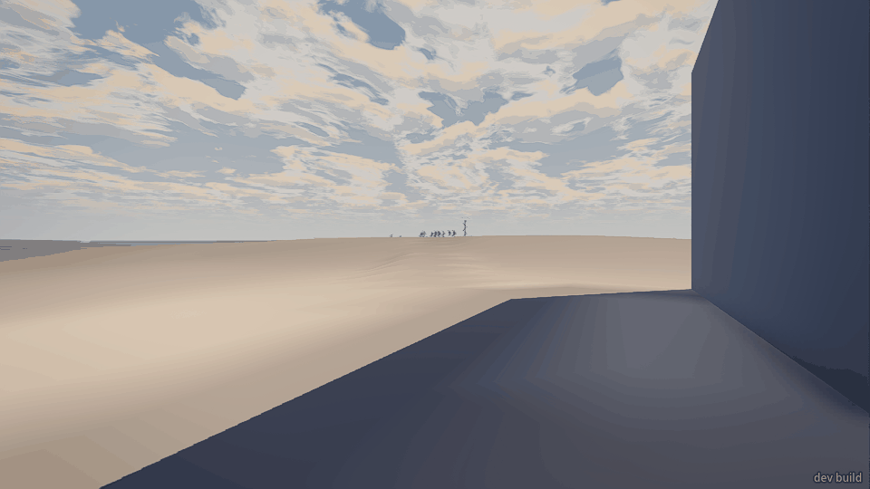
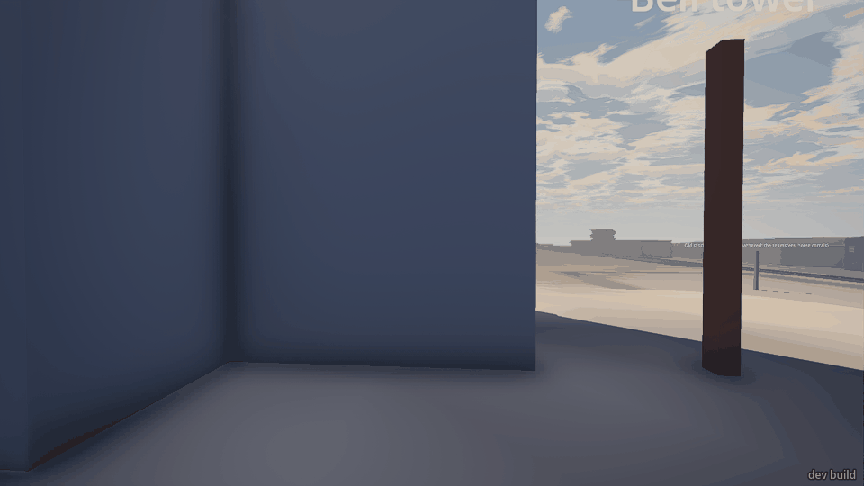
Nothing said where to go; the figures were the only thing to walk at. `walk cemetery` answered
"no way there", so I walked at the preacher instead. As I got within a few metres (57 s in) he
spoke: *"Man that is born of a woman hath but a short time to live..."*. Twelve people stand
round a black rectangle on the ground with a brown box beside it, among a few low grave mounds
with headboards.
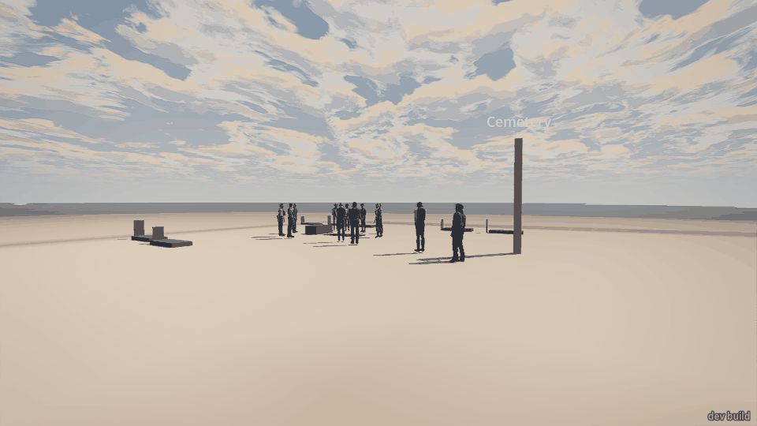
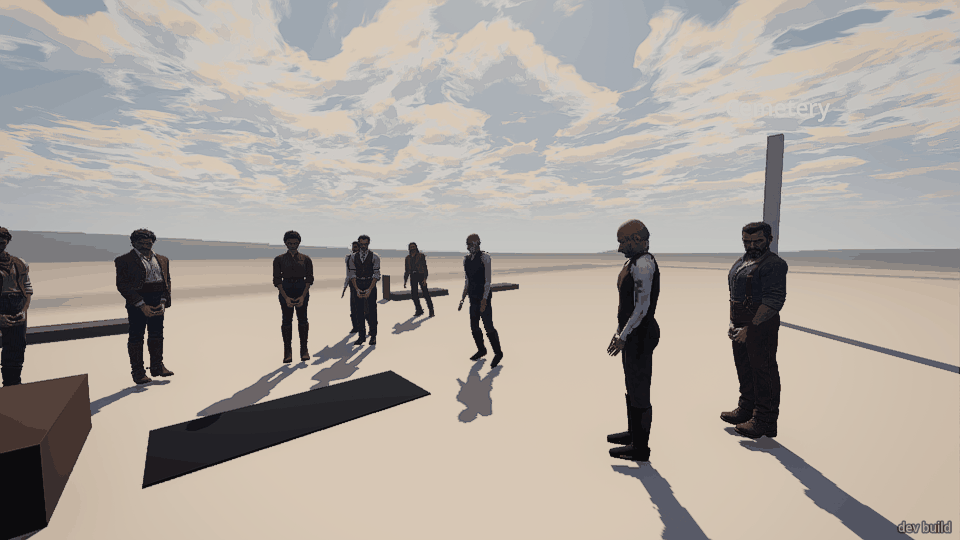
I stood among them. In the next minute: loudmouth *"Fined me twice. Fair, both times."*;
barkeep *"He'd come in Saturdays. One drink. Never two."*; baron to the widow *"A hard day,
ma'am. When that place grows too much for you, come to me first. You'll not find a fairer
figure."*; wife *"Not today. Not any day."*; then baron to me *"Mr. Harlan. A sad day for the
county."* and wife *"You came, Mr. Harlan. He'd have noticed that."* (113 s). That was the last
line anyone said in the whole run.
By 208 s nine of the twelve had gone: three (undertaker, townsman, loudmouth) were walking down
toward town in single file, the other six (baron, foreman, miner, barkeep, rancher, drifter)
were no longer in the world at all. The widow, the doctor and the preacher stayed at the grave,
unmoving and silent, for another minute and a half; I walked right up to the widow and waited:
nothing. Around 300 s they walked off together too, and 40 s later they had also ceased to
exist. The box was still sitting beside the open "grave" when I left at 353 s.
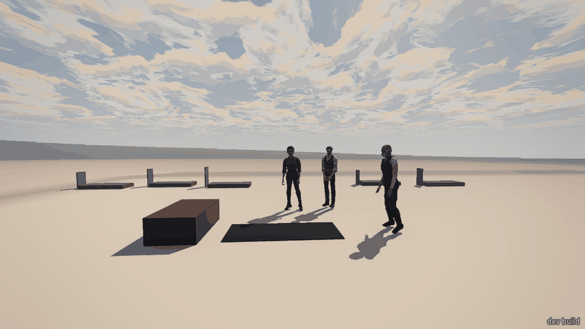
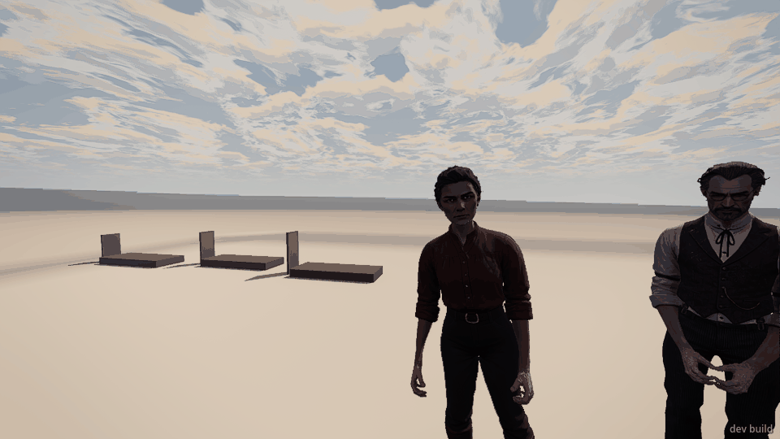
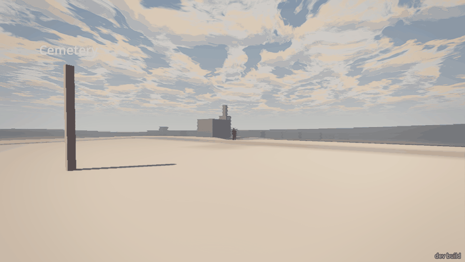

**Run 2: kept back about 40 m and only watched** (played twice: the first time I had my back
turned at the key moment). For two and a half minutes nothing moves at all: twelve dots on a
ridge. At 150 s the service starts by itself, but at 40 m I got no words, no sound I could tell
of, and no visible change: `events` stayed empty the whole run. About 45 s later the whole
crowd turns and walks down the slope straight at me in one tight knot, overlapping each other.
Between 222 s and 236 s, with them 12 to 19 m in front of me and in full view, nine of them
disappeared; the remaining three walked past me at arm's length (1.6 m) without a word or a
look. When I went up afterwards the grave was a filled mound with a blank headboard and the
box was gone.
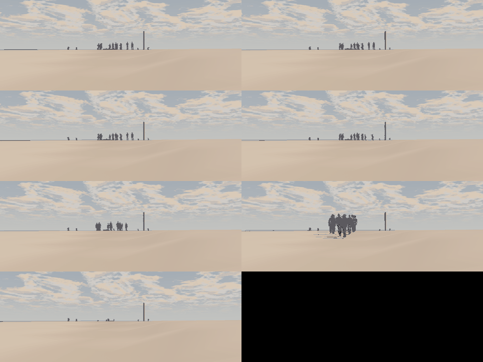
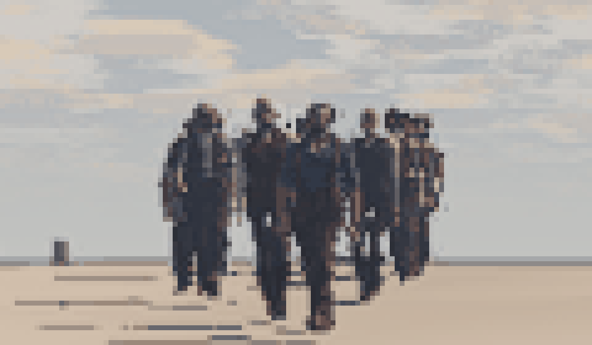
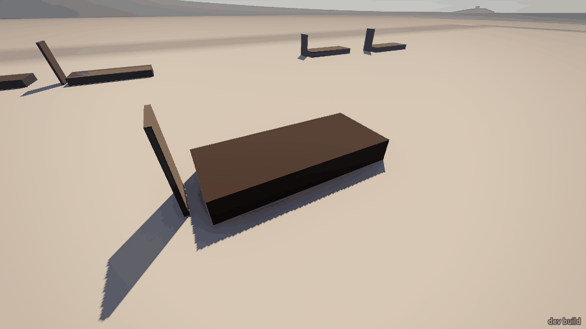

**Run 3: went down into town, came up later.** `walk` to any town place said "no way there"
from the start spot, so I walked by coordinates, crossed the railway and ran into the blank
back wall of a block building, where I stayed stuck for about two minutes (each new `walk`
moved me 0.7 m). Sidestepped by hand and reached the saloon at 290 s. The town was empty: not
one person. From 150 m away I could still read the mourners in `read people`; by 258 s nine had
vanished and the same three were coming down. Loudmouth walked the length of the lane past me
to the street and said nothing. I ran back up (450 s): filled grave, blank headboard, nobody.
Nothing more happened.
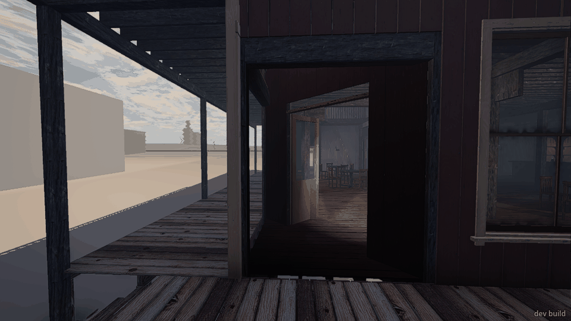
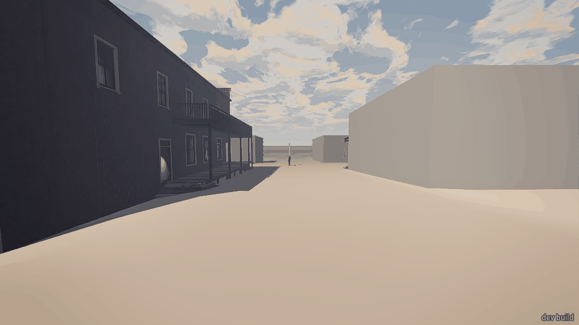
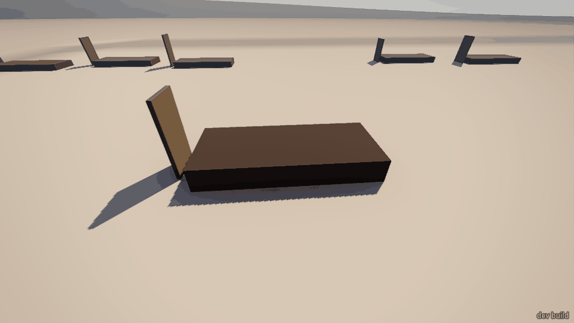

### `story` at the end of each run

- Run 1 (attended): `nolaw.funeral: "attended"`, `nolaw.offer_heard: true`, `baron.met: true`,
  plus the starting facts (`nolaw.accepted: "nod"`, `nolaw.acting: "doctor"`, `nolaw.deputy:
  true`, `nolaw.earl: "undertaker"`, `nolaw.morning: true`, `nolaw.murder: "done"`,
  `nolaw.revolver: "given"`, `nolaw.sheriff: "dead"`).
- Run 2 (watched from 40 m, both times): `nolaw.funeral: "distance"`, `nolaw.offer_heard:
  false`, no `baron.met`; the starting facts unchanged.
- Run 3 (in town): `nolaw.funeral: "missed"`, `nolaw.offer_heard: false`, no `baron.met`; the
  starting facts unchanged.

## What broke

- **People vanish in plain view.** Run 2: nine mourners 12 to 19 m in front of me, walking at
  me, were gone 14 seconds later (`r2b_strip.png`, last two frames). Run 1: six went within a
  minute and a half of the last line while I stood at the grave; later the widow, doctor and
  preacher went the same way about 40 s after setting off, at most ~60 m from me on open ground.
  Only undertaker, townsman and loudmouth ever really walk to town.
- **Stay to the end and the sheriff is never buried.** In run 1 the box sat beside the open
  grave after everyone had gone. When I wasn't near (runs 2 and 3) the grave filled itself:
  box gone, mound and headboard there, with nobody seen doing it. In run 2 that happened while
  I was looking at the spot from 40 m, about half a minute after they left.
- **The grave is a flat black rectangle,** not a hole. Standing on it my shadow disappears
  (`r1_grave_end.png`). The coffin is a plain brown box; I only worked out it was a coffin from
  context.
- **No way to walk anywhere by name from the start.** `walk cemetery`, `walk vp_cemetery`,
  `walk saloon_steps`, `walk lane_n2` all "no way there" from the lane; `walk preacher` and
  raw coordinates work. Once I was in the back lane, `walk saloon_steps` worked.
- **Stuck on a blank wall** behind town at about (-37, -67): two minutes pushing at it
  (`r3_stuck.png`). One odd short walk in run 2 too: 5 m took 19 s and left me facing away.
- **Stalls.** A yellow line "The game stalled over 5 s just now (it came back)..." came up on
  screen in the first half-minute of run 1 (`r1_approach.png`), and in run 3 the bridge timed
  out once after a 75 s wait and answered again a little later. The machine was loaded, so this
  may be nothing.

## What was flat or confusing

- **Nothing tells you where to go or what this is.** No line, no bell, no one walking up the
  lane. The mourners are specks on the skyline; the church is a blank block. I went because I'd
  been told about a death, not because the game showed me.
- **It reads as a funeral only up close,** from the preacher's words and the box. Nobody is in
  black, no one holds a hat, no flowers, no cross or name on any headboard, no shovel, no
  lowering. The **widow is a short-haired figure in a red shirt, trousers and boots**; from 6 m
  I took her for a man, and only the baron's "ma'am" and the label "wife" told me otherwise.
  The **preacher is a bald man in a waistcoat** with nothing clerical about him. I never
  learned the sheriff's name.
- **Who's who:** I worked out the baron (rich man making an offer on her land at the grave: a
  good, nasty beat) and the widow from their lines. Foreman (the only armed one), miner,
  rancher, drifter, doc and undertaker never spoke, so they were only names in a readout. A
  player without the readout has no names at all.
- **Statues.** Before the service and through it everyone stands on the spot, hands clasped;
  between stills several seconds apart I saw no one shift, turn to a speaker or look at me when
  they spoke to me by name. The last three stood 90 s in silence after everyone left. (At a frame a
  second I can't rule out small motion.)
- **Pacing: a long nothing, then too fast.** If you hang back it's 150 s of nothing, then the
  whole service is 45 s and they're walking. If you walk up it starts at once and is over in
  under a minute of talk: one prayer, two remembrances, the offer, two greetings. No "amen", no
  closing word, no earth on the box; they just go.
- **Nothing after.** In all three runs the scene ends with me alone and no idea what to do
  next. Nobody says "come by the office" or anything else. The three who walk to town pass you
  silently, one at 1.6 m.
- **Watching from a distance gives you nothing at all:** no words, no gestures you can read
  at 40 m, and nobody remarks afterwards that the new deputy stood off. Missing it entirely
  is the same: nobody in town mentions it.
- **The leaving crowd** comes down as one overlapping clump, and the three who reach town
  walk in exact single file on a line.
- The country is bare: no fence or gate to the cemetery, no path up, most town buildings
  plain grey blocks. Floating white labels ("Bell tower", "Cemetery") hang in the sky.

## What was fun

- The lines are good. "Fined me twice. Fair, both times." and "One drink. Never two." tell you
  who the dead man was in ten words; the baron's offer over the coffin and "Not today. Not any
  day." is a proper scene, and it made me dislike him at once.
- "You came, Mr. Harlan. He'd have noticed that." landed: it was the one moment the scene knew
  I was there.
- Seeing the gathering small on the ridge from the lane is a good picture, once you know what
  it is.
- That the grave is filled and marked when you come back later feels right.

## The top three things to fix

1. People vanishing in view (nine at 12 to 19 m, walking at the player), and the crowd leaving
   as one clump.
2. The ending: if you stay, the coffin is never lowered or covered, there's no closing word,
   and nothing and nobody gives you a next step; the three who stay behind stand mute.
3. Reading it as a funeral and finding it: something to draw you up the hill, a widow who
   reads as a widow, a preacher who reads as a preacher, a real hole; and when you hang back,
   the 150 s of nothing followed by a 45 s service you can't hear a word of.

## Notes for the developer (`moment_result`)

- Run 1 end: `outcome: attended`, `beat: 13`, `done: true`, `filled: false`, `near_s: 36.9`,
  `far_s: 12.6`, `heard: [prayer, town_1, town_2, offer, refuse, baron_you, you_came]`,
  `mourners: 3`, `leaving: 3` (wife, doc, preacher, "stand") at 313 s.
- Run 2 end: `outcome: distance`, `filled: true`, `heard: []`, `far_s: 49.4`. Timeline:
  gather 0 s, service 150.0, prayer 151.5 (unheard), loudmouth 172.3, barkeep 175.8, baron
  187.0, wife 196.4, facts set 199.4, "the grave's filled" 231.9.
- Run 3 end: `outcome: missed`, `filled: true`, `heard: []`, `near_s: 0`, `far_s: 0`; same
  timeline, facts set 199.42, "the grave's filled" 199.52.
- In run 1 the prayer began at 57 s (as I arrived), not 150 s, so coming close starts it.
