# Playtest: the cabin (No Justice, step 4), 2026-11-15

Three runs as the brief asked, plus a second go at run 3 (3b) to try another "doing" answer.
Played through the dev bridge at about one frame a second. Screenshots are in `2026-11-15/`.

## What I did

**Run 1 (nod).** I start about 9 m from the shack's door, Joe at my shoulder, five dead men round
the fire. The line on screen says the red shirt has barred himself in and to kick the door. I
walk up. Kett shouts "Stay out! I got a gun! I'll use it!" First kick: "It doesn't give. Your foot
does: bruised." Second: "The bar holds. Again." Third: the same "It doesn't give" line, but two
pieces of timber break and the door is down. Kett gives up straight away ("I'm done! I ain't
heeled! You're law, ain't you? Then take me in!"). Joe walks in past me. I can't: I'm stuck on the
threshold standing up, and only get in crouched. Kett and Joe trade lines; Joe asks "Are you
going to stop me?" I nod. Joe: "Then take him. Take him to your law. We will see what it does."
Kett: "Bless you, Deputy... I'll come quiet." The screen says "Take him in: G by him." My first
G from the doorway (4.5 m off) shouted him out to a duel instead ("You! Step out here and face
me!"). Once I crawled up next to him, G tied his hands and the screen said "Walk him to the
jail's door." A few seconds later I was standing in town in front of the jail, Kett and Joe
behind me, with "The game stalled over 5 s just now" on screen. I walked up the jail steps; Kett
went in. The story says ending "arrest", Joe's trust "strained". Nothing on screen said so.

**Run 2 (shake).** Same door: the first six kicks all said "a miss (nothing within reach)" with
the door 0.9 m in front of me, looking slightly down at it. Looking level, it took three kicks
again. In crouched, the same lines, the same question. I shook my head. Joe at once stabbed Kett
four times (abdomen, chest, abdomen, neck). "It is done." Screen: "It's over. The bodies are left
where they lie." Kett was still alive, out cold, and bled to death 15 seconds later. I stayed
another 50 s: nothing more happened. Ending "revenge", Joe's trust "kept".

**Run 3 (`--down`, answer by doing).** Kett is down in the dirt outside, no door. I walked to him.
He gave up out loud ("Then take me in!"), so I pressed G by him to tie him before Joe could ask.
It shouted him out to a duel instead. Joe asked his question. I didn't nod or shake: I drew my
revolver and faced Joe. Joe: "Harlan. Not at me." Then about 30 s after the question he killed
Kett anyway, with my gun still out. Joe: "Point it somewhere else." then "It is done." Story:
answer "none", ending "revenge".

**Run 3b (`--down`, shove).** Same start. When Joe asked, I shoved him (he staggered back). Joe
said nothing about it. 30 s after the question he stabbed Kett. I shoved him again mid-stabbing;
he finished anyway. Ending "revenge", answer "none".

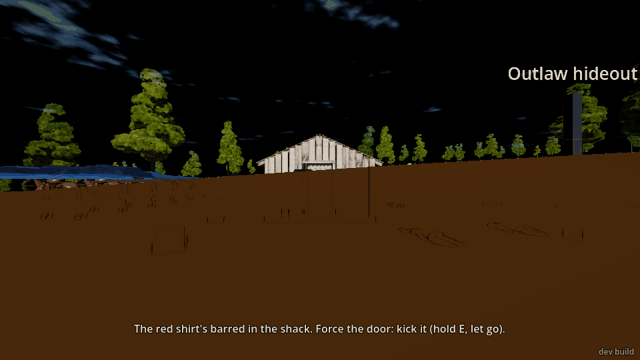
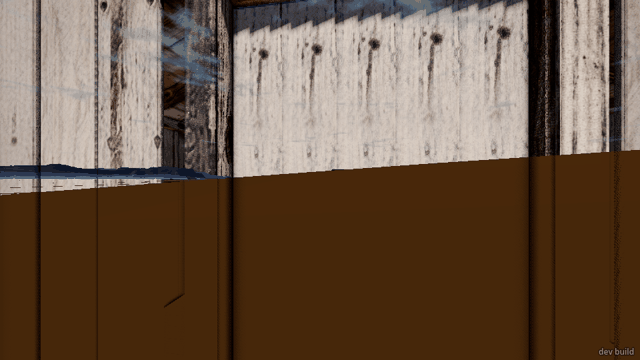
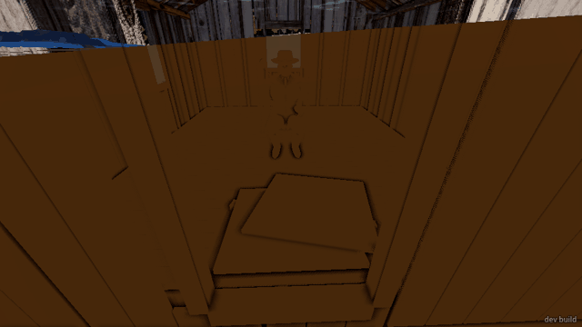
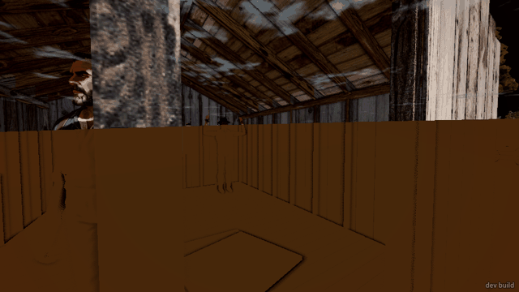
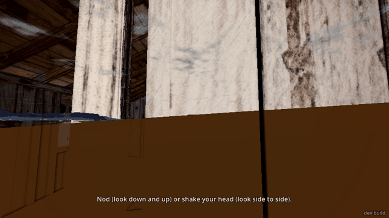
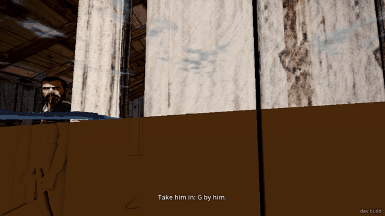
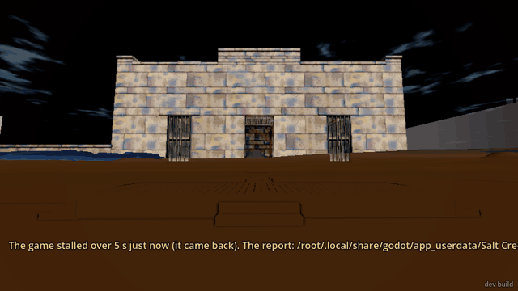
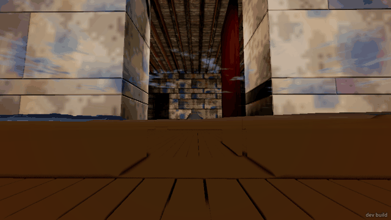
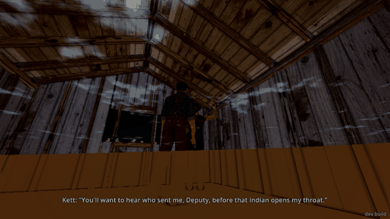
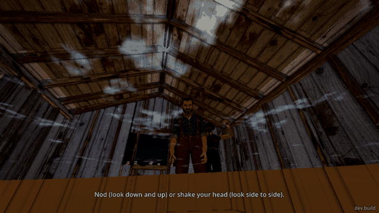
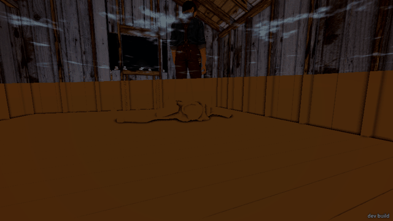
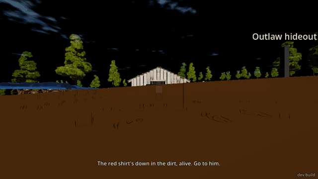
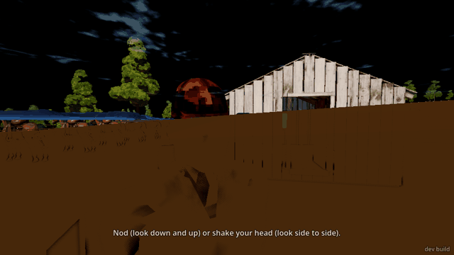

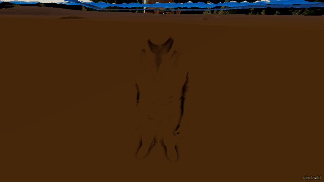

## Getting in

- The instruction is clear: "Force the door: kick it (hold E, let go)." Good.
- It took three kicks each time. That's about right for a barred door.
- The messages contradict each other: the kick that breaks the door also says "It doesn't give."
  I only knew it had broken from the event log ("2 pieces of timber broke") and that I could now
  see inside. The breaking kick needs its own line ("The bar splits", etc.).
- Each kick bruised my foot (three wounds by the time I was in). Fine as flavour, but nothing told
  me whether it mattered.
- Kicks missed a lot. In run 2 six kicks in a row said "nothing within reach" with the door 0.9 m
  away, looking a little down at it. Looking level, they landed. In run 1 the same downward look
  landed. The kick reply also often said "it didn't start (busy)" when the kick did happen a moment
  later.
- **I couldn't walk through the open doorway standing up.** Joe could. I stopped dead on the
  threshold every time, from several angles, walking and running and after a jump. Crouched, I went
  straight in. Nothing tells you to duck. A player at a keyboard would think the door was still
  blocked.

## The scene inside

- The lines are good and land in order: Kett's bluster, his surrender, "It weren't only me", Joe's
  "You know me. You were at my camp.", Kett's "before that Indian opens my throat", and Joe's flat
  "Are you going to stop me?" Joe's "He talks a great deal for a man with his hands tied" later is
  the best line in the scene.
- It's clear what Joe means to do: Kett says it for him.
- **Who is who is not clear on screen.** Inside, Joe stands right in front of Kett and hides him;
  I saw an arm, not a red shirt. In run 1 I was stuck in the doorway and saw only the jamb while
  Joe asked. Outside (run 3) both men were completely under the brown ground sheet: I could not see
  either of them at any point, which stopped me reading the scene by eye at all.
- Crouched or crawling to get in, I watched the whole scene from the floor, looking up at Joe.
- Kett says "I got a gun!" but the game shows him unarmed throughout. Fine as a bluff, but nothing
  lets the player find that out (he never shows a gun; there's none to see).

## The answer

- "Are you going to stop me?" is a question where "yes" and "no" are easy to mix up. The game took
  both the way I meant: nod = "yes, I'll stop you" (Joe lets the law have him), shake = "no" (Joe
  kills him). Good.
- The nod and shake each worked first time.
- **Doing didn't count as an answer.** Drawing on Joe got "Harlan. Not at me." and "Point it
  somewhere else." but he went ahead regardless. Shoving him twice (once mid-stabbing) got no word
  and didn't stop him. Pressing G to tie Kett (who had already said "take me in") shouted him out
  to a duel instead. The story records all of these as answer "none". If silence counts as
  consent, a player who acts instead of nodding will feel cheated: I stood between them, gun out,
  and the game treated me as not caring.
- The timer after the question (about 30 s) isn't shown or hinted. Long enough to read, but a
  player who walks over to stand between them will run out of it without knowing there was one.

## What followed

- **Run 1 (arrest):** Joe's line "We will see what it does" is a fine, sour ending note. Then the
  jump to town came with no black card and no line of text that I saw (and none in the log): one
  moment Kett's being tied in the shack, the next I'm in front of the jail with a stall warning.
  Kett walked in when I reached the steps. No line says he's locked up, no word from Joe, no
  "it's over". The story says "arrest" but I only know from the debug log. It didn't feel ended.
- **Run 2 (revenge, shake):** quick and brutal. Four stabs, "It is done." That landed. But the
  screen line "The bodies are left where they lie" came while Kett was still alive; he bled out 15
  s later. It would hit harder if the line waited for him to die, or if Harlan had a moment to
  watch it.
- **Run 3 / 3b (revenge, by doing):** same as run 2, but I'd drawn a gun on Joe or shoved him.
  This didn't feel earned: I did everything short of shooting Joe to stop him.

## What broke

- Standing up, I can't get through the shack's open doorway (runs 1 and 2). Joe can. Crouch works.
- After `press crouch_toggle` once, `read player` showed me crawling as well as crouching (run 2);
  pressing it again in run 1 left me crouched; it took a third press to stop crawling. I never got
  back to standing in run 1.
- The breaking kick says "It doesn't give. Your foot does: bruised." at the same moment the door
  breaks.
- Kicks at the door 0.9 m away often "missed (nothing within reach)"; the bridge answered
  "it didn't start (busy)" for kicks that then happened.
- Pressing G by Kett when he'd surrendered (run 1, from the doorway 4.5 m off; run 3 at 0.6 m,
  before Joe's question) shouted a duel call-out at an unarmed man who'd given up. In run 3 it
  happened standing right next to him.
- Run 1: "The game stalled over 5 s just now (it came back)" on screen when the ride to town
  happened; no ride card or text that I saw.
- Joe was "hit in the shin_l" as he walked through the broken door in run 1. Nothing came of it.
- The renderer's brown ground sheet (known): inside the shack it was bearable, but outside in run 3
  it hid both men completely for the whole scene.
- The sky is black with clouds at 12:36 in the afternoon.

## What was flat or confusing

- No ending for the arrest: no card, no closing line, no word from Joe once Kett is in.
- The jump from the shack to the jail with no warning (I'd have liked the black ride card the
  brief mentions).
- "Take him in: G by him." doesn't say how close "by him" is; a few metres away it calls a duel.
- Nothing hints to crouch through the door.
- After revenge, nothing more happens; Joe stands there. No ride home, no word.

## What worked

- The writing. Kett's voice is right (whining, threatening, bargaining), Joe's few words carry
  weight. "He talks a great deal for a man with his hands tied" is a keeper.
- The barred door with three kicks and Kett shouting through it is a good beat.
- The nod/shake read correctly on a tricky yes/no question, first time, both ways.
- The shake ending is sudden and grim, which suits it.
- Joe reacting to a drawn gun ("Harlan. Not at me." / "Point it somewhere else.") felt alive.
- Kett following me, hands tied, to the jail, and walking in when I got there, worked.

## The top three things to fix

1. **Let doing answer Joe.** Drawing on him, shoving him, standing between them or tying Kett
   should count as "yes, I'll stop you". Now they're ignored and Joe kills Kett after ~30 s of
   silence, so a player who acts instead of nodding gets the revenge ending he was fighting. And G
   by a man who has given up should tie him, not shout him out to a duel.
2. **Let the player through the shack's door standing up** (or tell him to duck), and make the
   breaking kick say it broke. As it is, the door looks open but won't let you in, and the message
   says it held.
3. **Finish the arrest ending.** Show the ride (the black card), then give a closing beat at the
   jail: a line when Kett is locked up, a word from Joe, "It's over". Right now it ends silently
   on the jail steps after a stall warning.
