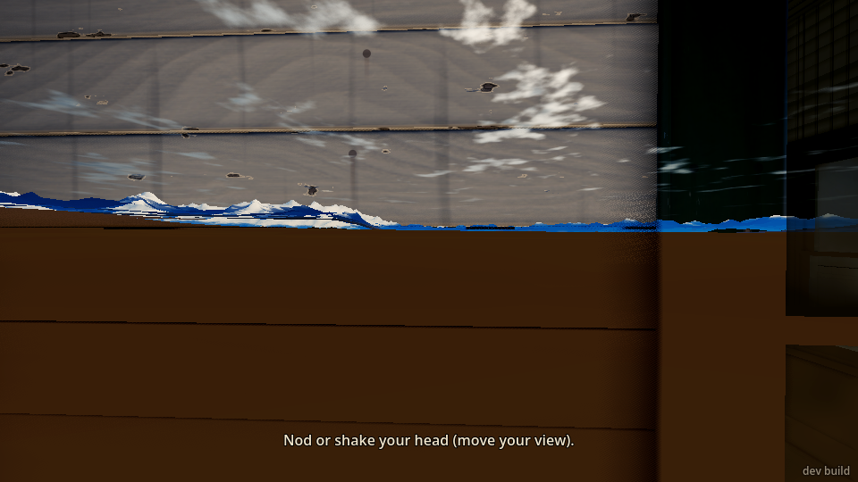
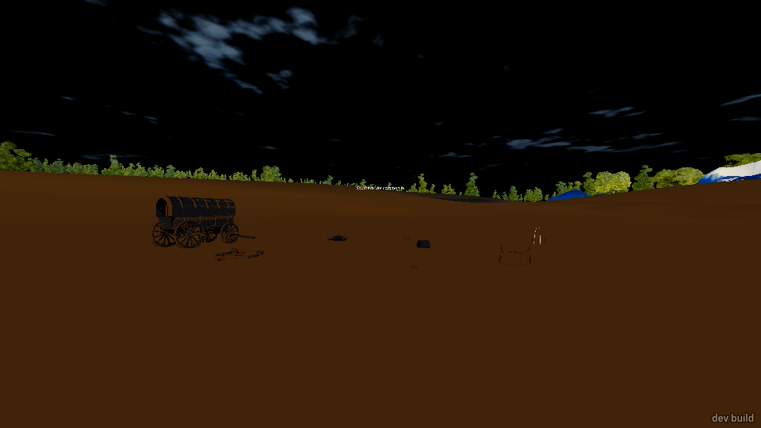
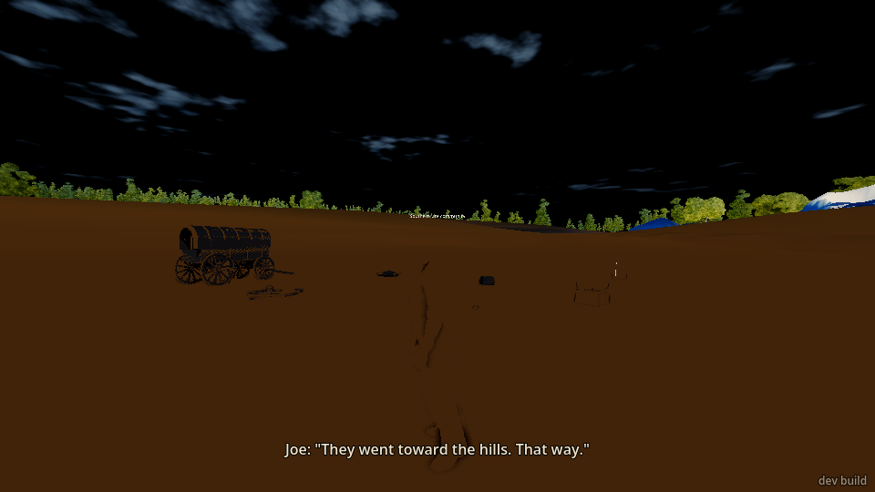
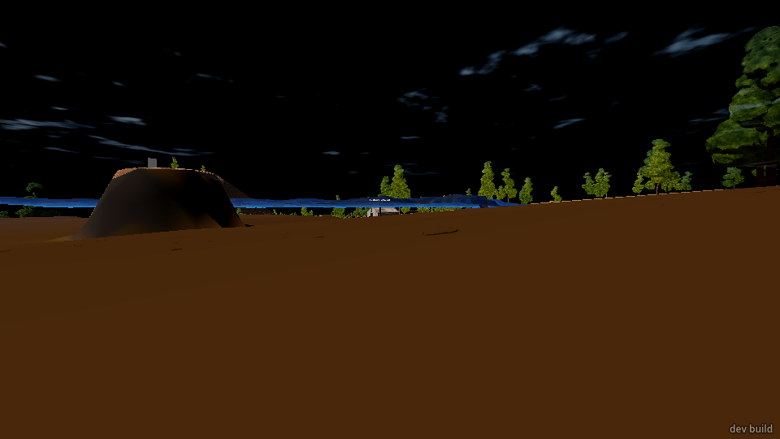
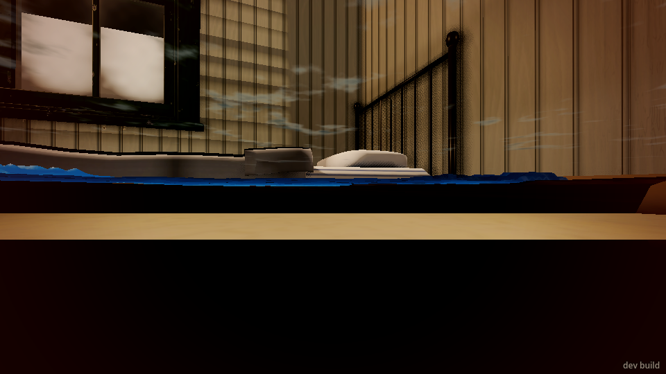
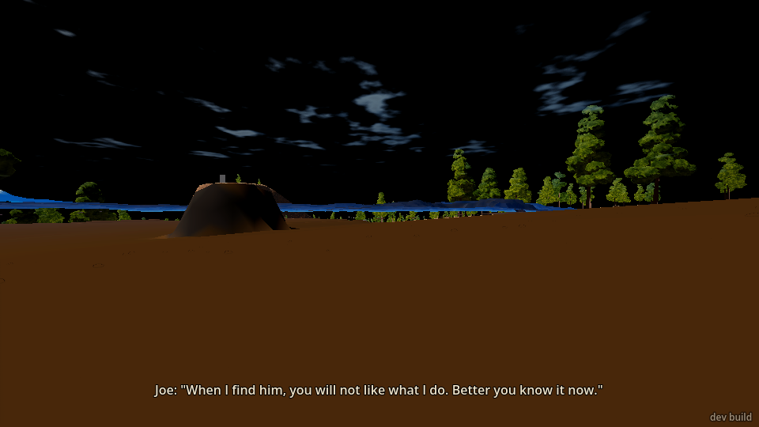
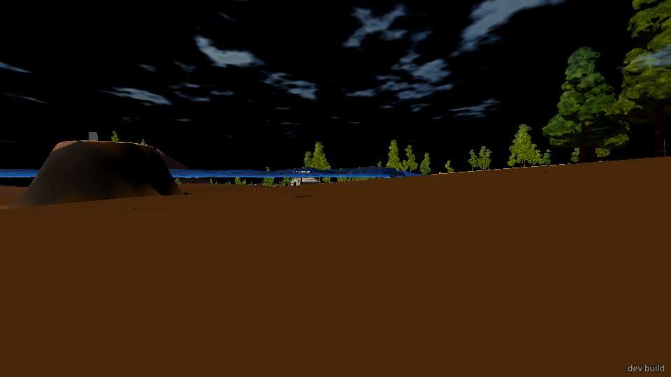
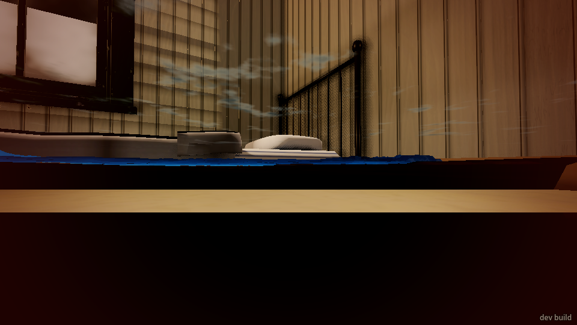

# Playtest: No Justice, played whole (2026-11-15)

Blind playtest through the dev bridge, `--world=valley --mission=no_justice`. I played it three
times from the start. **I never reached the end of the story.** All three runs ended the same way:
I was shot down at the hideout, woke at the doctor's at 17:03, and could not move. Nothing more
happened after that. Screenshots are in `2026-11-15/` (the files starting `r1_0`, `r2_0` and
`r3_end_doctors`. The folder also holds older files from another test).

On this machine the game ran about one frame a second. The opening at the doctor's ran much
slower than the rest. In run 2 and run 3 a single `wait 25` there took over ten minutes of real
time. Later scenes were quicker.

## What I did

### Run 1 (as a lawman)

- **The doctor's (10:30).** I started on Main Street with the line "The doctor's: along Main
  Street. Go in." `walk doc` brought me to the doctor's front, but not inside: Joe and the doc
  were behind a board wall 0.3 m from my face. The scene played anyway. The doc introduced Joe,
  Joe said what happened to his wife, the doc and a cowboy said no jury would hang a white man for
  it, and Joe asked "I ride today. Will you come?". The on-screen line said to nod or shake. I
  nodded. Joe said "Then we go now." and the screen said "Joe goes out to the horses."
  
- **The ride to the camp.** I didn't see a ride card in `events` (it may have been on screen
  only). Six seconds after the nod I was at the Ute camp at 10:47 with Joe beside me. He said
  "Wait here." The same moment the town logged "20 pieces of timber broke", with nothing breaking
  that I'd done.
  
- **The camp.** Joe went off ("Joe talks with the survivors, in Ute."), came back and told me
  about six or seven riders and a man in a faded red shirt. He put on a cowboy hat and neckerchief
  and explained why. Then he read the trail: south-east to the box canyon under the rimrock, and
  "G: tell him to wait or come". This is a good scene. It took about three minutes of game time.
  
- **The ride to the hideout.** I shouted at Joe meaning "come", but the first shout made him say
  "I will wait here." A second shout got "I am with you." I walked south-east and after about 15
  m I was moved to the hills near the hideout (11:03). My walk command was still running, so it
  carried me 700 m on past the hideout, and Joe followed me. That was my fault, but nothing on
  screen marked the jump. I walked back.
- **The hideout.** "The hideout's over the brow below you. Go up quiet." Joe said "When I find
  him, you will not like what I do." Six armed men (Pete, Lew, Dutch, Boyd, Amos) and Kett,
  unarmed, were round a shack about 100 m off. I crouched and crept to the brow (45 m), then on to
  about 30 m. Amos shot me in the upper arm (pumping, bone broken) before I'd drawn. Joe shouted
  "Harlan! Get down." and fired. I fired four rounds (no hits; a shack wall was in the line), tied
  a belt on my arm (worked: "Belt cinched tight"), reloaded and fired again. Lew shot me down.
  
- **After.** "You come round at the doctor's, bandaged, 6 hours on. It's 17:03. / Lew shot you
  down. / They say you were as good as dead. / Your arm's in a sling, everything aches." I was on
  the floor by a cot, "crawling", and could not move at all: `walk`, crouch toggle, jump and turn
  did nothing. The doc stood 6.5 m away and said nothing. **Joe was gone from the world**: he
  wasn't in the people list at all. The gang were all still at the hideout, unhurt and calm. I
  waited over a minute and nothing happened.
  

### Run 2 (answered by silence, then an ambush from the brow)

- **The doctor's.** I meant to nod again, but the game was so slow here that my command didn't
  land before the question timed out. Joe said "No. I did not think so." and "Joe goes out to the
  horses." **Five seconds later I was at the camp with him anyway**, and he said "Wait here." as
  if I'd said yes. The story recorded "met: followed". So the answer you give doesn't decide
  whether you go.
- **The camp.** Same lines, same order, as run 1. This time I didn't call Joe. I walked
  south-east, and about 20 m on I was moved to the hideout (11:03), with Joe 2.5 m behind me.
  
- **The hideout.** I told Joe to wait (he said "I will wait here."), crept to the brow alone and
  opened fire at 47 m. I hit Pete. The screen said "The red shirt's barred himself in the shack."
  The gang shouted and spread out ("Keep him busy, I'm going round!"). Joe came up and joined the
  fight even though I'd told him to wait. I emptied the gun, then reloaded. I was hit badly
  (bleeding inside, a broken bone), and I don't remember seeing the hit in `events`. I tried to
  tend the wounds, blacked out, and woke at the doctor's at 17:03 again ("Lew shot you down. /
  You're weak from the blood you lost."). I was stuck on the floor exactly as in run 1, and Joe
  was missing from the world again.
  

### Run 3 (nod, then fight from behind the brow)

- **The doctor's and the camp.** I nodded on time. It went the same as run 1.
- **The hideout.** I kept Joe with me and waited 80 s at the arrival spot to see if he'd lead.
  Nothing happened: it's up to the player. I fought from the brow, popping up to fire and dropping
  back behind it to reload. This worked for a while. I wasn't hit, and two aimed shots made **Lew
  give up** ("Alright! Alright! I'm done!"; "Lew's quit on us!"). Then Joe went down out cold with
  four wounds, off on my right. I moved toward him to help and was knocked out on the way. I saw
  no hit on me in `events`, only near misses, then "you blacked out". I woke at the doctor's at
  17:03 again ("Boyd shot you down."), stuck on the floor. This time Joe was still in the world,
  2 km away at the hideout, out cold, with Lew still "surrendered" beside the gang. Nobody at the
  doctor's mentioned him.
  

I didn't play a fourth run. Each run took close to an hour of real time, and all three ended in
the same dead end.

## The joins

- **Town to camp:** It happens fast, about six seconds after "Joe goes out to the horses". The
  clock jumps 10:30 to 10:47, which is believable. I saw no ride card in `events`. Joe was with
  me, in the right place. At the moment I left, "20 pieces of timber broke" was logged with
  nothing to explain it, in both runs where I looked.
- **The answer at the doctor's doesn't matter:** saying nothing (which Joe takes as "no", "I did
  not think so") still takes you to the camp with him, and he treats you as having come.
- **Camp to hideout:** The move happens after walking 15–20 m south-east. No card, no line, just
  a new place: easy to walk on past without knowing (I did, in run 1). The clock goes 10:47 to
  11:03. Joe was with me and in the right place.
- **The clock stops between joins:** It stays on 10:47 through about four minutes of the camp
  scene, and on 11:03 through the whole hideout fight (ten minutes or more). The sky looked like
  night the whole time, even on Main Street at 10:30. That may be this machine's renderer.
- **Hideout to the doctor's (when you go down):** The card is clear and well written, and the
  time (6 hours on, 17:03) makes sense. But then you're stuck crawling on the floor, unable to
  move or turn, and nothing else happens. The story stops here.
- **Joe after you go down:** In runs 1 and 2 Joe is gone from the world altogether. In run 3 he's
  left out cold at the hideout. Nobody says what became of him.
- **The gang after you go down:** They stay at the hideout 6 hours later, standing calm where they
  were. A surrendered Lew stays "surrendered" next to them.

## Joe

He stayed with me from the doctor's to the hideout in all three runs, and he's the best thing
here. His lines are spare and strong, and they're the same man from scene to scene: the camp, the
hat and neckerchief, "you will not like what I do". In the fight he talks like a partner: "He is
loading.", "That one is empty.", "Harlan. Behind.", "One on your left."

Problems:
- "Wait here" and "Come on" are one key that switches between them. The first press gave the
  opposite of what I meant.
- At the hideout he ignored "wait here" and came into the fight.
- He doesn't hold his own in the fight: in run 3 he went down with four wounds.
- After the player goes down he vanishes (runs 1 and 2) or is left behind (run 3). Nothing
  carries him into the doctor's scene.

## Each scene

- **The doctor's:** The point is clear (go in, listen, nod or shake). The words are good. I
  couldn't get inside: `walk doc` stops at the front wall, and the scene plays through the wall. I
  only learned that silence counts as "no" by being too slow.
- **The camp:** Clear. You wait while Joe talks, then you get the trail and a direction. Good
  pacing, maybe a little long with nothing to do.
- **The hideout:** "Go up quiet" is the only guidance. Nothing says what quiet should get you.
  From the brow the ground sheet hides the whole camp, so I could only fight by the bridge's
  lists, not by sight. The gang see you at about 30 m and open up at once. In three tries I never
  got near the shack or Kett. Going in, ambushing from 47 m, and fighting from cover all ended
  with me shot down within a few minutes.
- **The doctor's afterwards:** No clear thing to do, and you can't move.

## The end

I never reached it. The furthest I got was Lew surrendering in run 3. Every run ended at "You
come round at the doctor's", stuck on the floor, with nothing following. I couldn't judge the
ending or whether it feels earned.

## What broke

1. **Stuck after waking at the doctor's** (all 3 runs): after "You come round at the doctor's",
   the player is crawling on the floor by a cot and can't walk, stand, jump or turn. Nothing else
   happens. The run is over.
2. **Joe vanishes** when you go down at the hideout (runs 1 and 2): he's no longer anywhere in the
   world.
3. **Saying nothing still takes you along** (run 2): Joe says "No. I did not think so." and leaves,
   then you're at the camp with him anyway.
4. **Can't get inside the doctor's** for the opening: `walk doc` and `walk doctor` stop at the
   front, and the scene plays through a board wall.
5. **"20 pieces of timber broke"** logged in town the moment you ride off (both times I looked).
6. **Going down without a hit:** in run 3 I was knocked out with only near misses in `events`.
   In run 2 a bad wound appeared without a hit line I can find.
7. **The clock stands still** within a scene (10:47 at the camp for minutes, 11:03 through the
   whole fight).

## What was flat or confusing

- After a ride you just appear. There's no line to say you've arrived, so it's easy to walk on.
- One key for both "wait" and "come", and you can't tell which it will say.
- At the hideout there's no sense of what "quiet" buys you, or how to reach the red shirt in the
  shack, before the shooting starts.
- The fight is hard to win with a revolver at 35–45 m: I missed almost everything, and they
  spread out and flank. With the ground sheet I couldn't see them at all.
- At the doctor's at 17:03 no one speaks to you: not the doc, and nobody about Joe.
- The very slow opening at the doctor's on this machine made the timed yes/no easy to miss.

## What worked

- The writing: the doc and the cowboy on juries, Joe at the camp, the hat and neckerchief, "you
  will not like what I do". It feels grounded and Western.
- Joe in the fight sounds like a real partner.
- The gang feel alive: callouts, covering each other, flanking, "Lew's quit on us!", "You'll pay
  for that!". Shooting a man until he gives up worked.
- The belt on a pumping arm wound worked and was clear.
- The wake-up card is well done ("They say you were as good as dead"; "Your arm's in a sling").
- Clock jumps at each ride (10:30, 10:47, 11:03, then 17:03 after you go down) make sense.

## The top three things to fix

1. **Going down at the hideout is a dead end.** You wake at the doctor's stuck on the floor, with
   no next scene and no word of Joe. In three runs that's the only way the story ended. The player
   needs to be able to get up, and the story needs to go on from there (or the scene needs another
   way out).
2. **Joe has to carry across the joins:** he vanishes or is left behind when you go down, and "no"
   at the doctor's still takes you along with him. Your answer and his fate should carry forward.
3. **The hideout fight is too hard to survive and gives no clear way in.** The ground sheet hides
   the camp, the gang spot you at 30 m, there's no clear "quiet" approach to the red shirt, and
   one key both tells Joe to wait and to come. Smaller: let the player get inside the doctor's for
   the opening, and say when a ride has brought you somewhere.
