# Playtest 2026-11-15: the valley town at three times of day

Valley world, no mission (`--world=valley,--no-murder`), no shooting. About 10 minutes of real play.

**Read this first: in this run the picture was mostly broken**, so most of what I say about
people comes from the people list (`read people`: names, positions, every 15-20 s) rather than
from seeing them. The game draws about one frame a second here; stills are a few seconds apart.

## What I did

1. Started the game. Set the clock to 6:18. Walked to the liveryman by the livery, watched him
   ~1 min. Walked to the general store porch (storekeeper), then to the smith's. ~1 min each.
2. The screen looked wrong from the first shot, so I restarted twice (once without
   `--no-murder`). Same picture each time. Carried on.
3. Set 10:30. Saloon steps (loudmouth), then followed him west to the general store, where the
   store wife was. Then the hotel (townsman) and the undertaker's. ~1 min each.
4. Set 19:12. Saloon porch (loudmouth, pianist, fiddler), then the bar in the saloon's yard
   (barkeep, miner, fiddler). ~1.5 min each.

## The three questions

**1. Three people and what they do for a living.** The liveryman (at the livery), the
storekeeper (pacing the general store porch) and the barkeep (behind the yard bar in the
evening). Honestly, I knew from their *names* in the people list and from where they stood. I
could not see a single tool, apron or bit of work in their hands; nobody did any work I could
see. The undertaker, the smith and the "miner" are the same: the name told me, nothing else did.

**2. Anyone do something I didn't expect?** Yes:
- At 10:30 the loudmouth walked straight from the saloon to the general store (~60 m in under
  half a minute) and then stood **under the store's porch floor**: the game said a floorboard
  was between me and him, while the store wife stood on the porch right above him.
- In the evening the liveryman left his post and walked onto the saloon porch, and the miner
  walked to the yard bar and stood by the barkeep. That was nice to see.
- At 19:12 it is pitch-black night with stars out. I expected dusk.

**3. Anyone do exactly the same thing twice?** Almost everyone did one thing forever. The
liveryman (6:18), smith (6:18), townsman and undertaker (10:30), and the barkeep, pianist and
loudmouth (19:12) did not move a centimetre across one to two minutes of watching. The
storekeeper at 6:18 walked the same ~3 m back and forth along his porch, over and over. The
loudmouth and store wife, once at the store, froze there. Nobody spoke: `events` was empty the
whole session, all three visits.

## What looked wrong

- **The picture (every shot, every time of day).** A flat brown or black ground layer is drawn
  *over* the lower half of the screen, covering the street, boardwalks and people's legs; you see
  their outlines through it like a tracing. Distant snowy mountains and clouds are drawn in front
  of building fronts and across people's faces. The sky is a box with a hard corner (tan or grey
  flat panels with clouds painted on them). Examples:
  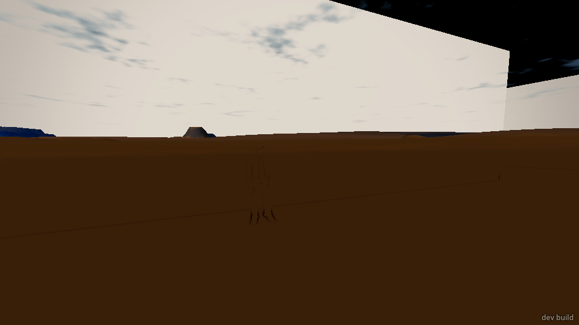
  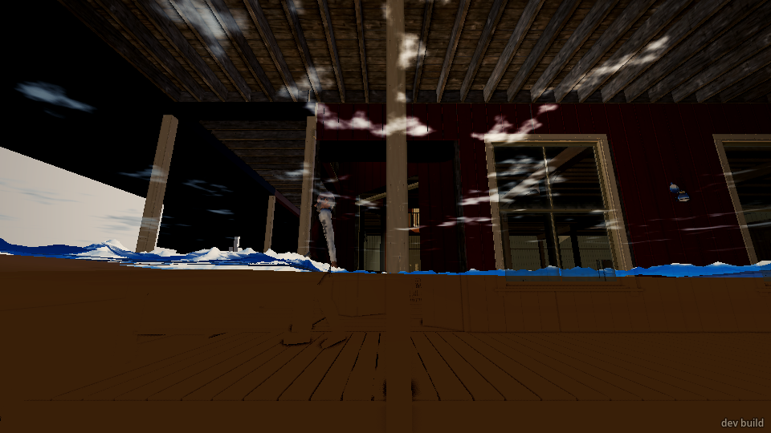
  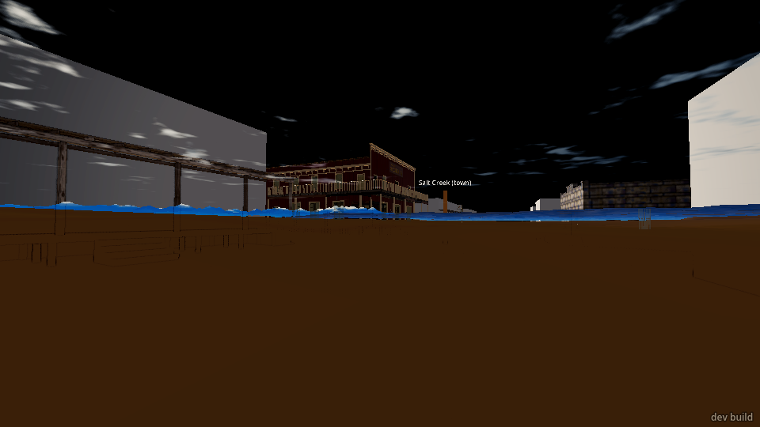
  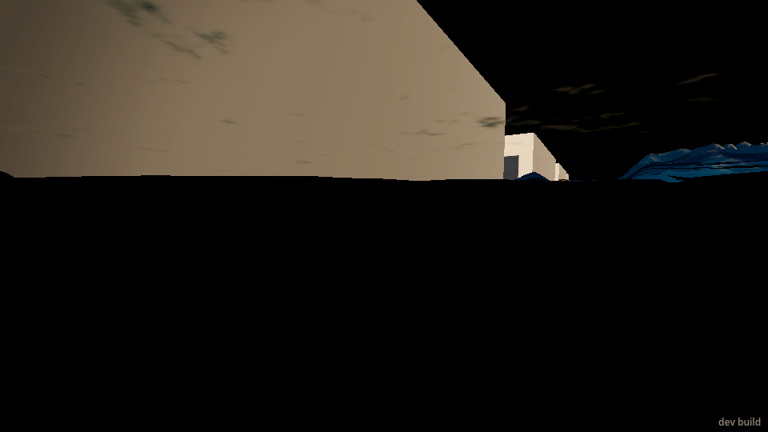
  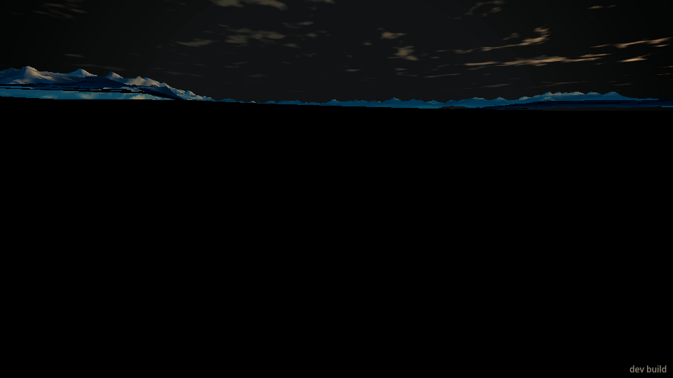
  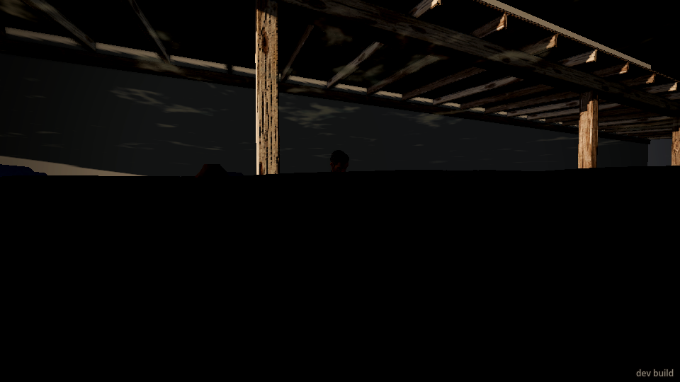
- **The loudmouth under the general store porch** at 10:30 (him at floor level, a floorboard in
  the way, the store wife standing above him).
  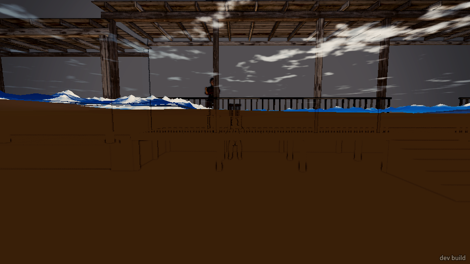
- **The store wife** seemed to hold something out in front of her with both arms, but it was too
  dark and cloud-covered to tell what. 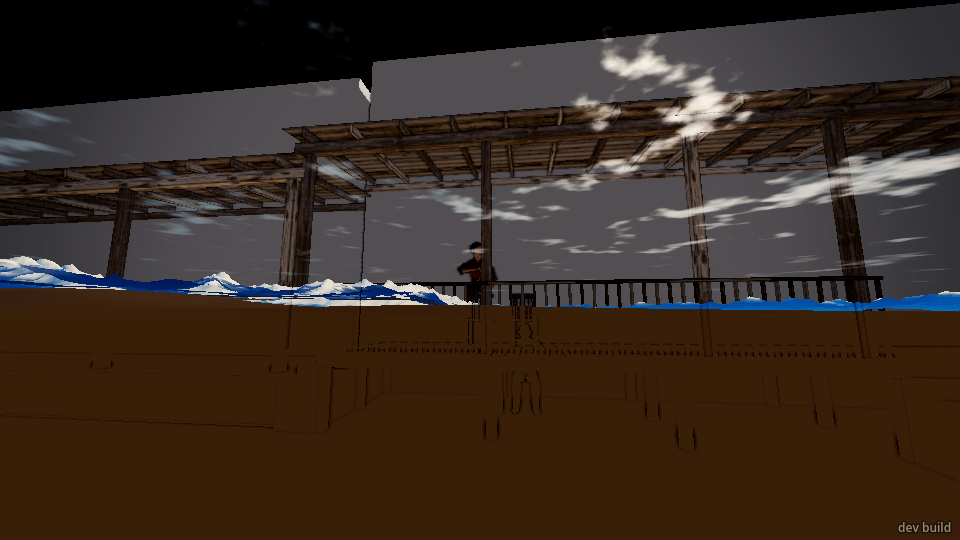
- **The clock never moved.** It read 06:18 after more than four minutes of waiting.
- **19:12 is full night.** The saloon porch was one lamp and black.
  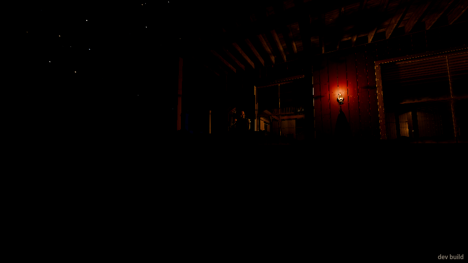
  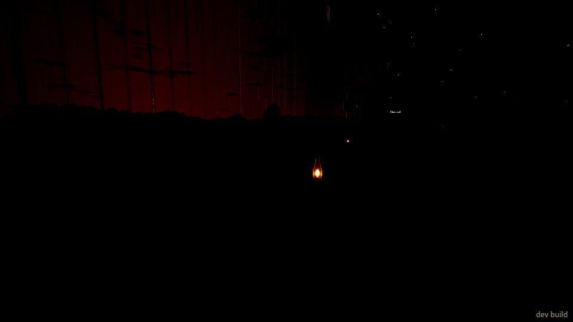
- 10:30 sky was dark grey, not daylight blue.
- Townsman 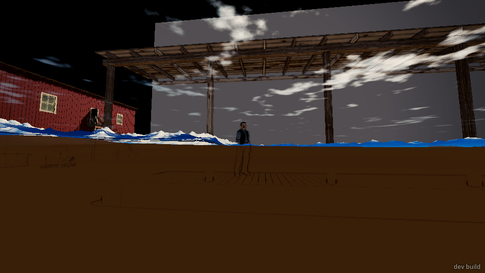 and undertaker
  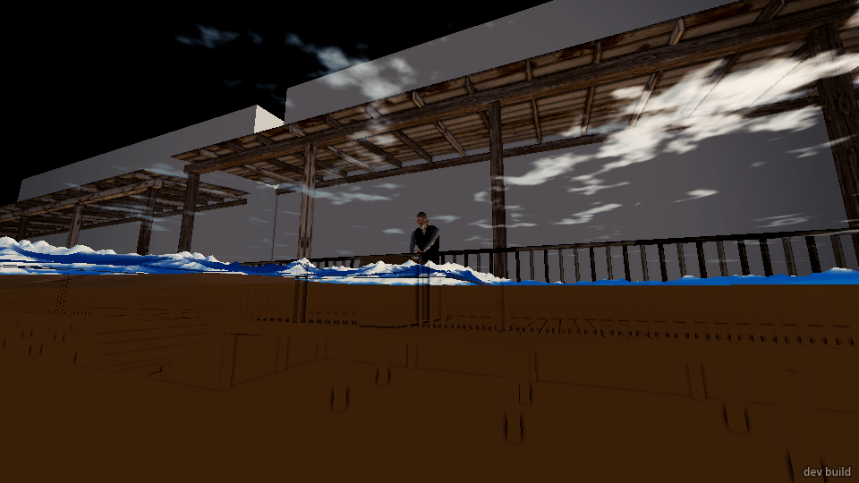 are statues on their porches.

## What felt alive

- The evening gathering: people drifting to the saloon and the yard bar after dark (liveryman,
  miner, fiddler), a musician on the porch, a lamp lit on the saloon wall.
- The town population changes with the hour (storekeeper at dawn, store wife mid-morning,
  pianist/fiddler/barkeep/miner at night). It suggests a day's routine.
- Building fronts that did show (the red saloon, porches, railings, rafters) look solid and old.

## Top three things to fix

1. **The drawing in the valley**: ground and sky drawn over the town and people. As it stands a
   player can't see anyone.
2. **People stand frozen and silent.** Give them something visible to do at their spot (work,
   shift weight, turn, talk to each other) and let them talk; no one said a word in ten minutes.
3. **The loudmouth sinking under the store porch**, and the clock not running (plus 19:12 being
   full night).
