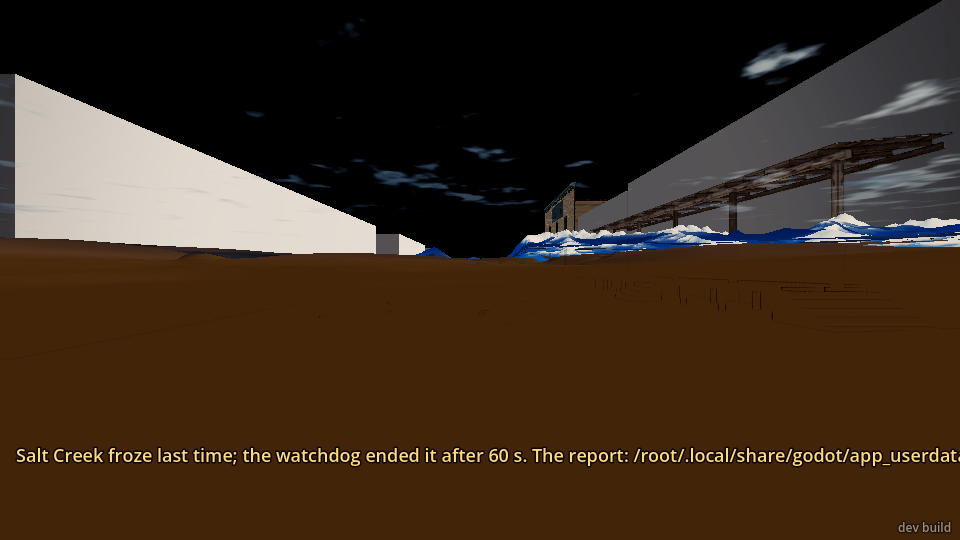
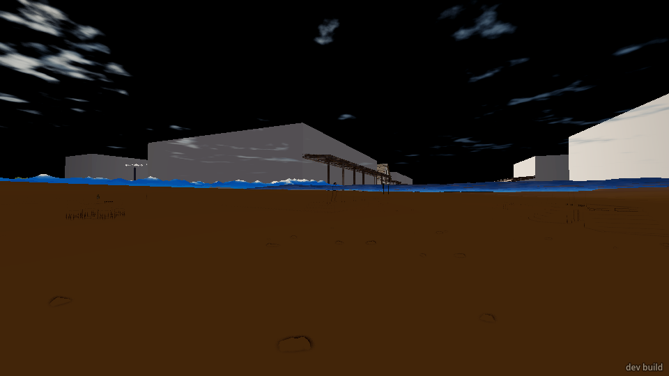
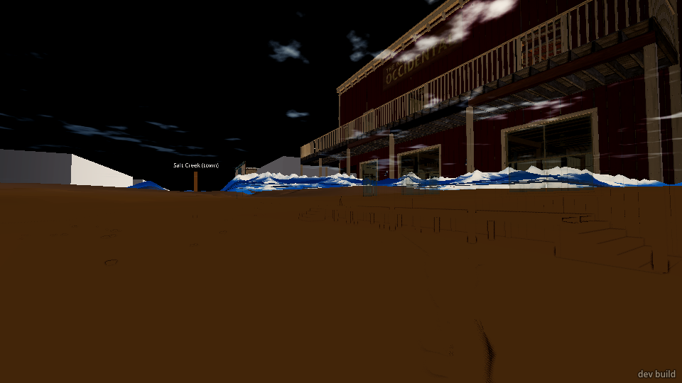
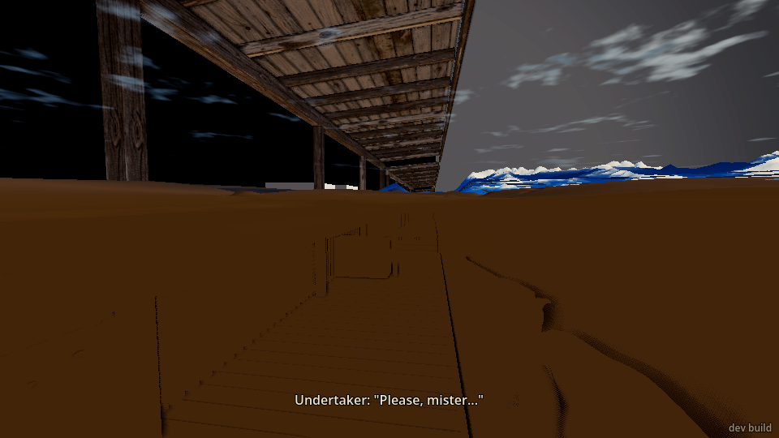

# Playtest 2026-11-17: how the street reacts to one shot

Valley town, no mission (`--world=valley --no-murder`), clock set to noon. About 6 minutes of
game time. Times below are seconds after my shot unless said otherwise.

**Could I see people in the screenshots? No.** In every picture the ground is drawn as a flat
brown sheet that covers the street at about knee-to-eye height, so the townsfolk, porches and
my own gun are hidden under it. Some buildings are blank grey boxes and the noon sky is black.
Everything below about people comes from `read people` and `events`, not from the picture. The
spoken lines do show as subtitles on screen.

## What I did

1. Started the game. The first try froze when I jumped to the street with `goto main@24.5`
   followed by `wait 20`; the watchdog ended it after 60 s and the next start showed "Salt Creek
   froze last time" on screen. I restarted and walked instead of jumping. No freeze after that.
2. Set the clock to noon and walked to the middle of Main Street (x 25). Only three townsfolk
   were in town: **loudmouth** (17 m west), **townsman** (23 m east) and **undertaker** (86 m
   east). An **engineer** (no mood shown) was moving along the rail line ~90-800 m away.
   For about 50 s before the shot nobody moved at all; all three stood still, "calm".
   
   
3. Drew my revolver while facing the townsman, tipped it up 70 degrees and fired one shot.
4. Watched with `read people` and `events` every second at first, then every 10-15 s. About 10 s
   after the shot I turned to face the loudmouth (gun still in hand) to take a screenshot.
   
5. At ~100 s I put the gun away and faced away.
6. Walked to the undertaker, stood 6 m from him, drew the revolver and pointed it at him without
   firing. Held it ~40 s, then put it away and watched another 40 s.
   

## The two questions

### Q7. After the shot, what did the street do, in order?

- **0 s** — shot fired.
- **~1 s** — **townsman (24 m, in front of me, saw it)**: mood "running", shouted *"Get down!
  Everybody down!"*. **Loudmouth (17 m, behind me, heard it)**: "alarmed", turned to look.
  **Undertaker (89 m)**: "alarmed", looked.
- **~1.6 s** — loudmouth: *"Lord almighty!"*
- **~3 s** — townsman had run ~8 m east (away from me) to 31 m and dropped to "cowering".
  Loudmouth moved under 2 m and also "cowering" (his reaction said "flee", but he barely moved).
  Undertaker "watching" and started walking **toward** the noise (gawking), about 6 m closer.
- **~9 s** — undertaker: *"Who's shooting?"*
- **~10-50 s** — nothing changed: both near men stayed cowering where they were, undertaker stood
  watching. Engineer never reacted (he's at the same distance as the undertaker but on the line).
- **~50 s** — undertaker went from "watching" to "shaken".
- **~55 s** — loudmouth went to "hands_up" (I had been facing him with the gun out for ~45 s):
  *"Don't shoot! I got a family!"*.
- **~57 s** — townsman: *"...They gone?"*
- **~57-65 s** — townsman back on his exact original spot, mood "calm". Undertaker back on his
  original spot, "calm".
- **~65-100 s** — loudmouth kept his hands up and begged every ~7 s: *"Please, mister..."*,
  *"Take it! Take whatever you want!"*, *"Don't shoot! I got a family!"* (twice).
- **~103 s** — I holstered. Within 2 s loudmouth dropped his hands ("shaken"): *"Lord. Lord,
  lord."* and stepped back to his original spot.
- **~4.5 min** — loudmouth still "shaken" (not "calm") on his spot.

**How long until it looked ordinary?** By position, about **one minute**: everybody was standing
on his original spot by ~60 s (loudmouth at ~105 s, only because I was covering him). By mood,
the far man and the townsman read "calm" within a minute; the loudmouth was still "shaken" after
4.5 minutes. Since nobody was moving before the shot either, "ordinary" here means three men
standing still.

### Q5. Did anyone react to something they couldn't have known about?

Nothing clear-cut. Each reaction fits what the man could see or hear: the townsman was in front
of me and "saw" the shot; the loudmouth behind me reacted as to a sound; the undertaker at 89 m
reacted weakly (fear 0.15) and asked *"Who's shooting?"*, which is right for a man who only heard
it. Two small oddities:
- The townsman's *"...They gone?"* (plural) when it was one man, and I was still standing 31 m
  from him with the gun out.
- The townsman and undertaker were "calm" again within a minute while I was still in the street
  with the revolver drawn (I had turned toward the loudmouth). They seemed to stop caring that the
  shooter was still right there and armed.
- The engineer at ~88 m never reacted at all while the undertaker at the same distance did. He may
  simply have been too far or inside the engine's noise; I couldn't tell.

## What broke

- **Freeze on the first run:** `goto main@24.5` then `wait 20`, ~20 s after start. The game hung
  and the watchdog closed it after 60 s.
- **The ground covers everything below eye level** in every screenshot: no people, no gun, porch
  steps seen through the dirt. Noon sky is black; several buildings are plain grey boxes.
- `turn 67 70` turned me to 134 degrees (it seems to add to my facing rather than set it). Harmless
  here, but surprising.

## What was flat or confusing

- **The town is nearly empty at noon:** three men on a long Main Street, and none of them moved
  for the 50 s before the shot. Nothing to compare "back to normal" against.
- **"Flee" without fleeing:** the loudmouth's reaction said flee, but he moved less than 2 m and
  crouched in the open 17 m from the shooter. The townsman ran only 8 m.
- **Nobody went indoors or behind cover**, and nobody left the street.
- **Hands up came late:** the loudmouth only raised his hands ~45 s after I turned my drawn gun
  on him. The undertaker, by contrast, raised his within ~2 s of me drawing at 6 m. Distance may
  explain it, but 45 s felt like a long time to stand there covered.
- **Begging on a loop:** both covered men repeated the same three lines every 5-7 s
  ("Please, mister..." four times in a row from the undertaker).
- The townsman shouted "Everybody down!" but the others didn't respond to it in any visible way.

## What felt alive

- The first second is good: three different reactions to one shot by distance and what they saw:
  the near man who saw it shouts a warning and runs, the man behind flinches and prays, the far
  man walks *toward* the noise and asks "Who's shooting?". That's very Western.
- *"...They gone?"* as the townsman comes out of cover is a lovely touch.
- Holstering made the covered man drop his hands within two seconds, with *"Lord. Lord, lord."* —
  a clear, readable cause and effect.
- Drawing at 6 m without firing: the undertaker's *"Whoa, now. Easy with that iron."* then hands
  up felt right.
- People remember: the loudmouth stayed shaken for minutes, not seconds.

## Top three things to fix

1. **Make the people visible** in this renderer (the ground sheet hides them, and the freeze on
   `goto`): until then a playtest can't judge any reaction by eye.
2. **Fleeing should mean leaving:** men who flee should get behind something or indoors, not crouch
   2-8 m away in the open, and they shouldn't be back to "calm" on the same spot within a minute
   while the shooter still stands in the street with the gun out.
3. **More life before and after:** more townsfolk at noon, doing things that move, so the street
   has a normal to break and to return to; and less looping in the begging lines.
