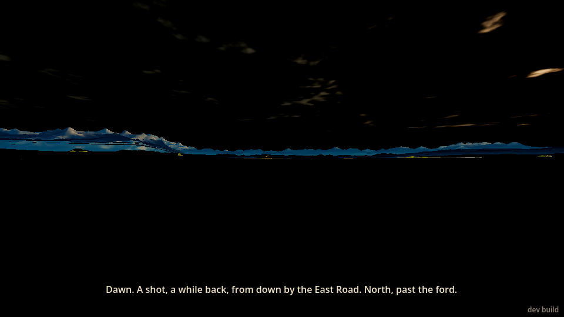
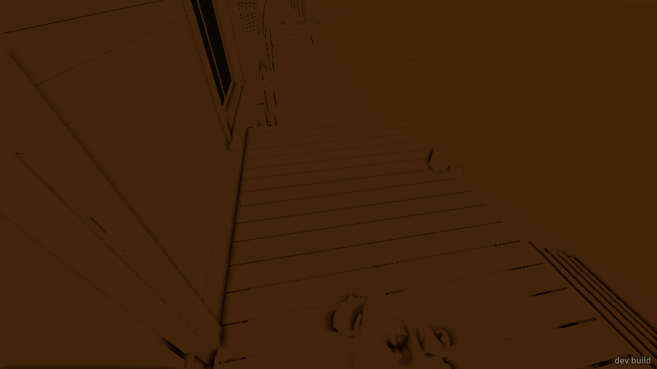

# Playtest 2026-11-18 (slice): prologue only, the game froze at the doctor's door

> **Note from the session that ran this (not the playtester):** this is a partial run. The blind playtester got through the prologue only; the game crashed once and then hung at the doctor's door, so the saloon, the night, the morning and No Justice were not played and answers 1, 3 and 4 are open. The sandbox draws with a software renderer (black sky, flat brown ground, as on 2026-11-17), so every picture is poor and the findings rest on `read`/`events` text. The crash and the hang may be the software renderer (shader-instance warnings, 7.6 GB); whether they happen on a real GPU is not known. Also worth a look: the clock went from 06:58 to 12:14 while carrying him 485 m (about five game hours).

Build: `--world=valley --mission=sheriff`. Short version: I played the prologue (find the wounded sheriff, nod, press his wound, carry him 485 m to town), reached the doctor's door at noon, knocked, and nobody answered. After that the game stopped answering the bridge (20+ minutes of no reply to `ping`, 400% CPU, 7.6 GB memory) and I had to stop. **I never reached the saloon, the card game, the night, the morning, or No Justice.** Answers 1, 3 and 4 are therefore "not seen". Everything below is from text (`read all`, `events`) unless I say a picture showed it.

## Pictures
All screenshots are bad in this environment, as warned.
-  Black ground and sky; I can see only a strip of mountains and the caption "Dawn. A shot, a while back, from down by the East Road. North, past the ford."
-  Completely black. I can see nothing; no claim about how the sheriff looks.
-  A dark brown picture, but I can see porch boards, steps and a door frame. Usable, but flat.

## What I did (in order)
1. The first game crashed about four minutes in (native crash inside the shader compiler of the software graphics driver, signal 11). I restarted it, which the rules allow for an early crash.
2. Start: caption "Dawn. A shot, a while back..." I stood at the homestead, 351 m from the sheriff, who lay gut-shot.
3. Ran to him (76 s). He called "Hold it! Who's that?", then "Harlan. You're Harlan, from up the creek. I'm gut-shot. I need the doc. You going to help me or not?" The screen said "Nod to help him, shake your head to leave him (move your view)".
4. I tried to nod by turning the view down and up with `turn`, four times. **Nothing registered.** He repeated "Well? Nod or don't, but don't just stand there." about every 14 s. I only got on after finding the `nod` command in `help` (playtest.md doesn't list it). Then he said "Thank God. Press on it. Hard. It won't quit bleeding."
5. `press tend_wounds` did nothing visible. `press shove` close to him gave "E: take him by the collar", then "E: let him go" and "Christ! That's it. Keep on it."; `read player` said I was carrying the sheriff.
6. `walk doctor run` carried him all the way: 484.7 m, clock 06:58 to 12:14. He said "Don't let me lie here." about every 20 s. At the door a caption said "Packed and bound. E by his horse to take him in", odd, as the horse was left back at the ford.
7. At the doctor's porch: "E: bang on the door". My first `shove` missed (I was looking at the floor). After turning to the door, `shove` said "something solid: it held"; the knock count went 1, then 5. `knock.heard` lists "doctor". **Nobody opened, nobody spoke, and no doctor appears in `read people`** (townsman, undertaker, loudmouth, engineer nearby; landlady, liveryman, storekeeper, smith further off).
8. I tried a 60 s `wait`; the game never answered again.

## What broke
- **The game froze for good at the doctor's door** (no reply to `ping` for 20+ minutes, 400% CPU, 7.6 GB RAM). The stall guard wrote no new report after 15:45. Before that every call was slow: a short `wait` could take tens of seconds.
- First run crashed within minutes (signal 11 in the LLVM shader compiler of the driver).
- The log is full of "Too many instances using shader instance variables" (limit 4096).
- The nod prompt can't be answered by moving the view through the bridge; only the `nod` command worked.
- The "E by his horse to take him in" caption shows again at the doctor's door, after he has already been carried in.
- Five knocks, no answer.

## What was flat or confusing
- Nothing tells a new player how to nod, or that E does different things: tap on his body takes him by the collar, hold on the wound presses it.
- It is noon when I arrive; the sheriff is still alive and talking after six hours of being carried.
- The doctor isn't there and nothing says why (out, asleep, at the saloon?). I could not tell whether the story needs night or another action.
- Reach matters for E: the first knock "missed" because I stood looking at the floor.

## What was fun
- The sheriff talks. "Stranger on a bald-faced sorrel. Rode up easy, like he wanted directions. Called me friend. Then he shot me." is a good clue; "Sun's coming up. Ain't that something." and "Damn, it burns." make him a person.
- Nod or shake as the choice is a good idea.

## Answers
1. Saloon scene: **not reached.**
2. The shot man: I carried him to the doctor's door (485 m). At the doctor's I knocked five times; no one answered; then the game froze. I don't know what the doctor does.
3. Shot in the air at noon: **not done** (frozen). It was noon at the doctor's door, so it could have been done there.
4. The town remembering next morning: **not reached.**
5. Three worst problems:
   1. The game froze and stopped answering at the doctor's door (or got painfully slow under this renderer); the prologue could not be finished. A driver-level crash also hit the first run.
   2. Nobody answers the doctor's door and nothing says what to do instead.
   3. The nod prompt can't be answered by moving the view the way a bridge player does (needs the `nod` command), and the "E by his horse" caption is stale.
