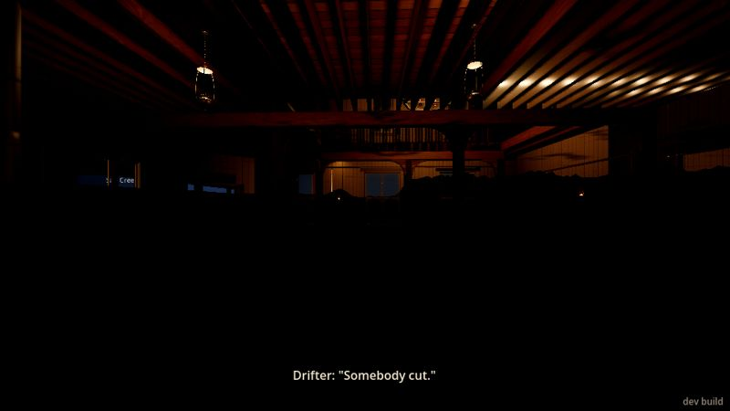

# Playtest 2026-11-25: the saloon, No Law's first night

Blind playtest (no code read). Valley, `--mission=no_law`, starting in the saloon at 21:45 by the bar.
Game times below are the `events` clock in seconds since start.

## What I did

1. Started the drawn game (`playtest.py start --game-args=--world=valley,--mission=no_law`). It came up
   in the saloon, facing west across the room toward the card table. I took one screenshot.
2. Turned to face the barkeep. **The game crashed** (signal 11, inside the software graphics driver's
   shader compiler). I restarted and did the same thing; it crashed again at the same moment. I went on
   with the headless game (`bridge.py start --headless ...`), so the rest is from `read` and `events`,
   with no pictures.
3. Looked round the room by facing each person in turn. Ten people in: the barkeep behind the bar, three
   drinkers along the bar (rancher, miner, loudmouth, about 2 m apart), the liveryman and saloon girl
   talking in the middle of the room, Earl and the drifter seated at the card table, the pianist seated
   at the piano and the fiddler standing next to him. Everyone was fully visible from where I stood
   except the barkeep (the counter hides his legs, as it should) and the saloon girl (the liveryman stood
   in my line). Nobody shared a spot, nobody was floating, nobody stood in a wall or a prop.
4. Walked to the bar (stopped at the counter, beside the rancher), then to the card table. "E: sit down"
   came up by a chair; I pressed E and sat (ValleySaloonChair10). The drifter: "Sit, if you're sitting."
   The screen: "You're in from the next hand."
5. Played a hand. Dealt a pair of aces at 47.5. "Your bet. Nod: check · shake: fold." I tried to nod
   with two quick pitch turns; it didn't count, and after ten seconds it checked for me. Drew 3, checked
   again, and at 78.0 took the pot with the aces. Drifter: "Don't get used to it, mister." Nice.
6. Stayed seated and watched the event through, then about two and a half minutes after it.

## The card-table event, in order

- 86.5 Earl: "Deal's mine. Watch my hands, if you like."
- 89.3 **The stranger**: "Evening. Mind if I sit in a while?" — he was already by the table when he
  spoke. I didn't catch him coming in (I was waiting in 10-second steps and had no picture), so I can't
  say which door he used.
- 92.3 **Cody**: "Earl, you cheating son of a bitch!" (92.7: I'm dealt in, ace high, mid-quarrel.)
- 94.1 Stranger, to me: "Don't move, friend. Whatever happens next, you sit still." My seat showed I
  was being held by Cody (`held: cody`) for the next twenty seconds or so.
- 97.3 Earl: "Now, Cody, I never..."
- 100.0 **Earl's chair (ValleySaloonChair9) is kicked out**: one member broke and the chair fell over
  whole. Earl went down. In the same tenth of a second **the whole card table went over too** (20
  members loose, "no shot") and the deck and chips fell. Earl was "hit" in the pelvis, chest, pelvis
  again and right shin during that fall, before any shot.
- 105.2 **Cody fired** once. Earl hit in the chest.
- 106.1 Cody: "Ain't no law left in this valley to save you now, Earl."
- 109.4 Barkeep: "Jesus, Cody, my chair!" (Good line.)
- Around 104-114 Cody walked straight to **the saloon's front door** (about 8.9, -9.6) and was out in
  the street by 124, then off east along it.
- 121.1 Stranger: "You didn't see a thing tonight. Nobody did. Remember that." He then left by **the
  same front door** (by 134) and went off east along the street after Cody.
- People during it: the barkeep ran to the front door and cowered there; the drifter got up from the
  table and cowered by the door too; the pianist ducked at his piano; the liveryman and rancher ran for
  the door; the miner cowered at the door; the saloon girl and loudmouth ran out into the street.
  The three at the bar first stayed "calm" through the kick and the shot.

## Afterwards

- 125.9 Barkeep: "Somebody ought to fetch the... hell. Ain't nobody left to fetch."
- 130.0 Barkeep: "He's breathing. Harlan. You. Get him up to Doc's." Screen: "E by him: take him up."
  That's the one clear instruction to me, and it's a good one.
- 133.4 Pianist: "Is he done, you reckon?" 148.6 Rancher: "Is it done?" 156.0 Liveryman: "Is it over?"
- 155.0 Barkeep: "Go on! He can't lie there." 155.9 Saloon girl: "I'm too old for this."
  163.3 Loudmouth: "My heart's going like a hammer."
- The barkeep came over and stood by Earl for about forty seconds, then went back behind the bar.
- Most people drifted back to their places within a minute (rancher and loudmouth to the bar, liveryman
  to the middle of the room, the band to their spots, the saloon girl back in). The drifter walked off
  down the street and didn't come back; the miner left too. The room's mood went "hushed" (0.07).
- I stayed seated (I was told to watch, not act). At **251.6 Earl died of blood loss**. Then, *after*
  he was dead: 253.1 Liveryman: "Somebody fetch Doc!" and 253.5 Barkeep: "He's hit! Get the doctor!"

## What broke

- **The drawn game crashes when you turn from the start view to face the barkeep** (twice in two
  tries, same moment: signal 11 inside the software Vulkan driver compiling a shader). Before it, the
  game's log had about 540 lines of "Too many instances using shader instance variables... Maximum
  items supported by this hardware is: 4096." This may be this test machine's software renderer only,
  but it stopped the screenshots.
- **The card table goes over with the chair.** When Earl's chair is kicked out, the whole table falls
  over in the same instant, with deck and chips, and it's logged as a 20-member break with "no shot".
  Maybe meant, but it reads as if Earl's fall throws the table.
- **"He's hit! Get the doctor!" after he's dead.** Two seconds after Earl died, the liveryman and the
  barkeep call for the doctor as if the shooting had just happened, and that after the barkeep had
  already said "Ain't nobody left to fetch."
- **Nodding to bet didn't work for me** through the bridge (two instant turns down and up). Every bet
  timed out to a check, so I never found out whether I could fold or raise. There's no "bet" option on
  the prompt, only check and fold.

## What was flat or confusing

- The start view is very dark: the lamps and roof beams are lit, but the lower half of the screen (the
  floor, the table, the people) is near black. I couldn't see a single person in the first shot.
  
- I couldn't tell where the stranger and Cody came in from: they were simply at the table when the
  stranger spoke. There was no "door creaks" or "someone comes in" line in `events` before him.
- Earl lay there two minutes after "Get him up to Doc's" and nobody but me could do anything; fine as a
  choice for the player, but the room only repeated "Is it over?" lines. No one went for the doctor
  themselves, and then they called for him once he'd died.
- Earl's falling counted as four "hits" before the shot, which makes the event log look like he was shot
  four times.
- The three drinkers at the bar stayed "calm" through a chair kicked, a man down and a shot ten metres
  away.

## What was fun

- The card talk is lovely and alive: "Two pair, eights and fours. Don't look at me like that." /
  "Every damn hand." Being dealt in by "Sit, if you're sitting" and winning with aces felt right.
- The stranger telling me "Don't move, friend. Whatever happens next, you sit still." and afterwards
  "You didn't see a thing tonight. Nobody did." is a strong, Western beat.
- "Jesus, Cody, my chair!" is the best line of the night.
- The barkeep putting it on me ("Harlan. You. Get him up to Doc's.") gives the player a clear job and a
  clock: if you don't, Earl dies. That's good stakes.
- The room scattering for the door and drifting back, hushed, felt real.

## The top three things to fix

1. **The crash on turning to the bar in the drawn game** (and the 4096 shader-instance-variable
   overflow before it): it stops every screenshot playtest of this room.
2. **The card table falls over with Earl's chair**, and his fall logs as four hits before the shot.
3. **The calls for the doctor after Earl is already dead** (and the barkeep contradicting his own "ain't
   nobody left to fetch"); and no one but the player ever goes for Doc.

## Quick answers

- Everyone in the room at a sensible place, nobody inside a prop or wall: **yes** (from positions and
  line-of-sight checks; no pictures of the people because of the crash).
- The card-table event played through (chair kicked, man falling, shot): **yes**.
- The newcomers came in through a door and left through one: **left yes** (both by the front door, then
  east along the street); **came in: not seen** (they were already at the table when I first caught them).
