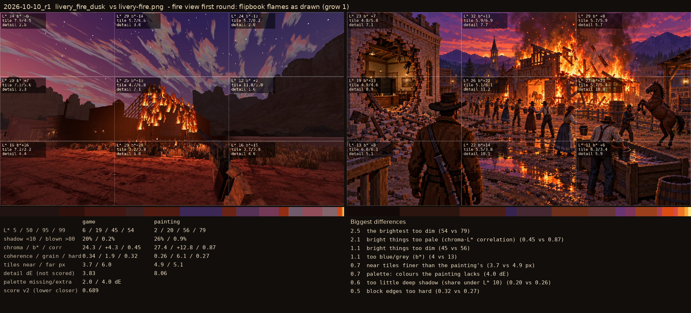

# 2026-10-10_r1: fire view first round: flipbook flames as drawn (grow 1)

## livery_fire_dusk (score 0.689, lower is closer)

- 2.5 the brightest too dim (54 vs 79)
- 2.1 bright things too pale (chroma-L* correlation) (0.45 vs 0.87)
- 1.1 bright things too dim (45 vs 56)
- 1.1 too blue/grey (b*) (4 vs 13)
- 0.7 near tiles finer than the painting's (3.7 vs 4.9 px)
- 0.7 palette: colours the painting lacks (4.0 dE)
- 0.6 too little deep shadow (share under L* 10) (0.20 vs 0.26)
- 0.5 block edges too hard (0.32 vs 0.27)
