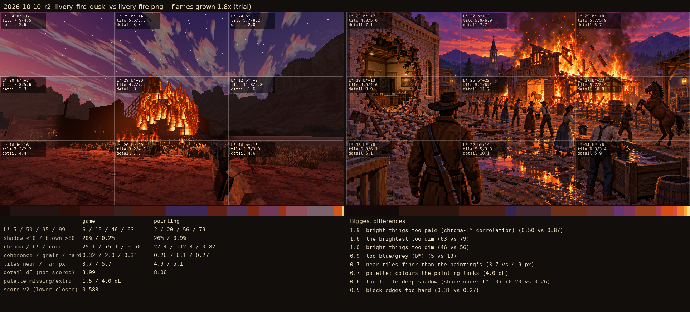

# 2026-10-10_r2: flames grown 1.8x (trial)

## livery_fire_dusk (score 0.583, lower is closer)

- 1.9 bright things too pale (chroma-L* correlation) (0.50 vs 0.87)
- 1.6 the brightest too dim (63 vs 79)
- 1.0 bright things too dim (46 vs 56)
- 0.9 too blue/grey (b*) (5 vs 13)
- 0.7 near tiles finer than the painting's (3.7 vs 4.9 px)
- 0.7 palette: colours the painting lacks (4.0 dE)
- 0.6 too little deep shadow (share under L* 10) (0.20 vs 0.26)
- 0.5 block edges too hard (0.31 vs 0.27)
