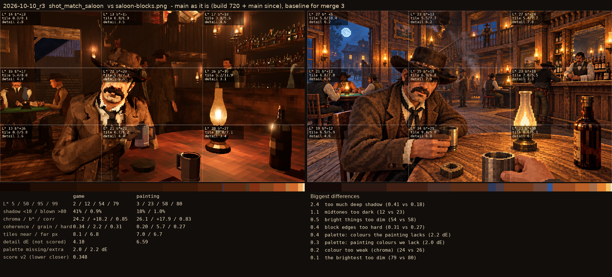

# 2026-10-10_r3: main as it is (build 720 + main since), baseline for merge 3

## shot_match_saloon (score 0.348, lower is closer)

- 2.4 too much deep shadow (0.41 vs 0.18)
- 1.1 midtones too dark (12 vs 23)
- 0.5 bright things too dim (54 vs 58)
- 0.4 block edges too hard (0.31 vs 0.27)
- 0.4 palette: colours the painting lacks (2.2 dE)
- 0.3 palette: painting colours we lack (2.0 dE)
- 0.2 colour too weak (chroma) (24 vs 26)
- 0.1 the brightest too dim (79 vs 80)
