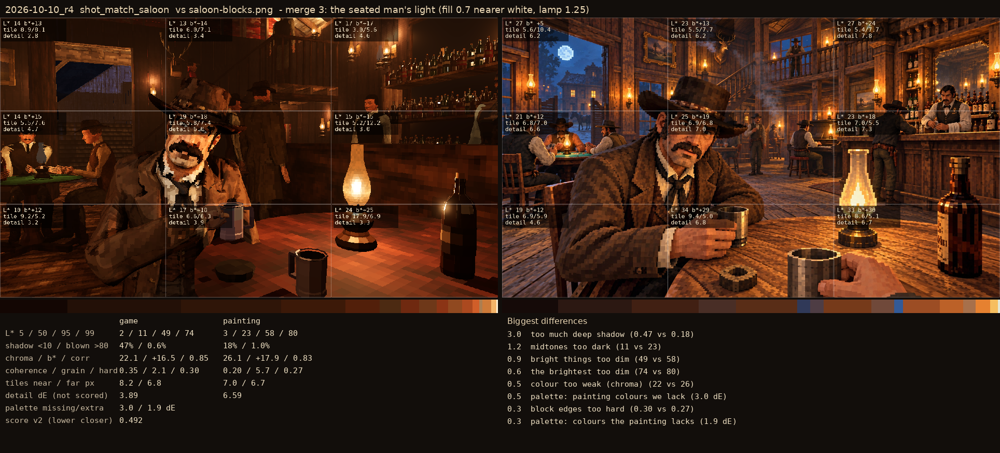

# 2026-10-10_r4: merge 3: the seated man's light (fill 0.7 nearer white, lamp 1.25)

## shot_match_saloon (score 0.492, lower is closer)

- 3.0 too much deep shadow (0.47 vs 0.18)
- 1.2 midtones too dark (11 vs 23)
- 0.9 bright things too dim (49 vs 58)
- 0.6 the brightest too dim (74 vs 80)
- 0.5 colour too weak (chroma) (22 vs 26)
- 0.5 palette: painting colours we lack (3.0 dE)
- 0.3 block edges too hard (0.30 vs 0.27)
- 0.3 palette: colours the painting lacks (1.9 dE)
