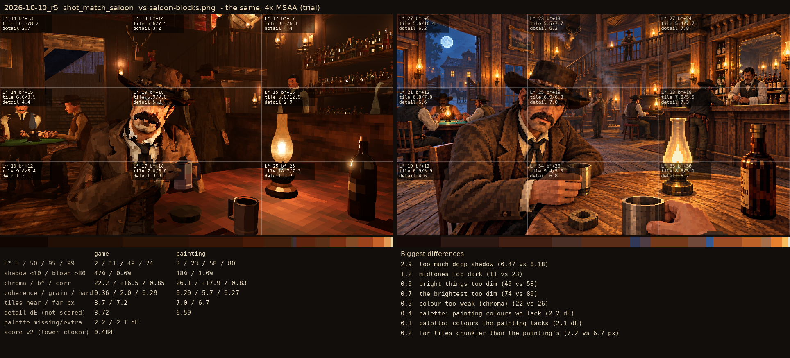

# 2026-10-10_r5: the same, 4x MSAA (trial)

## shot_match_saloon (score 0.484, lower is closer)

- 2.9 too much deep shadow (0.47 vs 0.18)
- 1.2 midtones too dark (11 vs 23)
- 0.9 bright things too dim (49 vs 58)
- 0.7 the brightest too dim (74 vs 80)
- 0.5 colour too weak (chroma) (22 vs 26)
- 0.4 palette: painting colours we lack (2.2 dE)
- 0.3 palette: colours the painting lacks (2.1 dE)
- 0.2 far tiles chunkier than the painting's (7.2 vs 6.7 px)
