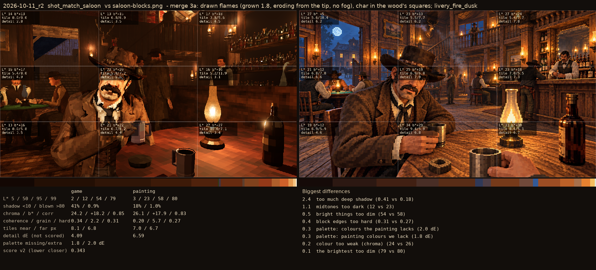
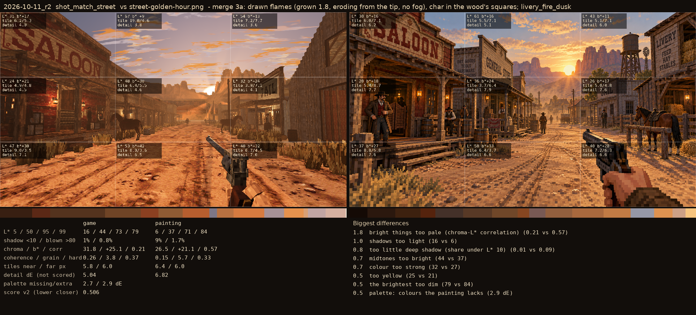
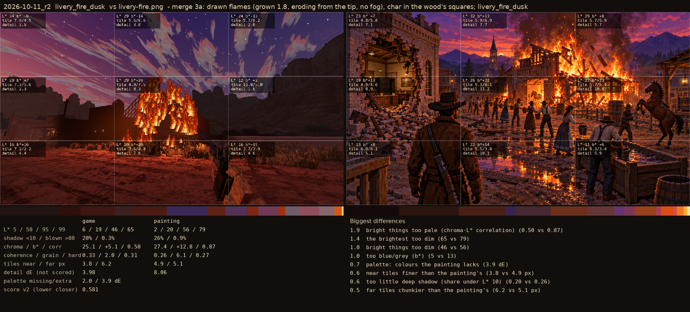

# 2026-10-11_r1: merge 3a: drawn flames (grown 1.8, eroding from the tip, no fog), char in the wood's squares; livery_fire_dusk

## shot_match_saloon (score 0.343, lower is closer)

- 2.4 too much deep shadow (0.41 vs 0.18)
- 1.1 midtones too dark (12 vs 23)
- 0.5 bright things too dim (54 vs 58)
- 0.4 block edges too hard (0.31 vs 0.27)
- 0.3 palette: colours the painting lacks (2.0 dE)
- 0.3 palette: painting colours we lack (1.8 dE)
- 0.2 colour too weak (chroma) (24 vs 26)
- 0.1 the brightest too dim (79 vs 80)

## shot_match_street (score 0.506, lower is closer)

- 1.8 bright things too pale (chroma-L* correlation) (0.21 vs 0.57)
- 1.0 shadows too light (16 vs 6)
- 0.8 too little deep shadow (share under L* 10) (0.01 vs 0.09)
- 0.7 midtones too bright (44 vs 37)
- 0.7 colour too strong (32 vs 27)
- 0.5 too yellow (25 vs 21)
- 0.5 the brightest too dim (79 vs 84)
- 0.5 palette: colours the painting lacks (2.9 dE)

## livery_fire_dusk (score 0.581, lower is closer)

- 1.9 bright things too pale (chroma-L* correlation) (0.50 vs 0.87)
- 1.4 the brightest too dim (65 vs 79)
- 1.0 bright things too dim (46 vs 56)
- 1.0 too blue/grey (b*) (5 vs 13)
- 0.7 palette: colours the painting lacks (3.9 dE)
- 0.6 near tiles finer than the painting's (3.8 vs 4.9 px)
- 0.6 too little deep shadow (share under L* 10) (0.20 vs 0.26)
- 0.5 far tiles chunkier than the painting's (6.2 vs 5.1 px)
