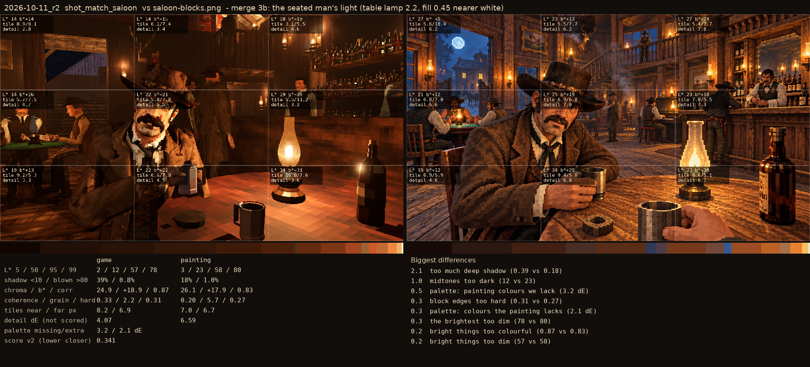

# 2026-10-11_r2: merge 3b: the seated man's light (table lamp 2.2, fill 0.45 nearer white)

## shot_match_saloon (score 0.341, lower is closer)

- 2.1 too much deep shadow (0.39 vs 0.18)
- 1.0 midtones too dark (12 vs 23)
- 0.5 palette: painting colours we lack (3.2 dE)
- 0.3 block edges too hard (0.31 vs 0.27)
- 0.3 palette: colours the painting lacks (2.1 dE)
- 0.3 the brightest too dim (78 vs 80)
- 0.2 bright things too colourful (0.87 vs 0.83)
- 0.2 bright things too dim (57 vs 58)
