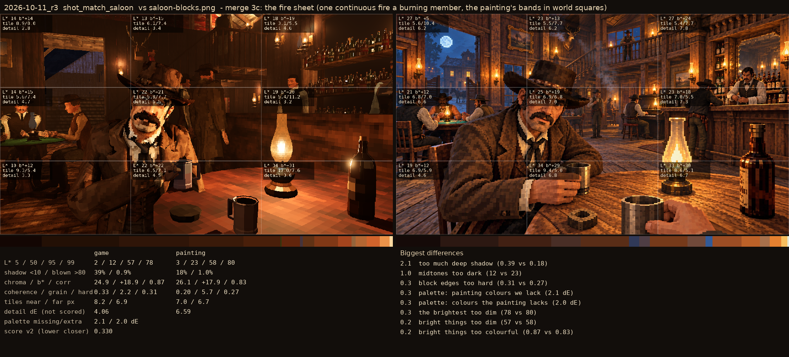
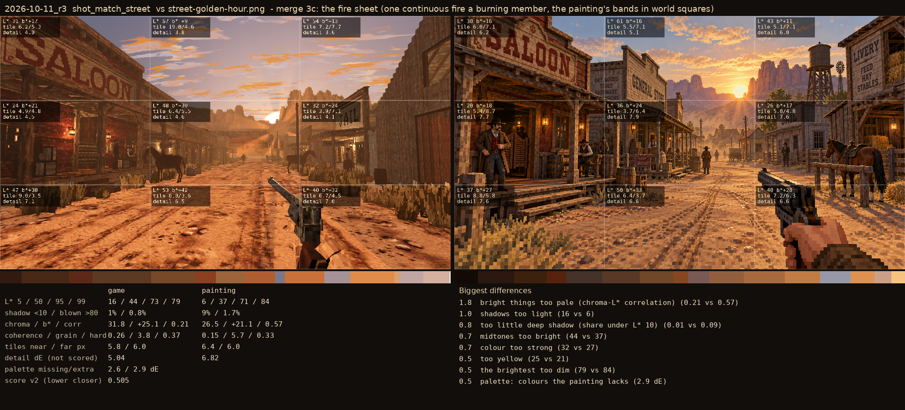
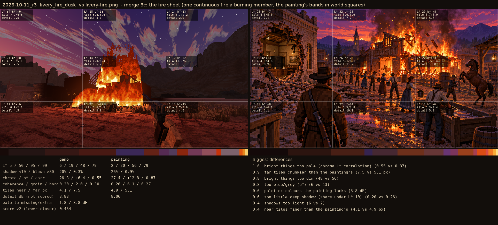

# 2026-10-11_r3: merge 3c: the fire sheet (one continuous fire a burning member, the painting's bands in world squares)

## shot_match_saloon (score 0.330, lower is closer)

- 2.1 too much deep shadow (0.39 vs 0.18)
- 1.0 midtones too dark (12 vs 23)
- 0.3 block edges too hard (0.31 vs 0.27)
- 0.3 palette: painting colours we lack (2.1 dE)
- 0.3 palette: colours the painting lacks (2.0 dE)
- 0.3 the brightest too dim (78 vs 80)
- 0.2 bright things too dim (57 vs 58)
- 0.2 bright things too colourful (0.87 vs 0.83)

## shot_match_street (score 0.505, lower is closer)

- 1.8 bright things too pale (chroma-L* correlation) (0.21 vs 0.57)
- 1.0 shadows too light (16 vs 6)
- 0.8 too little deep shadow (share under L* 10) (0.01 vs 0.09)
- 0.7 midtones too bright (44 vs 37)
- 0.7 colour too strong (32 vs 27)
- 0.5 too yellow (25 vs 21)
- 0.5 the brightest too dim (79 vs 84)
- 0.5 palette: colours the painting lacks (2.9 dE)

## livery_fire_dusk (score 0.454, lower is closer)

- 1.6 bright things too pale (chroma-L* correlation) (0.55 vs 0.87)
- 0.9 far tiles chunkier than the painting's (7.5 vs 5.1 px)
- 0.8 bright things too dim (48 vs 56)
- 0.8 too blue/grey (b*) (6 vs 13)
- 0.6 palette: colours the painting lacks (3.8 dE)
- 0.6 too little deep shadow (share under L* 10) (0.20 vs 0.26)
- 0.4 shadows too light (6 vs 2)
- 0.4 near tiles finer than the painting's (4.1 vs 4.9 px)
