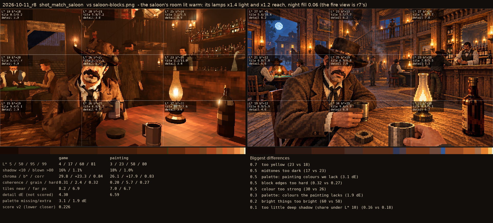
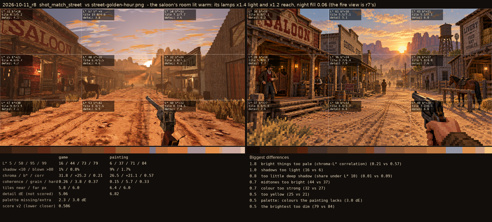
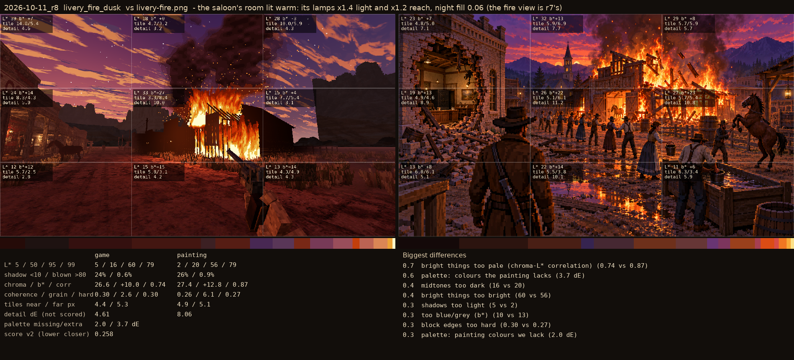

# 2026-10-11_r8: the saloon's room lit warm: its lamps x1.4 light and x1.2 reach, night fill 0.06 (the fire view is r7's)

## shot_match_saloon (score 0.226, lower is closer)

- 0.7 too yellow (23 vs 18)
- 0.5 midtones too dark (17 vs 23)
- 0.5 palette: painting colours we lack (3.1 dE)
- 0.5 block edges too hard (0.32 vs 0.27)
- 0.5 colour too strong (30 vs 26)
- 0.3 palette: colours the painting lacks (1.9 dE)
- 0.2 bright things too bright (60 vs 58)
- 0.1 too little deep shadow (share under L* 10) (0.16 vs 0.18)

## shot_match_street (score 0.506, lower is closer)

- 1.8 bright things too pale (chroma-L* correlation) (0.21 vs 0.57)
- 1.0 shadows too light (16 vs 6)
- 0.8 too little deep shadow (share under L* 10) (0.01 vs 0.09)
- 0.7 midtones too bright (44 vs 37)
- 0.7 colour too strong (32 vs 27)
- 0.5 too yellow (25 vs 21)
- 0.5 palette: colours the painting lacks (3.0 dE)
- 0.5 the brightest too dim (79 vs 84)

## livery_fire_dusk (score 0.258, lower is closer)

- 0.7 bright things too pale (chroma-L* correlation) (0.74 vs 0.87)
- 0.6 palette: colours the painting lacks (3.7 dE)
- 0.4 midtones too dark (16 vs 20)
- 0.4 bright things too bright (60 vs 56)
- 0.3 shadows too light (5 vs 2)
- 0.3 too blue/grey (b*) (10 vs 13)
- 0.3 block edges too hard (0.30 vs 0.27)
- 0.3 palette: painting colours we lack (2.0 dE)
