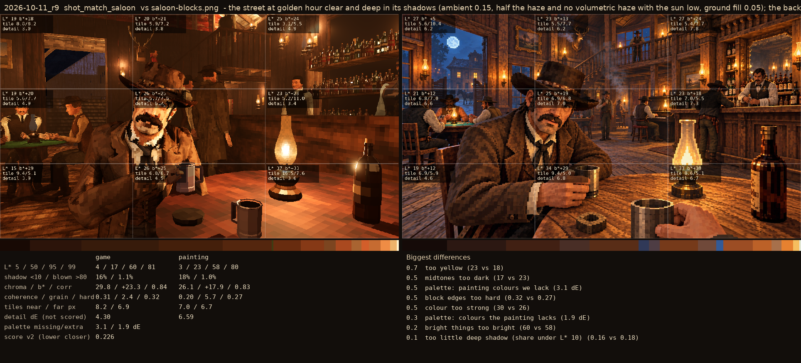
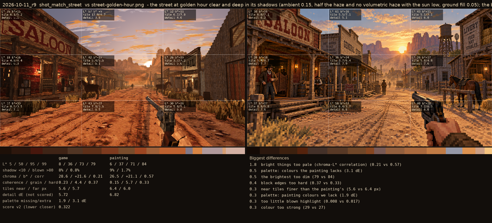
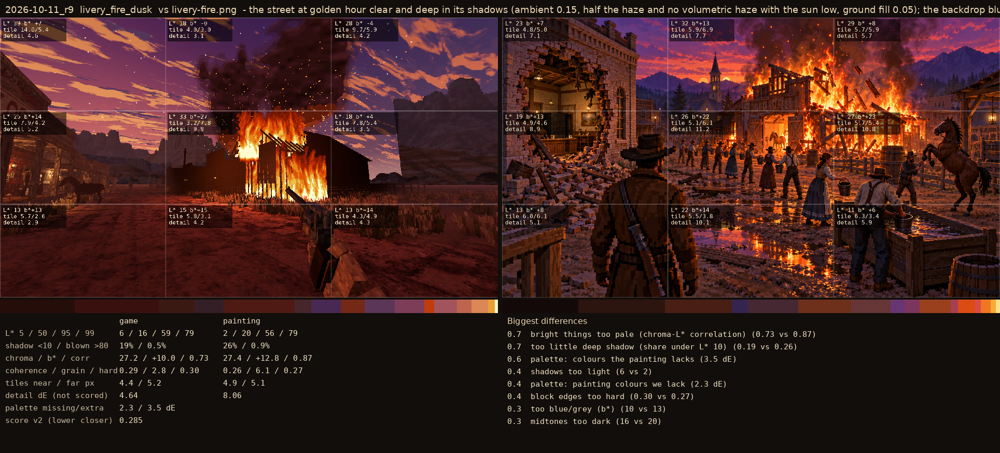

# 2026-10-11_r9: the street at golden hour clear and deep in its shadows (ambient 0.15, half the haze and no volumetric haze with the sun low, ground fill 0.05); the backdrop blue-violet after sunset (the saloon is r8's)

## shot_match_saloon (score 0.226, lower is closer)

- 0.7 too yellow (23 vs 18)
- 0.5 midtones too dark (17 vs 23)
- 0.5 palette: painting colours we lack (3.1 dE)
- 0.5 block edges too hard (0.32 vs 0.27)
- 0.5 colour too strong (30 vs 26)
- 0.3 palette: colours the painting lacks (1.9 dE)
- 0.2 bright things too bright (60 vs 58)
- 0.1 too little deep shadow (share under L* 10) (0.16 vs 0.18)

## shot_match_street (score 0.322, lower is closer)

- 1.8 bright things too pale (chroma-L* correlation) (0.21 vs 0.57)
- 0.5 palette: colours the painting lacks (3.1 dE)
- 0.5 the brightest too dim (79 vs 84)
- 0.4 block edges too hard (0.37 vs 0.33)
- 0.3 near tiles finer than the painting's (5.6 vs 6.4 px)
- 0.3 palette: painting colours we lack (1.9 dE)
- 0.3 too little blown highlight (0.008 vs 0.017)
- 0.3 colour too strong (29 vs 27)

## livery_fire_dusk (score 0.285, lower is closer)

- 0.7 bright things too pale (chroma-L* correlation) (0.73 vs 0.87)
- 0.7 too little deep shadow (share under L* 10) (0.19 vs 0.26)
- 0.6 palette: colours the painting lacks (3.5 dE)
- 0.4 shadows too light (6 vs 2)
- 0.4 palette: painting colours we lack (2.3 dE)
- 0.4 block edges too hard (0.30 vs 0.27)
- 0.3 too blue/grey (b*) (10 vs 13)
- 0.3 midtones too dark (16 vs 20)
