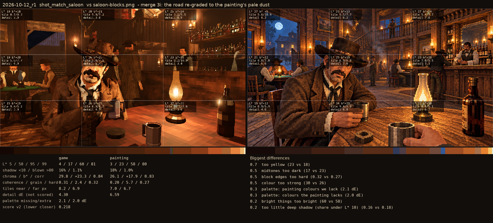
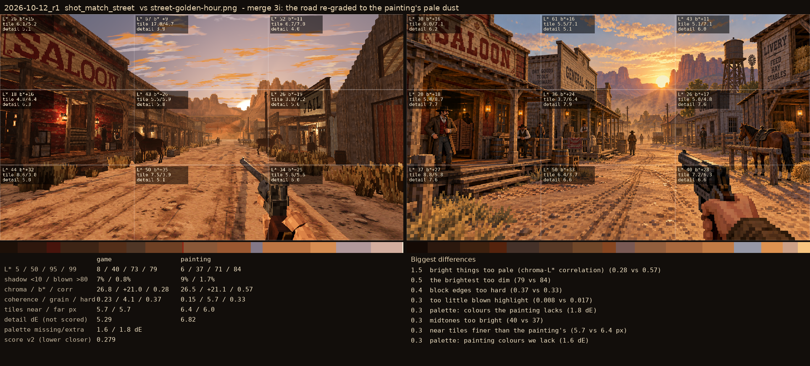
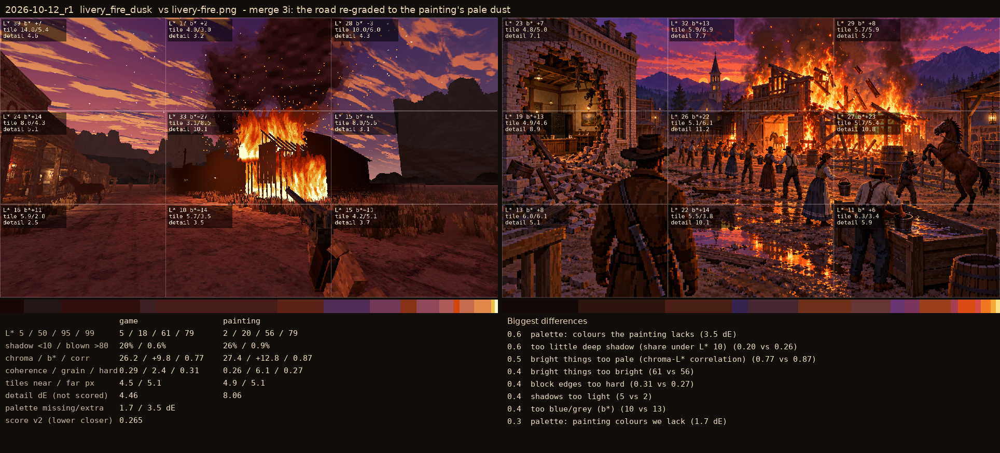

# 2026-10-12_r1: merge 3i: the road re-graded to the painting's pale dust

## shot_match_saloon (score 0.218, lower is closer)

- 0.7 too yellow (23 vs 18)
- 0.5 midtones too dark (17 vs 23)
- 0.5 block edges too hard (0.32 vs 0.27)
- 0.5 colour too strong (30 vs 26)
- 0.3 palette: painting colours we lack (2.1 dE)
- 0.3 palette: colours the painting lacks (2.0 dE)
- 0.2 bright things too bright (60 vs 58)
- 0.2 too little deep shadow (share under L* 10) (0.16 vs 0.18)

## shot_match_street (score 0.279, lower is closer)

- 1.5 bright things too pale (chroma-L* correlation) (0.28 vs 0.57)
- 0.5 the brightest too dim (79 vs 84)
- 0.4 block edges too hard (0.37 vs 0.33)
- 0.3 too little blown highlight (0.008 vs 0.017)
- 0.3 palette: colours the painting lacks (1.8 dE)
- 0.3 midtones too bright (40 vs 37)
- 0.3 near tiles finer than the painting's (5.7 vs 6.4 px)
- 0.3 palette: painting colours we lack (1.6 dE)

## livery_fire_dusk (score 0.265, lower is closer)

- 0.6 palette: colours the painting lacks (3.5 dE)
- 0.6 too little deep shadow (share under L* 10) (0.20 vs 0.26)
- 0.5 bright things too pale (chroma-L* correlation) (0.77 vs 0.87)
- 0.4 bright things too bright (61 vs 56)
- 0.4 block edges too hard (0.31 vs 0.27)
- 0.4 shadows too light (5 vs 2)
- 0.4 too blue/grey (b*) (10 vs 13)
- 0.3 palette: painting colours we lack (1.7 dE)
