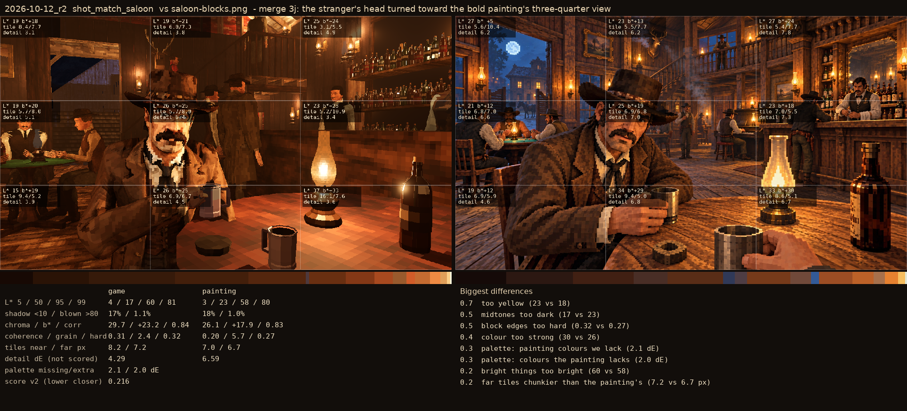

# 2026-10-12_r2: merge 3j: the stranger's head turned toward the bold painting's three-quarter view

## shot_match_saloon (score 0.216, lower is closer)

- 0.7 too yellow (23 vs 18)
- 0.5 midtones too dark (17 vs 23)
- 0.5 block edges too hard (0.32 vs 0.27)
- 0.4 colour too strong (30 vs 26)
- 0.3 palette: painting colours we lack (2.1 dE)
- 0.3 palette: colours the painting lacks (2.0 dE)
- 0.2 bright things too bright (60 vs 58)
- 0.2 far tiles chunkier than the painting's (7.2 vs 6.7 px)
