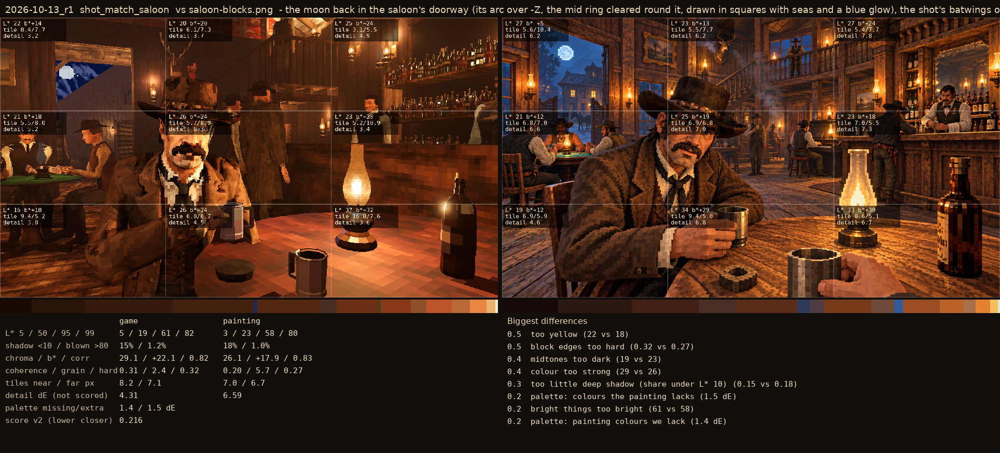
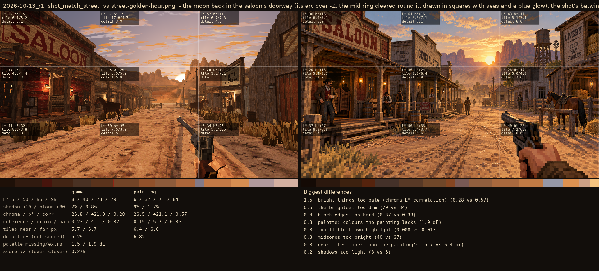

# 2026-10-13_door1: the moon back in the saloon's doorway (its arc over -Z, the mid ring cleared round it, drawn in squares with seas and a blue glow), the shot's batwings open, the livery's west lantern lit after dark

## shot_match_saloon (score 0.216, lower is closer)

- 0.5 too yellow (22 vs 18)
- 0.5 block edges too hard (0.32 vs 0.27)
- 0.4 midtones too dark (19 vs 23)
- 0.4 colour too strong (29 vs 26)
- 0.3 too little deep shadow (share under L* 10) (0.15 vs 0.18)
- 0.2 palette: colours the painting lacks (1.5 dE)
- 0.2 bright things too bright (61 vs 58)
- 0.2 palette: painting colours we lack (1.4 dE)

## shot_match_street (score 0.279, lower is closer)

- 1.5 bright things too pale (chroma-L* correlation) (0.28 vs 0.57)
- 0.5 the brightest too dim (79 vs 84)
- 0.4 block edges too hard (0.37 vs 0.33)
- 0.3 palette: colours the painting lacks (1.9 dE)
- 0.3 too little blown highlight (0.008 vs 0.017)
- 0.3 midtones too bright (40 vs 37)
- 0.3 near tiles finer than the painting's (5.7 vs 6.4 px)
- 0.2 shadows too light (8 vs 6)
