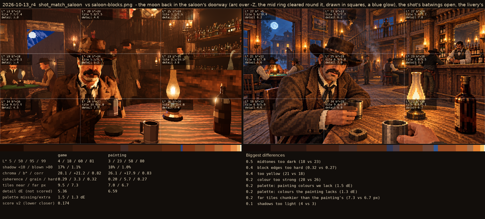

# 2026-10-13_r4: the moon back in the saloon's doorway (arc over -Z, the mid ring cleared round it, drawn in squares, a blue glow), the shot's batwings open, the livery's west lantern after dark; on main's jobs 1-2

## shot_match_saloon (score 0.174, lower is closer)

- 0.5 midtones too dark (18 vs 23)
- 0.4 block edges too hard (0.32 vs 0.27)
- 0.4 too yellow (21 vs 18)
- 0.2 colour too strong (28 vs 26)
- 0.2 palette: painting colours we lack (1.5 dE)
- 0.2 palette: colours the painting lacks (1.3 dE)
- 0.2 far tiles chunkier than the painting's (7.3 vs 6.7 px)
- 0.1 shadows too light (4 vs 3)

## shot_match_street (score 0.280, lower is closer)

- 1.3 bright things too pale (chroma-L* correlation) (0.31 vs 0.57)
- 0.5 block edges too hard (0.38 vs 0.33)
- 0.5 the brightest too dim (79 vs 84)
- 0.5 near tiles finer than the painting's (5.3 vs 6.4 px)
- 0.4 palette: colours the painting lacks (2.6 dE)
- 0.3 palette: painting colours we lack (2.0 dE)
- 0.3 too little blown highlight (0.008 vs 0.017)
- 0.2 shadows too light (8 vs 6)
