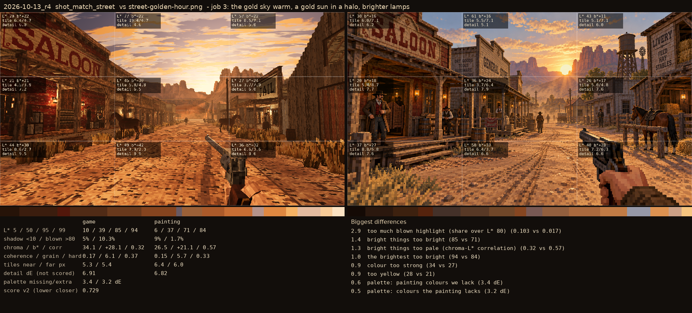

# 2026-10-13_r5: job 3: the gold sky warm, a gold sun in a halo, brighter lamps

## shot_match_saloon (score 0.419, lower is closer)

- 1.2 too yellow (28 vs 18)
- 1.0 colour too strong (34 vs 26)
- 0.8 too little deep shadow (share under L* 10) (0.10 vs 0.18)
- 0.7 bright things too bright (66 vs 58)
- 0.6 block edges too hard (0.33 vs 0.27)
- 0.5 the brightest too bright (86 vs 80)
- 0.4 palette: painting colours we lack (2.4 dE)
- 0.3 shadows too light (6 vs 3)

## shot_match_street (score 0.729, lower is closer)

- 2.9 too much blown highlight (share over L* 80) (0.103 vs 0.017)
- 1.4 bright things too bright (85 vs 71)
- 1.3 bright things too pale (chroma-L* correlation) (0.32 vs 0.57)
- 1.0 the brightest too bright (94 vs 84)
- 0.9 colour too strong (34 vs 27)
- 0.9 too yellow (28 vs 21)
- 0.6 palette: painting colours we lack (3.4 dE)
- 0.5 palette: colours the painting lacks (3.2 dE)
