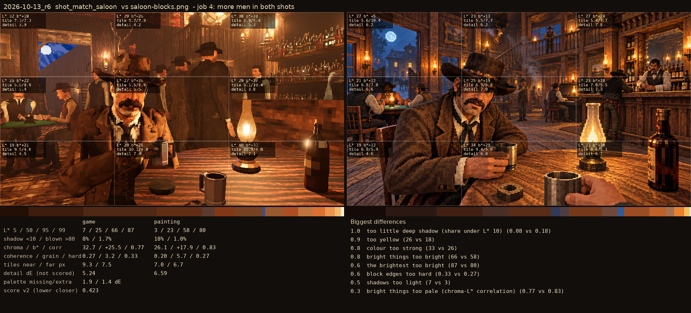
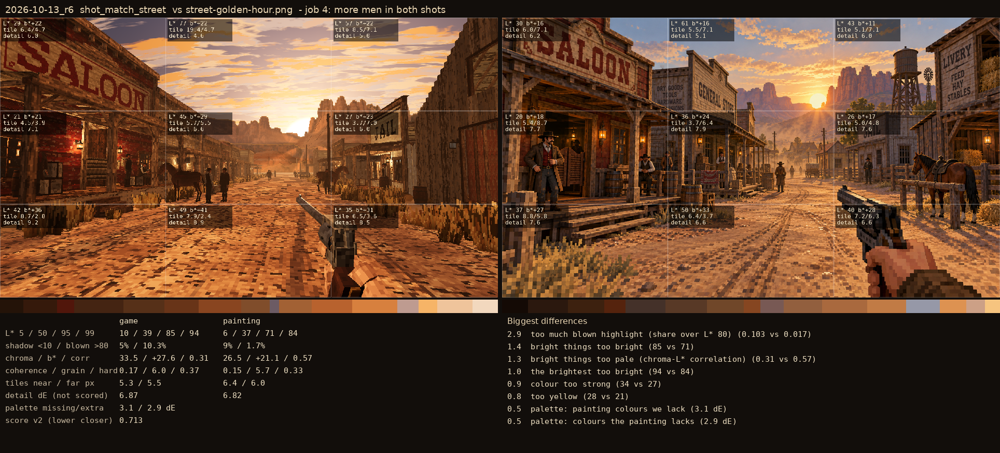

# 2026-10-13_r6: job 4: more men in both shots

## shot_match_saloon (score 0.423, lower is closer)

- 1.0 too little deep shadow (share under L* 10) (0.08 vs 0.18)
- 0.9 too yellow (26 vs 18)
- 0.8 colour too strong (33 vs 26)
- 0.8 bright things too bright (66 vs 58)
- 0.6 the brightest too bright (87 vs 80)
- 0.6 block edges too hard (0.33 vs 0.27)
- 0.5 shadows too light (7 vs 3)
- 0.3 bright things too pale (chroma-L* correlation) (0.77 vs 0.83)

## shot_match_street (score 0.713, lower is closer)

- 2.9 too much blown highlight (share over L* 80) (0.103 vs 0.017)
- 1.4 bright things too bright (85 vs 71)
- 1.3 bright things too pale (chroma-L* correlation) (0.31 vs 0.57)
- 1.0 the brightest too bright (94 vs 84)
- 0.9 colour too strong (34 vs 27)
- 0.8 too yellow (28 vs 21)
- 0.5 palette: painting colours we lack (3.1 dE)
- 0.5 palette: colours the painting lacks (2.9 dE)
