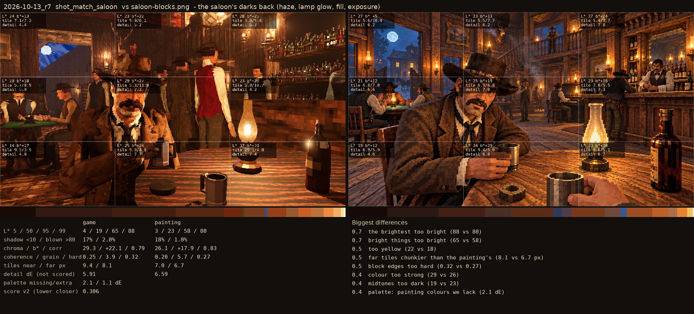
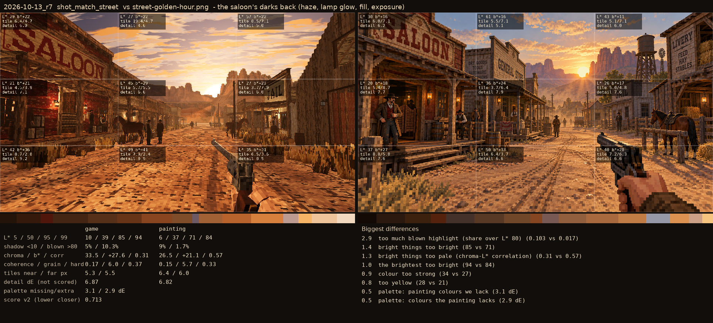

# 2026-10-13_r7: the saloon's darks back (haze, lamp glow, fill, exposure)

## shot_match_saloon (score 0.306, lower is closer)

- 0.7 the brightest too bright (88 vs 80)
- 0.7 bright things too bright (65 vs 58)
- 0.5 too yellow (22 vs 18)
- 0.5 far tiles chunkier than the painting's (8.1 vs 6.7 px)
- 0.5 block edges too hard (0.32 vs 0.27)
- 0.4 colour too strong (29 vs 26)
- 0.4 midtones too dark (19 vs 23)
- 0.4 palette: painting colours we lack (2.1 dE)

## shot_match_street (score 0.713, lower is closer)

- 2.9 too much blown highlight (share over L* 80) (0.103 vs 0.017)
- 1.4 bright things too bright (85 vs 71)
- 1.3 bright things too pale (chroma-L* correlation) (0.31 vs 0.57)
- 1.0 the brightest too bright (94 vs 84)
- 0.9 colour too strong (34 vs 27)
- 0.8 too yellow (28 vs 21)
- 0.5 palette: painting colours we lack (3.1 dE)
- 0.5 palette: colours the painting lacks (2.9 dE)
