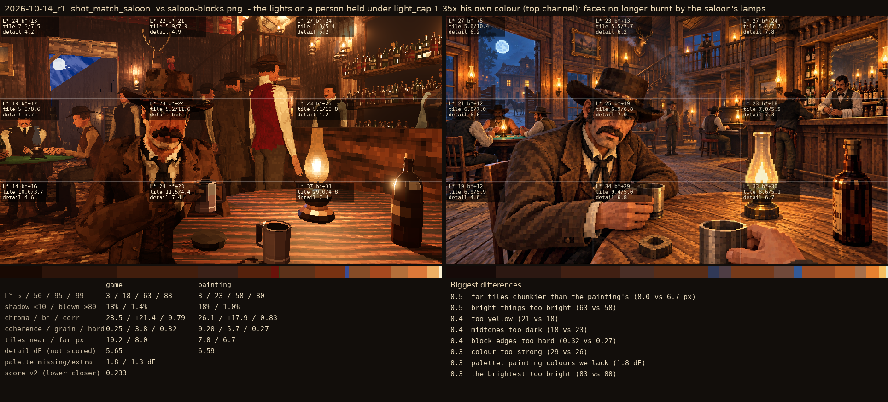
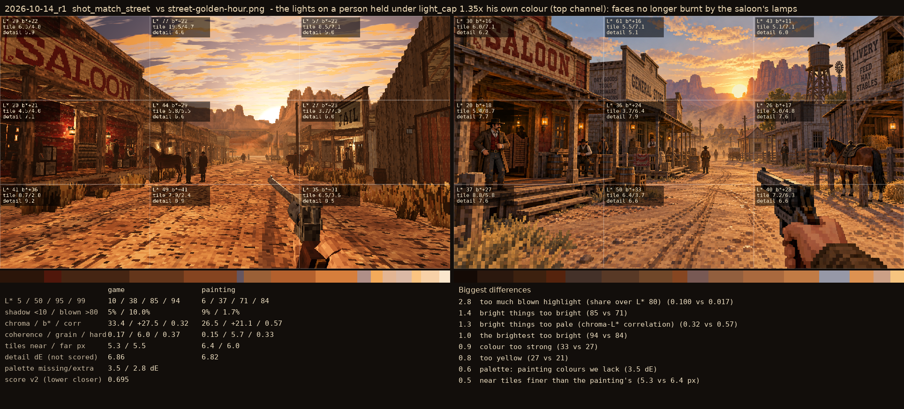

# 2026-10-14_r1: the lights on a person held under light_cap 1.35x his own colour (top channel): faces no longer burnt by the saloon's lamps

## shot_match_saloon (score 0.233, lower is closer)

- 0.5 far tiles chunkier than the painting's (8.0 vs 6.7 px)
- 0.5 bright things too bright (63 vs 58)
- 0.4 too yellow (21 vs 18)
- 0.4 midtones too dark (18 vs 23)
- 0.4 block edges too hard (0.32 vs 0.27)
- 0.3 colour too strong (29 vs 26)
- 0.3 palette: painting colours we lack (1.8 dE)
- 0.3 the brightest too bright (83 vs 80)

## shot_match_street (score 0.695, lower is closer)

- 2.8 too much blown highlight (share over L* 80) (0.100 vs 0.017)
- 1.4 bright things too bright (85 vs 71)
- 1.3 bright things too pale (chroma-L* correlation) (0.32 vs 0.57)
- 1.0 the brightest too bright (94 vs 84)
- 0.9 colour too strong (33 vs 27)
- 0.8 too yellow (27 vs 21)
- 0.6 palette: painting colours we lack (3.5 dE)
- 0.5 near tiles finer than the painting's (5.3 vs 6.4 px)
