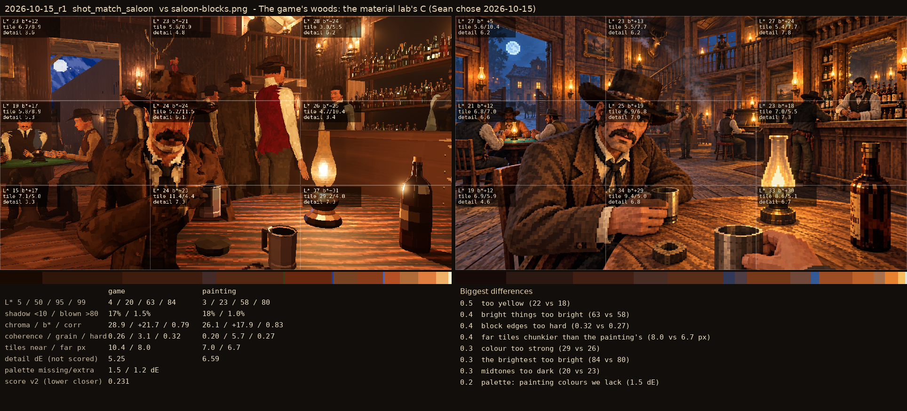
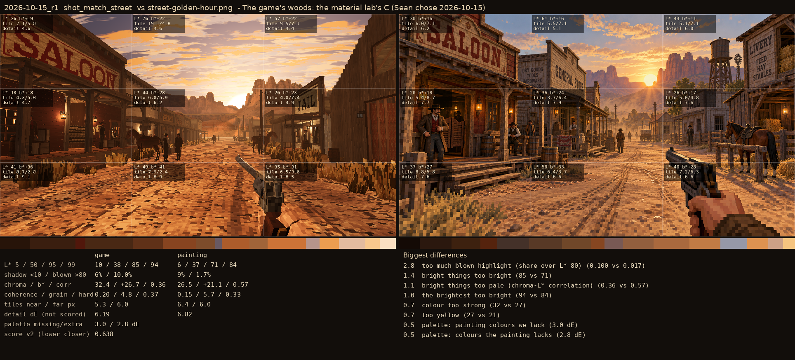

# 2026-10-15_r1: The game's woods: the material lab's C (Sean chose 2026-10-15)

## shot_match_saloon (score 0.231, lower is closer)

- 0.5 too yellow (22 vs 18)
- 0.4 bright things too bright (63 vs 58)
- 0.4 block edges too hard (0.32 vs 0.27)
- 0.4 far tiles chunkier than the painting's (8.0 vs 6.7 px)
- 0.3 colour too strong (29 vs 26)
- 0.3 the brightest too bright (84 vs 80)
- 0.3 midtones too dark (20 vs 23)
- 0.2 palette: painting colours we lack (1.5 dE)

## shot_match_street (score 0.638, lower is closer)

- 2.8 too much blown highlight (share over L* 80) (0.100 vs 0.017)
- 1.4 bright things too bright (85 vs 71)
- 1.1 bright things too pale (chroma-L* correlation) (0.36 vs 0.57)
- 1.0 the brightest too bright (94 vs 84)
- 0.7 colour too strong (32 vs 27)
- 0.7 too yellow (27 vs 21)
- 0.5 palette: painting colours we lack (3.0 dE)
- 0.5 palette: colours the painting lacks (2.8 dE)
