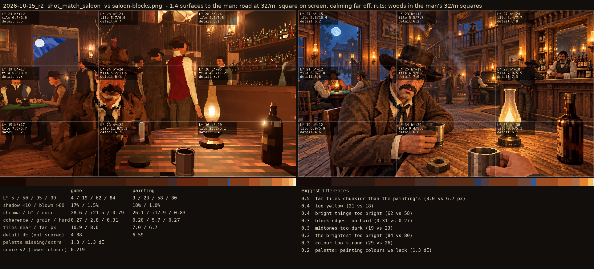
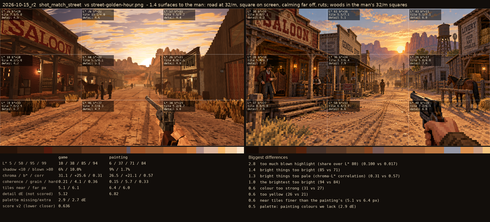

# 2026-10-15_r2: 1.4 surfaces to the man: road at 32/m, square on screen, calming far off, ruts; woods in the man's 32/m squares

## shot_match_saloon (score 0.219, lower is closer)

- 0.5 far tiles chunkier than the painting's (8.0 vs 6.7 px)
- 0.4 too yellow (21 vs 18)
- 0.4 bright things too bright (62 vs 58)
- 0.3 block edges too hard (0.31 vs 0.27)
- 0.3 midtones too dark (19 vs 23)
- 0.3 the brightest too bright (84 vs 80)
- 0.3 colour too strong (29 vs 26)
- 0.2 palette: painting colours we lack (1.3 dE)

## shot_match_street (score 0.636, lower is closer)

- 2.8 too much blown highlight (share over L* 80) (0.100 vs 0.017)
- 1.4 bright things too bright (85 vs 71)
- 1.3 bright things too pale (chroma-L* correlation) (0.31 vs 0.57)
- 1.0 the brightest too bright (94 vs 84)
- 0.6 colour too strong (31 vs 27)
- 0.6 too yellow (26 vs 21)
- 0.6 near tiles finer than the painting's (5.1 vs 6.4 px)
- 0.5 palette: painting colours we lack (2.9 dE)
