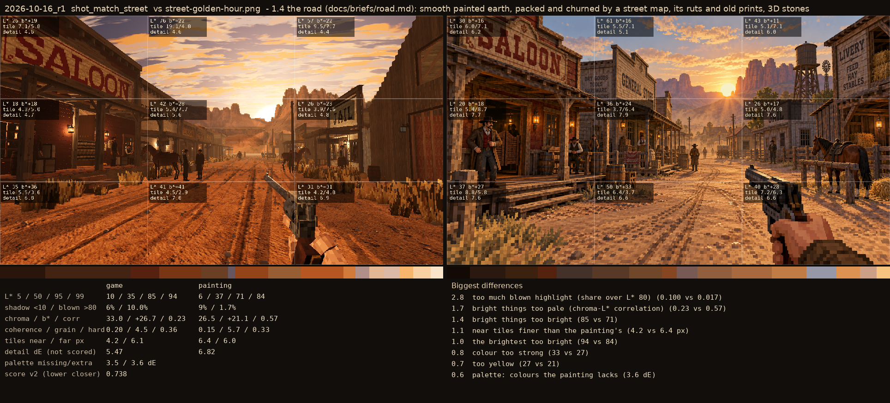

# 2026-10-16_r1: 1.4 the road (docs/briefs/road.md): smooth painted earth, packed and churned by a street map, its ruts and old prints, 3D stones

## shot_match_street (score 0.738, lower is closer)

- 2.8 too much blown highlight (share over L* 80) (0.100 vs 0.017)
- 1.7 bright things too pale (chroma-L* correlation) (0.23 vs 0.57)
- 1.4 bright things too bright (85 vs 71)
- 1.1 near tiles finer than the painting's (4.2 vs 6.4 px)
- 1.0 the brightest too bright (94 vs 84)
- 0.8 colour too strong (33 vs 27)
- 0.7 too yellow (27 vs 21)
- 0.6 palette: colours the painting lacks (3.6 dE)
