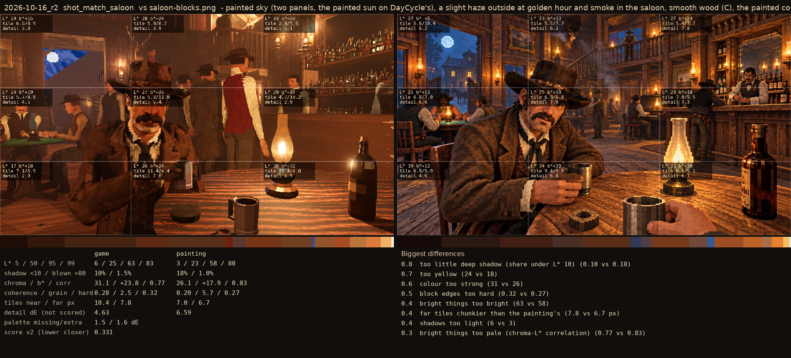
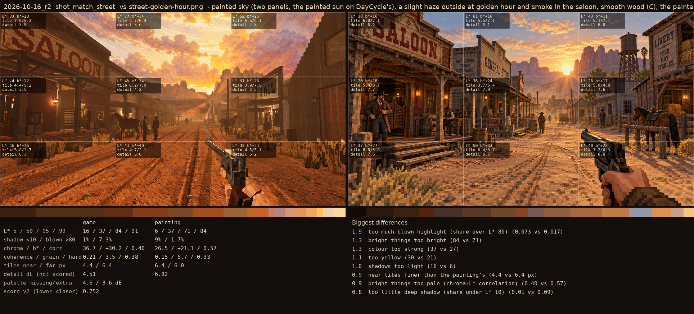

# 2026-10-16_r2: painted sky (two panels, the painted sun on DayCycle's), a slight haze outside at golden hour and smoke in the saloon, smooth wood (C), the painted cowboy's sun ceiling

## shot_match_saloon (score 0.331, lower is closer)

- 0.8 too little deep shadow (share under L* 10) (0.10 vs 0.18)
- 0.7 too yellow (24 vs 18)
- 0.6 colour too strong (31 vs 26)
- 0.5 block edges too hard (0.32 vs 0.27)
- 0.4 bright things too bright (63 vs 58)
- 0.4 far tiles chunkier than the painting's (7.8 vs 6.7 px)
- 0.4 shadows too light (6 vs 3)
- 0.3 bright things too pale (chroma-L* correlation) (0.77 vs 0.83)

## shot_match_street (score 0.752, lower is closer)

- 1.9 too much blown highlight (share over L* 80) (0.073 vs 0.017)
- 1.3 bright things too bright (84 vs 71)
- 1.3 colour too strong (37 vs 27)
- 1.1 too yellow (30 vs 21)
- 1.0 shadows too light (16 vs 6)
- 0.9 near tiles finer than the painting's (4.4 vs 6.4 px)
- 0.9 bright things too pale (chroma-L* correlation) (0.40 vs 0.57)
- 0.8 too little deep shadow (share under L* 10) (0.01 vs 0.09)
