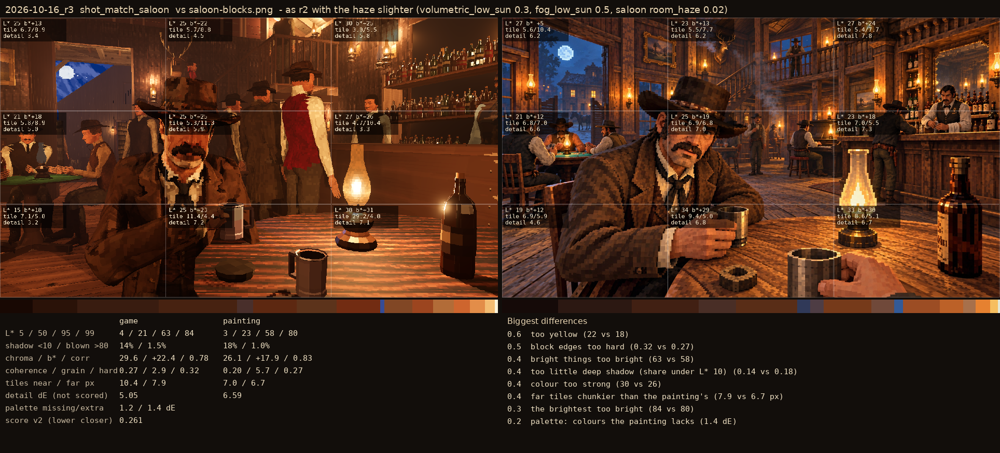
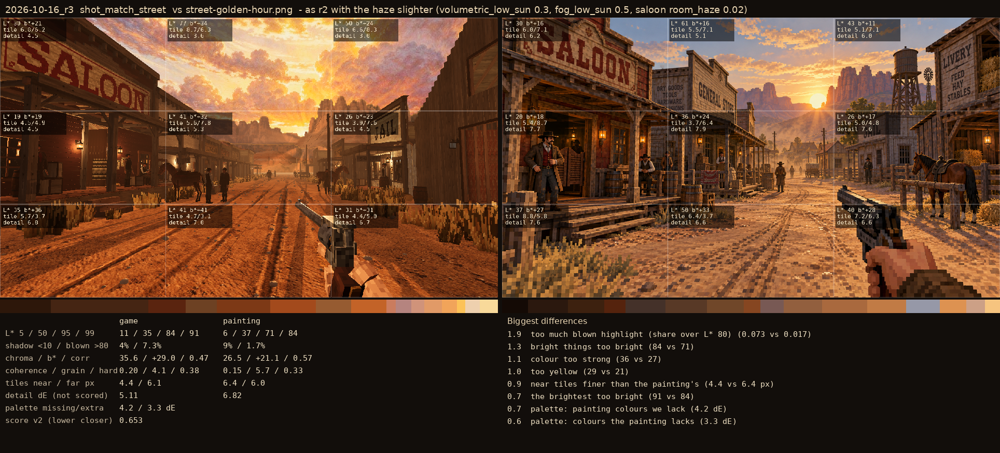

# 2026-10-16_r3: as r2 with the haze slighter (volumetric_low_sun 0.3, fog_low_sun 0.5, saloon room_haze 0.02)

## shot_match_saloon (score 0.261, lower is closer)

- 0.6 too yellow (22 vs 18)
- 0.5 block edges too hard (0.32 vs 0.27)
- 0.4 bright things too bright (63 vs 58)
- 0.4 too little deep shadow (share under L* 10) (0.14 vs 0.18)
- 0.4 colour too strong (30 vs 26)
- 0.4 far tiles chunkier than the painting's (7.9 vs 6.7 px)
- 0.3 the brightest too bright (84 vs 80)
- 0.2 palette: colours the painting lacks (1.4 dE)

## shot_match_street (score 0.653, lower is closer)

- 1.9 too much blown highlight (share over L* 80) (0.073 vs 0.017)
- 1.3 bright things too bright (84 vs 71)
- 1.1 colour too strong (36 vs 27)
- 1.0 too yellow (29 vs 21)
- 0.9 near tiles finer than the painting's (4.4 vs 6.4 px)
- 0.7 the brightest too bright (91 vs 84)
- 0.7 palette: painting colours we lack (4.2 dE)
- 0.6 palette: colours the painting lacks (3.3 dE)
