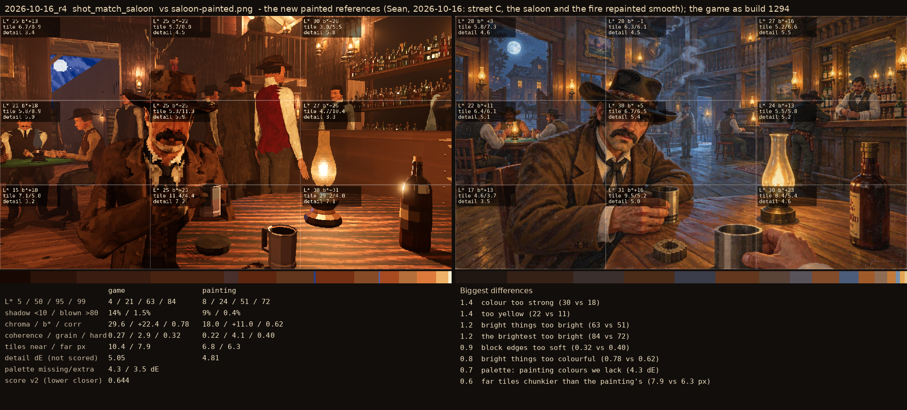
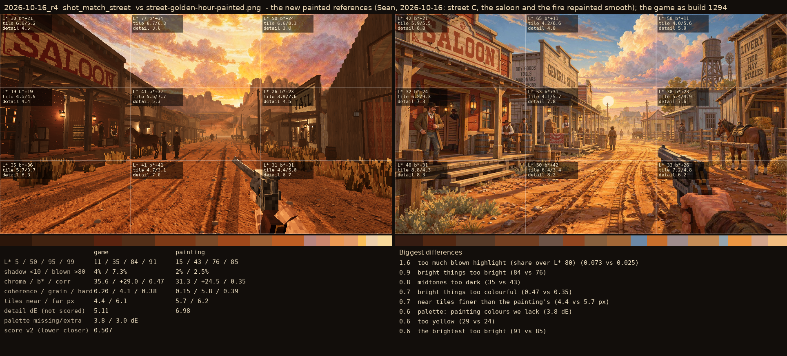

# 2026-10-16_r4: the new painted references (Sean, 2026-10-16: street C, the saloon and the fire repainted smooth); the game as build 1294

## shot_match_saloon (score 0.644, lower is closer)

- 1.4 colour too strong (30 vs 18)
- 1.4 too yellow (22 vs 11)
- 1.2 bright things too bright (63 vs 51)
- 1.2 the brightest too bright (84 vs 72)
- 0.9 block edges too soft (0.32 vs 0.40)
- 0.8 bright things too colourful (0.78 vs 0.62)
- 0.7 palette: painting colours we lack (4.3 dE)
- 0.6 far tiles chunkier than the painting's (7.9 vs 6.3 px)

## shot_match_street (score 0.507, lower is closer)

- 1.6 too much blown highlight (share over L* 80) (0.073 vs 0.025)
- 0.9 bright things too bright (84 vs 76)
- 0.8 midtones too dark (35 vs 43)
- 0.7 bright things too colourful (0.47 vs 0.35)
- 0.7 near tiles finer than the painting's (4.4 vs 5.7 px)
- 0.6 palette: painting colours we lack (3.8 dE)
- 0.6 too yellow (29 vs 24)
- 0.6 the brightest too bright (91 vs 85)
