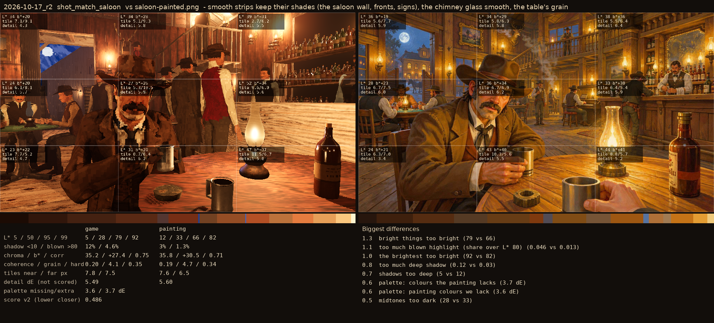
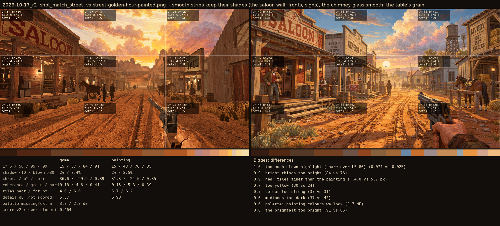

# 2026-10-17_r2: smooth strips keep their shades (the saloon wall, fronts, signs), the chimney glass smooth, the table's grain

## shot_match_saloon (score 0.486, lower is closer)

- 1.3 bright things too bright (79 vs 66)
- 1.1 too much blown highlight (share over L* 80) (0.046 vs 0.013)
- 1.0 the brightest too bright (92 vs 82)
- 0.8 too much deep shadow (0.12 vs 0.03)
- 0.7 shadows too deep (5 vs 12)
- 0.6 palette: colours the painting lacks (3.7 dE)
- 0.6 palette: painting colours we lack (3.6 dE)
- 0.5 midtones too dark (28 vs 33)

## shot_match_street (score 0.464, lower is closer)

- 1.6 too much blown highlight (share over L* 80) (0.074 vs 0.025)
- 0.9 bright things too bright (84 vs 76)
- 0.9 near tiles finer than the painting's (4.0 vs 5.7 px)
- 0.7 too yellow (30 vs 24)
- 0.7 colour too strong (37 vs 31)
- 0.6 midtones too dark (37 vs 43)
- 0.6 palette: painting colours we lack (3.7 dE)
- 0.6 the brightest too bright (91 vs 85)
