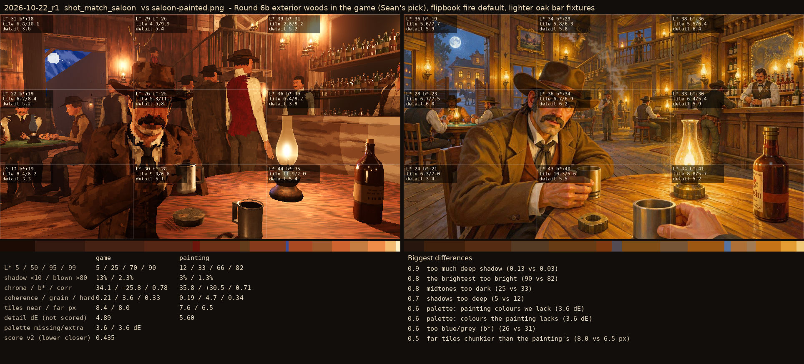
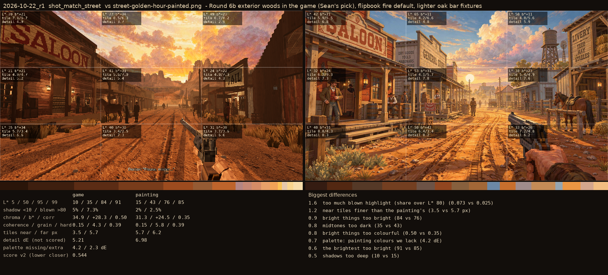

# 2026-10-22_r1: Round 6b exterior woods in the game (Sean's pick), flipbook fire default, lighter oak bar fixtures

## shot_match_saloon (score 0.435, lower is closer)

- 0.9 too much deep shadow (0.13 vs 0.03)
- 0.8 the brightest too bright (90 vs 82)
- 0.8 midtones too dark (25 vs 33)
- 0.7 shadows too deep (5 vs 12)
- 0.6 palette: painting colours we lack (3.6 dE)
- 0.6 palette: colours the painting lacks (3.6 dE)
- 0.6 too blue/grey (b*) (26 vs 31)
- 0.5 far tiles chunkier than the painting's (8.0 vs 6.5 px)

## shot_match_street (score 0.544, lower is closer)

- 1.6 too much blown highlight (share over L* 80) (0.073 vs 0.025)
- 1.2 near tiles finer than the painting's (3.5 vs 5.7 px)
- 0.9 bright things too bright (84 vs 76)
- 0.8 midtones too dark (35 vs 43)
- 0.8 bright things too colourful (0.50 vs 0.35)
- 0.7 palette: painting colours we lack (4.2 dE)
- 0.6 the brightest too bright (91 vs 85)
- 0.5 shadows too deep (10 vs 15)
